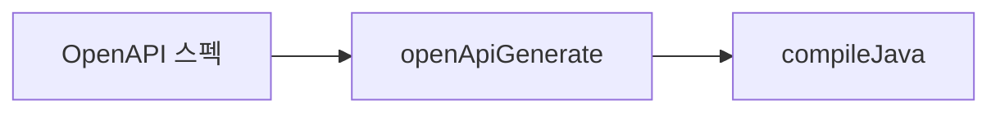

# iinow.github.io

https://iinow.github.io/ 블로그. GitHub Pages 가 Jekyll 로 알아서 빌드한다. `gh-pages` 브랜치에 푸시하면 1분쯤 뒤 반영.

## 새 글 쓰기

```bash
scripts/new-post.sh kafka-retry "카프카 재시도 정리"        # 한국어 글
scripts/new-post.sh kafka-retry "Kafka retries" en          # 영어 글
# 글 쓰고
git add -A && git commit -m "글: 카프카 재시도" && git push
```

- 주소는 `/posts/kafka-retry/`. 첫 화면 **글** 목록에 최신순으로 자동으로 들어간다.
- 파일 이름은 `_posts/YYYY-MM-DD-영문-주소.md` (영어 글은 `-en.md`). 날짜가 미래면 그날까지 안 보인다.
- 아직 안 올릴 글은 `_drafts/` 에 둔다 (공개 안 됨).
- 스크립트가 글 파일과 함께 그 글의 미리보기 카드(`img/og/…png`)를 만들고 `image`·`image_alt`·`ref`·`lang`(영어면 `permalink` 도) 을 채워 둔다. 아래 두 절 참고.

## 다국어 (KO / EN)

같은 글을 한국어·영어 두 편으로 쓰고 `ref` 로 묶으면 상단 `KO | EN` 전환과 `hreflang` 이 자동으로 서로를 가리킨다.

| | 한국어 | 영어 |
|---|---|---|
| 파일 | `_posts/YYYY-MM-DD-<주소>.md` | `_posts/YYYY-MM-DD-<주소>-en.md` |
| `lang` | `ko` (생략해도 됨) | `en` |
| `ref` | `<주소>` | 같은 `<주소>` |
| `permalink` | 생략 (기본 `/posts/<주소>/`) | **`/en/posts/<주소>/`** |
| `category` | `개발` / `여행` | `Dev` / `Travel` |

- 영어 글에 `permalink` 를 빠뜨리면 `/posts/<주소>-en/` 으로 올라간다. 꼭 적는다 (`new-post.sh` 가 넣어 준다).
- `ref` 가 같으면 `_layouts/default.html` 이 짝을 찾아 `hreflang="ko"`·`hreflang="en"`·`x-default`(한국어) 를 넣고, 머리의 `KO | EN` 링크도 그 글로 간다. 짝이 없으면 각각 `/`, `/en/` 홈으로 간다.
- 홈 목록은 `lang` 으로 갈린다. `/` 는 `lang` 이 `en` 이 아닌 글, `/en/` 은 `lang: en` 인 글만 보여 준다.
- `category` 는 홈의 `전체 / 개발 / 여행`(`All / Dev / Travel`) 필터와 `article:section` 에 쓰인다. 한국어 글에 `Dev` 를 적으면 필터에 안 걸리니 언어별로 값을 맞춘다.

영어 글 머리 예:

```yaml
---
layout: post
title: "Kafka retries, in practice"
summary: 목록과 글 머리에 보일 한두 문장. 링크 미리보기 설명으로도 쓰인다.
image: /img/og/kafka-retry-en.png
image_alt: "Kafka retries, in practice"
category: Dev
lang: en
ref: kafka-retry
permalink: /en/posts/kafka-retry/
---
```

## 글 안에서 쓸 수 있는 것

일반 마크다운(소제목 `##`, 표, 목록, 코드 블록, 인용)은 그대로 된다.

| 쓰고 싶은 것 | 쓰는 법 |
|---|---|
| 그림 | ``. 누르면 크게 보인다 |
| 그래프·흐름도 | 그림 파일 대신 `mermaid` 코드 블록 (아래 「그래프·흐름도는 머메이드로」) |
| 그림 + 설명 | `<figure><figcaption>설명</figcaption></figure>` |
| 숫자 요약 칸 | `<dl class="facts"><div><dt>이름</dt><dd>12<small>일</small></dd></div>…</dl>` |
| 알약 목록 | 목록 바로 아래 줄에 `{: .stack}` |
| 순서 흐름 | `<ol class="loop"><li>…</li><li class="hot">강조</li></ol>` |
| 탭으로 넘기는 화면 캡처 | `_posts/2026-11-15-lite-oc.md` 의 `<div class="shots">` 를 복사 |
| 작은 회색 글 | 문단 바로 아래 줄에 `{: .note}` |

### 그래프·흐름도는 머메이드로

**기본 그래프·흐름도는 그림 파일로 굽지 말고 `mermaid` 코드 블록(` ``` ` 세 개 + `mermaid`)으로 그린다.** 글 안에 그 블록이 있을 때만 `main.js` 가 Mermaid 11(jsDelivr CDN)을 내려받아 SVG 로 바꾸므로, 머메이드가 없는 글에는 네트워크 비용도 붙지 않는다. 색은 사이트 변수(`--ink`·`--paper`·`--surface`·`--line`)를 읽어 맞추고, OS 가 다크 모드로 바뀌면 다시 그린다. 좁은 화면에서는 그림이 상자보다 넓을 때 글자를 줄이지 않고 가로로 스크롤된다.

````markdown

````

- 종류는 `flowchart`, `sequenceDiagram`, `classDiagram`, `stateDiagram-v2`, `erDiagram`, `gantt` 등 Mermaid 가 아는 것이면 된다.
- 딱지 글자는 따옴표로 감싼다(`A["build/generated/openapi"]`). 그래야 `()`·`:`·`<br/>` 가 문법으로 읽히지 않는다.
- 사진·스크린샷처럼 머메이드로 그릴 수 없는 것만 `img/<영문-주소>/` 에 넣는다.
- CDN 이 막히면 블록은 원래 코드 그대로 보인다 (`main.js` 가 되돌린다).

## 링크 미리보기 · 검색 노출

글 머리(frontmatter)에 적는 값:

| 값 | 쓰임 |
|---|---|
| `summary` | 목록·글 머리·검색 설명. `meta description` 은 160자, `og:description`·`twitter:description` 은 300자로 잘려 나간다 |
| `image` | 미리보기 그림. 없으면 `/img/og.png` (사이트 기본 카드) |
| `image_alt` | 그림 설명(`og:image:alt`, `twitter:image:alt`). 없으면 제목이 쓰인다 |
| `image_width` / `image_height` | 그림 크기 (기본 1200×630). 카드 대신 사진을 쓸 때 실제 픽셀 값을 적는다 |
| `noindex: true` | 그 페이지만 검색에서 뺀다 |

- `_layouts/default.html` 이 페이지마다 `og:title`·`og:description`·`og:url`·`og:image`·`og:image:width/height/alt/type`·`og:locale`(+alternate), `twitter:card`(`summary_large_image`)·`twitter:title/description/image/image:alt`, 글에는 `article:published_time/section/author` 와 구조화 데이터(JSON-LD `BlogPosting`) 를 자동으로 만든다. 손으로 넣을 필요 없다.
- `og:image:type` 은 `image` 확장자를 보고 png / jpeg / webp 중에서 붙는다.
- `sitemap.xml`, `robots.txt`, `feed.xml` 은 자동.
- 구글 서치 콘솔·네이버 서치어드바이저 확인 코드는 `_config.yml` 의 `google_site_verification`, `naver_site_verification` 에 넣는다.

### 카드 그림 만들기

```bash
python3 scripts/make-og.py --out img/og/kafka-retry.png --title "카프카 재시도 정리" --kicker "개발 · 2026.11.27"
python3 scripts/make-og.py --out img/og/kafka-retry-en.png --title "Kafka retries" --kicker "Dev · 2026.11.27" --lang en
```

- 1200×630 PNG. 제목이 그림 안에 그려지므로 메신저가 어떻게 잘라도 제목이 보인다. 글꼴은 `scripts/fonts/` (Bagel Fat One·Pretendard, OFL).
- 긴 제목은 알아서 줄을 나누고 글자를 줄인다. `--lang en` 이면 카드 아래 브랜드 문구가 영어가 된다.
- `scripts/new-post.sh` 로 글을 만들면 카드까지 같이 만들어진다 (Pillow 필요: `pip install pillow`). 카드 문구는 나중에 직접 고쳐도 된다.

### 글 머리 YAML 따옴표

값에 `: ` 나 `#` 가 들어가면 반드시 따옴표로 감싼다 (`title: "lite-oc: 더블클릭…"`). 안 감싸면 그 글의 frontmatter 가 깨져 **`permalink` 까지 무시되고** `/posts/2026-11-15-lite-oc-en/` 같은 엉뚱한 주소로 올라간다. 제목·`image_alt`·`summary` 는 늘 따옴표로 쓰는 게 안전하다 (`new-post.sh` 가 그렇게 만든다).

### 카카오톡 링크 미리보기 캐시

- 카카오톡은 한 번 공유한 URL 의 미리보기를 자체 캐시로 기억한다. 카드를 바꿔도 **이미 붙였던 링크**는 한동안 옛 썸네일·문구로 보인다. 새 URL 은 바로 새 카드가 뜬다.
- 바로 바꾸려면 카카오 계정으로 로그인해 https://developers.kakao.com/tool/clear/og 에서 그 URL 을 넣고 캐시를 초기화한다. (본인 계정 작업)
- X·슬랙·디스코드는 보통 링크를 새로 붙일 때 다시 긁어 간다.

## 화면 기능

| 기능 | 어떻게 동작하나 |
|---|---|
| 코드 복사 | `main.js` 가 `.prose pre` 마다 우측 상단에 `복사` 버튼을 붙인다. 머메이드 그림은 제외. 누르면 `복사됨 ✓` 로 잠깐 바뀐다 |
| 라이트/다크 | 머리 `KO | EN` 옆 해/달 버튼. 고른 값은 `localStorage('theme')` 에 남고, 안 고르면 OS 설정을 따른다. `<head>` 인라인 스크립트가 `data-theme` 을 먼저 세팅해 깜빡임이 없다 |
| 글 검색 | `/search.json` 색인을 `Ctrl+K`·`Cmd+K` 또는 머리 검색 버튼으로 연다. 제목·요약·본문 앞부분을 실시간으로 거르고 화살표·Enter·Esc 로 움직인다 |
| 읽기 진행률 | 글 화면 머리 아래 3px 노란 선. 스크롤에 따라 0→100% |
| 댓글 | `_config.yml` 의 `giscus` 블록이 `enabled: true` 일 때 글 하단에 giscus 위젯. 테마 전환을 `postMessage` 로 따라간다 |

## 온라인 도구

| 주소 | 하는 일 |
|---|---|
| `/online/tsid/` · `/en/online/tsid/` | TSID 생성·대량 생성, 10진수/Base32 Crockford 변환, 시각·노드·카운터 분해 |
| `/online/openapi-diff/` · `/en/online/openapi-diff/` | OpenAPI 3.x 스펙 두 개를 비교해 Breaking / 안전한 변경을 엔드포인트별로 |

두 페이지 모두 `layout: tool` 을 쓰고 frontmatter 에 `tools: true` 를 두면 `tool.css` 가 붙는다. 계산은 브라우저에서만 하고, 스펙은 어디로도 보내지 않는다.

## 파일

| 파일 | 하는 일 |
|---|---|
| `_posts/` | 글 (`YYYY-MM-DD-<주소>.md`, 영어는 `-en.md`) |
| `index.html` | 첫 화면 (히어로, 글 목록, 분류 필터, 공개 저장소) |
| `en/index.html` | 영어 첫 화면 (`All / Dev / Travel`) |
| `_layouts/default.html` | 공통 머리·메뉴·바닥. `og:*`·`twitter:*`·`hreflang`·JSON-LD 생성 |
| `_layouts/post.html` | 글 화면 틀 (분류 링크, 이전·다음 글) |
| `style.css`, `main.js` | 모양, 애니메이션·탭·크게 보기, 머메이드 그림 |
| `img/og/` | 페이지별 링크 미리보기 카드(1200×630). `img/og.png` 는 사이트 기본 카드 |
| `img/<주소>/` | 글에 넣는 사진·그림 |
| `scripts/new-post.sh` | 새 글 파일 + 카드 생성 |
| `scripts/make-og.py` | 카드 그림 생성. 글꼴은 `scripts/fonts/` |
| `search.json` | `Ctrl+K` 검색 색인 (글 + `search_include: true` 인 페이지) |
| `tool.css`, `tool-tsid.js`, `tool-openapi-diff.js` | 온라인 도구 화면과 계산 |
| `_config.yml` | 주소 규칙(`permalink: /posts/:slug/`), 기본 언어, 검색 등록 확인 코드, 플러그인 |
| `service-worker.js`, `404.html` | 오프라인 캐시, 404 페이지 |

합쳐지는 애니메이션은 lite-oc 글 안에 있다 (`<div class="stage">`, 목록은 `main.js` 의 `SERVICES`).
