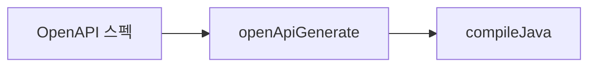

# iinow.github.io

https://iinow.github.io/ 블로그. GitHub Pages 가 Jekyll 로 알아서 빌드한다. `gh-pages` 브랜치에 푸시하면 1분쯤 뒤 반영.

## 새 글 쓰기

```bash
scripts/new-post.sh kafka-retry "카프카 재시도 정리"          # 한국어 글
scripts/new-post.sh kafka-retry "Kafka retries" en            # 영어 글
scripts/new-post.sh kafka-retry "Kafka のリトライ" ja         # 일본어 글
scripts/new-post.sh kafka-retry "Kafka 重试" zh               # 중국어(간체) 글
# 글 쓰고
git add -A && git commit -m "글: 카프카 재시도" && git push
```

- 주소는 `/posts/kafka-retry/`. 첫 화면 **글** 목록에 최신순으로 자동으로 들어간다.
- 파일 이름은 `_posts/YYYY-MM-DD-영문-주소.md` (다른 언어는 `-en.md` / `-ja.md` / `-zh.md`). 날짜가 미래면 그날까지 안 보인다.
- 아직 안 올릴 글은 `_drafts/` 에 둔다 (공개 안 됨).
- 스크립트가 글 파일과 함께 그 글의 미리보기 카드(`img/og/…png`)를 만들고 `image`·`image_alt`·`ref`·`lang`(영어면 `permalink` 도) 을 채워 둔다. 아래 두 절 참고.

## 다국어 (KO / EN / JA / ZH)

같은 글을 언어별로 따로 쓰고 `ref` 로 묶으면 상단 `KO | EN | JA | ZH` 전환과 `hreflang` 이 자동으로 서로를 가리킨다. 짝이 없는 언어는 그 언어의 홈(`/`, `/en/`, `/ja/`, `/zh/`)으로 간다.

| | 한국어 | 영어 | 일본어 | 중국어(간체) |
|---|---|---|---|---|
| 파일 | `_posts/YYYY-MM-DD-<주소>.md` | `…-en.md` | `…-ja.md` | `…-zh.md` |
| `lang` | `ko` (생략해도 됨) | `en` | `ja` | `zh` |
| `ref` | `<주소>` | 같은 `<주소>` | 같은 `<주소>` | 같은 `<주소>` |
| `permalink` | 생략 (기본 `/posts/<주소>/`) | **`/en/posts/<주소>/`** | **`/ja/posts/<주소>/`** | **`/zh/posts/<주소>/`** |
| `category` | `개발` / `여행` | `Dev` / `Travel` | `開発` / `旅行` | `开发` / `旅行` |
| 홈 | `/` | `/en/` | `/ja/` | `/zh/` |
| 주요 코스·태그 날짜 형식 | `2026년 11월 26일` | `Nov 26, 2026` | `2026年11月26日` | `2026年11月26日` |

- 한국어가 아닌 글에 `permalink` 를 빠뜨리면 `/posts/<주소>-<lang>/` 으로 올라간다. 꼭 적는다 (`new-post.sh` 가 넣어 준다).
- `ref` 가 같으면 `_layouts/default.html` 이 짝을 찾아 `hreflang="ko"·"en"·"ja"·"zh"` 와 `x-default`(한국어, 없으면 있는 것 중 첫 번째), `og:locale`(+alternate) 을 넣고, 머리의 언어 링크도 그 글로 간다.
- `<html lang>` 은 `ko` / `en` / `ja` / `zh-CN` 이다. giscus 댓글 언어도 같은 값(`ko`/`en`/`ja`/`zh-CN`)을 쓴다.
- 홈 글 목록(`_includes/post-list.html`)은 `ref` 가 같은 글을 한 줄로 묶는다. 제목·요약은 그 화면 언어의 글을 쓰고(없으면 한국어 → 영어 → 일본어 → 중국어 순), 아래에 읽을 수 있는 언어를 `KO` `EN` `JA` `ZH` 태그로 보여 준다. 태그를 누르면 그 언어 판으로 간다.
- 왼쪽 글 목록과 `Ctrl+K` 검색은 지금 보고 있는 언어의 글만 보여 준다 (`search.json` 은 모든 언어를 담고 `main.js` 가 `lang` 으로 거른다). `category` 는 언어별 값을 맞춰야 홈의 분류 필터에 걸린다.
- 글 안에서 다른 글을 가리킬 때는 그 언어의 주소를 쓴다 — `[lite-oc](/ja/posts/lite-oc/)`, `[lite-oc](/zh/posts/lite-oc/)`.
- 그림·머메이드 도형에 글자가 박혀 있으면 언어별로 따로 만들어야 한다. sqlc 글처럼 영어판 도형을 그대로 쓰고 설명(alt·figcaption)만 번역한 경우도 있다.

영어 글 머리 예:

```yaml
---
layout: post
title: "Kafka retries, in practice"
summary: 목록과 글 머리에 보일 한두 문장. 링크 미리보기 설명으로도 쓰인다.
image: /img/og/kafka-retry-en.png
image_alt: "Kafka retries, in practice"
category: Dev
lang: en
ref: kafka-retry
permalink: /en/posts/kafka-retry/
---
```

## 글 안에서 쓸 수 있는 것

일반 마크다운(소제목 `##`, 표, 목록, 코드 블록, 인용)은 그대로 된다.

| 쓰고 싶은 것 | 쓰는 법 |
|---|---|
| 그림 | ``. 누르면 크게 보인다 |
| 그래프·흐름도 | 그림 파일 대신 `mermaid` 코드 블록 (아래 「그래프·흐름도는 머메이드로」) |
| 그림 + 설명 | `<figure><figcaption>설명</figcaption></figure>` |
| 숫자 요약 칸 | `<dl class="facts"><div><dt>이름</dt><dd>12<small>일</small></dd></div>…</dl>` |
| 알약 목록 | 목록 바로 아래 줄에 `{: .stack}` |
| 순서 흐름 | `<ol class="loop"><li>…</li><li class="hot">강조</li></ol>` |
| 탭으로 넘기는 화면 캡처 | `_posts/2026-11-15-lite-oc.md` 의 `<div class="shots">` 를 복사 |
| 작은 회색 글 | 문단 바로 아래 줄에 `{: .note}` |

### 그래프·흐름도는 머메이드로

**기본 그래프·흐름도는 그림 파일로 굽지 말고 `mermaid` 코드 블록(` ``` ` 세 개 + `mermaid`)으로 그린다.** 글 안에 그 블록이 있을 때만 `main.js` 가 Mermaid 11(jsDelivr CDN)을 내려받아 SVG 로 바꾸므로, 머메이드가 없는 글에는 네트워크 비용도 붙지 않는다. 색은 사이트 변수(`--ink`·`--paper`·`--surface`·`--line`)를 읽어 맞추고, OS 가 다크 모드로 바뀌면 다시 그린다. 좁은 화면에서는 그림이 상자보다 넓을 때 글자를 줄이지 않고 가로로 스크롤된다.

````markdown

````

- 종류는 `flowchart`, `sequenceDiagram`, `classDiagram`, `stateDiagram-v2`, `erDiagram`, `gantt` 등 Mermaid 가 아는 것이면 된다.
- 딱지 글자는 따옴표로 감싼다(`A["build/generated/openapi"]`). 그래야 `()`·`:`·`<br/>` 가 문법으로 읽히지 않는다.
- 사진·스크린샷처럼 머메이드로 그릴 수 없는 것만 `img/<영문-주소>/` 에 넣는다.
- CDN 이 막히면 블록은 원래 코드 그대로 보인다 (`main.js` 가 되돌린다).

## 링크 미리보기 · 검색 노출

글 머리(frontmatter)에 적는 값:

| 값 | 쓰임 |
|---|---|
| `summary` | 목록·글 머리·검색 설명. `meta description` 은 160자, `og:description`·`twitter:description` 은 300자로 잘려 나간다 |
| `image` | 미리보기 그림. 없으면 `/img/og.png` (사이트 기본 카드) |
| `image_alt` | 그림 설명(`og:image:alt`, `twitter:image:alt`). 없으면 제목이 쓰인다 |
| `image_width` / `image_height` | 그림 크기 (기본 1200×630). 카드 대신 사진을 쓸 때 실제 픽셀 값을 적는다 |
| `noindex: true` | 그 페이지만 검색에서 뺀다 |

- `_layouts/default.html` 이 페이지마다 `og:title`·`og:description`·`og:url`·`og:image`·`og:image:width/height/alt/type`·`og:locale`(+alternate), `twitter:card`(`summary_large_image`)·`twitter:title/description/image/image:alt`, 글에는 `article:published_time/section/author` 와 구조화 데이터(JSON-LD `BlogPosting`) 를 자동으로 만든다. 손으로 넣을 필요 없다.
- `og:image:type` 은 `image` 확장자를 보고 png / jpeg / webp 중에서 붙는다.
- `sitemap.xml`, `robots.txt`, `feed.xml` 은 자동.
- 구글 서치 콘솔·네이버 서치어드바이저 확인 코드는 `_config.yml` 의 `google_site_verification`, `naver_site_verification` 에 넣는다.

### 카드 그림 만들기

```bash
python3 scripts/make-og.py --out img/og/kafka-retry.png --title "카프카 재시도 정리" --kicker "개발 · 2026.11.27"
python3 scripts/make-og.py --out img/og/kafka-retry-en.png --title "Kafka retries" --kicker "Dev · 2026.11.27" --lang en
python3 scripts/make-og.py --out img/og/kafka-retry-ja.png --lang ja --title "Kafka のリトライ" --kicker "開発 · 2026.11.27"
python3 scripts/make-og.py --out img/og/kafka-retry-zh.png --lang zh --title "Kafka 重试" --kicker "开发 · 2026.11.27"
```

- 1200×630 PNG. 제목이 그림 안에 그려지므로 메신저가 어떻게 잘라도 제목이 보인다. 글꼴은 `scripts/fonts/` (Bagel Fat One·Pretendard, OFL — 한국어·영어).
- 일본어·중국어는 `NotoSansJP-Bold-subset.ttf`·`NotoSansSC-Bold-subset.ttf`(OFL) 를 쓴다. 사이트에 실린 일본어·중국어 글과 화면 문구에 나온 글자만 담은 부분집합이라 각 300~400KB 다. 제목에 없는 글자가 나오면 스크립트가 글리프를 확인해 시스템 Noto Sans CJK 로 넘어가고, 그것도 없으면 경고를 찍는다(두부 방지). 부분집합을 넓히려면 fontTools 로 다시 만든다: `pyftsubset "NotoSansJP[wght].ttf" --text-file=<글자 모음> --output-file=scripts/fonts/NotoSansJP-Bold-subset.ttf`.
- 일본어·중국어는 띄어쓰기가 없어서 제목을 단어(가타카나·라틴 문자 연속) 단위로 끊고, `・`·`、` 같은 금칙 글자가 줄 첫머리로 나가지 않게 한다. 마지막 줄이나 중간 줄에 한두 글자만 남으면 한 단계 작은 크기로 다시 잡는다.
- 긴 제목은 알아서 줄을 나누고 글자를 줄인다. `--lang en` 이면 카드 아래 브랜드 문구가 영어가 된다.
- `scripts/new-post.sh` 로 글을 만들면 카드까지 같이 만들어진다 (Pillow 필요: `pip install pillow`). 카드 문구는 나중에 직접 고쳐도 된다.

### 글 머리 YAML 따옴표

값에 `: ` 나 `#` 가 들어가면 반드시 따옴표로 감싼다 (`title: "lite-oc: 더블클릭…"`). 안 감싸면 그 글의 frontmatter 가 깨져 **`permalink` 까지 무시되고** `/posts/2026-11-15-lite-oc-en/` 같은 엉뚱한 주소로 올라간다. 제목·`image_alt`·`summary` 는 늘 따옴표로 쓰는 게 안전하다 (`new-post.sh` 가 그렇게 만든다).

### 카카오톡 링크 미리보기 캐시

- 카카오톡은 한 번 공유한 URL 의 미리보기를 자체 캐시로 기억한다. 카드를 바꿔도 **이미 붙였던 링크**는 한동안 옛 썸네일·문구로 보인다. 새 URL 은 바로 새 카드가 뜬다.
- 바로 바꾸려면 카카오 계정으로 로그인해 https://developers.kakao.com/tool/clear/og 에서 그 URL 을 넣고 캐시를 초기화한다. (본인 계정 작업)
- X·슬랙·디스코드는 보통 링크를 새로 붙일 때 다시 긁어 간다.

## 화면 기능

| 기능 | 어떻게 동작하나 |
|---|---|
| 코드 복사 | `main.js` 가 `.prose pre` 마다 우측 상단에 `복사` 버튼을 붙인다. 머메이드 그림은 제외. 누르면 `복사됨 ✓` 로 잠깐 바뀐다 |
| 라이트/다크 | 머리 `KO | EN | JA | ZH` 옆 해/달 버튼. 고른 값은 `localStorage('theme')` 에 남고, 안 고르면 OS 설정을 따른다. `<head>` 인라인 스크립트가 `data-theme` 을 먼저 세팅해 깜빡임이 없다 |
| 글 검색 | `/search.json` 색인을 `Ctrl+K`·`Cmd+K` 또는 머리 검색 버튼으로 연다. 제목·요약·본문 앞부분을 실시간으로 거르고 화살표·Enter·Esc 로 움직인다 |
| 읽기 진행률 | 글 화면 머리 아래 3px 노란 선. 스크롤에 따라 0→100% |
| 댓글 | `_config.yml` 의 `giscus` 블록이 `enabled: true` 일 때 글 하단에 giscus 위젯. 테마 전환을 `postMessage` 로 따라간다 |

## 홈 화면 앱 · 오프라인 (PWA)

휴대폰 브라우저에서 `홈 화면에 추가` 를 하면 주소창 없이 앱처럼 열리고, 한 번 열어 본 페이지는 연결이 끊겨도 보인다.

| 파일 | 하는 일 |
|---|---|
| `manifest.webmanifest` | 앱 이름(`iinow`), `start_url: /`, `scope: /`, `display: standalone`, 테마·배경색, 192·512 아이콘(`any` / `maskable`), 바로가기(글 목록·온라인 도구·EN) |
| `sw.js` | 서비스 워커. 첫 화면(`/`, `/en/`), `offline.html`, `style.css`, `main.js`, `search.json`, 아이콘을 미리 저장하고 요청을 나눠 받는다 |
| `offline.html` | 연결이 끊긴 채 처음 여는 페이지에 보여 줄 안내. `다시 시도`·`홈으로 가기`, 사이트와 같은 라이트/다크 |
| `img/icon-192x192.png` · `512x512` | 앱 아이콘(`purpose: any`) |
| `img/icon-maskable-*.png` | 안드로이드가 모양을 잘라 써도 그림이 안 잘리도록 안전 영역 안에 그린 아이콘 |
| `scripts/make-icons.py` | 아이콘을 `favicon.svg` 도형으로 다시 만든다 (`python3 scripts/make-icons.py`) |

캐시 전략:

- 페이지 이동(`mode: navigate`)은 **네트워크 우선** → 실패하면 저장본 → 그것도 없으면 `offline.html`. 온라인이면 항상 새 HTML 을 받는다.
- 같은 사이트의 CSS·JS·이미지는 **저장본 먼저(SWR)** — 바로 보여 주고 뒤에서 최신으로 갈아 둔다. `?v=` 가 붙은 주소는 `ignoreSearch` 로 맞춘다.
- 다른 도메인(GA4, giscus, 폰트 CDN)과 `GET` 이 아닌 요청은 가로채지 않는다.
- `sw.js` 의 `VERSION` 을 올리면 새 캐시로 갈아타고, `activate` 에서 `iinow-` 가 아닌 옛 캐시를 지운다.
- `service-worker.js` 는 예전 방문자 브라우저에 남은 등록을 스스로 정리하는 자리다. 새 워커는 `sw.js` 다.

## 온라인 도구

| 주소 | 하는 일 |
|---|---|
| `/online/tsid/` · `/en/…` · `/ja/…` · `/zh/…` | TSID 생성·대량 생성, 10진수/Base32 Crockford 변환, 시각·노드·카운터 분해 |
| `/online/openapi-diff/` · `/en/…` · `/ja/…` · `/zh/…` | OpenAPI 3.x 스펙 두 개를 비교해 Breaking / 안전한 변경을 엔드포인트별로. 붙여 넣기·파일·URL 가져오기, 최근 비교 10건 이력 |
| `/online/uuid-v7/` · `/en/…` · `/ja/…` · `/zh/…` | UUID v7(RFC 9562) 생성·대량 생성, 붙여 넣는 즉시 시각·버전 풀어 보기, 최근 풀어 본 10개 이력 |
| `/online/base64/` · `/en/…` · `/ja/…` · `/zh/…` | Base64 인코딩·디코딩 (UTF-8, URL-safe). 입력하는 즉시 변환, 최근 10개 이력 |
| `/online/url-encode/` · `/en/…` · `/ja/…` · `/zh/…` | URL(퍼센트) 인코딩·디코딩 (`encodeURIComponent` / `encodeURI`, 공백 `+`). 입력하는 즉시 변환, 최근 10개 이력 |

모든 도구는 `layout: tool` 을 쓰고 frontmatter 에 `tools: true` 를 두면 `tool.css` 가 붙는다. 계산은 브라우저에서만 하고, 입력은 어디로도 보내지 않는다.

- **Base64 · URL 도구**는 화면이 같아서 `_layouts/codec.html` 하나를 쓴다. 페이지 파일에는 본문 없이 머리만 두고 `codec: base64` / `codec: url` 로 고른다. 화면 문구·설명·FAQ 는 `_data/codec.yml` 에 언어별로 있고, 계산은 `tool-codec.js` 가 한다.
- **날짜·시각 고르기**는 flatpickr 4.6.13(jsDelivr CDN, 언어 파일 `l10n/ko·ja·zh`)을 쓴다. UUID v7 의 「시각 지정」에 붙어 있고, 색은 `tool.css` 에서 사이트 변수로 맞췄다(다크 모드 포함). CDN 이 막히면 브라우저 기본 `datetime-local` 입력으로 동작한다.
- **UUID v7 도구**도 같은 방식이다. `_layouts/uuid7.html` + `_data/uuid7.yml` + `tool-uuid7.js`, 페이지 머리에 `tool_data: uuid7` 을 두면 그 데이터 파일의 `faq` 가 `FAQPage` 로 들어간다. 새 도구를 이 방식으로 더 만들 때도 `tool_data: <데이터 파일 이름>` 만 맞추면 된다.
- **검색 노출용 머리 값** — `seo_title`(있으면 `<title>`·`og:title` 에 `title` 대신 쓰인다), `keywords`(`meta keywords`). `tools: true` 인 페이지에는 `_layouts/default.html` 이 JSON-LD `WebApplication` + `BreadcrumbList` 를 넣고, `codec` 페이지에는 `_data/codec.yml` 의 `faq` 로 `FAQPage` 까지 넣는다. FAQ 는 화면에도 같은 글로 보인다.
- **이력** — `localStorage` 에 도구별로 최근 10개(`iinow:codec:base64:history`, `iinow:codec:url:history`, `iinow:uuid7:history`, `iinow:openapi-diff:history`). Base64·URL 은 입력이 0.8초 멈추면 저장하고 이어서 친 값은 맨 위 항목을 갈아 끼운다. OpenAPI 는 비교가 성공할 때 스펙 두 개를 통째로 저장하고, 용량이 넘치면 오래된 것부터 버린다.
- **OpenAPI URL 가져오기**는 브라우저가 직접 `fetch` 하므로 상대 서버가 CORS 를 허용해야 한다. `github.com/…/blob/…` 주소는 `raw.githubusercontent.com` 으로 바꿔 읽는다.

## 파일

| 파일 | 하는 일 |
|---|---|
| `_posts/` | 글 (`YYYY-MM-DD-<주소>.md`, 다른 언어는 `-en.md`·`-ja.md`·`-zh.md`) |
| `index.html` | 첫 화면 (히어로, 글 목록, 분류 필터, 공개 저장소) |
| `en/index.html` · `ja/index.html` · `zh/index.html` | 영어·일본어·중국어 첫 화면 (`All / Dev / Travel`, `すべて / 開発 / 旅行`, `全部 / 开发 / 旅行`) |
| `_layouts/default.html` | 공통 머리·메뉴·바닥. `og:*`·`twitter:*`·`hreflang`·JSON-LD 생성 |
| `_layouts/post.html` | 글 화면 틀 (분류 링크, 이전·다음 글) |
| `style.css`, `main.js` | 모양, 애니메이션·탭·크게 보기, 머메이드 그림, 언어별 문구 |
| `img/og/` | 페이지별 링크 미리보기 카드(1200×630). `img/og.png` 는 사이트 기본 카드 |
| `img/<주소>/` | 글에 넣는 사진·그림 |
| `scripts/new-post.sh` | 새 글 파일 + 카드 생성 |
| `scripts/make-og.py` | 카드 그림 생성(`--lang ko/en/ja/zh`). 글꼴은 `scripts/fonts/` |
| `search.json` | `Ctrl+K` 검색 색인 (글 + `search_include: true` 인 페이지) |
| `tool.css`, `tool-tsid.js`, `tool-openapi-diff.js`, `tool-codec.js` | 온라인 도구 화면과 계산(문구는 `ko/en/ja/zh`) |
| `_layouts/codec.html`, `_data/codec.yml` | Base64 · URL 인코딩/디코딩 공용 화면과 언어별 문구·FAQ |
| `_layouts/uuid7.html`, `_data/uuid7.yml`, `tool-uuid7.js` | UUID v7 생성기 화면, 언어별 문구·FAQ, 계산 |
| `_config.yml` | 주소 규칙(`permalink: /posts/:slug/`), 기본 언어, 검색 등록 확인 코드, 플러그인 |
| `manifest.webmanifest`, `sw.js`, `offline.html` | 홈 화면 앱(PWA)·오프라인 캐시, 오프라인 안내 페이지 |
| `service-worker.js` | 옛 서비스 워커 정리용 껍데기(새 워커는 `sw.js`) |
| `404.html` | 404 페이지 |

합쳐지는 애니메이션은 lite-oc 글 안에 있다 (`<div class="stage">`, 목록은 `main.js` 의 `SERVICES`).
