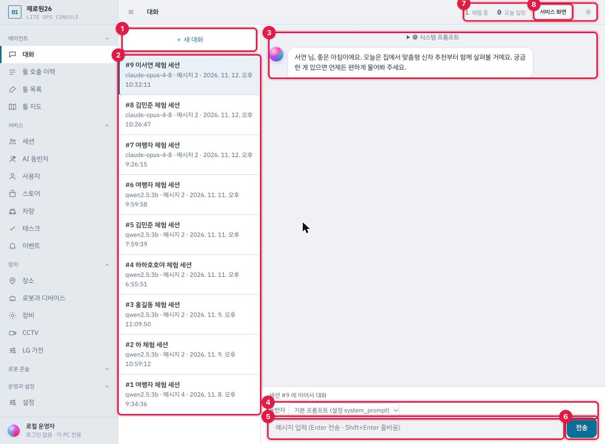

<dl class="facts">
  
<dt>Executable</dt><dd>1</dd>

  
<dt>Build time</dt><dd>12<small>days</small></dd>

  
<dt>Commits</dt><dd>92</dd>

  
<dt>Admin screens</dt><dd>27</dd>

</dl>

## What I cut

  

  

  

    
18services

    
lite-oc

    <ul class="inside">
      <li>Go server</li>
      <li>SQLite file</li>
      <li>Built-in UI</li>
    </ul>
  

  
Eighteen services that used to run separately — PostgreSQL, MQTT, S3, SQS, nginx, Grafana and the rest — collapse into a single executable.

  <button class="replay" id="replay" type="button">Replay</button>

The original system was a Docker Compose bundle: two layers of entry nginx, the Go server, PostgreSQL, an MQTT broker, S3 storage, an SQS queue, and observability tools such as Jaeger, Prometheus, Loki and Grafana. lite-oc removed them or folded them into a single process.

| Job | Before | lite-oc |
|---|---|---|
| Data | PostgreSQL container | One SQLite file |
| Realtime delivery | MQTT broker | SSE sent straight from the server |
| Images and video | S3 storage | Embedded in the binary + a local folder |
| Screens | Two containers, tablet and back office | Next.js static build embedded in Go |
| Robots | A real SPOT, robot arm and companion robot | Simulated inside the server |
| Distribution | Deploy with Compose on a server | Mac dmg, Windows zip, Docker |

## How the AI runs

The agent is a simple loop built with [Eino](https://github.com/cloudwego/eino). The model calls a tool, the server runs it, hands the result back to the model, and answers once there is nothing left to call. No values are stuffed into the prompt; the model pulls the data it needs with tools.

<ol class="loop" aria-label="Agent loop">
  <li>Question</li>
  <li>Model call</li>
  <li class="hot">Run tool</li>
  <li class="hot">Result to model</li>
  <li>Answer</li>
</ol>

You choose the model in the admin. Pick one of local Ollama, an OpenAI-compatible API, Claude or an in-house gateway and save, and the next call uses it without a restart. Answers stream over SSE as the tokens arrive.

## A look around the screens

  

    <button role="tab" data-img="/img/lite-oc/chat.jpg" data-cap="Chat. Every session records which model answered, and a conversation on the service screen can be picked up here.">Chat</button>
    <button role="tab" data-img="/img/lite-oc/toolmap.jpg" data-cap="Tool map. Lines show which tables each of the agent's ten tools reads and writes.">Tool map</button>
    <button role="tab" data-img="/img/lite-oc/settings-llm.jpg" data-cap="Model settings. Pick one of four providers, choose from the model list and save.">Model settings</button>
    <button role="tab" data-img="/img/lite-oc/spot.jpg" data-cap="SPOT console. A simulation inside the server moves instead of the real robot, showing the command queue and state as they are.">Robot console</button>
    <button role="tab" data-img="/img/lite-oc/tasks.jpg" data-cap="Tasks. Edit the to-dos for each place and the change shows up on the service screen right away.">Tasks</button>
  

  <figure role="tabpanel">
    
    <figcaption>Chat. Every session records which model answered, and a conversation on the service screen can be picked up here.</figcaption>
  </figure>

## Stack

- Go 1.25
- Gin
- Eino
- SQLite (modernc)
- sqlc
- Next.js 16
- React 19
- Tailwind 4
- SSE
- systray
- Docker
{: .stack}

The repository is private, so there is no link. If you're curious, ask me by email.
{: .note}
