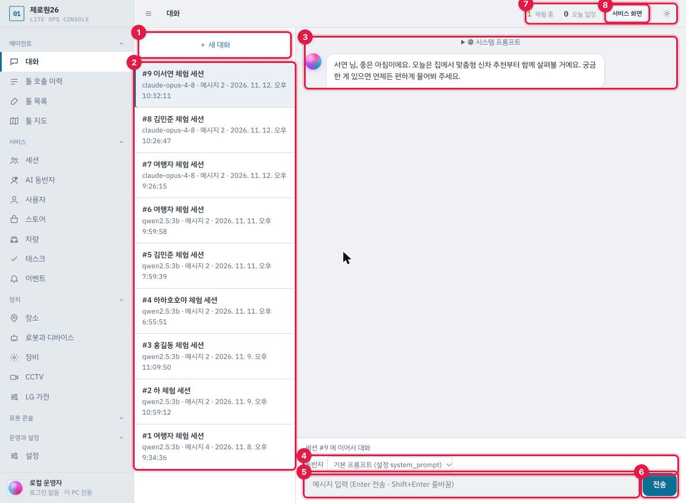

<dl class="facts">
  
<dt>実行ファイル</dt><dd>1<small>個</small></dd>

  
<dt>作った期間</dt><dd>12<small>日</small></dd>

  
<dt>コミット</dt><dd>92<small>個</small></dd>

  
<dt>管理画面</dt><dd>27<small>個</small></dd>

</dl>

## 何を減らしたか

  

  

  

    
18個

    
lite-oc

    <ul class="inside">
      <li>Go サーバー</li>
      <li>SQLite ファイル</li>
      <li>画面を内蔵</li>
    </ul>
  

  
PostgreSQL、MQTT、S3、SQS、nginx、Grafana など別々に起動していたサービス 18 個が、実行ファイル 1 つにまとまった。

  <button class="replay" id="replay" type="button">もう一度見る</button>

もとのシステムは、入口の nginx が 2 段、Go サーバー、PostgreSQL、MQTT ブローカー、S3 ストレージ、SQS キュー、そして Jaeger・Prometheus・Loki・Grafana のような可観測性ツールが Docker Compose でまとまっていました。lite-oc はこれを外すか、1 つのプロセスの中に統合しました。

| していたこと | もともと | lite-oc |
|---|---|---|
| データ | PostgreSQL コンテナ | SQLite ファイル 1 つ |
| リアルタイム配信 | MQTT ブローカー | サーバーが直接送る SSE |
| 画像・映像 | S3 ストレージ | バイナリに内蔵 + ローカルフォルダー |
| 画面 | タブレット・バックオフィスのコンテナ 2 つ | Next.js の静的ビルドを Go に内蔵 |
| ロボット | 実機の SPOT・ロボットアーム・ペットロボット | サーバー内のシミュレーション |
| 配布 | サーバーに Compose で上げる | Mac dmg、Windows zip、Docker |

## AI はこう回る

エージェントは [Eino](https://github.com/cloudwego/eino) で作った単純な繰り返しです。モデルがツールを呼べば実行し、結果をモデルに返し、もう呼ぶものがなければ答えます。プロンプトに値を埋め込まず、必要なデータはモデルがツールで直接取りに行きます。

<ol class="loop" aria-label="エージェントの反復順序">
  <li>質問</li>
  <li>モデル呼び出し</li>
  <li class="hot">ツール実行</li>
  <li class="hot">結果をモデルへ</li>
  <li>回答</li>
</ol>

モデルは管理画面で選びます。ローカルの Ollama、OpenAI 互換 API、Claude、社内ゲートウェイのどれかを選んで保存すると、再起動なしで次の呼び出しから切り替わります。回答は SSE でトークンが出た分だけ流します。

## 画面を見て回る

  

    <button role="tab" data-img="/img/lite-oc/chat.jpg" data-cap="会話。セッションごとにどのモデルが答えたかが残り、サービス画面の会話もここから続けて見られる。">会話</button>
    <button role="tab" data-img="/img/lite-oc/toolmap.jpg" data-cap="ツールマップ。エージェントが使う 10 個のツールがどのテーブルを読み書きするかを線で示す。">ツールマップ</button>
    <button role="tab" data-img="/img/lite-oc/settings-llm.jpg" data-cap="AI モデル設定。提供元 4 つのうち 1 つを選び、モデル一覧から選んで保存する。">モデル設定</button>
    <button role="tab" data-img="/img/lite-oc/spot.jpg" data-cap="SPOT 操縦コンソール。実機の代わりにサーバーのシミュレーションが動き、コマンドキューと状態をそのまま見せる。">ロボットコンソール</button>
    <button role="tab" data-img="/img/lite-oc/tasks.jpg" data-cap="タスク。場所ごとのやることを直すと、サービス画面にすぐ反映される。">タスク</button>
  

  <figure role="tabpanel">
    
    <figcaption>会話。セッションごとにどのモデルが答えたかが残り、サービス画面の会話もここから続けて見られる。</figcaption>
  </figure>

## 使ったもの

- Go 1.25
- Gin
- Eino
- SQLite (modernc)
- sqlc
- Next.js 16
- React 19
- Tailwind 4
- SSE
- systray
- Docker
{: .stack}

リポジトリは非公開なのでリンクはありません。気になることがあればメールで聞いてください。
{: .note}
