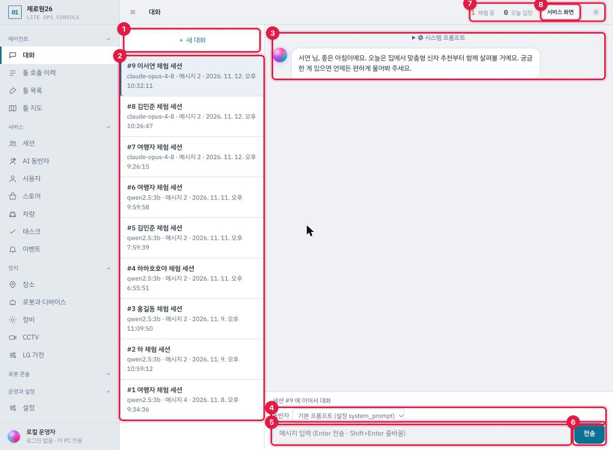

<dl class="facts">
  
<dt>可执行文件</dt><dd>1<small>个</small></dd>

  
<dt>制作周期</dt><dd>12<small>天</small></dd>

  
<dt>提交</dt><dd>92<small>次</small></dd>

  
<dt>管理页面</dt><dd>27<small>个</small></dd>

</dl>

## 减掉了什么

  

  

  

    
18个

    
lite-oc

    <ul class="inside">
      <li>Go 服务器</li>
      <li>SQLite 文件</li>
      <li>界面内置</li>
    </ul>
  

  
PostgreSQL、MQTT、S3、SQS、nginx、Grafana 等 18 个单独运行的服务，合并成了一个可执行文件。

  <button class="replay" id="replay" type="button">再看一次</button>

原来的系统里，两层入口 nginx、Go 服务器、PostgreSQL、MQTT 代理、S3 存储、SQS 队列，还有 Jaeger、Prometheus、Loki、Grafana 这些可观测性工具都捆在 Docker Compose 里。lite-oc 把它们去掉，或者合进了一个进程。

| 原来做什么 | 原来 | lite-oc |
|---|---|---|
| 数据 | PostgreSQL 容器 | 一个 SQLite 文件 |
| 实时推送 | MQTT 代理 | 服务器直接推送的 SSE |
| 图片·视频 | S3 存储 | 内嵌进二进制 + 本地文件夹 |
| 界面 | 平板·后台两个容器 | 把 Next.js 静态构建内嵌进 Go |
| 机器人 | 实机 SPOT·机械臂·宠物机器人 | 服务器里的模拟 |
| 部署 | 在服务器上用 Compose 部署 | Mac dmg、Windows zip、Docker |

## AI 是这样跑的

智能体是用 [Eino](https://github.com/cloudwego/eino) 做的简单循环。模型调用工具就执行，把结果交回模型，没有要调用的了就回答。不往提示词里塞值，需要的数据由模型用工具自己取。

<ol class="loop" aria-label="智能体循环顺序">
  <li>提问</li>
  <li>调用模型</li>
  <li class="hot">执行工具</li>
  <li class="hot">结果交回模型</li>
  <li>回答</li>
</ol>

模型在管理页面里选。从本地 Ollama、OpenAI 兼容 API、Claude、公司内部网关里选一个保存，不用重启，下一次调用就换过去。回答以 SSE 按 token 流式返回。

## 看看界面

  

    <button role="tab" data-img="/img/lite-oc/chat.jpg" data-cap="对话。每个会话留下是哪个模型回答的，服务界面里的对话也能从这里接着看。">对话</button>
    <button role="tab" data-img="/img/lite-oc/toolmap.jpg" data-cap="工具地图。用线画出智能体使用的 10 个工具读写哪些表。">工具地图</button>
    <button role="tab" data-img="/img/lite-oc/settings-llm.jpg" data-cap="AI 模型设置。从四个提供方里选一个，在模型列表里选好保存。">模型设置</button>
    <button role="tab" data-img="/img/lite-oc/spot.jpg" data-cap="SPOT 控制台。代替实机的是服务器里的模拟，命令队列和状态照原样显示。">机器人控制台</button>
    <button role="tab" data-img="/img/lite-oc/tasks.jpg" data-cap="任务。改掉每个地点要做的事，服务界面马上反映出来。">任务</button>
  

  <figure role="tabpanel">
    
    <figcaption>对话。每个会话留下是哪个模型回答的，服务界面里的对话也能从这里接着看。</figcaption>
  </figure>

## 用到的

- Go 1.25
- Gin
- Eino
- SQLite (modernc)
- sqlc
- Next.js 16
- React 19
- Tailwind 4
- SSE
- systray
- Docker
{: .stack}

仓库是私有的，所以没有链接。有想了解的可以发邮件问我。
{: .note}
