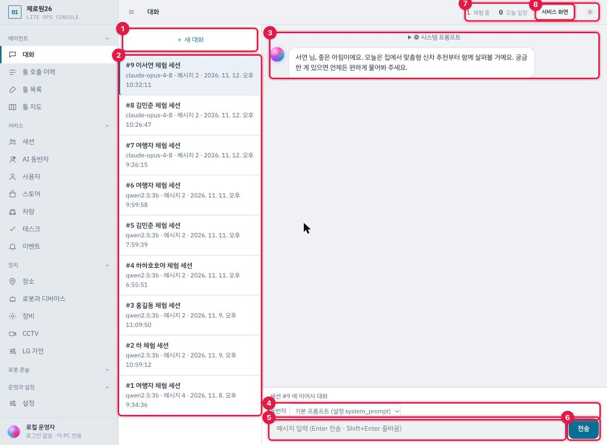

<dl class="facts">
  
<dt>실행 파일</dt><dd>1<small>개</small></dd>

  
<dt>만든 기간</dt><dd>12<small>일</small></dd>

  
<dt>커밋</dt><dd>92<small>개</small></dd>

  
<dt>어드민 화면</dt><dd>27<small>개</small></dd>

</dl>

## 무엇을 줄였나

  

  

  

    
18개

    
lite-oc

    <ul class="inside">
      <li>Go 서버</li>
      <li>SQLite 파일</li>
      <li>화면 내장</li>
    </ul>
  

  
PostgreSQL, MQTT, S3, SQS, nginx, Grafana 등 따로 띄우던 서비스 열여덟 개가 실행 파일 하나로 합쳐졌다.

  <button class="replay" id="replay" type="button">다시 보기</button>

원래 시스템은 진입용 nginx 두 겹, Go 서버, PostgreSQL, MQTT 브로커, S3 저장소, SQS 큐, 그리고 Jaeger·Prometheus·Loki·Grafana 같은 관측 도구가 Docker Compose 로 묶여 있었습니다. lite-oc 는 이걸 빼거나 한 프로세스 안으로 합쳤습니다.

| 하던 일 | 원래 | lite-oc |
|---|---|---|
| 데이터 | PostgreSQL 컨테이너 | SQLite 파일 하나 |
| 실시간 전달 | MQTT 브로커 | 서버가 직접 보내는 SSE |
| 이미지·영상 | S3 저장소 | 바이너리 내장 + 로컬 폴더 |
| 화면 | 태블릿·백오피스 컨테이너 두 개 | Next.js 정적 빌드를 Go 에 내장 |
| 로봇 | 실물 SPOT·로봇팔·반려로봇 | 서버 안 시뮬레이션 |
| 배포 | 서버에 Compose 로 올리기 | Mac dmg, Windows zip, Docker |

## AI 는 이렇게 돈다

에이전트는 [Eino](https://github.com/cloudwego/eino) 로 만든 단순한 반복입니다. 모델이 도구를 부르면 실행하고, 결과를 모델에 돌려주고, 더 부를 게 없으면 답합니다. 프롬프트에 값을 끼워 넣지 않고, 필요한 데이터는 모델이 도구로 직접 꺼내 갑니다.

<ol class="loop" aria-label="에이전트 반복 순서">
  <li>질문</li>
  <li>모델 호출</li>
  <li class="hot">도구 실행</li>
  <li class="hot">결과를 모델에</li>
  <li>답변</li>
</ol>

모델은 어드민에서 고릅니다. 로컬 Ollama, OpenAI 호환 API, Claude, 사내 게이트웨이 중 하나를 골라 저장하면 재시작 없이 다음 호출부터 바뀝니다. 답변은 SSE 로 토큰이 나오는 대로 흘려보냅니다.

## 화면 둘러보기

  

    <button role="tab" data-img="/img/lite-oc/chat.jpg" data-cap="대화. 세션마다 어떤 모델이 답했는지 남고, 서비스 화면의 대화도 여기서 이어 볼 수 있다.">대화</button>
    <button role="tab" data-img="/img/lite-oc/toolmap.jpg" data-cap="툴 지도. 에이전트가 쓰는 도구 열 개가 어떤 테이블을 읽고 쓰는지 선으로 보여 준다.">툴 지도</button>
    <button role="tab" data-img="/img/lite-oc/settings-llm.jpg" data-cap="AI 모델 설정. 제공자 네 곳 중 하나를 고르고 모델 목록에서 골라 저장한다.">모델 설정</button>
    <button role="tab" data-img="/img/lite-oc/spot.jpg" data-cap="SPOT 조종 콘솔. 실물 대신 서버 시뮬레이션이 움직이고 명령 큐와 상태를 그대로 보여 준다.">로봇 콘솔</button>
    <button role="tab" data-img="/img/lite-oc/tasks.jpg" data-cap="태스크. 장소별 할 일을 고치면 서비스 화면에 바로 반영된다.">태스크</button>
  

  <figure role="tabpanel">
    
    <figcaption>대화. 세션마다 어떤 모델이 답했는지 남고, 서비스 화면의 대화도 여기서 이어 볼 수 있다.</figcaption>
  </figure>

## 쓴 것

- Go 1.25
- Gin
- Eino
- SQLite (modernc)
- sqlc
- Next.js 16
- React 19
- Tailwind 4
- SSE
- systray
- Docker
{: .stack}

저장소는 비공개라 링크는 없습니다. 궁금한 건 메일로 물어봐 주세요.
{: .note}
