<dl class="facts">
  
<dt>Duration</dt><dd class="long">5 nights<small> · 6 days</small></dd>

  
<dt>City</dt><dd>Bangkok</dd>

  
<dt>Main stops</dt><dd class="long">Muang Boran<small> · Maeklong</small></dd>

  
<dt>Photos</dt><dd>39</dd>

</dl>

Six days in Bangkok. Only two things were booked in advance: Muang Boran tickets, and a half-day tour of the Damnoen Saduak floating market and the Maeklong railway. The other days I decided as I went. I dropped into temples, walked the city, and had dinner at a night market on the last evening.

| Date | Where I went |
|---|---|
| Nov 20 (Fri) | Flew out, arrived in Bangkok |
| Nov 21 (Sat) | Muang Boran, Le Lert Cafe |
| Nov 22 (Sun) | Wat Arun, Wat Pho, a walk downtown, Lung Rueang |
| Nov 23 (Mon) | Damnoen Saduak floating market, Maeklong railway |
| Nov 24 (Tue) | Downtown, night market |
| Nov 25 (Wed) | Flew home |

## November 20, starting with cold noodles at the airport

I flew out on Friday evening. Before going through I had dinner at the airport: cold noodles and dumplings. No Korean food for a few days, so this was getting it in early.

<figure>
  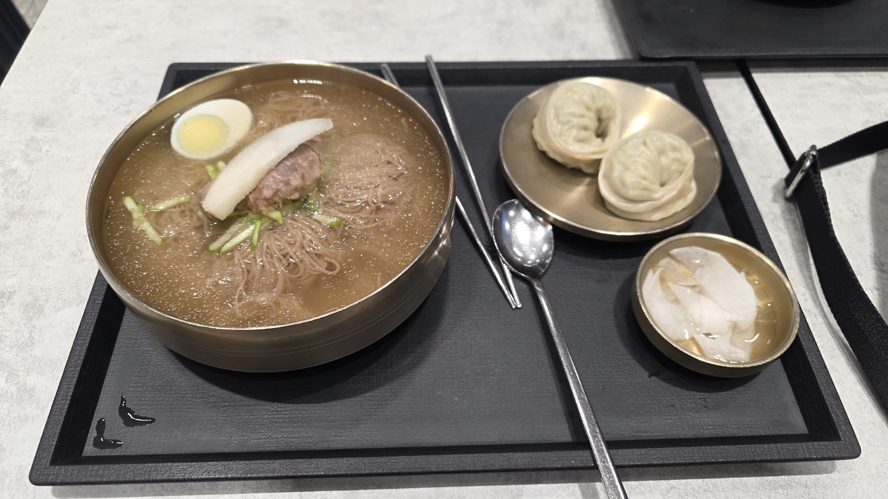
  <figcaption>Naengmyeon and dumplings before the flight. The chilled broth was a treat.</figcaption>
</figure>

Outside the jet bridge window it was already dark. A little over five hours to Bangkok — far enough that you arrive somewhere in your sleep.

<figure>
  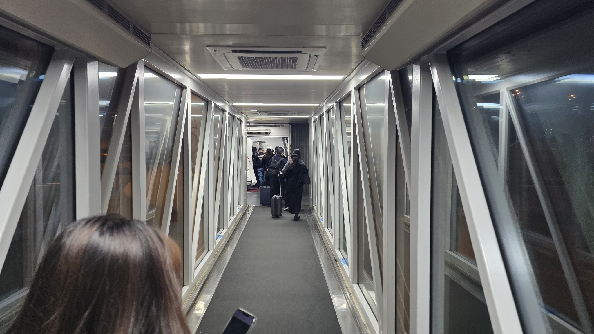
  <figcaption>The jet bridge. It was dark outside.</figcaption>
</figure>

## November 21, Muang Boran

Saturday went to Muang Boran, an open-air museum east of Bangkok in Samut Prakan that gathers temples and buildings brought in from all over Thailand. In one day you skim the whole country.

<figure>
  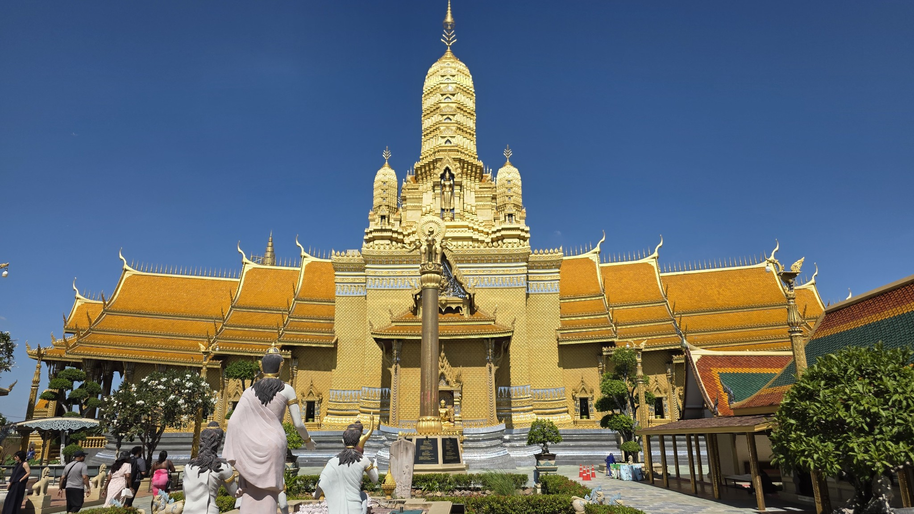
  <figcaption>The golden temple, right inside the gate. The roof colour was unusually deep.</figcaption>
</figure>

<figure>
  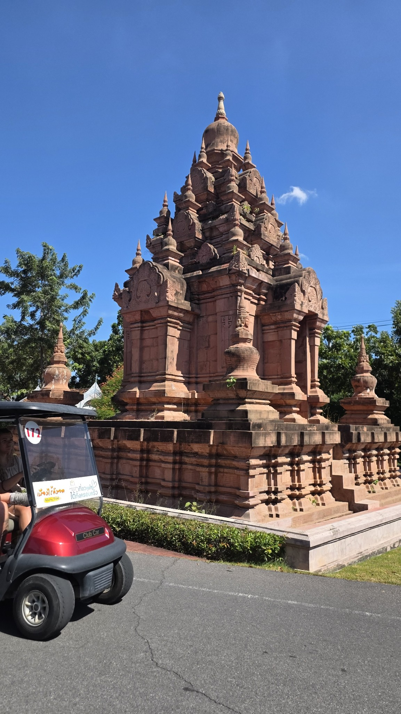
  <figcaption>A gilded Buddha, with the sky wide open behind it.</figcaption>
</figure>

I bought a ticket, went in and rented a golf cart. The place is far too big to cover on foot. Park the cart in front of a temple, take photos, drive on — that was the day.

<figure>
  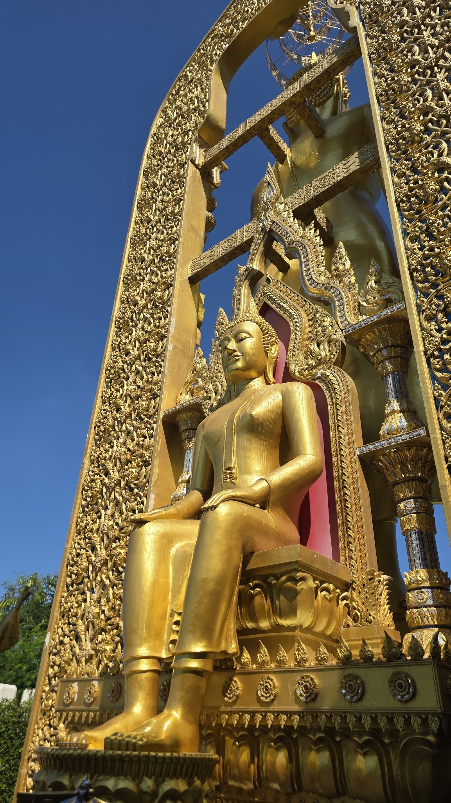
  <figcaption>Cart 172. Remember the number and it's easy to find your way back.</figcaption>
</figure>

<figure>
  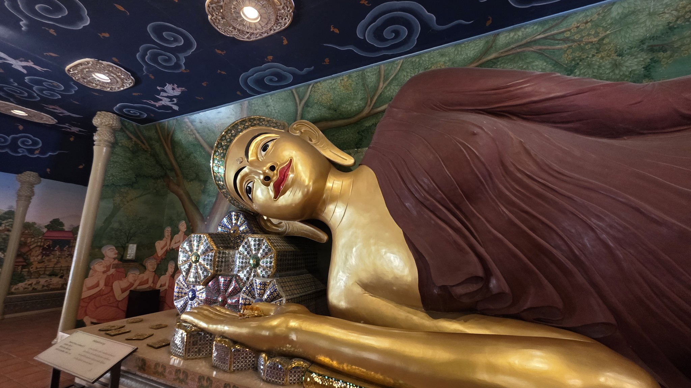
  <figcaption>The reclining Buddha. The ceiling above it was packed with paintings.</figcaption>
</figure>

What stayed with me most was a pavilion built on the water. A bridge runs out to the middle of the pond and the building waits at the end of it. So many people were taking pictures that I had to stand there a while.

<figure>
  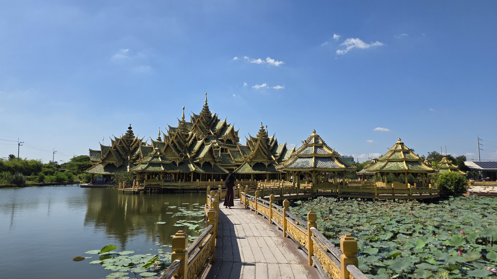
  <figcaption>The pavilion on the pond. Stand at the end of the bridge and the photos come out well.</figcaption>
</figure>

<figure>
  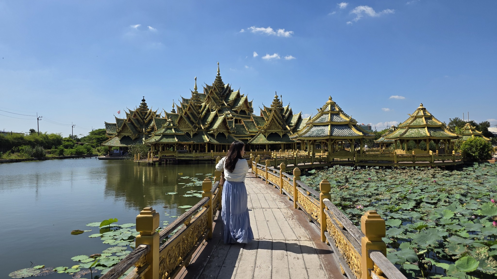
  <figcaption>One more from the same spot. It was morning, so the sun wasn't harsh yet.</figcaption>
</figure>

<figure>
  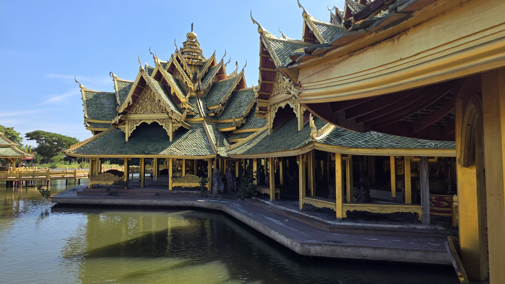
  <figcaption>The same pavilion from the side. Every pillar was wood.</figcaption>
</figure>

Lunch was at a cafe nearby, Le Lert Cafe. It calls itself a cafe, but the food is a proper meal. We ordered crab fried rice, tom yum goong and deep-fried pork belly, and finished with watermelon juice. It was a hot day, so the tom yum broth was especially welcome.

<figure>
  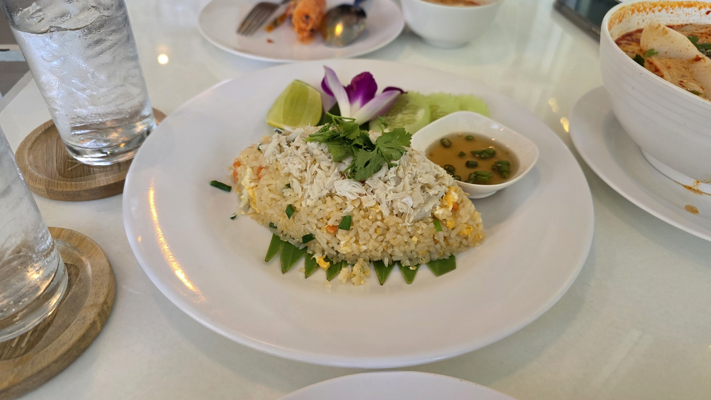
  <figcaption>Crab fried rice, with a generous heap of crab on top.</figcaption>
</figure>

<figure>
  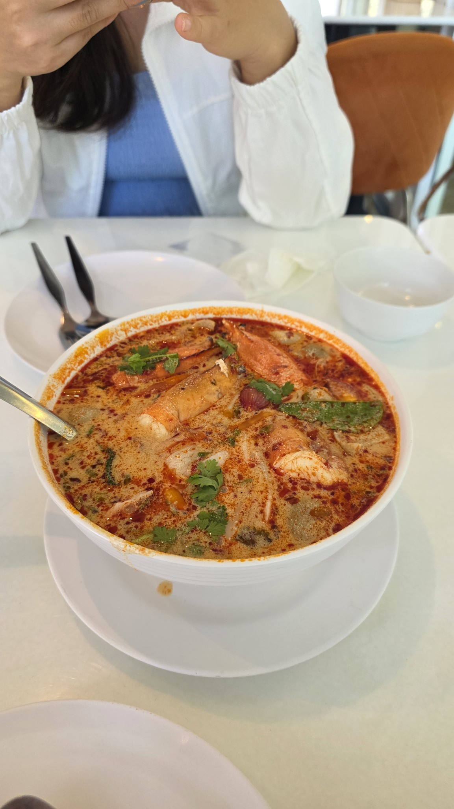
  <figcaption>Tom yum goong. Big prawns, a deep broth.</figcaption>
</figure>

<figure>
  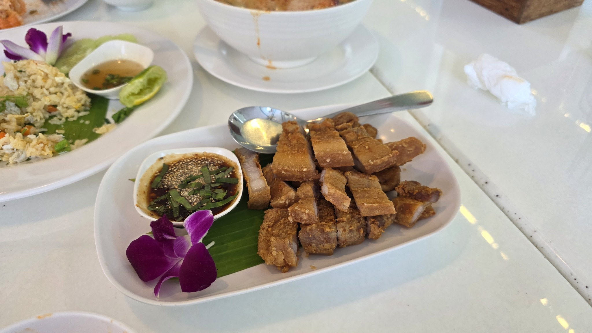
  <figcaption>Crispy pork belly, dipped in soy sauce.</figcaption>
</figure>

<figure>
  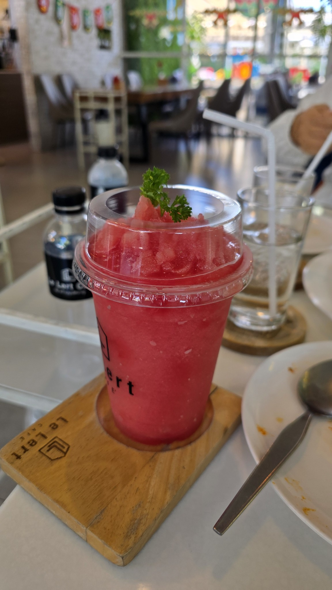
  <figcaption>Watermelon juice. The ice melts fast, so drink it quickly.</figcaption>
</figure>

## November 22, temples, then a walk through the city

Sunday started with the temples by the river. Wat Arun stands on the bank. Its central spire is startlingly tall and its surface is covered all over in small pieces of porcelain. Look up from below and every shard is different.

<figure>
  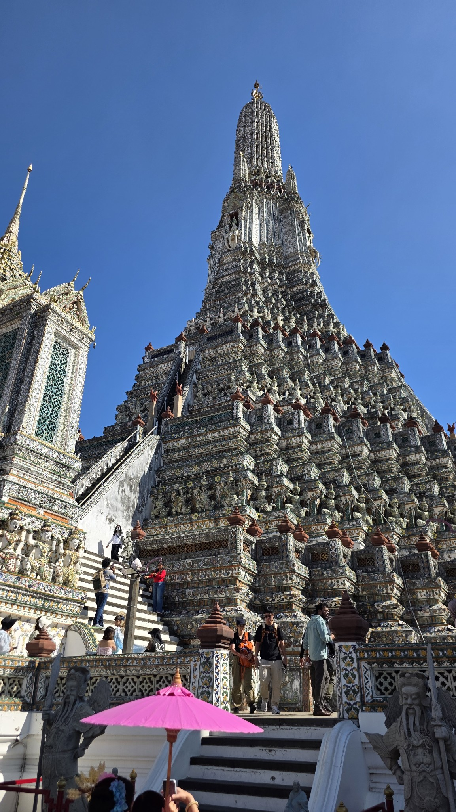
  <figcaption>The central spire of Wat Arun. Up close, the whole surface is small porcelain pieces.</figcaption>
</figure>

The stairs beside the spire never emptied. With that many people taking photos, I mostly stood below and looked up.

Next was Wat Pho, the temple famous for its enormous reclining Buddha. Crowded from the entrance.

<figure>
  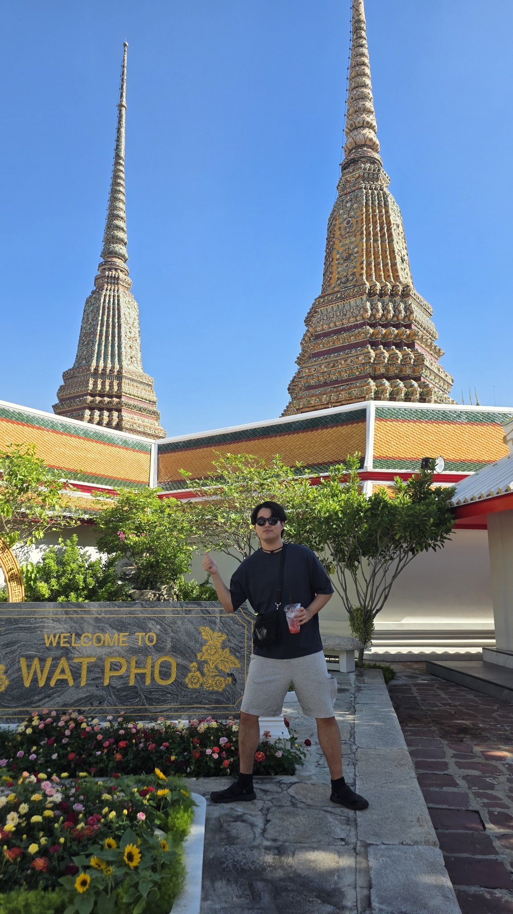
  <figcaption>The entrance to Wat Pho. The sign is big, so a photo in front of it works well.</figcaption>
</figure>

Inside there was a garden, with big rocks and stone figures scattered around; wander through and photo spots keep appearing. Thick trees made it a good place to get out of the sun too.

<figure>
  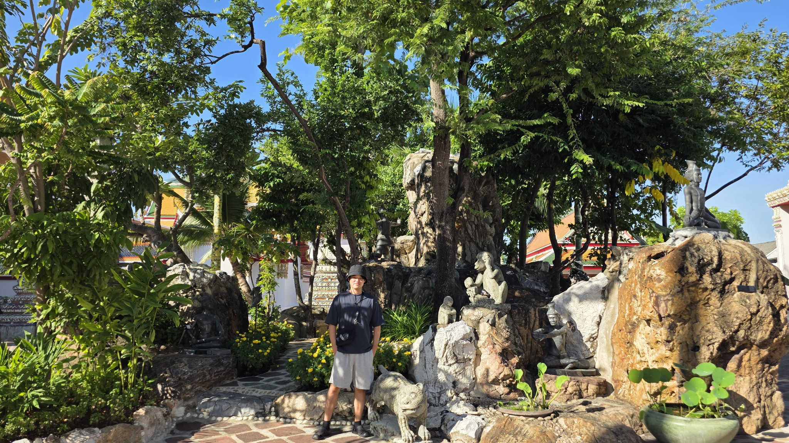
  <figcaption>The garden at Wat Pho. Stone figures stand between the rocks.</figcaption>
</figure>

Out of the temple, I walked toward downtown, past a park full of palms. It had a clock tower; I didn't note its name.

<figure>
  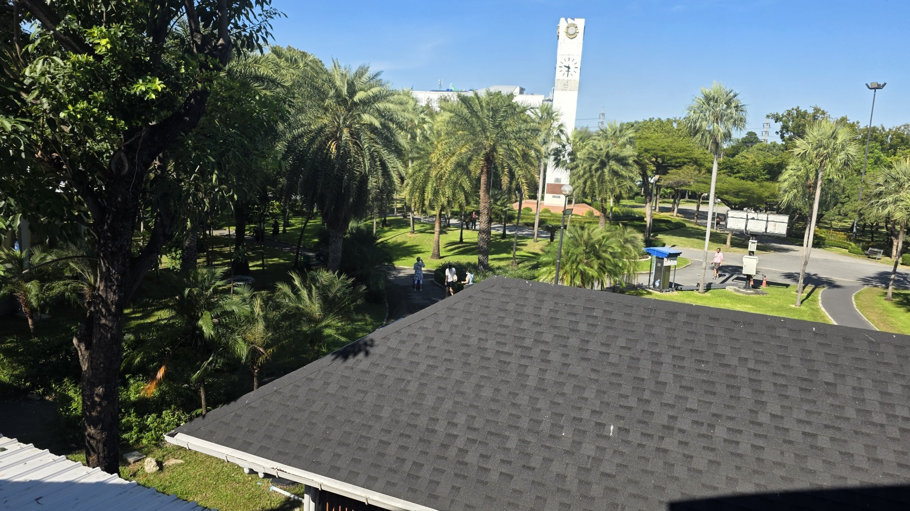
  <figcaption>A clock tower between the palms. Hardly anyone there, so it was quiet.</figcaption>
</figure>

Down the footbridge stairs and across the main road. Bangkok's footbridges have such long stairs that just getting down takes a while.

<figure>
  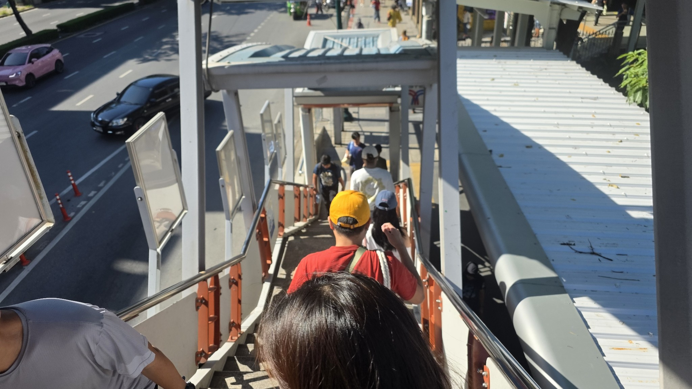
  <figcaption>The footbridge stairs. Below, the traffic never stops.</figcaption>
</figure>

Lunch was at Lung Rueang on Sukhumvit 26, a Michelin-listed pork noodle shop. We went early and sat down without waiting. One rice noodle soup, one dry mixed noodle, and fried fish skin. The broth was clear and not over-seasoned; the fish skin was crisp and salty, which went just right with the noodles.

<figure>
  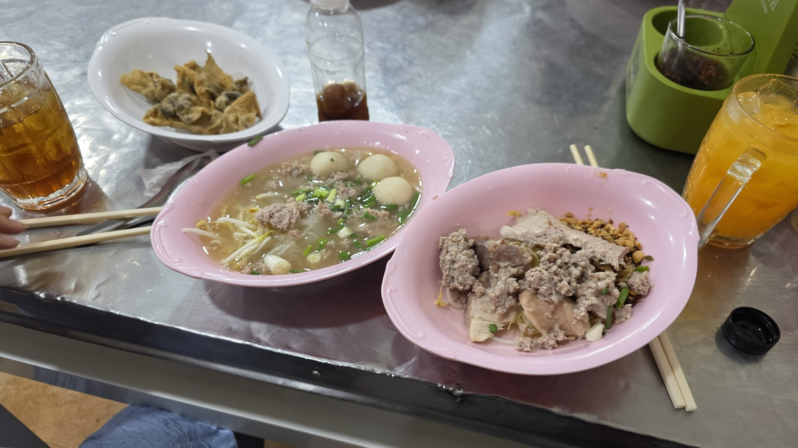
  <figcaption>Rice noodles, mixed noodles and fried fish skin at Lung Rueang.</figcaption>
</figure>

<figure>
  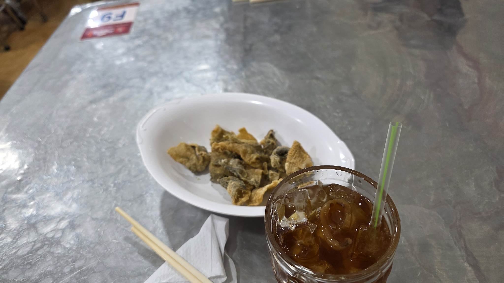
  <figcaption>Fried fish skin and iced tea. The tables were stainless steel.</figcaption>
</figure>

Dinner was at a Thai restaurant: pu pad pong curry, som tam and stir-fried morning glory, with rice.

Pu pad pong curry is a curry with a whole crab in it. Yellow curry with the crab meat loosened through it, spooned over rice. It isn't a soupy curry, so the rice is what makes it.

<figure>
  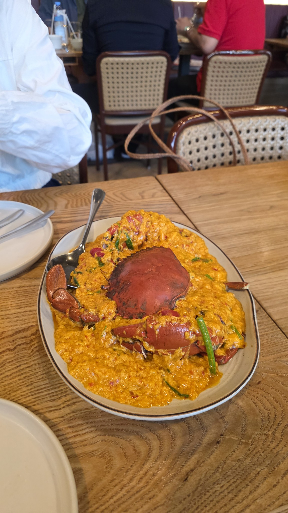
  <figcaption>Pu pad pong curry. A whole crab sits on top of the curry.</figcaption>
</figure>

Som tam is a salad of shredded unripe papaya, dressed sour and hot with peanuts in it. On a hot day it's exactly what makes you want to eat.

<figure>
  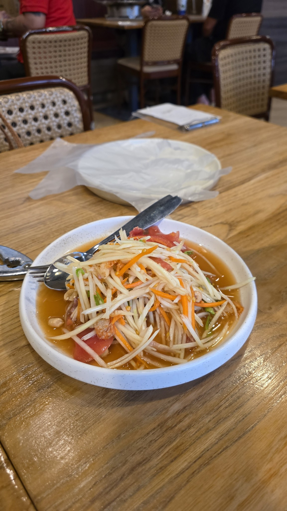
  <figcaption>Som tam. Tomato and peanuts among the shredded papaya.</figcaption>
</figure>

Pak bung fai daeng is stir-fried morning glory, tossed quickly over a high flame so the stems stay crisp. It comes out with rice.

<figure>
  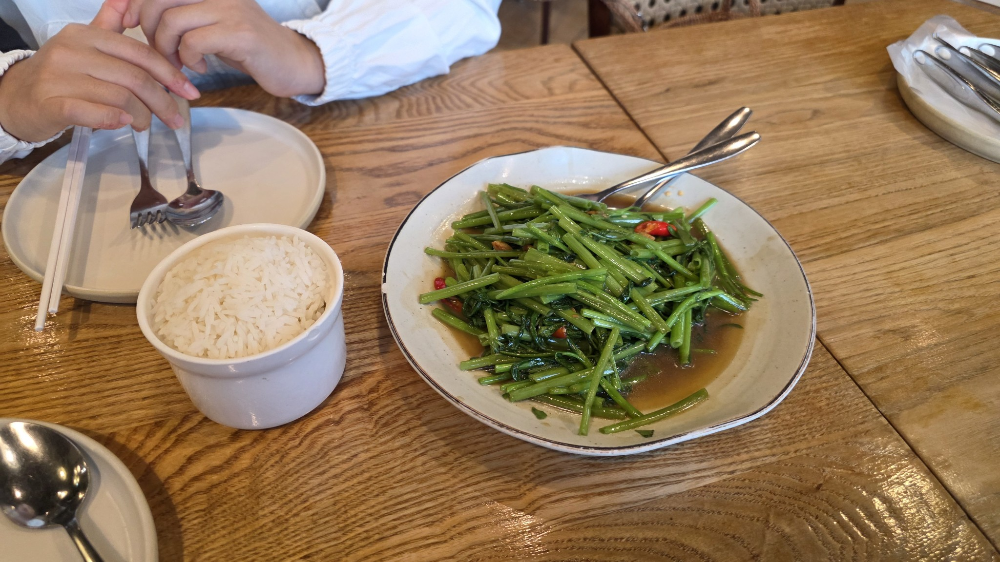
  <figcaption>Pak bung fai daeng. Morning glory stems stir-fried over a high flame.</figcaption>
</figure>

<figure>
  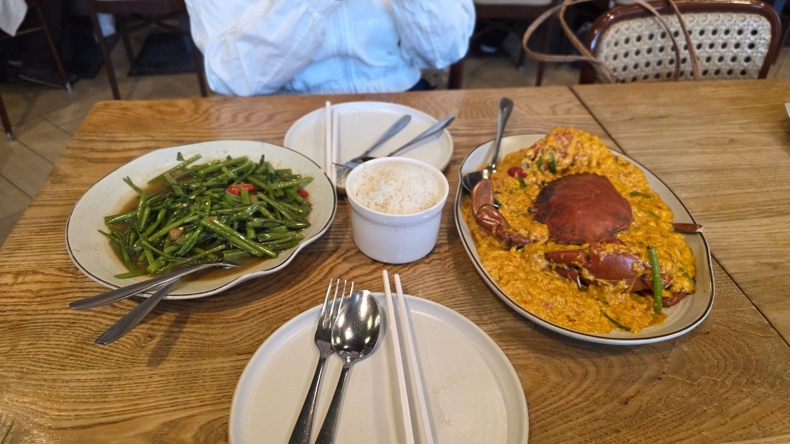
  <figcaption>The whole table. Three dishes and a bowl of rice was plenty for two.</figcaption>
</figure>

## November 23, the Damnoen Saduak floating market and the Maeklong railway

Monday ran around a half-day tour, the Damnoen Saduak floating market and the Maeklong railway, leaving from Asok station. A bus for about an hour in the morning and we were at Damnoen Saduak, where boats still pull up along the canals and sell from the water.

In the afternoon we went to Maeklong market, a market standing right on the railway tracks. When the announcement says a train is coming, the vendors fold up their stalls and umbrellas and everyone presses back against the wall. A few minutes later the train passes within arm's reach. It wasn't as loud as I expected, and once it's gone the market unfolds again.

<figure>
  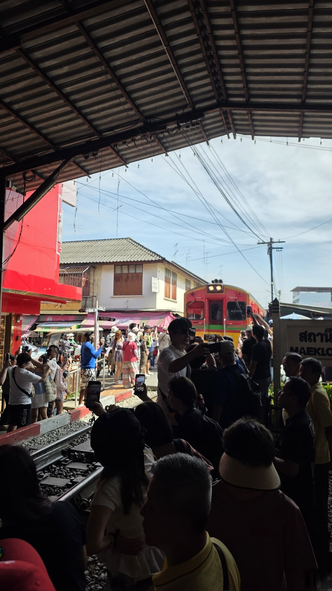
  <figcaption>The train coming down the tracks. Everyone had a phone up.</figcaption>
</figure>

## November 24, an evening at the night market

Tuesday I planned nothing and spent it downtown. Lunch was pad thai, a plate with whole prawns on it, mixed with bean sprouts, chives and ground peanuts.

<figure>
  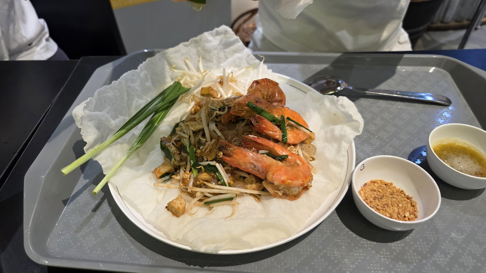
  <figcaption>Prawn pad thai. It comes out on a tray with ground peanuts and chilli on the side.</figcaption>
</figure>

On a hot afternoon I had a chocolate drink.

<figure>
  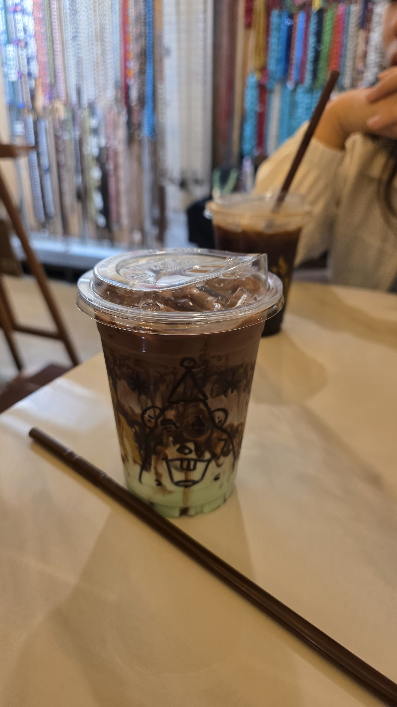
  <figcaption>The chocolate drink. The cup had a drawing on it.</figcaption>
</figure>

Walking past, I bought a toast: bread pressed and grilled with ham and cheese, crisp outside and hot inside.

<figure>
  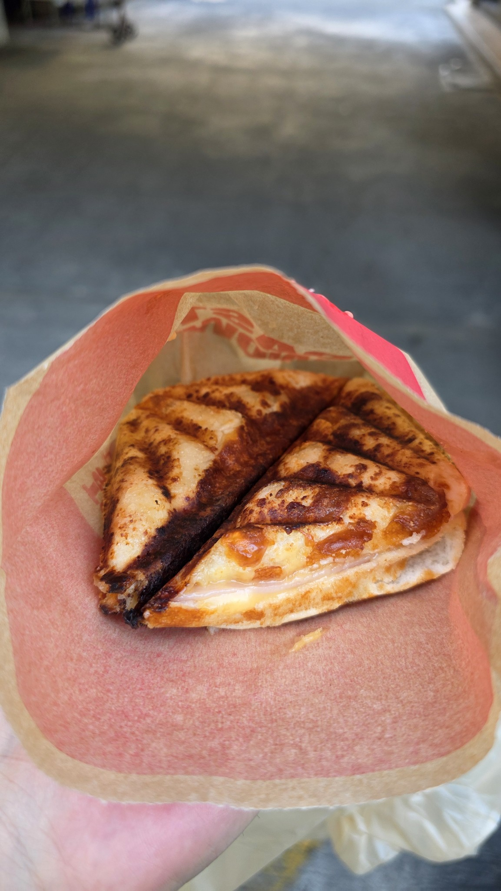
  <figcaption>Ham and cheese toast, handed over in a paper bag.</figcaption>
</figure>

Next to it they were frying dumplings on a griddle. Two big griddles, dumplings turned around in them and flipped as the bottoms browned. I bought a plate on the way past.

<figure>
  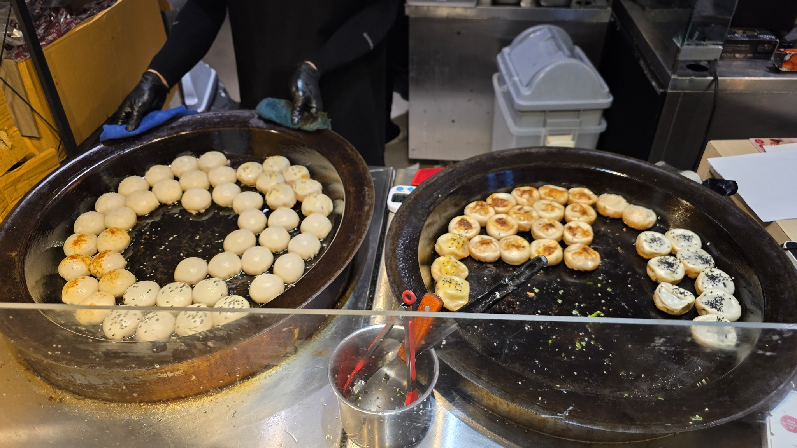
  <figcaption>Griddle dumplings. The front griddle is still pale, the back one already golden.</figcaption>
</figure>

I had a matcha drink too, from a shop called KAMU TEA. The cup was printed with flowers.

<figure>
  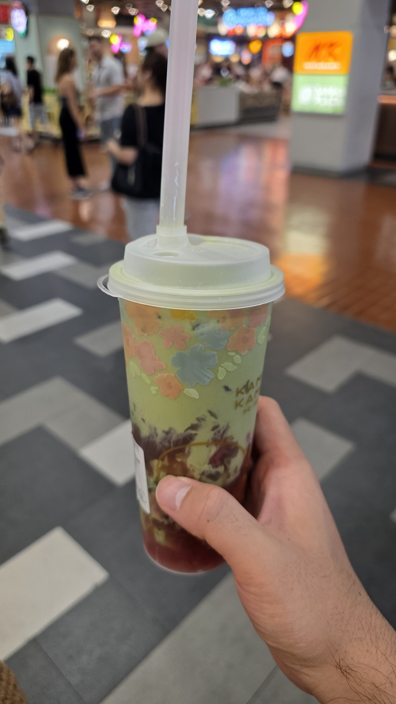
  <figcaption>The matcha drink. Flowers all over the cup.</figcaption>
</figure>

We stopped at a Dairy Queen and ordered two Blizzards, one chocolate with Maltesers and one with Oreo, plus a soft serve in a cup.

<figure>
  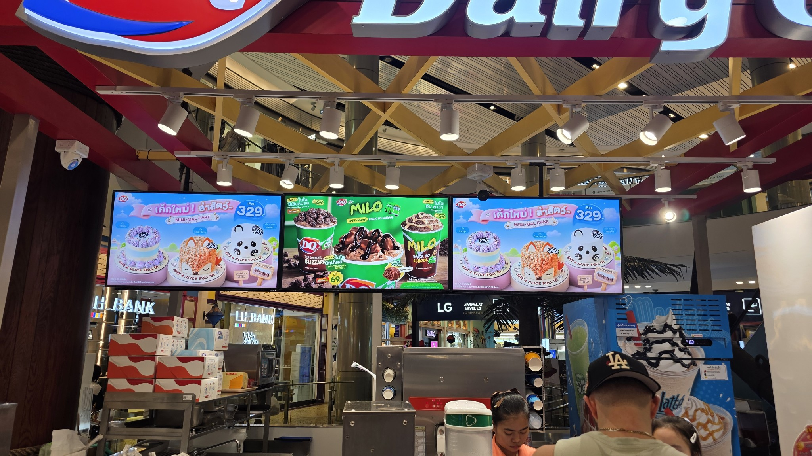
  <figcaption>The Dairy Queen, in a corner of a mall food court.</figcaption>
</figure>

<figure>
  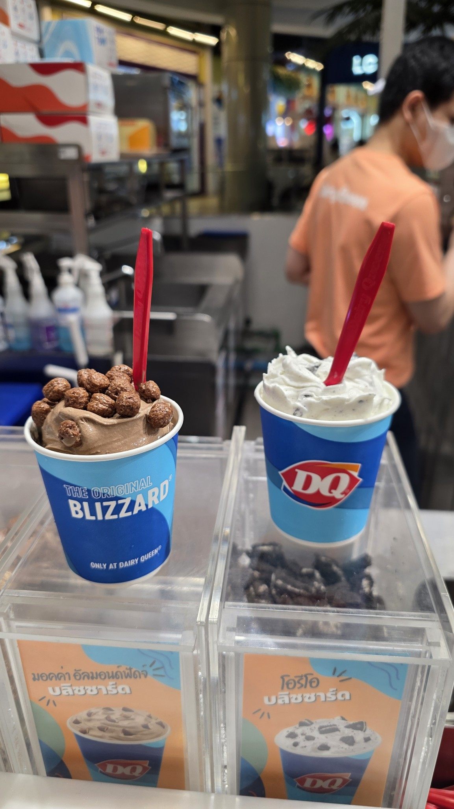
  <figcaption>Two Blizzards. Chocolate with Maltesers on the left, Oreo on the right.</figcaption>
</figure>

<figure>
  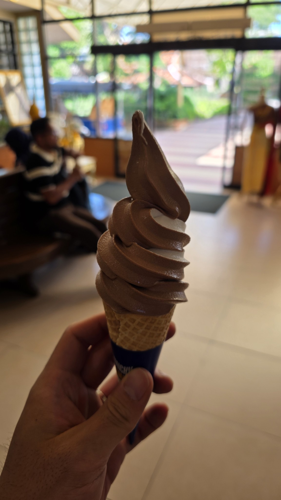
  <figcaption>Chocolate soft serve, filled right to the top of the cone.</figcaption>
</figure>

We stopped at a supermarket for yadom, the inhalers I buy every time I'm in Thailand. The shelf has so many kinds that I smelled them one by one and took only a few.

<figure>
  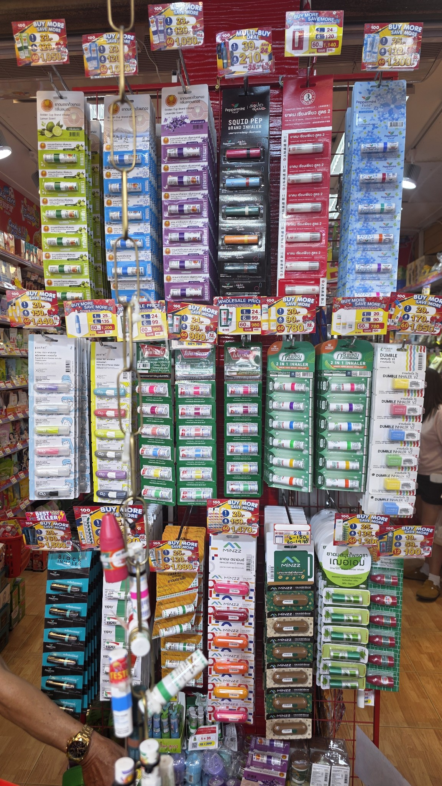
  <figcaption>The yadom shelf. Same name, and every one a different scent.</figcaption>
</figure>

Dinner was at the night market. Container shops and street stalls run in a long line along a big road with tables set out in the middle. It was busy enough that finding a seat wasn't easy.

<figure>
  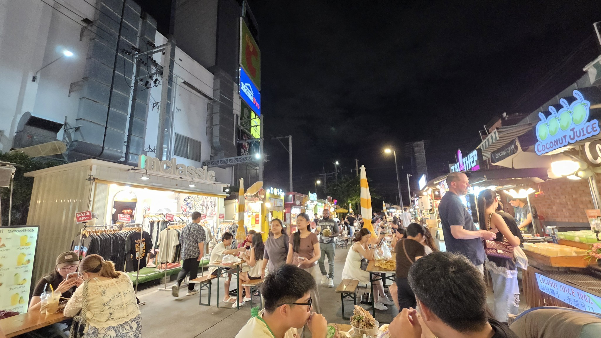
  <figcaption>The night market street. Clothes shops and food stalls alternating.</figcaption>
</figure>

The way it works is that you buy what you want one dish at a time and gather it on one table. We started with leng saap, pork spine simmered in a spicy broth with a heap of green chillies on top. The broth is clear, but the heat is real.

<figure>
  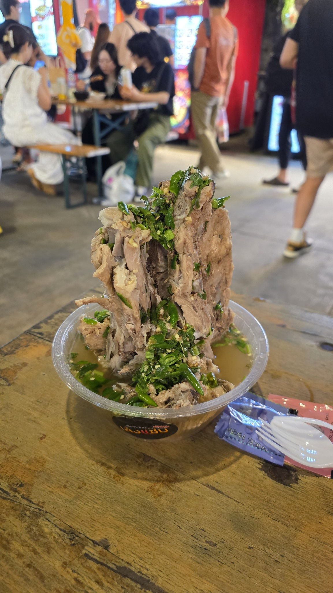
  <figcaption>Leng saap. Pork spine simmered in broth, with green chillies.</figcaption>
</figure>

We ordered pineapple fried rice as well, served in a pineapple split in half and hollowed out. Prawns, peanuts and dried pork on top.

<figure>
  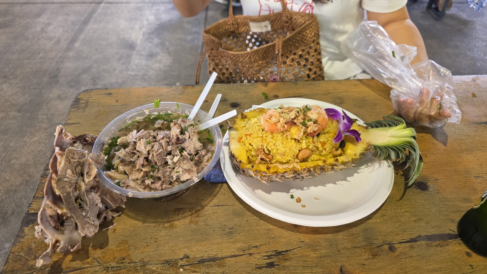
  <figcaption>Pineapple fried rice and leng saap. The pineapple skin is the bowl.</figcaption>
</figure>

For dessert, durian. The night market opens it for you, so you can eat it right there. Plenty of people hesitate over the smell; the taste is sweet and creamy.

<figure>
  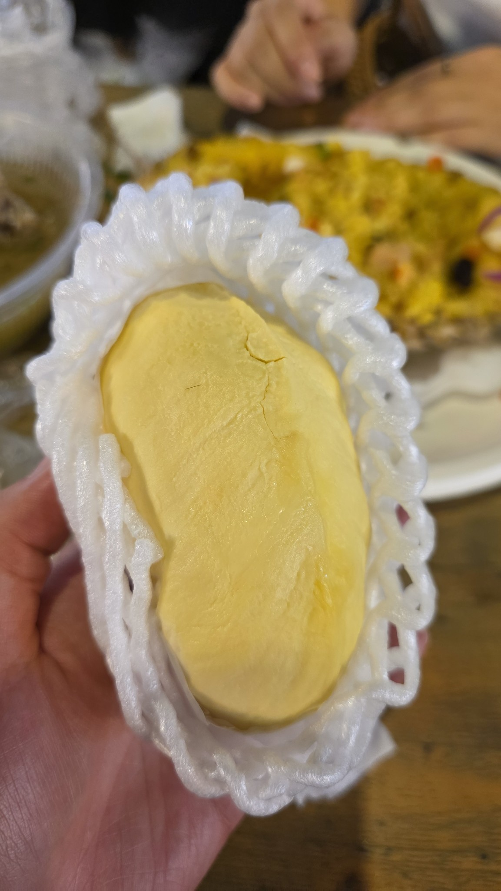
  <figcaption>Durian, opened and eaten right at the night market table.</figcaption>
</figure>

The durian we didn't finish and the snacks came back to the hotel. Laid out in the room, they filled a table along with the Blizzard cups from earlier.

<figure>
  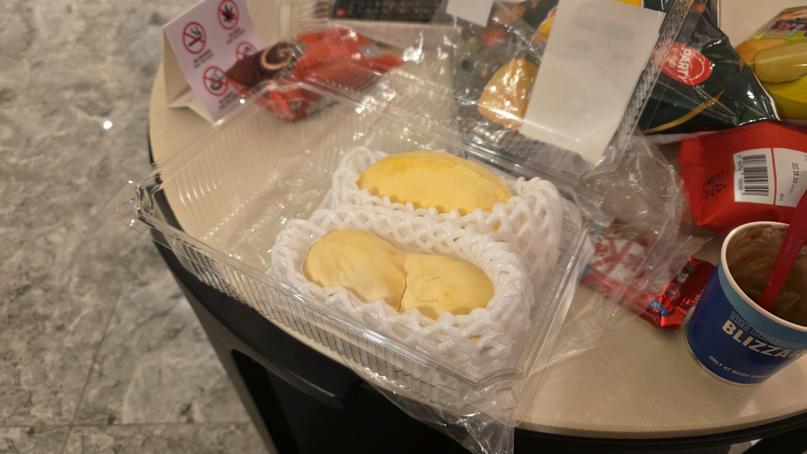
  <figcaption>Durian and snacks at the hotel, Blizzard cups included.</figcaption>
</figure>

## November 25, home

I flew home on Wednesday. Six days was neither short nor long. If I went again, I'd do Muang Boran early in the morning and take the morning tour for Maeklong.
