<dl class="facts">
  
<dt>期間</dt><dd>5<small>泊</small> 6<small>日</small></dd>

  
<dt>都市</dt><dd>バンコク</dd>

  
<dt>主なコース</dt><dd>ムアンボーラン・メークロン</dd>

  
<dt>写真</dt><dd>39<small>枚</small></dd>

</dl>

6 日間バンコクに行ってきました。事前に予約したのは 2 つでした。ムアンボーランの入場券と、ダムヌンサドゥアック水上マーケット・メークロン線路の半日ツアー。残りの日はその場で決めて動きました。寺に寄り、街を歩き、最後の日はナイトマーケットで夕食を食べました。

| 日付 | 行ったところ |
|---|---|
| 11/20 (金) | 出国、バンコク到着 |
| 11/21 (土) | ムアンボーラン、Le Lert Cafe |
| 11/22 (日) | ワット・アルン、ワット・ポー、街歩き、ルンルアン |
| 11/23 (月) | ダムヌンサドゥアック水上マーケット、メークロン線路 |
| 11/24 (火) | 街、ナイトマーケット |
| 11/25 (水) | 帰国 |

## 11 月 20 日、空港で冷麺から

出国は金曜の夜でした。入る前に空港で夕食を食べました。冷麺と餃子です。何日かは韓国料理を食べられないので、先に食べておくというわけでした。

<figure>
  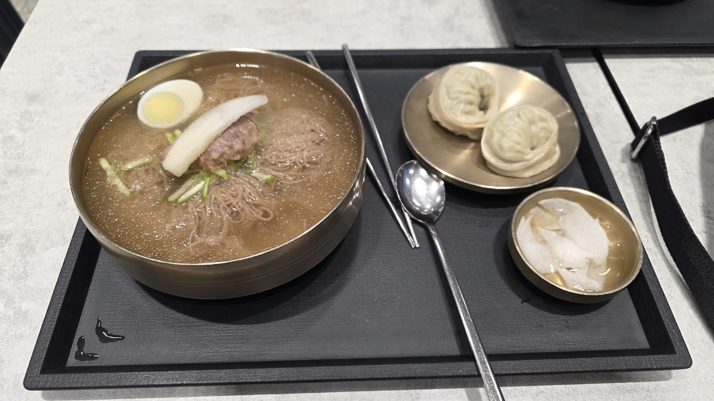
  <figcaption>出国前に食べた冷麺と餃子。スープが冷たくてよかったです。</figcaption>
</figure>

搭乗橋の窓の外はもう暗くなっていました。バンコクまで 5 時間ほど、寝ているうちに着く距離でした。

<figure>
  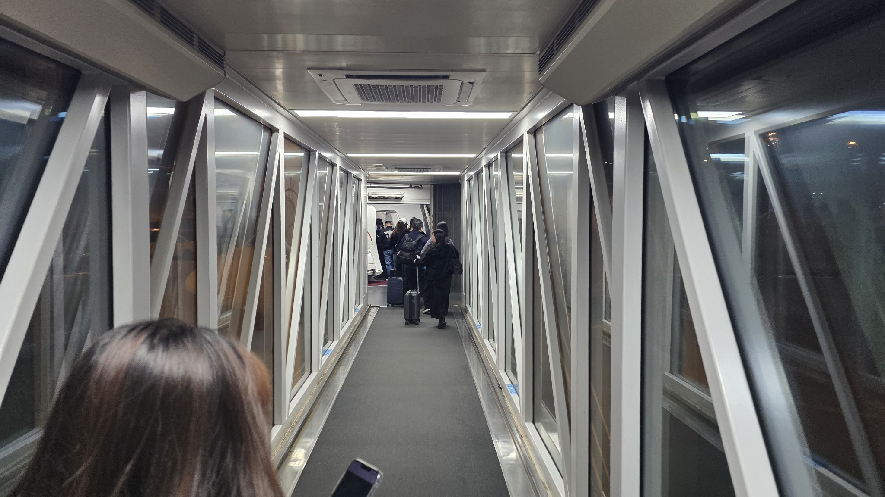
  <figcaption>搭乗橋。窓の外は暗くなっていました。</figcaption>
</figure>

## 11 月 21 日、ムアンボーラン

土曜日はムアンボーランに行ってきました。バンコク東部のサムットプラカーンにある野外博物館で、タイ各地の寺や建物を移して集めた場所です。1 日でタイ全体をざっと見るようなものです。

<figure>
  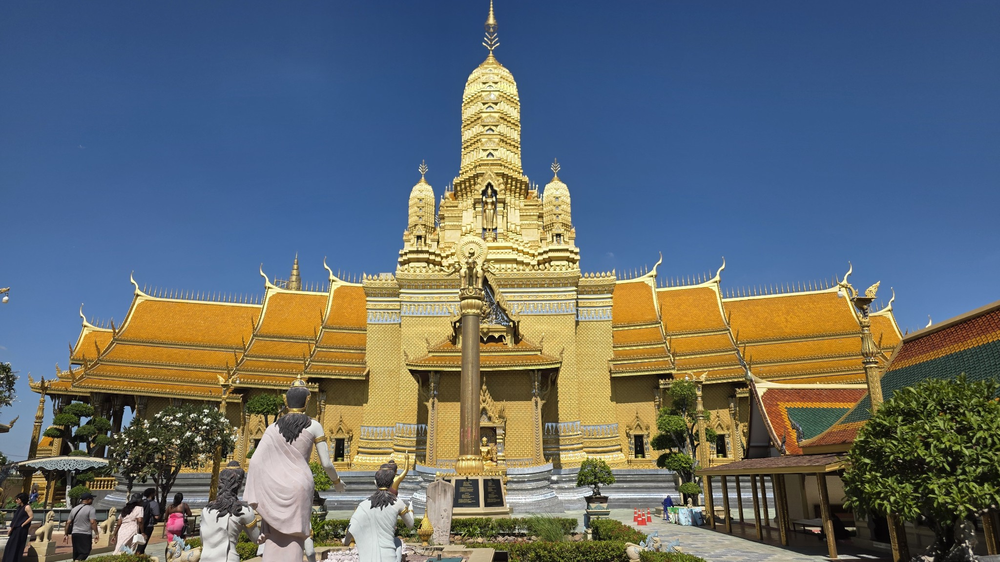
  <figcaption>入ってすぐに出会った金色の寺。屋根の色が特に濃かったです。</figcaption>
</figure>

<figure>
  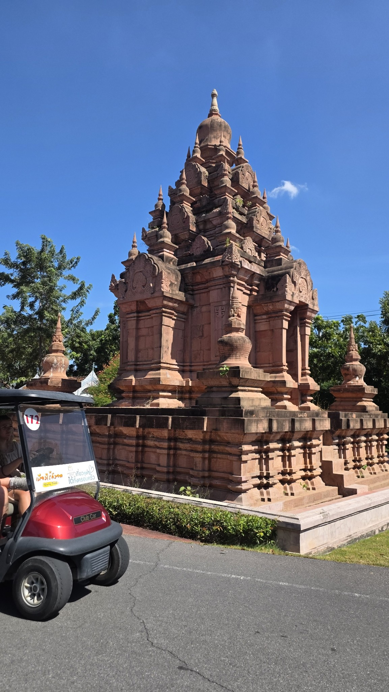
  <figcaption>金色の仏像。後ろは空がそのまま見えます。</figcaption>
</figure>

入場券を買って入り、ゴルフカートを借りました。歩いて回るには広すぎます。カートで寺の前に止めて、写真を撮って、また乗って、そんなふうに 1 日を過ごしました。

<figure>
  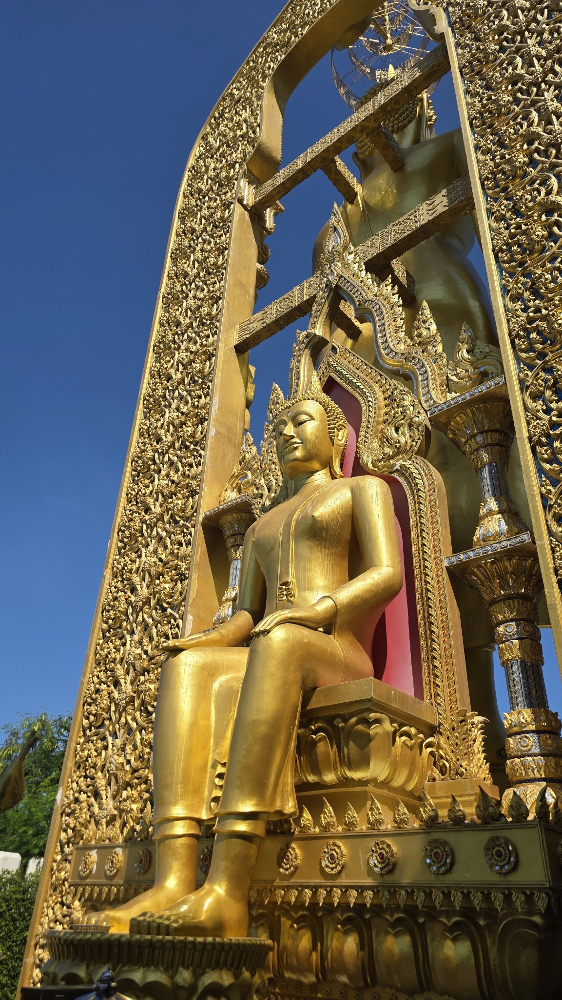
  <figcaption>172 番のカート。この番号を覚えておくと後で車を探しやすいです。</figcaption>
</figure>

<figure>
  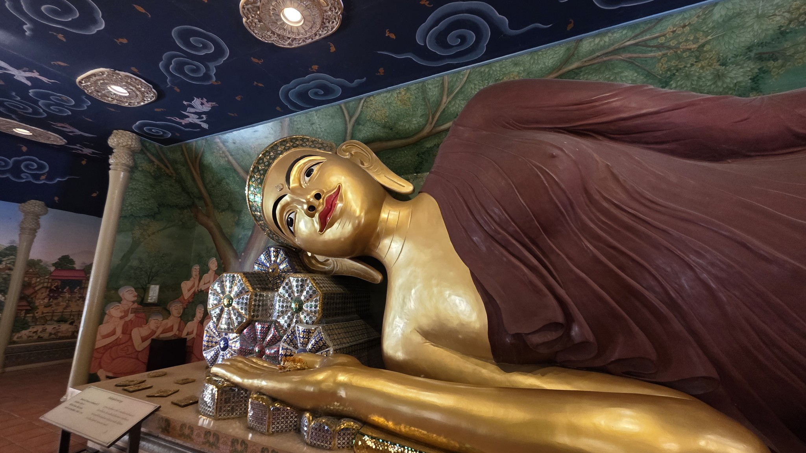
  <figcaption>横たわる仏像。天井まで絵がびっしりでした。</figcaption>
</figure>

いちばん記憶に残ったのは水の上に建つ楼閣でした。池の真ん中へ橋が続き、橋を渡ると建物が出てきます。写真を撮る人が多くて、しばらく立っている必要がありました。

<figure>
  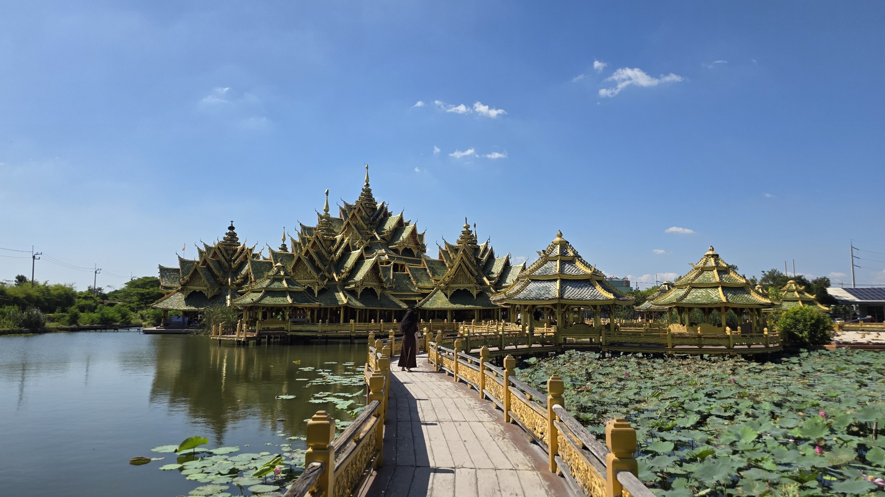
  <figcaption>池の上の楼閣。橋のたもとに立つと写真がよく撮れます。</figcaption>
</figure>

<figure>
  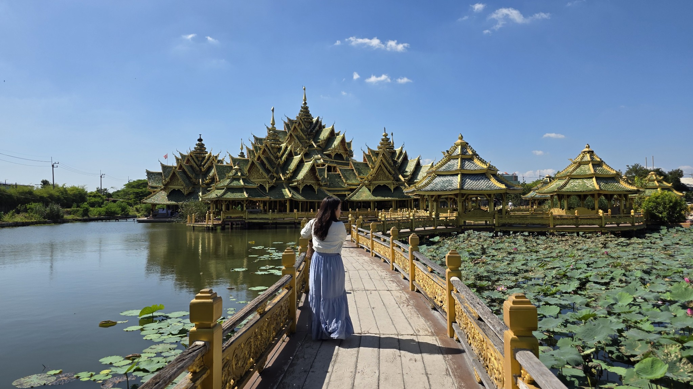
  <figcaption>同じ場所でもう 1 枚。午前なので日差しは強くありませんでした。</figcaption>
</figure>

<figure>
  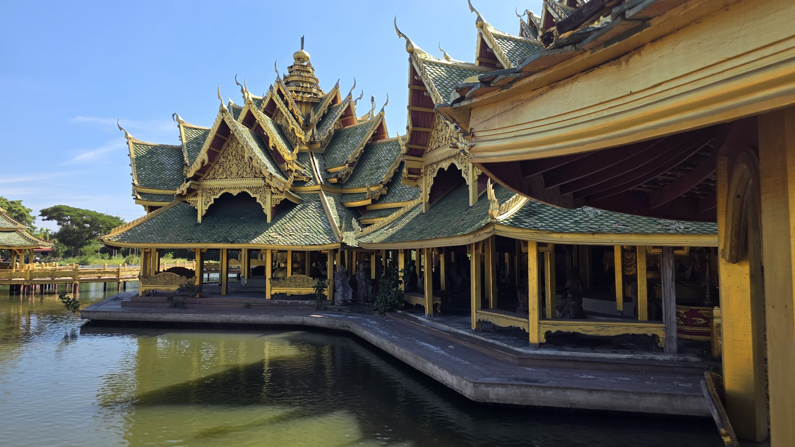
  <figcaption>横から見た姿。柱はすべて木でした。</figcaption>
</figure>

昼食は近くのカフェで食べました。Le Lert Cafe。名前はカフェですが、ごはんもちゃんと出ます。カニ炒飯、トムヤムクン、豚バラの揚げ物を頼んで、スイカジュースで締めました。暑い日だったのでトムヤムクンのスープが特に良かったです。

<figure>
  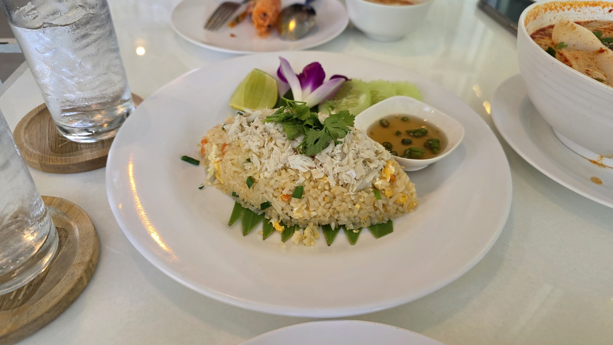
  <figcaption>カニ炒飯。上にカニがたっぷり乗っています。</figcaption>
</figure>

<figure>
  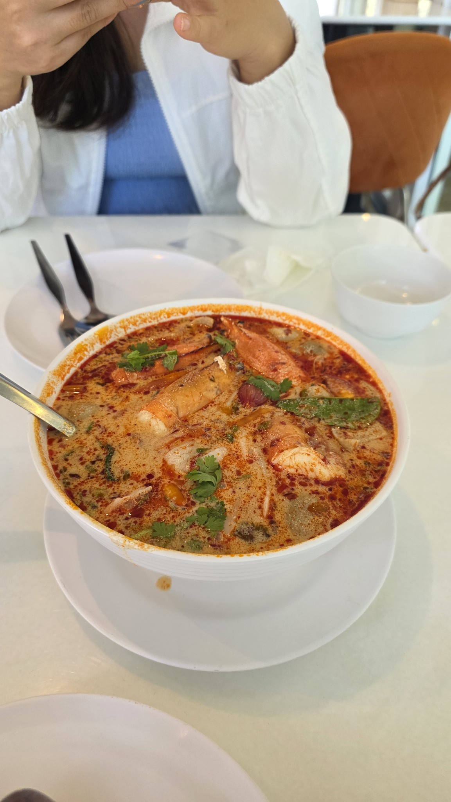
  <figcaption>トムヤムクン。エビが大きく、スープが濃かったです。</figcaption>
</figure>

<figure>
  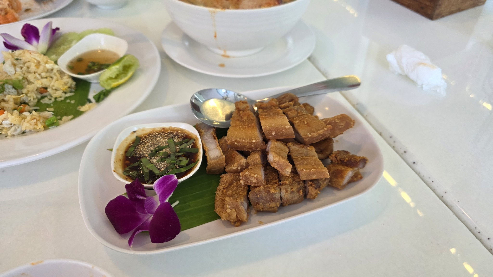
  <figcaption>豚バラの揚げ物。醤油ダレにつけて食べます。</figcaption>
</figure>

<figure>
  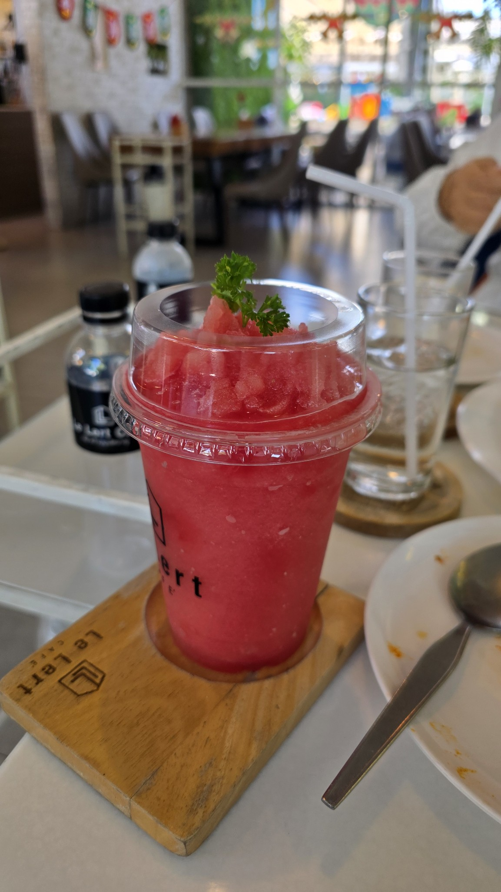
  <figcaption>スイカジュース。氷がすぐ溶けるので早く飲まないといけません。</figcaption>
</figure>

## 11 月 22 日、寺に寄って街を歩いた日

日曜日は川側の寺から見ました。ワット・アルンは川辺に立つ寺です。中央の塔がひときわ高く、表面が小さな陶器の破片で覆われています。下から見上げると、破片がひとつひとつ違います。

<figure>
  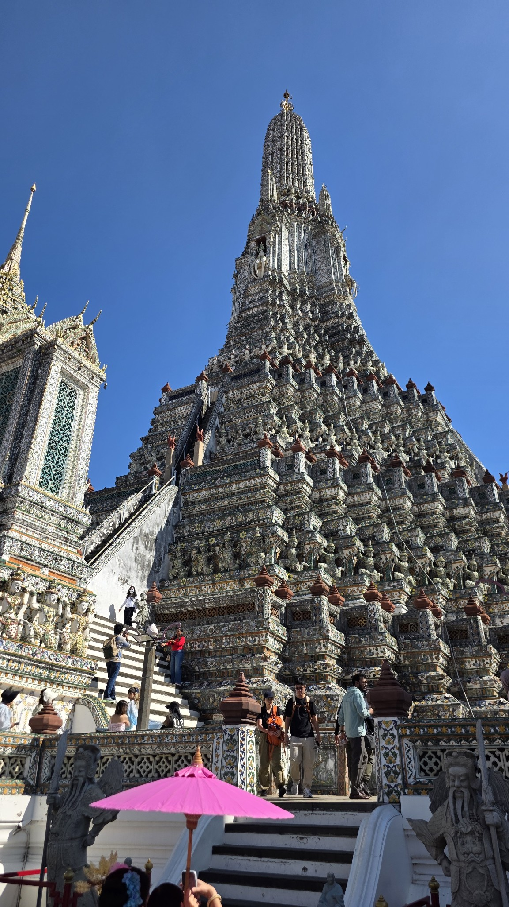
  <figcaption>ワット・アルンの中央塔。近くで見ると表面がすべて小さな陶器の破片です。</figcaption>
</figure>

塔の横の階段には人が絶えませんでした。写真を撮る人が多くて、下からしばらく見上げているだけでした。

続いてワット・ポーへ移動しました。巨大な涅槃仏で有名な寺です。入口から人が多かったです。

<figure>
  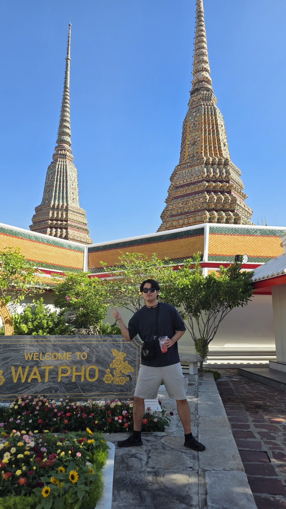
  <figcaption>ワット・ポーの入口。看板が大きいので、その前に立つと写真がよく撮れます。</figcaption>
</figure>

寺の奥には庭園がありました。大きな岩と石像が雑然と置かれていて、歩き回っていると写真を撮る場所が次々に出てきます。木が茂っているので日差しを避けるのにも良かったです。

<figure>
  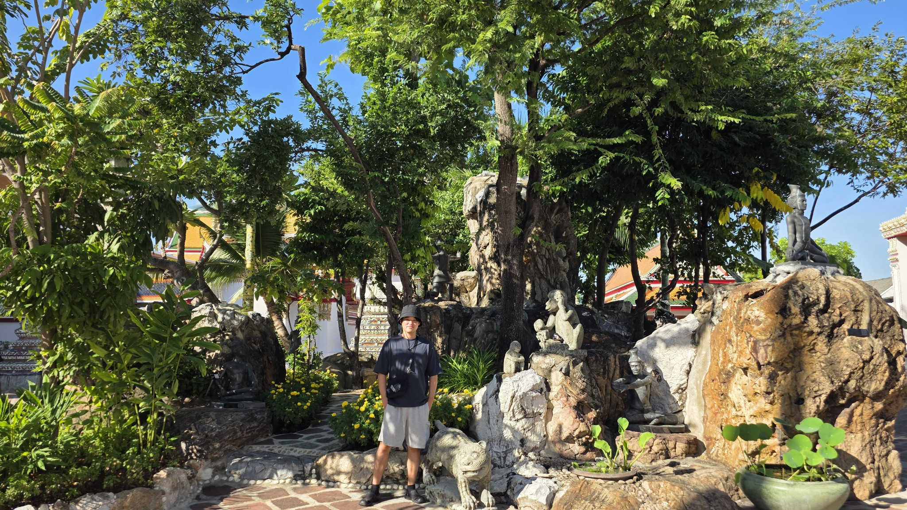
  <figcaption>ワット・ポー境内の庭園。岩のあいだに石像が立っています。</figcaption>
</figure>

寺を出てから街の方へ歩きました。ヤシの多い公園を通りました。時計塔のある公園でしたが、名前は控えていません。

<figure>
  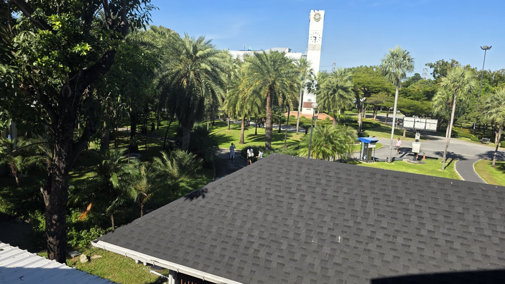
  <figcaption>ヤシのあいだから見える時計塔。人があまりいなくて静かでした。</figcaption>
</figure>

歩道橋の階段を下りて大通りを渡りました。バンコクの歩道橋は階段が長くて、下りるだけでかなり時間がかかります。

<figure>
  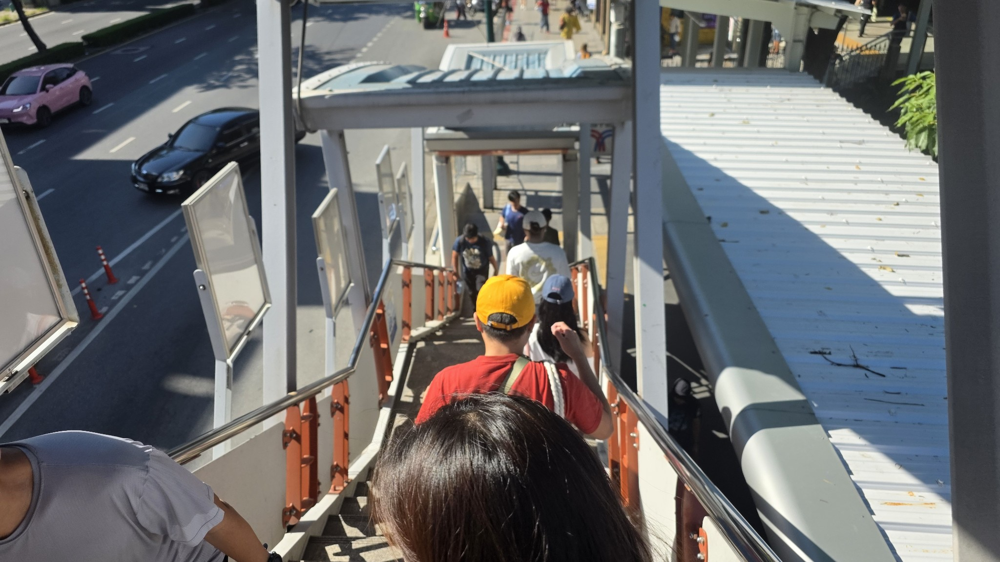
  <figcaption>歩道橋の階段。下では車が絶え間なく通っています。</figcaption>
</figure>

昼食はスクンビット 26 のルンルアンで食べました。ミシュランに載った豚肉麺の店です。早めに行ったので待たずに座れました。米麺と和え麺をひとつずつ、それに魚の皮の揚げ物を頼みました。スープは澄んでいて味は濃くありません。魚の皮はパリッとしていて塩気があり、麺と一緒に食べるとちょうど良かったです。

<figure>
  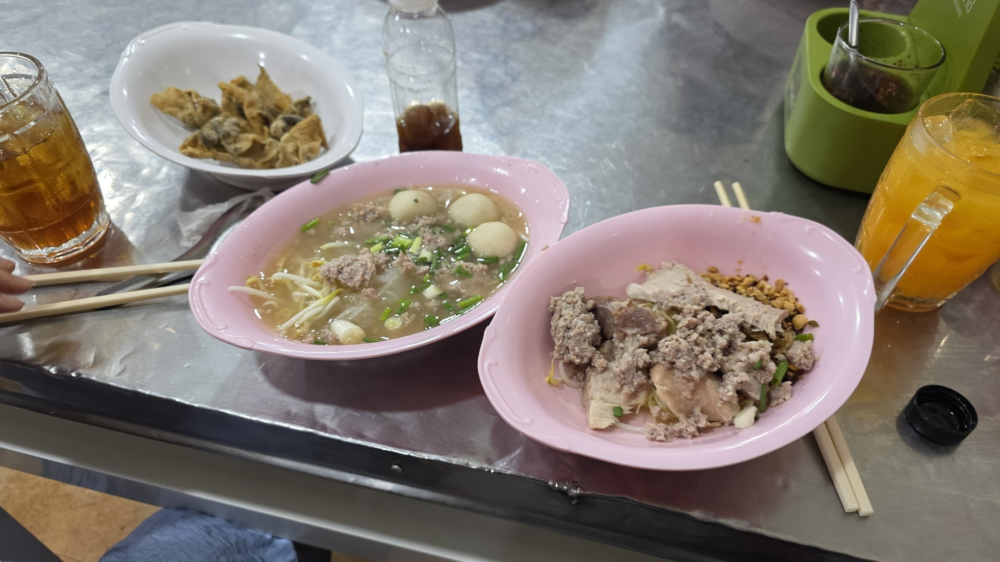
  <figcaption>ルンルアンの米麺と和え麺、魚の皮揚げ。</figcaption>
</figure>

<figure>
  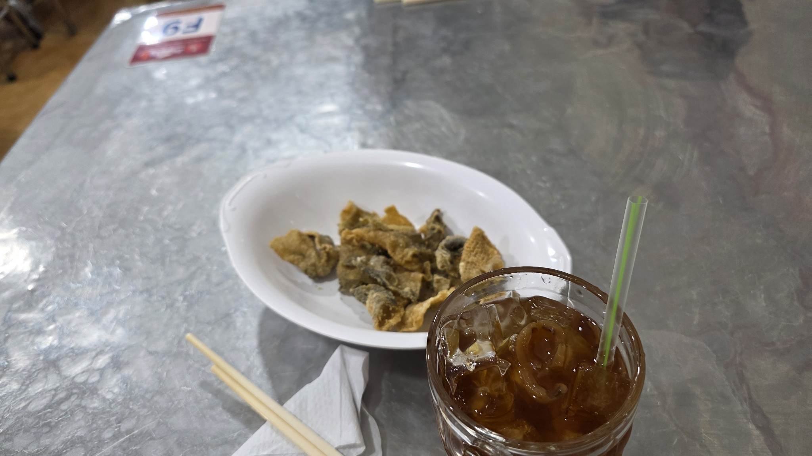
  <figcaption>魚の皮揚げとアイスティー。テーブルは銀色のステンレスでした。</figcaption>
</figure>

夕食はタイ料理の店で食べました。プーパッポンカリー、ソムタム、パッブンファイデーン炒めにごはんを添えました。

プーパッポンカリーはカニが 1 匹丸ごと入ったカレーです。黄色いカレーにカニ身をほぐして入れてあり、ごはんに乗せて食べます。汁気は多くないので、ごはんがあったほうが本領を発揮します。

<figure>
  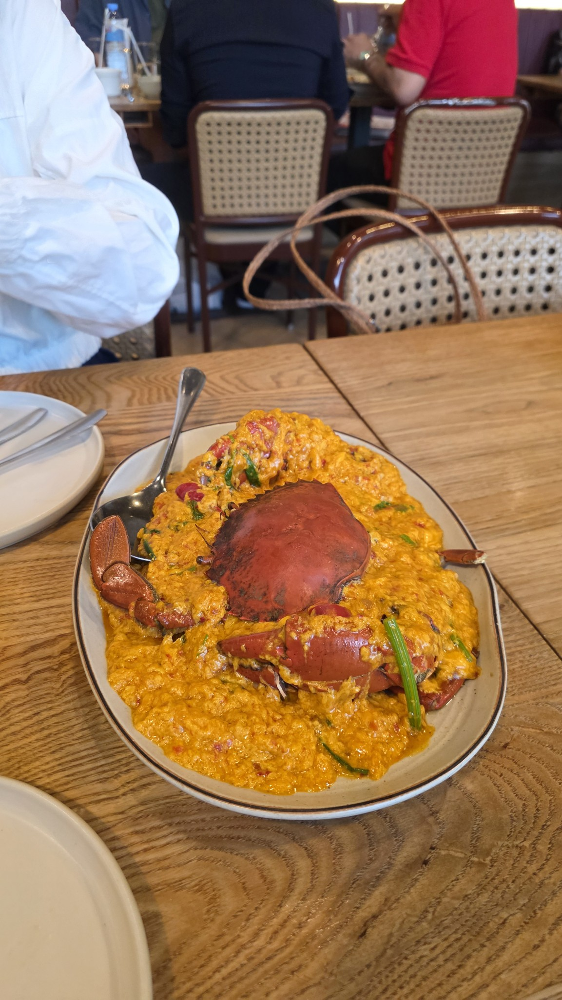
  <figcaption>プーパッポンカリー。カニ 1 匹がカレーの上に丸ごと乗っています。</figcaption>
</figure>

ソムタムは青パパイヤを細切りにしたサラダです。酸っぱく辛い味付けにピーナッツが入ります。暑い日に食欲をそそる味です。

<figure>
  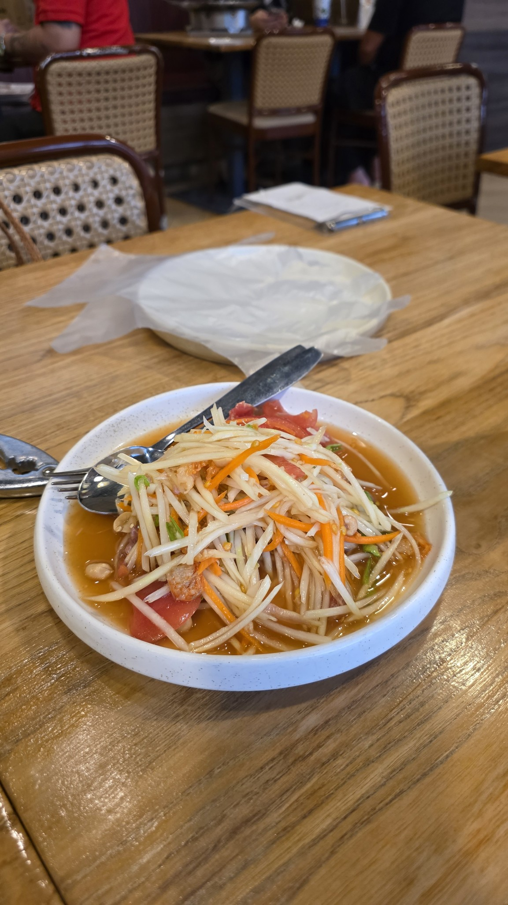
  <figcaption>ソムタム。パパイヤの細切りにトマトとピーナッツが入ります。</figcaption>
</figure>

パッブンファイデーンは空芯菜の炒め物です。強火でさっと炒めるので茎がシャキッとしています。ごはんと一緒に出てきます。

<figure>
  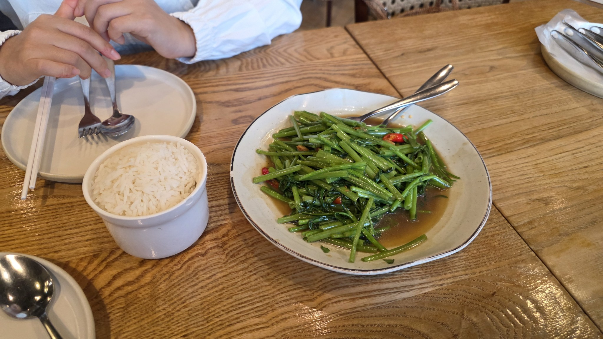
  <figcaption>パッブンファイデーン。空芯菜の茎を強火で炒めました。</figcaption>
</figure>

<figure>
  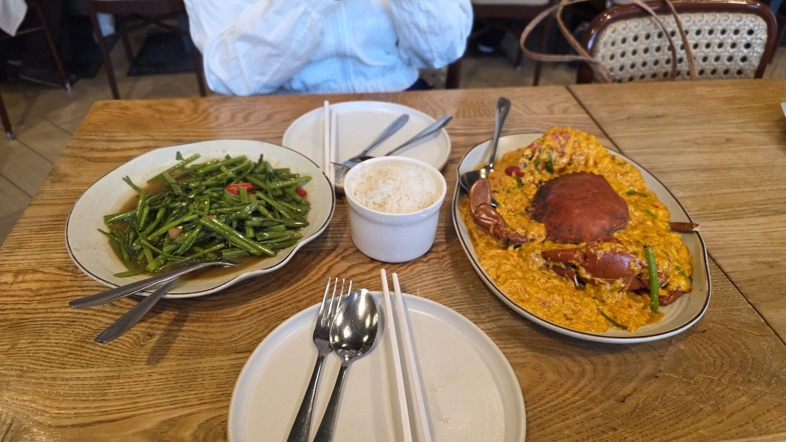
  <figcaption>一卓そろった様子。3 皿にごはん 1 杯で、2 人には十分でした。</figcaption>
</figure>

## 11 月 23 日、ダムヌンサドゥアック水上マーケットとメークロン線路

月曜日は半日ツアーを挟んで動きました。アソーク駅発のダムヌンサドゥアック水上マーケット・メークロン線路ツアーでした。朝にバスで 1 時間ほど走ってダムヌンサドゥアックに着きました。水路の両側に舟を着けて商売する姿がそのまま残っていました。

午後はメークロン市場に行きました。列車が通る線路の上に市場が立っている場所です。列車が来るという放送が流れると、商人たちは売り台と傘を畳み、人々は壁側に寄ります。数分後に列車が目の前を通ります。音は思ったより大きくなく、通り過ぎると市場がまた広がります。

<figure>
  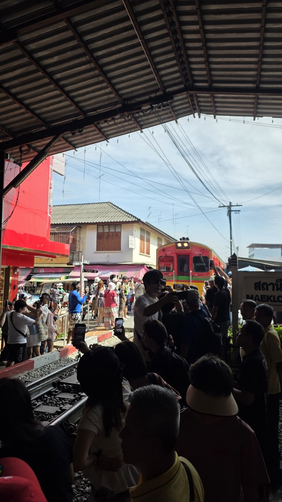
  <figcaption>線路に入ってくる列車。みんなスマートフォンを構えていました。</figcaption>
</figure>

## 11 月 24 日、ナイトマーケットに行った日

火曜日は何も決めずに街で過ごしました。昼食はパッタイ。エビが丸ごと乗ったパッタイで、もやしとニラ、ピーナッツ粉を混ぜて食べます。

<figure>
  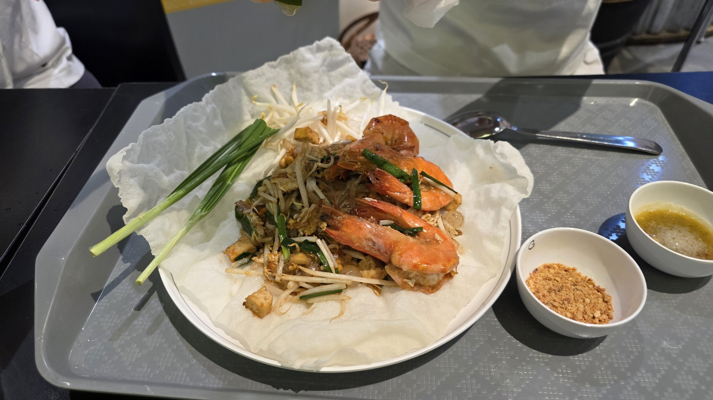
  <figcaption>エビのパッタイ。皿に盛られ、ピーナッツ粉と唐辛子が別に付きます。</figcaption>
</figure>

暑い午後にはチョコレート飲料を 1 杯飲みました。

<figure>
  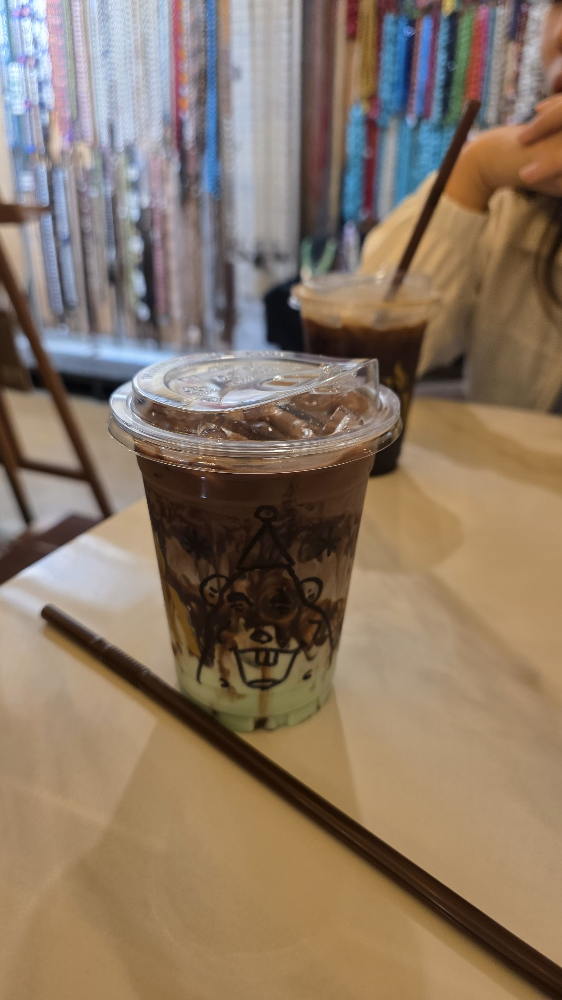
  <figcaption>チョコレート飲料。カップに絵が描かれていました。</figcaption>
</figure>

歩いていてトーストを 1 つ買って食べました。ハムとチーズを挟んで焼き押さえたパンで、外はパリッと、中は熱いです。

<figure>
  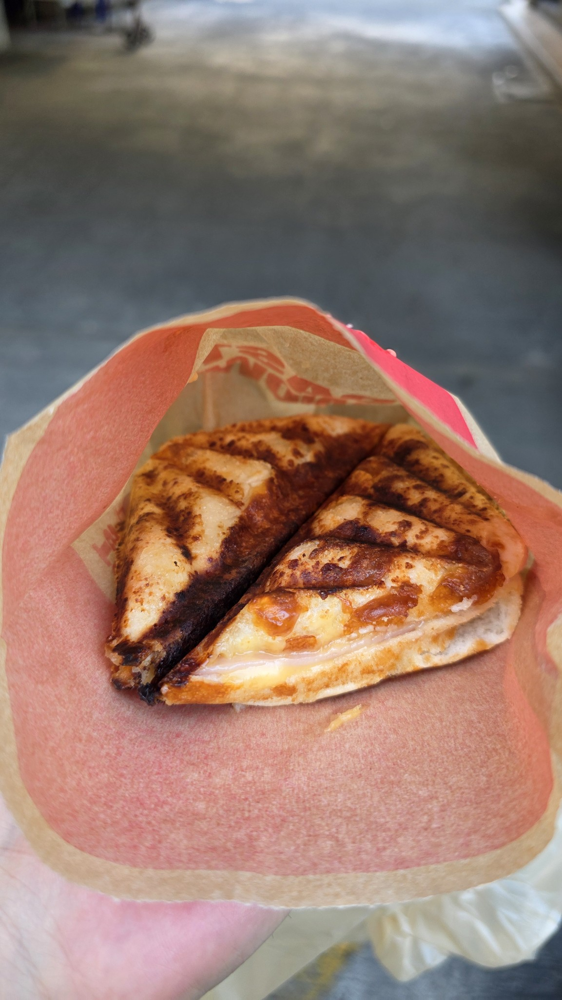
  <figcaption>ハムチーズトースト。紙袋に入れてくれます。</figcaption>
</figure>

隣では鉄板で焼き餃子を焼いていました。大きな鉄板 2 枚に餃子を並べ、底に焼き色が付くとひっくり返します。通りがかりに 1 皿買って食べました。

<figure>
  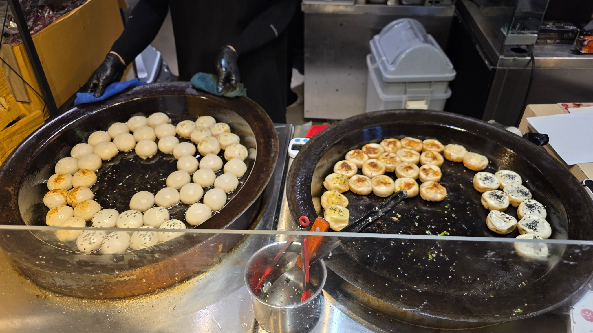
  <figcaption>鉄板の焼き餃子。手前の鉄板はまだ白く、奥は焼き色が付いています。</figcaption>
</figure>

抹茶飲料も 1 杯飲みました。KAMU TEA という店で、カップに花が印刷されていました。

<figure>
  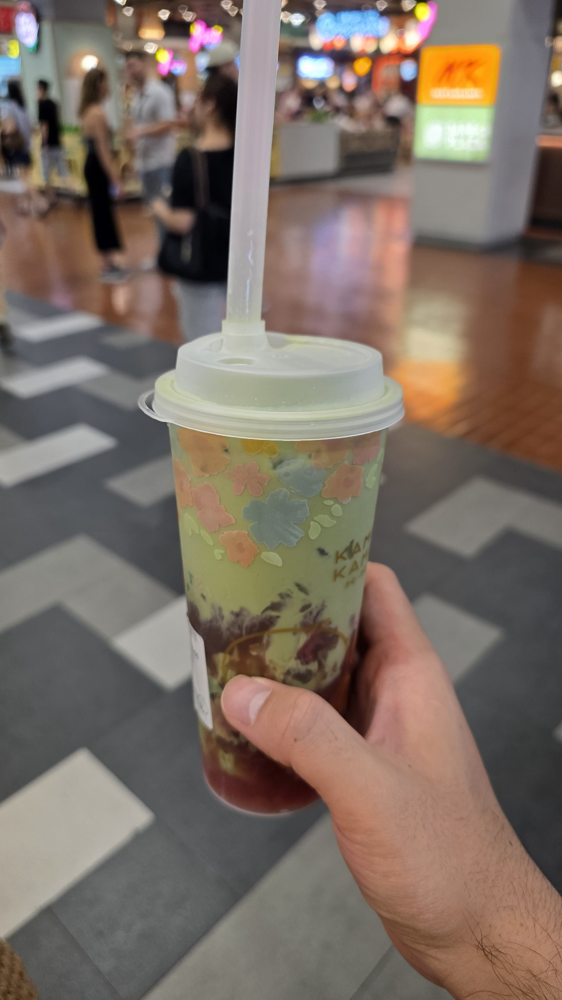
  <figcaption>抹茶飲料。カップの表面に花がたくさん描かれています。</figcaption>
</figure>

Dairy Queen に寄ってブリザードを 2 つ頼みました。チョコにモルティーザーが入ったものと、オレオが入ったものです。カップに入ったソフトクリームも 1 つ買って食べました。

<figure>
  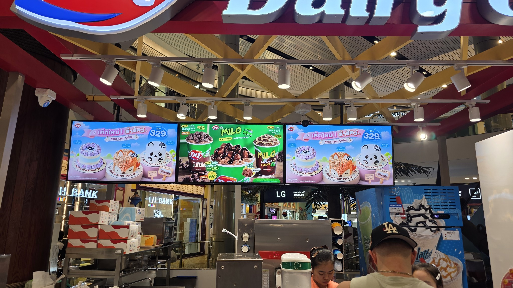
  <figcaption>Dairy Queen の店舗。モール内のフードコートの一角にありました。</figcaption>
</figure>

<figure>
  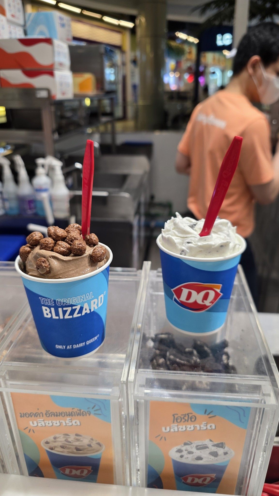
  <figcaption>ブリザード 2 つ。左はチョコにモルティーザー、右はオレオが入っています。</figcaption>
</figure>

<figure>
  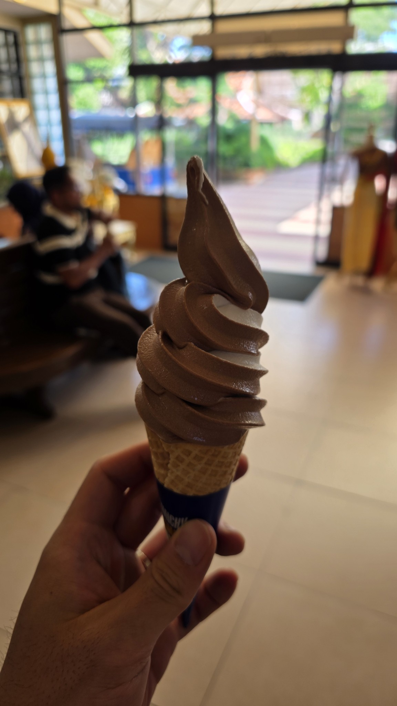
  <figcaption>チョコのソフトクリーム。コーンの上までチョコで満たしてくれます。</figcaption>
</figure>

スーパーに寄ってヤードムを買いました。タイに来ると必ず買うものです。棚に種類がとても多いので、香りをひとつずつ嗅いでいくつかだけ手に取ってきました。

<figure>
  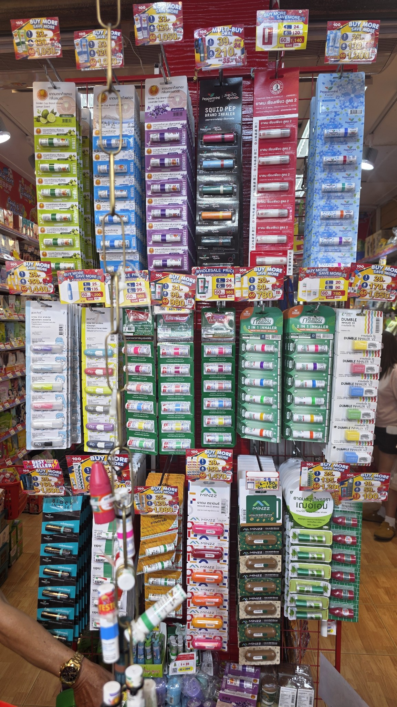
  <figcaption>ヤードムの棚。同じ名前なのに香りがみんな違います。</figcaption>
</figure>

夕食はナイトマーケットで食べました。大きな道路沿いにコンテナの店と屋台が長く続き、真ん中にテーブルが置かれています。人が多くて空席を探すのは簡単ではありませんでした。

<figure>
  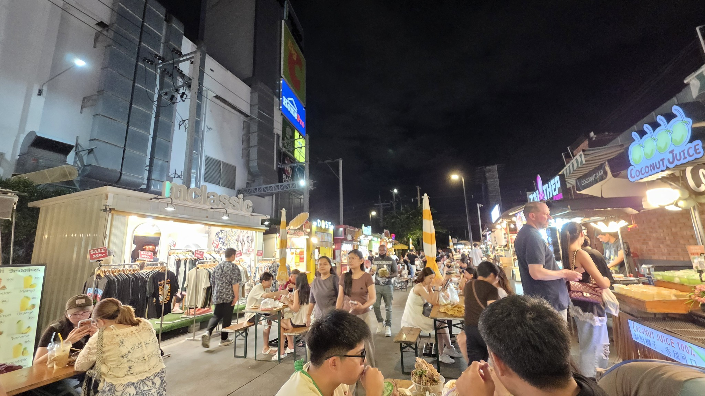
  <figcaption>ナイトマーケットの通り。服屋と食べ物の屋台が交互に続きます。</figcaption>
</figure>

食べたいものを 1 つずつ買ってきて 1 つのテーブルに集めて食べる方式です。まずレンサップを買ってきました。豚の背骨を辛いスープで煮た料理で、青唐辛子がたっぷり乗っています。スープは澄んでいますが辛さはかなり強いです。

<figure>
  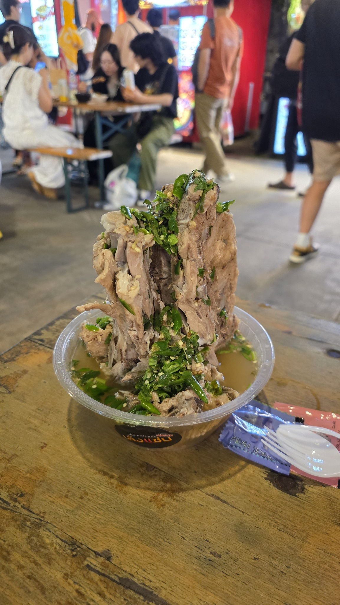
  <figcaption>レンサップ。豚の背骨を煮たスープに青唐辛子を入れています。</figcaption>
</figure>

パイナップル炒飯も 1 つ頼みました。パイナップルを半分に割って中をくり抜き、炒飯を詰めて出します。上にエビとピーナッツ、干し肉が乗ります。

<figure>
  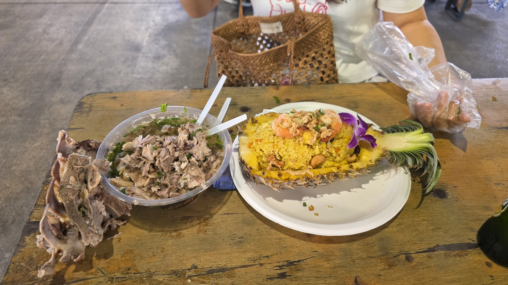
  <figcaption>パイナップル炒飯とレンサップ。パイナップルの皮を器にします。</figcaption>
</figure>

デザートにドリアンを食べました。ナイトマーケットで剥いて売っているので、すぐ食べられます。匂いが強いのでためらう人も多いですが、味は甘くてクリームのようです。

<figure>
  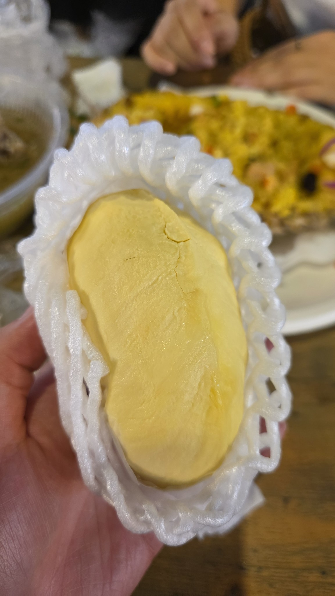
  <figcaption>ドリアン。ナイトマーケットのテーブルでそのまま剥いて食べました。</figcaption>
</figure>

食べ残したドリアンとお菓子は宿に持ち帰りました。部屋で出してみると、さっきのブリザードのカップまで加わってテーブルがいっぱいになりました。

<figure>
  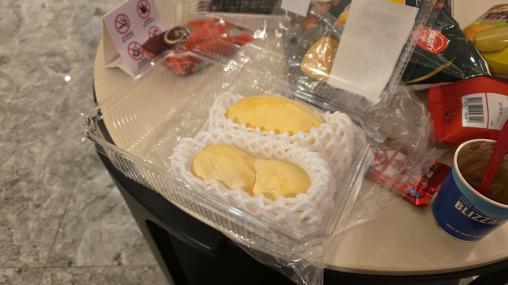
  <figcaption>宿で食べたドリアンとお菓子。ブリザードのカップも一緒にありました。</figcaption>
</figure>

## 11 月 25 日、帰国

水曜日に帰りました。6 日間は短くも長くもありませんでした。また行くなら、ムアンボーランは朝早く、メークロンは午前のツアーで行くと思います。
