<dl class="facts">
  
<dt>기간</dt><dd>5<small>박</small> 6<small>일</small></dd>

  
<dt>도시</dt><dd>방콕</dd>

  
<dt>주요 코스</dt><dd>무앙보란·매끌렁</dd>

  
<dt>사진</dt><dd>20<small>장</small></dd>

</dl>

6일 동안 방콕에 다녀왔습니다. 미리 예약해 둔 건 두 개였습니다. 무앙보란 입장권과 담넌사두억 수상시장·매끌렁 기찻길 반일 투어. 나머지 날은 그때그때 정해서 움직였습니다.

| 날짜 | 다녀온 곳 |
|---|---|
| 11/20 (금) | 출국, 방콕 도착 |
| 11/21 (토) | 무앙보란, Le Lert Cafe |
| 11/22 (일) | 시내 산책, 룽르엉 |
| 11/23 (월) | 담넌사두억 수상시장, 매끌렁 기찻길 |
| 11/24 (화) | 시내에서 하루 |
| 11/25 (수) | 귀국 |

## 11월 20일, 공항에서 냉면부터

출국은 금요일 저녁이었습니다. 들어가기 전에 공항에서 저녁을 먹었습니다. 냉면과 만두였습니다. 며칠 동안 한식은 못 먹을 테니 미리 먹어 두는 셈이었습니다.

<figure>
  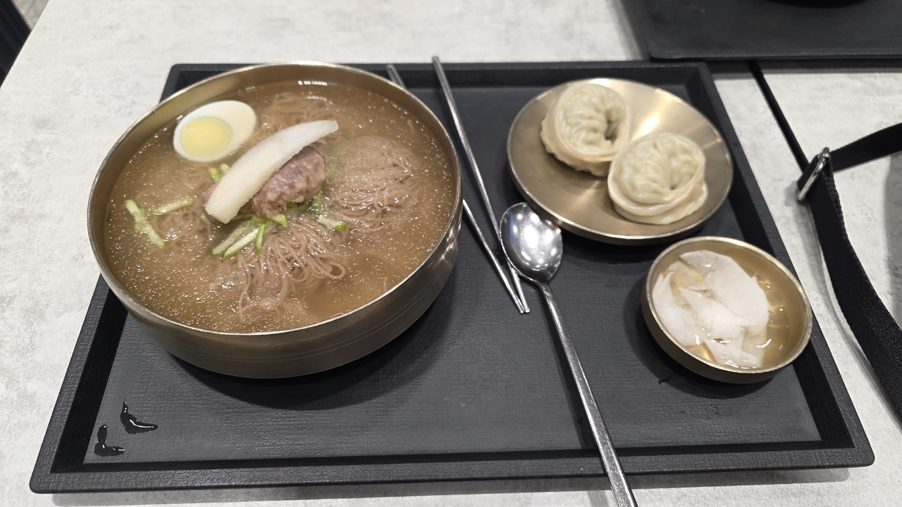
  <figcaption>출국 전에 먹은 냉면과 만두. 국물이 시원해서 좋았습니다.</figcaption>
</figure>

탑승교 창밖은 이미 어두웠습니다. 방콕까지 다섯 시간 남짓, 자다 보면 도착하는 거리였습니다.

<figure>
  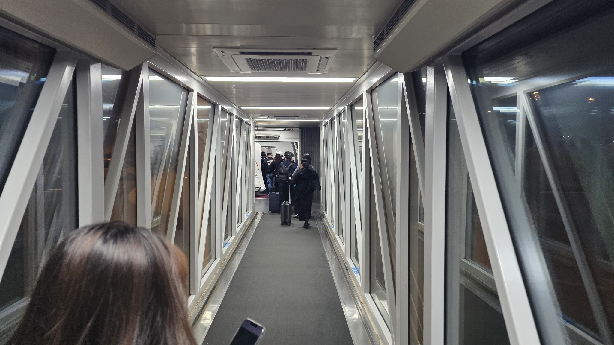
  <figcaption>탑승교. 창밖은 어두웠습니다.</figcaption>
</figure>

## 11월 21일, 무앙보란

토요일은 무앙보란에 다녀왔습니다. 방콕 동쪽 사뭇프라칸에 있는 야외 박물관으로, 태국 곳곳의 사원과 건물을 옮겨다 모아 놓은 곳입니다. 하루에 태국 전체를 훑는 셈입니다.

<figure>
  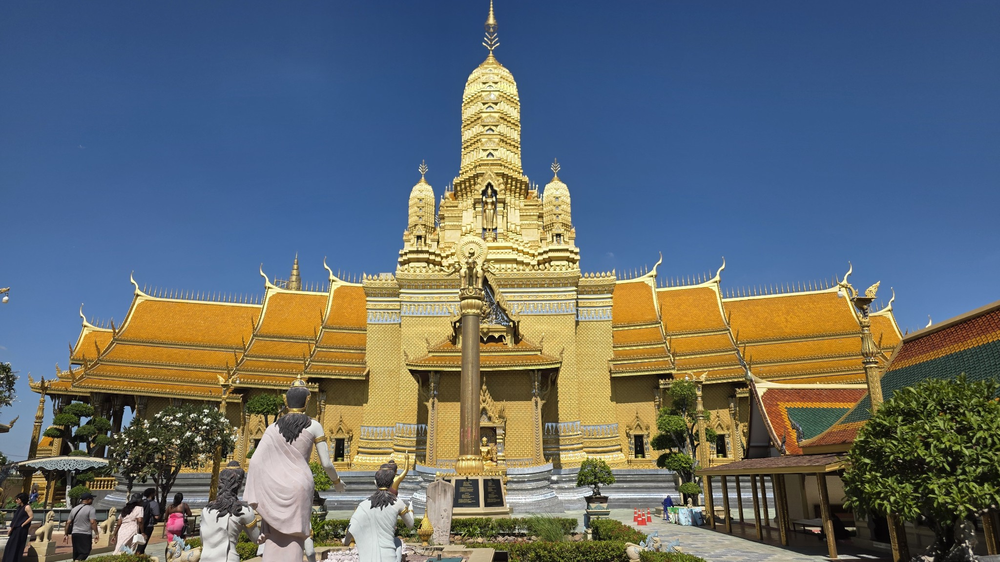
  <figcaption>들어가자마자 만난 금빛 사원. 지붕 색이 유난히 진했습니다.</figcaption>
</figure>

<figure>
  
  <figcaption>금빛 불상. 뒤로는 하늘이 그대로 보입니다.</figcaption>
</figure>

입장권을 끊고 들어가서 골프카트를 빌렸습니다. 걸어서 돌기에는 너무 넓습니다. 카트를 타고 사원 앞에 세우고, 사진을 찍고, 다시 타고, 그렇게 하루를 보냈습니다.

<figure>
  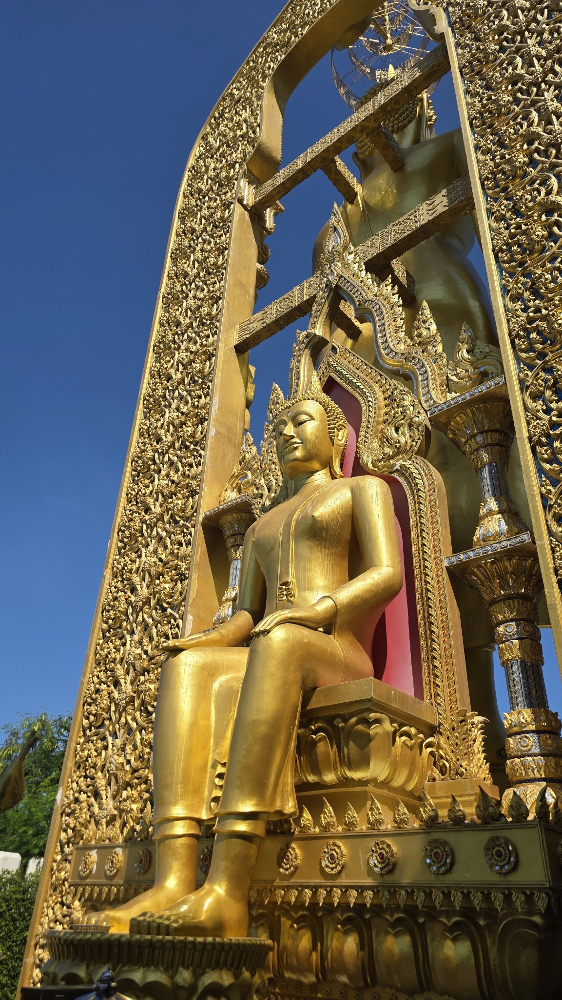
  <figcaption>172번 카트. 이 번호를 기억해 두면 나중에 차를 찾기 쉽습니다.</figcaption>
</figure>

<figure>
  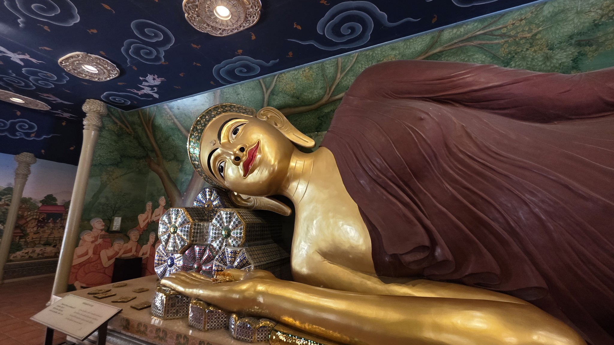
  <figcaption>누워 있는 불상. 천장까지 그림이 빼곡했습니다.</figcaption>
</figure>

가장 기억에 남은 건 물 위에 세운 누각이었습니다. 연못 한가운데로 다리가 이어져 있고, 다리를 건너면 건물이 나옵니다. 사진을 찍는 사람이 많아서 한참 서 있어야 했습니다.

<figure>
  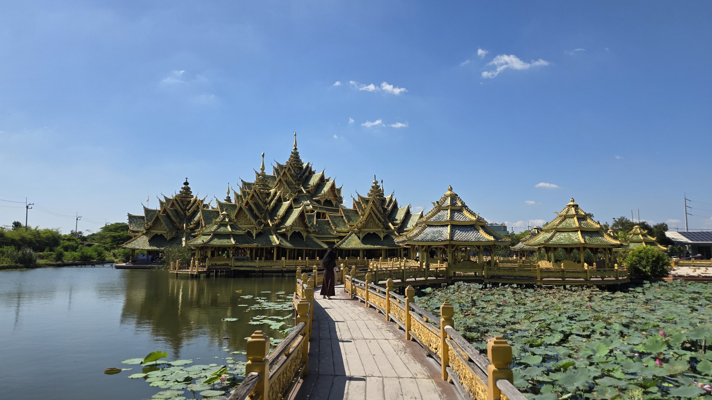
  <figcaption>연못 위의 누각. 다리 끝에 서면 사진이 잘 나옵니다.</figcaption>
</figure>

<figure>
  
  <figcaption>같은 자리에서 한 장 더. 오전이라 볕이 세지 않았습니다.</figcaption>
</figure>

<figure>
  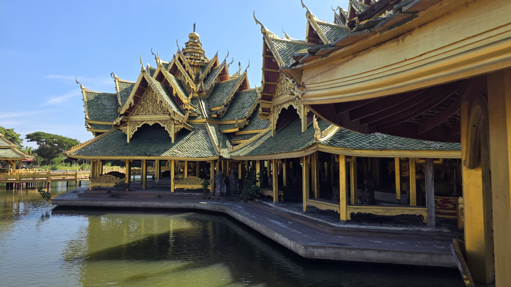
  <figcaption>옆에서 본 모습. 기둥이 전부 나무였습니다.</figcaption>
</figure>

점심은 근처 카페에서 먹었습니다. Le Lert Cafe. 이름은 카페인데 밥도 제대로 나옵니다. 게살 볶음밥, 똠얌꿍, 삼겹살 튀김을 시키고 수박주스로 마무리했습니다. 더운 날이라 똠얌꿍 국물이 특히 좋았습니다.

<figure>
  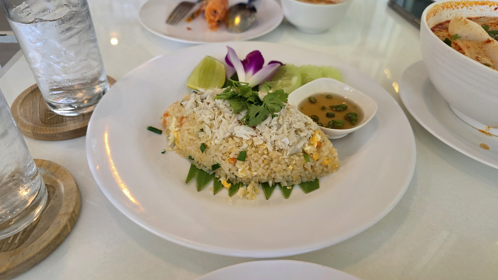
  <figcaption>게살 볶음밥. 위에 게살이 넉넉히 올라갑니다.</figcaption>
</figure>

<figure>
  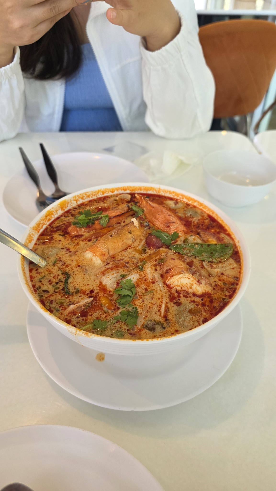
  <figcaption>똠얌꿍. 새우가 크고 국물이 진했습니다.</figcaption>
</figure>

<figure>
  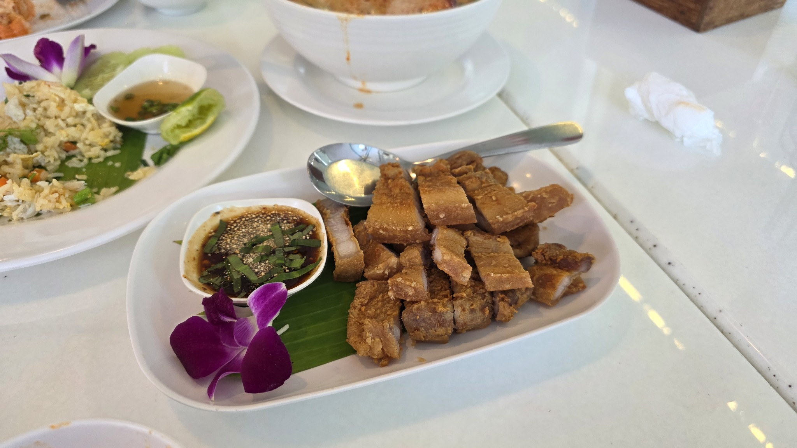
  <figcaption>삼겹살 튀김. 간장 소스에 찍어 먹습니다.</figcaption>
</figure>

<figure>
  
  <figcaption>수박주스. 얼음이 금방 녹아서 빨리 마셔야 합니다.</figcaption>
</figure>

## 11월 22일, 시내를 걸은 날

일요일은 시내에서 보냈습니다. 아침에 야자수 많은 공원을 지나 걸었습니다. 시계탑이 있는 공원이었는데 이름은 적어 두지 않았습니다.

<figure>
  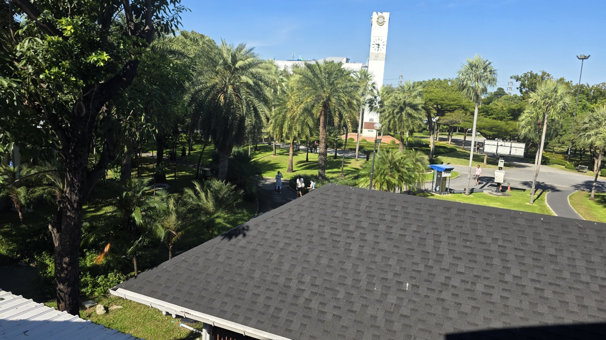
  <figcaption>야자수 사이로 보이는 시계탑. 사람이 별로 없어서 조용했습니다.</figcaption>
</figure>

육교 계단을 내려와 큰길을 건넜습니다. 방콕 육교는 계단이 길어서 내려오는 데만 한참 걸립니다.

<figure>
  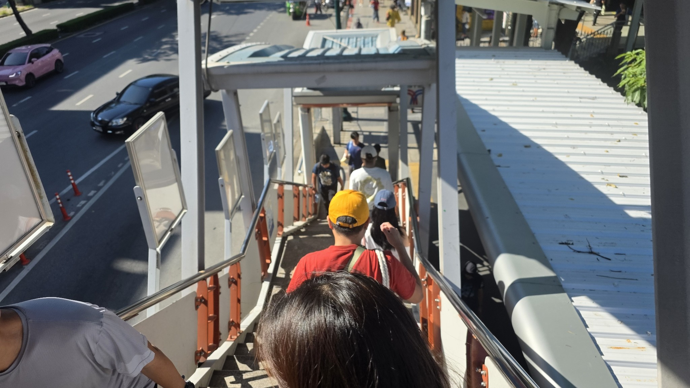
  <figcaption>육교 계단. 아래로 차들이 쉬지 않고 지나갑니다.</figcaption>
</figure>

점심은 수쿰빗 26의 룽르엉에서 먹었습니다. 미슐랭에 오른 돼지고기 국수집입니다. 일찍 갔더니 기다리지 않고 바로 앉았습니다. 쌀국수와 비빔국수 하나씩, 그리고 생선껍질 튀김을 시켰습니다. 국물은 맑고 간은 세지 않았습니다. 생선껍질은 바삭한데 짠맛이 있어서 국수와 같이 먹으면 딱 맞았습니다.

<figure>
  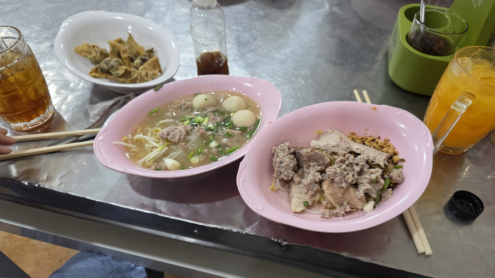
  <figcaption>룽르엉의 쌀국수와 비빔국수, 생선껍질 튀김.</figcaption>
</figure>

<figure>
  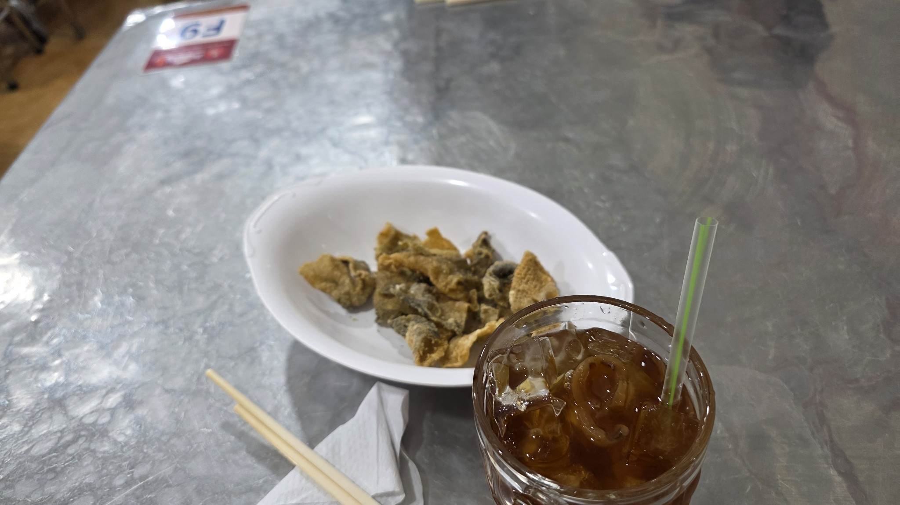
  <figcaption>생선껍질 튀김과 아이스티. 테이블이 은색 스테인리스였습니다.</figcaption>
</figure>

## 11월 23일, 담넌사두억 수상시장과 매끌렁 기찻길

월요일은 반일 투어를 끼고 움직였습니다. 아속역에서 출발하는 담넌사두억 수상시장·매끌렁 기찻길 투어였습니다. 아침에 버스를 타고 한 시간 남짓 달려 담넌사두억에 도착했습니다. 수로 양옆으로 배를 대고 장사하는 모습이 그대로 남아 있었습니다.

오후에는 매끌렁 시장에 갔습니다. 기차가 지나가는 기찻길 위에 시장이 서 있는 곳입니다. 기차가 온다는 방송이 나오면 상인들이 좌판과 우산을 접고, 사람들은 벽 쪽으로 붙습니다. 몇 분 뒤 기차가 코앞을 지나갑니다. 소리가 생각보다 크지 않았고, 지나가고 나면 시장이 다시 펼쳐집니다.

<figure>
  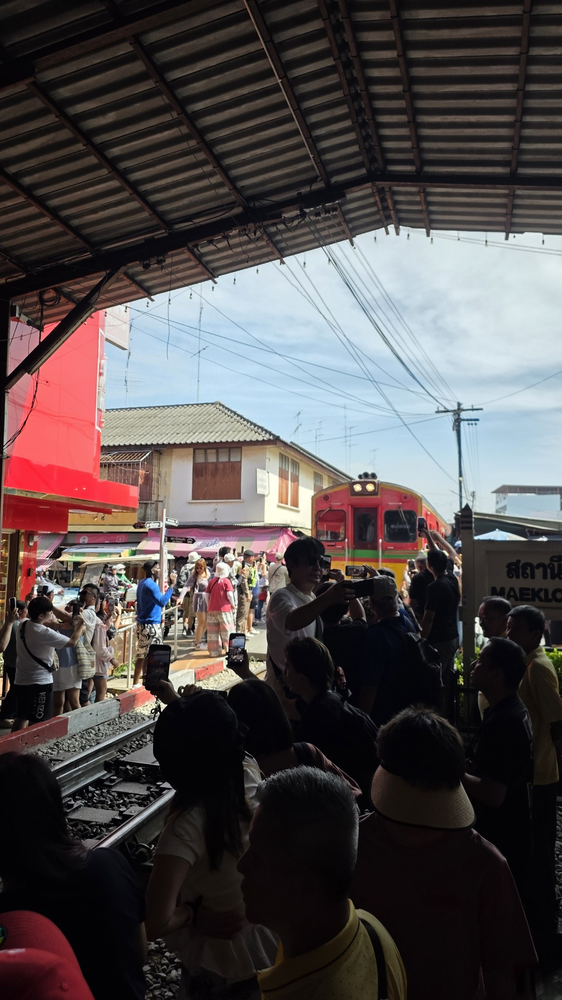
  <figcaption>기찻길로 들어오는 기차. 다들 휴대폰을 들고 있었습니다.</figcaption>
</figure>

## 11월 24일, 남은 하루

화요일은 아무것도 정하지 않고 시내에서 보냈습니다. 더운 오후에는 초코 음료를 한 잔 마셨습니다.

<figure>
  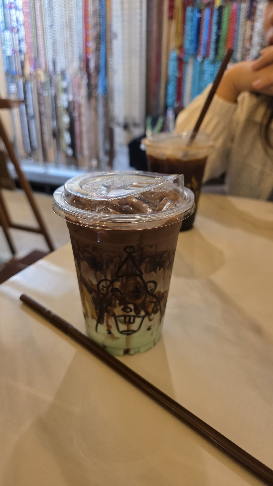
  <figcaption>초코 음료. 컵에 그림이 그려져 있었습니다.</figcaption>
</figure>

마트에 들러 야돔을 샀습니다. 태국에 오면 늘 사는 물건입니다. 진열대에 종류가 워낙 많아서 향을 하나씩 맡아 보고 몇 개만 집어 왔습니다.

<figure>
  
  <figcaption>야돔 진열대. 같은 이름인데 향이 다 다릅니다.</figcaption>
</figure>

## 11월 25일, 귀국

수요일에 돌아왔습니다. 6일은 짧지도 길지도 않았습니다. 다시 간다면 무앙보란은 아침 일찍, 매끌렁은 오전 투어로 갈 것 같습니다.

영상은 찍지 않았습니다. 사진과 글만 있는 기록입니다.
{: .note}
