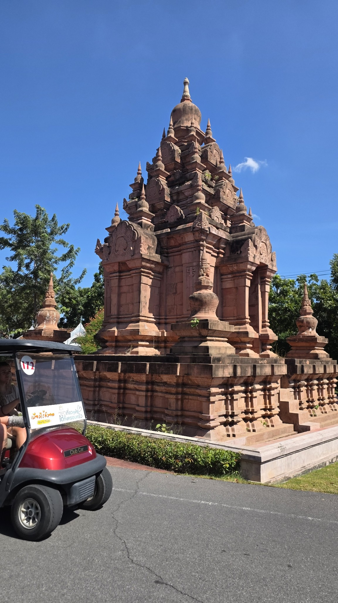
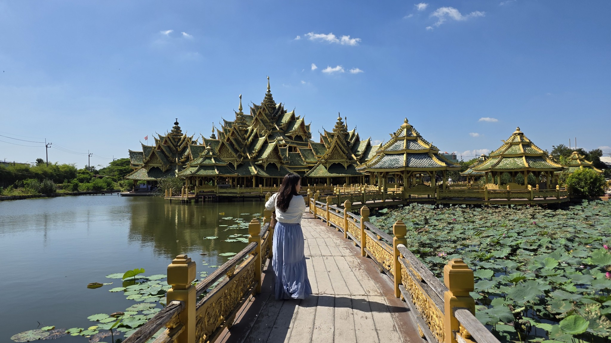
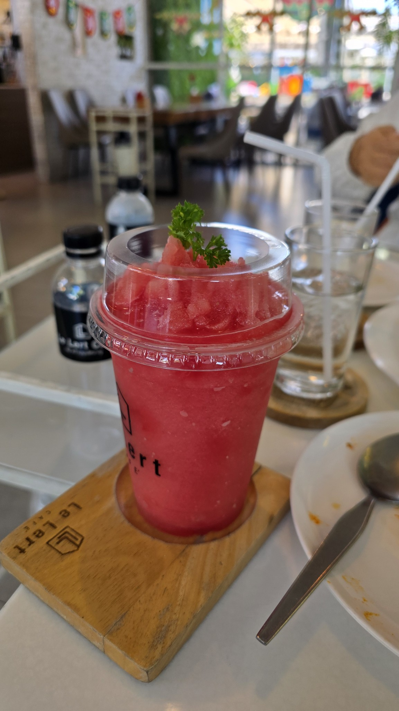
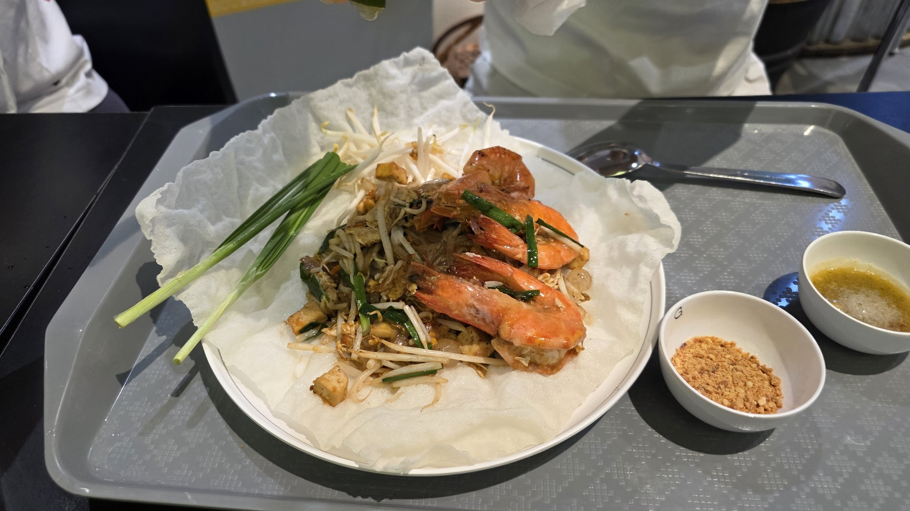
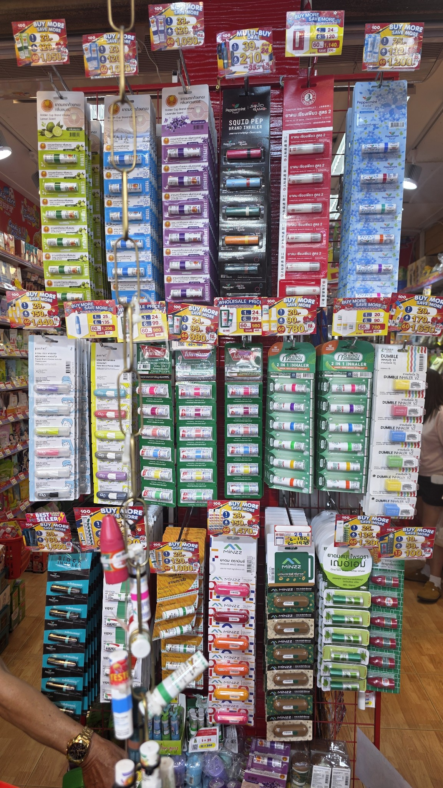
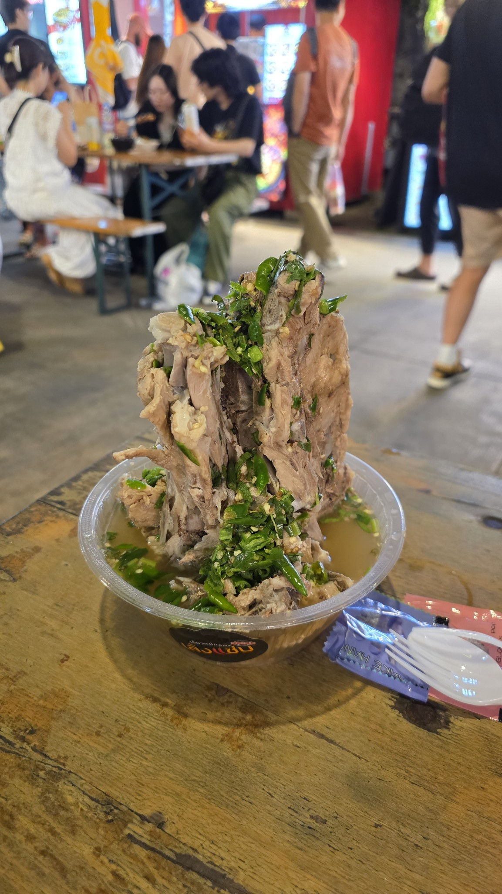

<dl class="facts">
  
<dt>기간</dt><dd>5<small>박</small> 6<small>일</small></dd>

  
<dt>도시</dt><dd>방콕</dd>

  
<dt>주요 코스</dt><dd>무앙보란·매끌렁</dd>

  
<dt>사진</dt><dd>39<small>장</small></dd>

</dl>

6일 동안 방콕에 다녀왔습니다. 미리 예약해 둔 건 두 개였습니다. 무앙보란 입장권과 담넌사두억 수상시장·매끌렁 기찻길 반일 투어. 나머지 날은 그때그때 정해서 움직였습니다. 사원에 들르고, 시내를 걷고, 마지막 날은 야시장에서 저녁을 먹었습니다.

| 날짜 | 다녀온 곳 |
|---|---|
| 11/20 (금) | 출국, 방콕 도착 |
| 11/21 (토) | 무앙보란, Le Lert Cafe |
| 11/22 (일) | 왓 아룬, 왓 포, 시내 산책, 룽르엉 |
| 11/23 (월) | 담넌사두억 수상시장, 매끌렁 기찻길 |
| 11/24 (화) | 시내, 야시장 |
| 11/25 (수) | 귀국 |

## 11월 20일, 공항에서 냉면부터

출국은 금요일 저녁이었습니다. 들어가기 전에 공항에서 저녁을 먹었습니다. 냉면과 만두였습니다. 며칠 동안 한식은 못 먹을 테니 미리 먹어 두는 셈이었습니다.

<figure>
  
  <figcaption>출국 전에 먹은 냉면과 만두. 국물이 시원해서 좋았습니다.</figcaption>
</figure>

탑승교 창밖은 이미 어두웠습니다. 방콕까지 다섯 시간 남짓, 자다 보면 도착하는 거리였습니다.

<figure>
  
  <figcaption>탑승교. 창밖은 어두웠습니다.</figcaption>
</figure>

## 11월 21일, 무앙보란

토요일은 무앙보란에 다녀왔습니다. 방콕 동쪽 사뭇프라칸에 있는 야외 박물관으로, 태국 곳곳의 사원과 건물을 옮겨다 모아 놓은 곳입니다. 하루에 태국 전체를 훑는 셈입니다.

<figure>
  
  <figcaption>들어가자마자 만난 금빛 사원. 지붕 색이 유난히 진했습니다.</figcaption>
</figure>

<figure>
  
  <figcaption>금빛 불상. 뒤로는 하늘이 그대로 보입니다.</figcaption>
</figure>

입장권을 끊고 들어가서 골프카트를 빌렸습니다. 걸어서 돌기에는 너무 넓습니다. 카트를 타고 사원 앞에 세우고, 사진을 찍고, 다시 타고, 그렇게 하루를 보냈습니다.

<figure>
  
  <figcaption>172번 카트. 이 번호를 기억해 두면 나중에 차를 찾기 쉽습니다.</figcaption>
</figure>

<figure>
  
  <figcaption>누워 있는 불상. 천장까지 그림이 빼곡했습니다.</figcaption>
</figure>

가장 기억에 남은 건 물 위에 세운 누각이었습니다. 연못 한가운데로 다리가 이어져 있고, 다리를 건너면 건물이 나옵니다. 사진을 찍는 사람이 많아서 한참 서 있어야 했습니다.

<figure>
  
  <figcaption>연못 위의 누각. 다리 끝에 서면 사진이 잘 나옵니다.</figcaption>
</figure>

<figure>
  
  <figcaption>같은 자리에서 한 장 더. 오전이라 볕이 세지 않았습니다.</figcaption>
</figure>

<figure>
  
  <figcaption>옆에서 본 모습. 기둥이 전부 나무였습니다.</figcaption>
</figure>

점심은 근처 카페에서 먹었습니다. Le Lert Cafe. 이름은 카페인데 밥도 제대로 나옵니다. 게살 볶음밥, 똠얌꿍, 삼겹살 튀김을 시키고 수박주스로 마무리했습니다. 더운 날이라 똠얌꿍 국물이 특히 좋았습니다.

<figure>
  
  <figcaption>게살 볶음밥. 위에 게살이 넉넉히 올라갑니다.</figcaption>
</figure>

<figure>
  
  <figcaption>똠얌꿍. 새우가 크고 국물이 진했습니다.</figcaption>
</figure>

<figure>
  
  <figcaption>삼겹살 튀김. 간장 소스에 찍어 먹습니다.</figcaption>
</figure>

<figure>
  
  <figcaption>수박주스. 얼음이 금방 녹아서 빨리 마셔야 합니다.</figcaption>
</figure>

## 11월 22일, 사원에 들르고 시내를 걸은 날

일요일은 강 쪽 사원부터 봤습니다. 왓 아룬은 강가에 서 있는 사원입니다. 가운데 탑이 유난히 높고, 탑 표면이 온통 작은 도자기 조각으로 덮여 있습니다. 아래에서 올려다보면 조각 하나하나가 다 다릅니다.

<figure>
  
  <figcaption>왓 아룬의 중앙 탑. 가까이서 보면 표면이 전부 작은 도자기 조각입니다.</figcaption>
</figure>

탑 옆 계단에는 사람들이 끊이지 않았습니다. 사진을 찍는 사람이 많아서 아래에서 한참 올려다보기만 했습니다.

이어서 왓 포로 이동했습니다. 거대한 와불상으로 유명한 사원입니다. 입구부터 사람이 많았습니다.

<figure>
  
  <figcaption>왓 포 입구. 간판이 커서 그 앞에 서면 사진이 잘 나옵니다.</figcaption>
</figure>

사원 안쪽에는 정원이 있었습니다. 큰 바위와 석상이 어지럽게 놓여 있는데, 돌아다니다 보면 사진 찍을 곳이 계속 나옵니다. 나무가 우거져서 볕을 피하기에도 좋았습니다.

<figure>
  
  <figcaption>왓 포 경내 정원. 바위 사이사이에 석상이 서 있습니다.</figcaption>
</figure>

사원을 나와서는 시내 쪽으로 걸었습니다. 야자수 많은 공원을 지났습니다. 시계탑이 있는 공원이었는데 이름은 적어 두지 않았습니다.

<figure>
  
  <figcaption>야자수 사이로 보이는 시계탑. 사람이 별로 없어서 조용했습니다.</figcaption>
</figure>

육교 계단을 내려와 큰길을 건넜습니다. 방콕 육교는 계단이 길어서 내려오는 데만 한참 걸립니다.

<figure>
  
  <figcaption>육교 계단. 아래로 차들이 쉬지 않고 지나갑니다.</figcaption>
</figure>

점심은 수쿰빗 26의 룽르엉에서 먹었습니다. 미슐랭에 오른 돼지고기 국수집입니다. 일찍 갔더니 기다리지 않고 바로 앉았습니다. 쌀국수와 비빔국수 하나씩, 그리고 생선껍질 튀김을 시켰습니다. 국물은 맑고 간은 세지 않았습니다. 생선껍질은 바삭한데 짠맛이 있어서 국수와 같이 먹으면 딱 맞았습니다.

<figure>
  
  <figcaption>룽르엉의 쌀국수와 비빔국수, 생선껍질 튀김.</figcaption>
</figure>

<figure>
  
  <figcaption>생선껍질 튀김과 아이스티. 테이블이 은색 스테인리스였습니다.</figcaption>
</figure>

저녁은 타이 음식점에서 먹었습니다. 푸팟퐁커리, 쏨땀, 팍붕파이뎅 볶음에 밥을 곁들였습니다.

푸팟퐁커리는 게 한 마리가 통째로 들어간 커리입니다. 노란 커리에 게살을 풀어 놓아서 밥에 얹어 먹으면 됩니다. 국물이 많은 편은 아니라서 밥이 있어야 제맛입니다.

<figure>
  
  <figcaption>푸팟퐁커리. 게 한 마리가 커리 위에 통째로 올라가 있습니다.</figcaption>
</figure>

쏨땀은 덜 익은 파파야를 채 썰어 만든 샐러드입니다. 새콤하고 매운 양념에 땅콩이 들어갑니다. 더운 날 입맛을 당기는 맛입니다.

<figure>
  
  <figcaption>쏨땀. 파파야 채에 토마토와 땅콩이 들어갑니다.</figcaption>
</figure>

팍붕파이뎅은 모닝글로리 볶음입니다. 센 불에 금방 볶아 내서 줄기가 아삭합니다. 밥과 같이 나옵니다.

<figure>
  
  <figcaption>팍붕파이뎅. 모닝글로리 줄기를 센 불에 볶았습니다.</figcaption>
</figure>

<figure>
  
  <figcaption>한 상 다 올라온 모습. 세 접시에 밥 한 그릇이면 둘이 먹기에 넉넉했습니다.</figcaption>
</figure>

## 11월 23일, 담넌사두억 수상시장과 매끌렁 기찻길

월요일은 반일 투어를 끼고 움직였습니다. 아속역에서 출발하는 담넌사두억 수상시장·매끌렁 기찻길 투어였습니다. 아침에 버스를 타고 한 시간 남짓 달려 담넌사두억에 도착했습니다. 수로 양옆으로 배를 대고 장사하는 모습이 그대로 남아 있었습니다.

오후에는 매끌렁 시장에 갔습니다. 기차가 지나가는 기찻길 위에 시장이 서 있는 곳입니다. 기차가 온다는 방송이 나오면 상인들이 좌판과 우산을 접고, 사람들은 벽 쪽으로 붙습니다. 몇 분 뒤 기차가 코앞을 지나갑니다. 소리가 생각보다 크지 않았고, 지나가고 나면 시장이 다시 펼쳐집니다.

<figure>
  
  <figcaption>기찻길로 들어오는 기차. 다들 휴대폰을 들고 있었습니다.</figcaption>
</figure>

## 11월 24일, 야시장에 다녀온 날

화요일은 아무것도 정하지 않고 시내에서 보냈습니다. 점심은 팟타이로 먹었습니다. 새우가 통째로 올라간 팟타이였는데, 숙주와 부추, 땅콩가루를 곁들여 비벼 먹습니다.

<figure>
  
  <figcaption>새우 팟타이. 쟁반에 담겨 나오고 땅콩가루와 고추를 따로 줍니다.</figcaption>
</figure>

더운 오후에는 초코 음료를 한 잔 마셨습니다.

<figure>
  
  <figcaption>초코 음료. 컵에 그림이 그려져 있었습니다.</figcaption>
</figure>

지나가다 토스트를 하나 사 먹었습니다. 햄과 치즈를 넣고 눌러 구운 빵인데, 겉이 바삭하고 속은 뜨겁습니다.

<figure>
  
  <figcaption>햄치즈 토스트. 종이봉투에 담아 줍니다.</figcaption>
</figure>

옆에서는 철판에 군만두를 굽고 있었습니다. 큰 철판 두 개에 만두를 돌려 담고, 밑이 노릇해지면 뒤집습니다. 지나가다 한 접시 사 먹었습니다.

<figure>
  
  <figcaption>철판 군만두. 앞쪽 철판은 아직 하얗고 뒤쪽은 노릇하게 익어 있습니다.</figcaption>
</figure>

말차 음료도 한 잔 마셨습니다. KAMU TEA라는 가게였는데, 컵에 꽃이 인쇄되어 있었습니다.

<figure>
  
  <figcaption>말차 음료. 컵 표면에 꽃이 잔뜩 그려져 있습니다.</figcaption>
</figure>

Dairy Queen에 들러 블리자드를 두 컵 시켰습니다. 초코에 몰티저가 들어간 것과 오레오가 들어간 것입니다. 컵에 담아 주는 소프트아이스크림도 하나 사 먹었습니다.

<figure>
  
  <figcaption>Dairy Queen 매장. 몰 안 푸드코트 한쪽에 있었습니다.</figcaption>
</figure>

<figure>
  
  <figcaption>블리자드 두 컵. 왼쪽은 초코에 몰티저, 오른쪽은 오레오가 들어갔습니다.</figcaption>
</figure>

<figure>
  
  <figcaption>초코 소프트아이스크림. 콘 위까지 초코로 채워 줍니다.</figcaption>
</figure>

마트에 들러 야돔을 샀습니다. 태국에 오면 늘 사는 물건입니다. 진열대에 종류가 워낙 많아서 향을 하나씩 맡아 보고 몇 개만 집어 왔습니다.

<figure>
  
  <figcaption>야돔 진열대. 같은 이름인데 향이 다 다릅니다.</figcaption>
</figure>

저녁은 야시장에서 먹었습니다. 큰 도로 옆으로 컨테이너 매장과 노점이 길게 이어지고, 가운데에 테이블이 놓여 있습니다. 사람이 많아서 빈자리를 찾기가 쉽지 않았습니다.

<figure>
  
  <figcaption>야시장 거리. 옷가게와 음식 노점이 번갈아 이어집니다.</figcaption>
</figure>

먹고 싶은 것을 하나씩 사 와서 한 테이블에 모아 먹는 방식입니다. 랭쌥을 먼저 사 왔습니다. 돼지 등뼈를 매운 국물에 삶아 낸 음식인데, 청고추가 잔뜩 올라가 있습니다. 국물은 맑은데 매운맛이 꽤 셉니다.

<figure>
  
  <figcaption>랭쌥. 돼지 등뼈를 삶아 낸 국물에 청고추를 넣었습니다.</figcaption>
</figure>

파인애플 볶음밥도 하나 시켰습니다. 파인애플을 반으로 갈라 속을 파내고 볶음밥을 담아 냅니다. 위에 새우와 땅콩, 육포가 올라갑니다.

<figure>
  
  <figcaption>파인애플 볶음밥과 랭쌥. 파인애플 껍질을 그릇으로 씁니다.</figcaption>
</figure>

디저트로 두리안을 먹었습니다. 야시장에서 까서 팔기 때문에 바로 먹을 수 있습니다. 냄새가 세다고 망설이는 사람이 많은데, 맛은 달고 크림 같습니다.

<figure>
  
  <figcaption>두리안. 야시장 테이블에서 바로 까서 먹었습니다.</figcaption>
</figure>

먹다 남은 두리안과 간식은 숙소로 가져왔습니다. 방에서 꺼내 놓으니 아까 그 블리자드 컵까지 한 테이블이 찼습니다.

<figure>
  
  <figcaption>숙소에서 먹은 두리안과 간식. 블리자드 컵도 함께 있었습니다.</figcaption>
</figure>

## 11월 25일, 귀국

수요일에 돌아왔습니다. 6일은 짧지도 길지도 않았습니다. 다시 간다면 무앙보란은 아침 일찍, 매끌렁은 오전 투어로 갈 것 같습니다.
