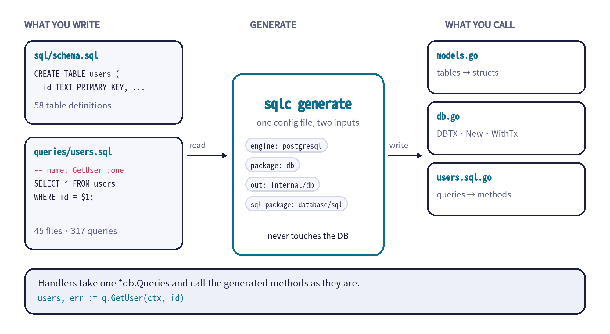
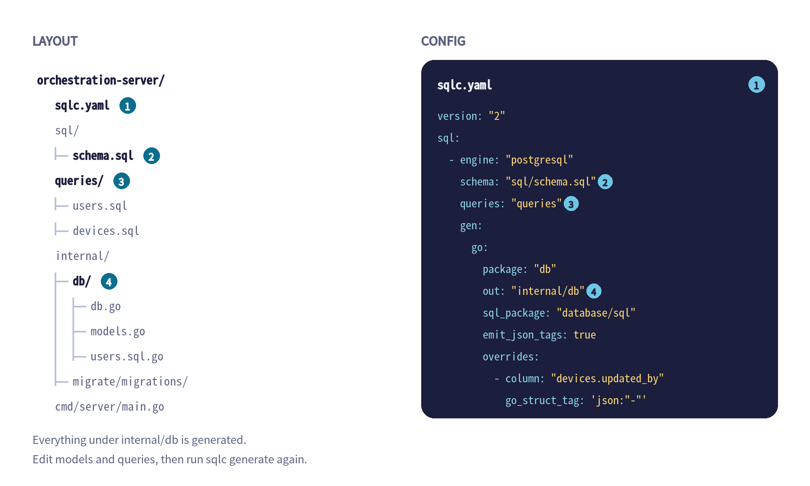
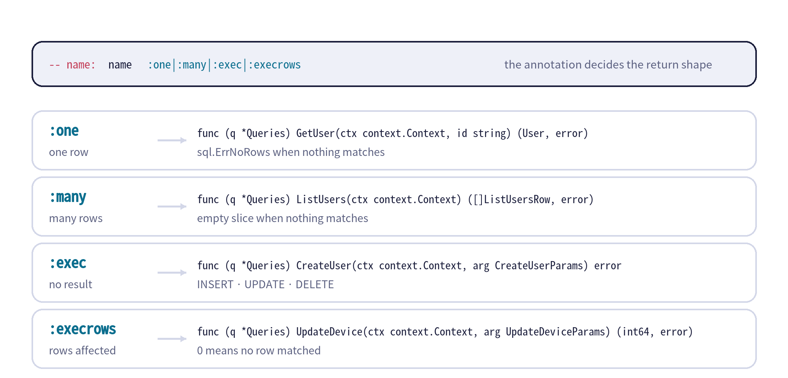
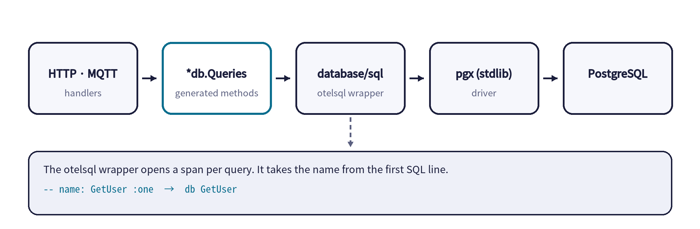
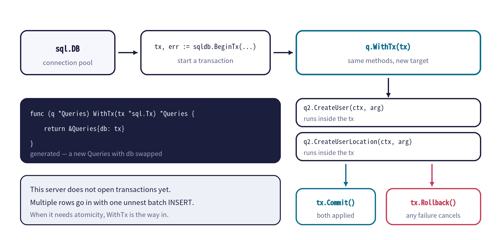

<dl class="facts">
  <div><dt>Queries</dt><dd>317</dd></div>
  <div><dt>Tables</dt><dd>58</dd></div>
  <div><dt>Annotations</dt><dd>4</dd></div>
  <div><dt>Hand-written scans</dt><dd>0</dd></div>
</dl>

## What sqlc does

In one sentence: **I write the SQL, and the tool writes the typed Go around it.**

<figure class="wide">
  
  <figcaption>Two kinds of text go in. Compiling Go comes out.</figcaption>
</figure>

`sqlc generate` never touches the database. It reads two text inputs — a schema file and the query files — and writes Go files. That makes it fast, credential-free, and identical wherever it runs. The trade-off is that you cannot assemble a dynamic `WHERE` at runtime. If the conditions vary, you write separate queries or take nullable arguments with `sqlc.narg`, shown below.

Against the alternatives:

| Item | database/sql by hand | ORM | sqlc |
|---|---|---|---|
| SQL | you write it | the tool builds it | you write it |
| Result types | you match `Scan` order | runtime reflection | generated structs |
| Add a column | may break silently | migration tool's job | `generate` fails |
| Runtime cost | none | reflection, query builder | none |

## One config file

<figure class="wide">
  
  <figcaption>The config points at three places: schema, queries, output.</figcaption>
</figure>

```yaml
version: "2"
sql:
  - engine: "postgresql"
    schema: "sql/schema.sql"
    queries: "queries"
    gen:
      go:
        package: "db"
        out: "internal/db"
        sql_package: "database/sql"
        emit_json_tags: true
```

| Key | What it does |
|---|---|
| `engine: postgresql` | parses schema and queries as PostgreSQL |
| `schema: sql/schema.sql` | table definitions; a table missing here cannot be used in a query |
| `queries: queries` | directory of `.sql` files that start with `-- name:` |
| `package: db`, `out: internal/db` | package name and output directory |
| `sql_package: database/sql` | which layer the generated code uses; `pgx/v5` gives pgx's own types |
| `emit_json_tags: true` | adds `json` tags to structs |

`overrides` handles per-column exceptions. The audit column `updated_by` is internal bookkeeping and has no business in an API response, so eleven tables hide it with `json:"-"`.

```yaml
        overrides:
          - column: "devices.updated_by"
            go_struct_tag: 'json:"-"'
```

The same mechanism renames: `ai_messages.user_id` ships as `session_id`, so it is overridden with `json:"session_id"`.

## Name and shape live in the query file

A query file is just SQL. One line at the top of each query decides its name and its return shape.

```sql
-- name: GetUser :one
SELECT * FROM users WHERE id = $1;

-- name: ListUsers :many
SELECT u.*, p.title AS persona_name
FROM users u
LEFT JOIN personas p ON p.id = u.persona_id
ORDER BY u.created_at DESC LIMIT 200;
```

<figure class="wide">
  
  <figcaption>One annotation fixes the return type. The SQL fixes everything else.</figcaption>
</figure>

The type of `$1` comes from the schema; the return type comes from the `SELECT` list. `users.*` becomes the `User` struct. Once joins and aliases mix columns, you get a row struct named after the query, like `ListUsersRow`.

`:execrows` returns the number of affected rows. You want it when a `UPDATE` or `DELETE` matching nothing is an error worth noticing. In this server 35 queries are `:execrows`.

When a query takes several arguments, naming them reads better. Keyset pagination is the usual case.

```sql
-- name: ListUsersPage :many
SELECT u.*, p.title AS persona_name
FROM users u
LEFT JOIN personas p ON p.id = u.persona_id
WHERE sqlc.narg('after_id')::text IS NULL OR u.id < sqlc.narg('after_id')
ORDER BY u.id DESC
LIMIT sqlc.arg('page_size');
```

```go
type ListUsersPageParams struct {
	AfterID  sql.NullString `json:"after_id"`
	PageSize int32          `json:"page_size"`
}
```

`sqlc.arg` is a required argument; `sqlc.narg` allows NULL, which turns the Go type into `sql.NullString`. The first page then falls out of the `IS NULL` branch without any extra code.

## Three kinds of generated file

**`db.go`** — a thin shell that links the query set to an execution target.

```go
type DBTX interface {
	ExecContext(context.Context, string, ...interface{}) (sql.Result, error)
	PrepareContext(context.Context, string) (*sql.Stmt, error)
	QueryContext(context.Context, string, ...interface{}) (*sql.Rows, error)
	QueryRowContext(context.Context, string, ...interface{}) *sql.Row
}

func New(db DBTX) *Queries { return &Queries{db: db} }
```

Both `*sql.DB` and `*sql.Tx` have those four methods. That is why the same query set can be reused inside a transaction — `WithTx` is exactly that.

**`models.go`** — one struct per table.

```go
type User struct {
	ID             string       `json:"id"`
	Username       string       `json:"username"`
	PersonaID      string       `json:"persona_id"`
	EndedAt        sql.NullTime `json:"ended_at"`
	LastActivityAt sql.NullTime `json:"last_activity_at"`
	PointBalance   int64        `json:"point_balance"`
	CreatedAt      time.Time    `json:"created_at"`
}
```

Nullable columns become `sql.NullTime` or `sql.NullString`, so "this may be absent" survives into the type.

**`<query file>.sql.go`** — one method per query.

```go
func (q *Queries) GetUser(ctx context.Context, id string) (User, error) {
	row := q.db.QueryRowContext(ctx, getUser, id)
	var i User
	err := row.Scan(&i.ID, &i.Username, &i.PersonaID, &i.EndedAt, /* ... */)
	return i, err
}
```

No more matching `Scan` argument order by hand. Add a column, run `generate`, and the schema, the query and the struct move together.

## Wiring it into the server

<figure class="wide">
  
  <figcaption>Handlers know only the generated methods; everything below is the standard library and the driver.</figcaption>
</figure>

```go
// register the pgx driver with database/sql (one blank import)
_ "github.com/jackc/pgx/v5/stdlib"

// a driver wrapped in otelsql — one span per query
sqldb, err := dbtrace.Open("pgx", cfg.DatabaseURL)
if err != nil {
	return err
}
defer sqldb.Close()
sqldb.SetMaxOpenConns(25)

if err := migrate.Up(sqldb); err != nil {
	return err
}

queries := db.New(sqldb)
```

Because `sql_package` is `database/sql`, the generated code only knows the standard interfaces. The driver is pgx's `stdlib`, and an `otelsql` wrapper sits between them to open a span per query. Swap the driver later and neither the generated code nor the handlers notice.

One `*db.Queries` is built and handed to the router; handlers receive only that.

```go
router := NewRouter(cfg, queries, mqttHub, mqttService, /* ... */)
```

```go
func (h *handler) getUser(c *gin.Context) {
	user, err := h.q.GetUser(c.Request.Context(), c.Param("id"))
	if errors.Is(err, sql.ErrNoRows) {
		c.Status(http.StatusNotFound)
		return
	}
	// ...
}
```

The span name comes from the first line of the generated SQL constant. Since it starts with `-- name: GetUser :one`, Jaeger shows `db GetUser`. Name your queries carelessly and your traces read carelessly.

## Transactions

<figure class="wide">
  
  <figcaption>No new type appears — just another query set whose target is the tx.</figcaption>
</figure>

```go
tx, err := sqldb.BeginTx(ctx, nil)
if err != nil {
	return err
}
defer tx.Rollback() // after a successful Commit this only returns an error and does nothing

q := queries.WithTx(tx)
if err := q.CreateUser(ctx, createUser); err != nil {
	return err
}
if err := q.CreateUserLocation(ctx, userLocation); err != nil {
	return err
}
return tx.Commit()
```

`WithTx` does one thing: it returns a new `*Queries` whose `db` field is the tx. So inside a transaction you call the same method names. If any step fails, the deferred `Rollback` undoes all of it.

One honest note: this server has no `BeginTx` call yet. When several rows have to land, it does it in a single statement instead.

```sql
-- name: CreateUserLocations :exec
INSERT INTO user_locations (id, user_id, location_id, visit_order)
SELECT unnest(@ids::text[]), @user_id::text,
       unnest(@location_ids::text[]), unnest(@visit_orders::bigint[]);
```

A single statement is atomic on its own, so there is nothing to commit or roll back. The loop of `INSERT` calls disappears and the round trips drop to one. When something genuinely needs atomicity, that is when `WithTx` comes out.

## What actually bites

- **Commit all of `internal/db` after `generate`.** Commit the query file but forget `models.go` and the build still passes while the struct drifts away from the schema.
- **The schema file lives apart from the migrations.** Runtime migrations are goose, numbered up to 164; `generate` reads `sql/schema.sql`, one file that flattens them. Add a migration and skip this file, and `generate` passes without knowing the new column exists.
- **Never edit generated files.** The next `generate` erases it. Change the query or the config instead.
- **Split queries instead of building dynamic SQL.** The moment you concatenate an `ORDER BY`, the type checking is gone. Three sort orders means three queries.
- **The query name is the span name.** It is read in logs and traces, so name it after what it does, `ListUsersPage` rather than `List2`.
- **`overrides` grows.** Every shared rule (hide an audit column, say) adds a line per column. Past a handful of rules, it is worth wrapping the generated structs with your own thin type.

## Wrapping up

What sqlc removes is not the SQL. It is the handwork between SQL and Go: the column list, the `Scan` order, the NULL handling, the affected-row count. Instead of keeping those aligned by hand, you write SQL and press `generate`. What you give up is the freedom to assemble queries at runtime — and most of the time you never needed it.

Every number and snippet here comes from a Go server running in production. The repository is private, so there is no link. The sqlc docs are at [sqlc.dev](https://sqlc.dev).
