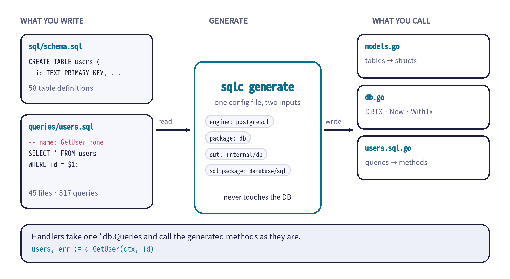
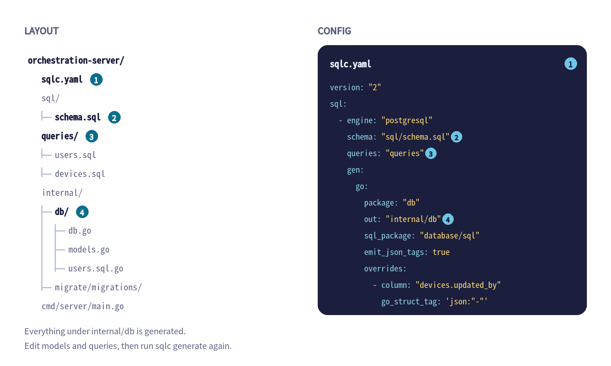
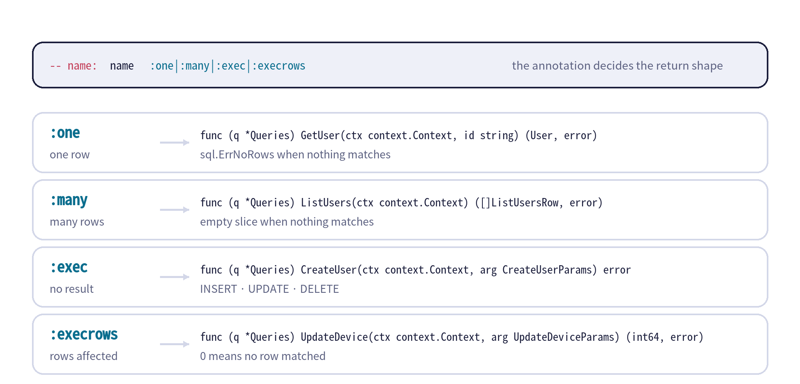
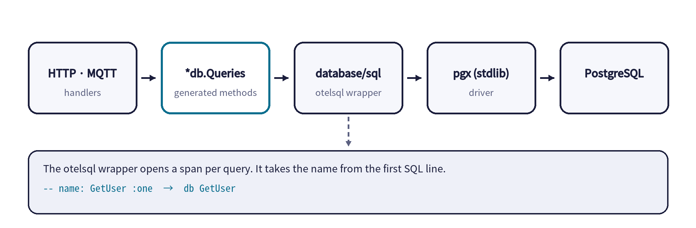
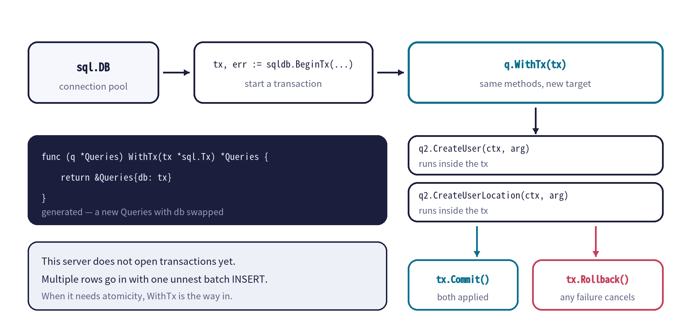

<dl class="facts">
  <div><dt>クエリ</dt><dd>317<small>個</small></dd></div>
  <div><dt>テーブル</dt><dd>58<small>個</small></dd></div>
  <div><dt>アノテーション</dt><dd>4<small>種</small></dd></div>
  <div><dt>Scan の手書き</dt><dd>0<small>行</small></dd></div>
</dl>

## sqlc がすること

1 文にするとこうです。**SQL は自分で書き、その SQL の入出力の型はツールが作る。**

<figure class="wide">
  
  <figcaption>入力はテキスト 2 種類だけ。出力はコンパイルが通る Go コードです。</figcaption>
</figure>

`sqlc generate` は DB につながりません。スキーマファイルとクエリファイル、2 つのテキストだけを読んで Go ファイルを書きます。だから速く、接続情報も要らず、どこで動かしても同じ結果になります。代わりに、実行時に条件を組み立てる動的な `WHERE` は使えません。条件が複数あるときはクエリを分けるか、後で説明する `sqlc.narg` で NULL を許す引数を受けます。

ORM と比べるとこう分かれます。

| 項目 | database/sql を直接 | ORM | sqlc |
|---|---|---|---|
| SQL | 自分で書く | ツールが作る | 自分で書く |
| 結果の型 | `Scan` の順序を手で合わせる | 実行時リフレクション | 生成された構造体 |
| カラム追加時 | 静かにずれることがある | マイグレーションツールの仕事 | `generate` が失敗する |
| 実行時コスト | なし | リフレクション・クエリビルダー | なし |

## 設定はファイル 1 つ

<figure class="wide">
  
  <figcaption>設定ファイルが指すのは 3 か所。スキーマ、クエリ、生成先です。</figcaption>
</figure>

```yaml
version: "2"
sql:
  - engine: "postgresql"
    schema: "sql/schema.sql"
    queries: "queries"
    gen:
      go:
        package: "db"
        out: "internal/db"
        sql_package: "database/sql"
        emit_json_tags: true
```

| 項目 | すること |
|---|---|
| `engine: postgresql` | スキーマとクエリを PostgreSQL の文法として解釈する |
| `schema: sql/schema.sql` | テーブル定義。ここにないテーブルはクエリで使えない |
| `queries: queries` | `-- name:` で始まる `.sql` ファイルを集めたディレクトリ |
| `package: db`, `out: internal/db` | 生成されるパッケージ名と場所 |
| `sql_package: database/sql` | 生成コードが使う層。`pgx/v5` にすると pgx 自身の型で出る |
| `emit_json_tags: true` | 構造体に `json` タグを付ける |

`overrides` でカラム単位の例外を置きます。監査用カラム `updated_by` は内部の記録で API レスポンスに出る理由がないので、11 のテーブルすべてで `json:"-"` に上書きしました。

```yaml
        overrides:
          - column: "devices.updated_by"
            go_struct_tag: 'json:"-"'
```

同じ方法で名前だけ変えることもできます。`ai_messages.user_id` はレスポンスで `session_id` という名前で出るべきなので `json:"session_id"` で上書きしました。

## クエリファイルに名前と形を書く

クエリファイルはただの SQL です。ファイルの先頭 1 行が名前と返す形を決めます。

```sql
-- name: GetUser :one
SELECT * FROM users WHERE id = $1;

-- name: ListUsers :many
SELECT u.*, p.title AS persona_name
FROM users u
LEFT JOIN personas p ON p.id = u.persona_id
ORDER BY u.created_at DESC LIMIT 200;
```

<figure class="wide">
  
  <figcaption>アノテーション 1 つが戻り値の型を決めます。残りは SQL が決めます。</figcaption>
</figure>

`$1` の型はスキーマから、戻り値の型は `SELECT` のリストから出ます。`users.*` は `User` 構造体、JOIN が付いて別名が混ざると `ListUsersRow` のような行専用の構造体ができます。

`:execrows` は影響した行数を返します。`UPDATE` や `DELETE` が 0 行かどうかを確かめたいときに使います。このサーバーでは 35 個のクエリが `:execrows` です。

引数が複数あるときは名前を付けたほうが読みやすいです。キーセットページングのクエリがその例です。

```sql
-- name: ListUsersPage :many
SELECT u.*, p.title AS persona_name
FROM users u
LEFT JOIN personas p ON p.id = u.persona_id
WHERE sqlc.narg('after_id')::text IS NULL OR u.id < sqlc.narg('after_id')
ORDER BY u.id DESC
LIMIT sqlc.arg('page_size');
```

```go
type ListUsersPageParams struct {
	AfterID  sql.NullString `json:"after_id"`
	PageSize int32          `json:"page_size"`
}
```

`sqlc.arg` は必須の引数、`sqlc.narg` は NULL を許す引数です。`narg` を使うと Go の型が `sql.NullString` になり、最初のページを取るときは `IS NULL` の分岐へ自然に流れます。

## 生成されるコードは 3 種類

**`db.go`** — クエリ集合と実行先をつなぐ小さな殻です。

```go
type DBTX interface {
	ExecContext(context.Context, string, ...interface{}) (sql.Result, error)
	PrepareContext(context.Context, string) (*sql.Stmt, error)
	QueryContext(context.Context, string, ...interface{}) (*sql.Rows, error)
	QueryRowContext(context.Context, string, ...interface{}) *sql.Row
}

func New(db DBTX) *Queries { return &Queries{db: db} }
```

`*sql.DB` も `*sql.Tx` もこの 4 つのメソッドを全部持っています。だから同じクエリ集合をトランザクションの上でそのまま使い回せます。`WithTx` がその仕事をします。

**`models.go`** — テーブル 1 つに構造体 1 つです。

```go
type User struct {
	ID              string       `json:"id"`
	Username        string       `json:"username"`
	PersonaID       string       `json:"persona_id"`
	EndedAt         sql.NullTime `json:"ended_at"`
	LastActivityAt  sql.NullTime `json:"last_activity_at"`
	PointBalance    int64        `json:"point_balance"`
	CreatedAt       time.Time    `json:"created_at"`
}
```

NULL になりうるカラムは `sql.NullTime`、`sql.NullString` で出ます。値がないかもしれないという事実が型に残ります。

**`<クエリファイル>.sql.go`** — クエリ 1 つにメソッド 1 つです。

```go
func (q *Queries) GetUser(ctx context.Context, id string) (User, error) {
	row := q.db.QueryRowContext(ctx, getUser, id)
	var i User
	err := row.Scan(&i.ID, &i.Username, &i.PersonaID, &i.EndedAt, /* ... */)
	return i, err
}
```

`Scan` の引数の順序を手で合わせる必要はありません。カラムを追加して `generate` を回し直せば、スキーマとクエリと構造体が一度にそろいます。

## サーバーへのつなぎ方

<figure class="wide">
  
  <figcaption>ハンドラーは生成されたメソッドだけを知り、その下は標準ライブラリとドライバーが担います。</figcaption>
</figure>

```go
// pgx ドライバーを database/sql に登録する (空インポート 1 行)
_ "github.com/jackc/pgx/v5/stdlib"

// otelsql で包んだドライバー — クエリごとにスパンができる
sqldb, err := dbtrace.Open("pgx", cfg.DatabaseURL)
if err != nil {
	return err
}
defer sqldb.Close()
sqldb.SetMaxOpenConns(25)

if err := migrate.Up(sqldb); err != nil {
	return err
}

queries := db.New(sqldb)
```

`sql_package: database/sql` で生成したので、コードは標準のインターフェースだけを使います。ドライバーは空インポートで登録する pgx の `stdlib` で、その間に `otelsql` のラッパーを挟んでクエリごとにスパンを作ります。あとでドライバーを変えても生成コードとハンドラーはそのままです。

`*db.Queries` を 1 つ作ってルーターに渡し、ハンドラーはそれだけを受け取ります。

```go
router := NewRouter(cfg, queries, mqttHub, mqttService, /* ... */)
```

```go
func (h *handler) getUser(c *gin.Context) {
	user, err := h.q.GetUser(c.Request.Context(), c.Param("id"))
	if errors.Is(err, sql.ErrNoRows) {
		c.Status(http.StatusNotFound)
		return
	}
	...
}
```

スパン名はクエリ定数の先頭行から出ます。生成された SQL 定数が `-- name: GetUser :one` で始まるので、Jaeger では `db GetUser` に見えます。名前をいい加減に付けると、トレースもいい加減に読めるようになります。

## トランザクション

<figure class="wide">
  
  <figcaption>新しい型ができるのではなく、実行先だけ tx に変わったクエリ集合がもう 1 つできます。</figcaption>
</figure>

```go
tx, err := sqldb.BeginTx(ctx, nil)
if err != nil {
	return err
}
defer tx.Rollback() // Commit のあとの Rollback はエラーを返すだけで何もしない

q := queries.WithTx(tx)
if err := q.CreateUser(ctx, createUser); err != nil {
	return err
}
if err := q.CreateUserLocation(ctx, userLocation); err != nil {
	return err
}
return tx.Commit()
```

`WithTx` がすることは 1 行です。`db` フィールドを `tx` に変えた `*Queries` を新しく作って返します。だからトランザクションの中でも同じメソッド名をそのまま使います。途中で 1 つでも失敗すれば `defer` の `Rollback` が全部戻します。

ここで正直に 1 つ書くと、このサーバーにはまだ `BeginTx` を開くコードがありません。複数行を入れる必要があるときは、トランザクションではなく 1 文で処理します。

```sql
-- name: CreateUserLocations :exec
INSERT INTO user_locations (id, user_id, location_id, visit_order)
SELECT unnest(@ids::text[]), @user_id::text,
       unnest(@location_ids::text[]), unnest(@visit_orders::bigint[]);
```

文 1 つはそれ自体が原子的なので、コミットもロールバックも要りません。ループを回して `INSERT` を呼ぶコードが消え、往復も 1 回に減ります。原子性が本当に必要な瞬間が来たら、そのときに `WithTx` で開きます。

## 実際に引っかかること

- **`generate` のあとは `internal/db` 全体をコミットします。** クエリファイルだけコミットして `models.go` を忘れると、ビルドは通るのに構造体とスキーマがずれたまま残ります。
- **スキーマファイルはマイグレーションとは別に生きます。** 実行時マイグレーションは goose で 164 番まで積んであり、`generate` が読むスキーマはそれを 1 ファイルに整理した `sql/schema.sql` です。新しいマイグレーションを入れてこのファイルを直さないと、`generate` は新しいカラムを知らないまま通り過ぎます。
- **生成ファイルは直接直しません。** 次の `generate` で消えます。直すものがあればクエリか設定を直します。
- **動的な並べ替えはクエリを分けます。** `ORDER BY` を文字列でつなぐ瞬間に型チェックの利点が消えます。並べ替えの基準が 3 つならクエリも 3 つが正解です。
- **クエリ名がそのままスパン名です。** ログとトレースで読む名前なので、`ListUsersPage` のように何をするか分かる名前にします。
- **`sqlc.yaml` の `overrides` は増えます。** 共通のルール(監査カラムを隠すなど)ができるとカラムごとに 1 行ずつ付きます。ルールが 5 つを超えたら、生成コードを薄く包む別の構造体を考える時機です。

## まとめ

sqlc がなくすのは SQL ではなく **SQL と Go のあいだの手作業**です。カラムの並び、`Scan` の順序、`NULL` の扱い、影響行数。これを手で合わせる代わりに SQL を書いて `generate` を押します。代わりに失うのは実行時に組み立てる自由で、その自由が要らない場所がほとんどです。

この記事の数字とコードは、実際に運用している Go サーバーから取ってきました。リポジトリは非公開なのでリンクはありません。sqlc 自体のドキュメントは [sqlc.dev](https://sqlc.dev) にあります。
