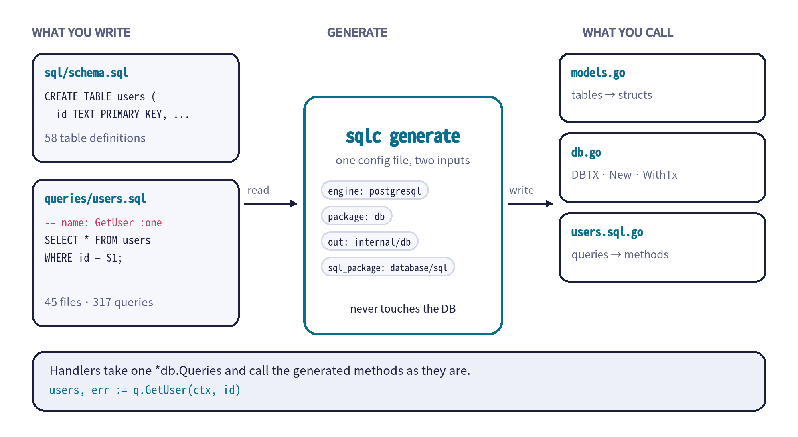
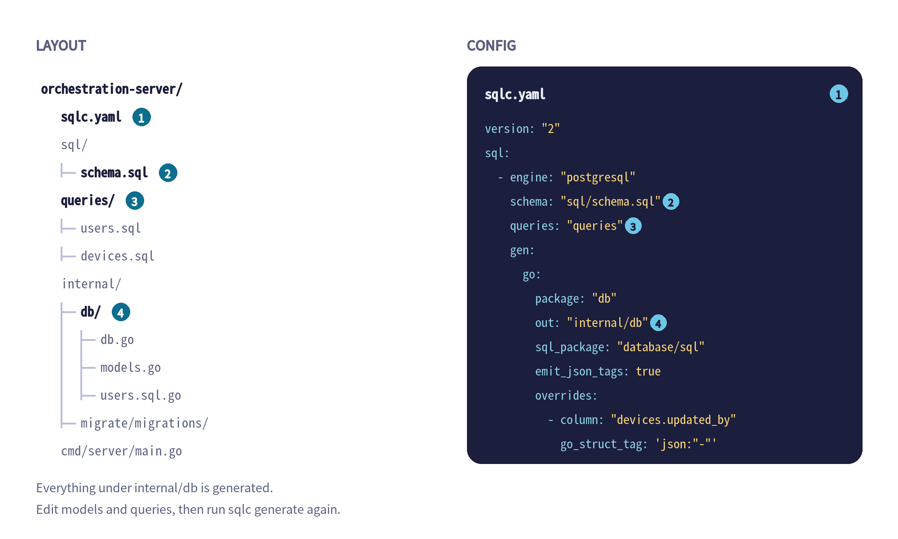
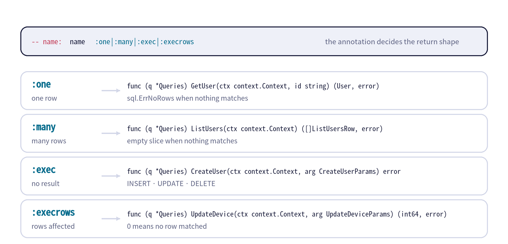
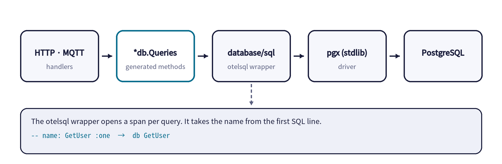
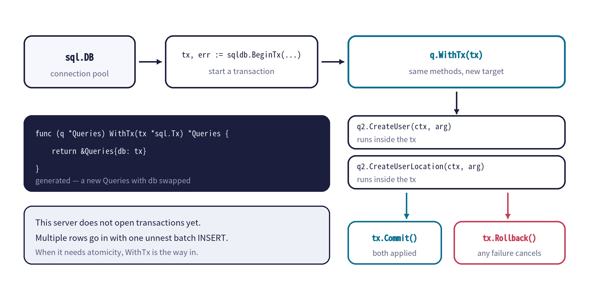

<dl class="facts">
  <div><dt>查询</dt><dd>317<small>条</small></dd></div>
  <div><dt>表</dt><dd>58<small>张</small></dd></div>
  <div><dt>注解</dt><dd>4<small>种</small></dd></div>
  <div><dt>手写 Scan</dt><dd>0<small>行</small></dd></div>
</dl>

## sqlc 做什么

用一句话概括：**SQL 由我来写，这条 SQL 的输入输出类型由工具生成。**

<figure class="wide">
  
  <figcaption>输入只有两种文本，输出是能编译通过的 Go 代码。</figcaption>
</figure>

`sqlc generate` 不会连数据库。它只读 schema 文件和查询文件这两份文本，然后写出 Go 文件。所以它快，不需要连接信息，在哪儿跑结果都一样。代价是用不了运行时拼接条件的动态 `WHERE`。条件有多个时，要么拆成几条查询，要么用后面会讲的 `sqlc.narg` 接收可为 NULL 的参数。

和 ORM 放在一起比，差别是这样。

| 项目 | 直接用 database/sql | ORM | sqlc |
|---|---|---|---|
| SQL | 自己写 | 工具生成 | 自己写 |
| 结果类型 | 手工对齐 `Scan` 顺序 | 运行时反射 | 生成的结构体 |
| 加列的时候 | 可能悄悄错位 | 交给迁移工具 | `generate` 会失败 |
| 运行时开销 | 无 | 反射·查询构建器 | 无 |

## 配置只有一个文件

<figure class="wide">
  
  <figcaption>配置文件指向三个地方：schema、查询、生成位置。</figcaption>
</figure>

```yaml
version: "2"
sql:
  - engine: "postgresql"
    schema: "sql/schema.sql"
    queries: "queries"
    gen:
      go:
        package: "db"
        out: "internal/db"
        sql_package: "database/sql"
        emit_json_tags: true
```

| 项目 | 作用 |
|---|---|
| `engine: postgresql` | 按 PostgreSQL 语法解析 schema 和查询 |
| `schema: sql/schema.sql` | 表定义。这里没有的表不能在查询里用 |
| `queries: queries` | 收集 `-- name:` 开头的 `.sql` 文件的目录 |
| `package: db`, `out: internal/db` | 生成的包名和位置 |
| `sql_package: database/sql` | 生成代码使用的层。设成 `pgx/v5` 就出 pgx 自己的类型 |
| `emit_json_tags: true` | 给结构体加上 `json` 标签 |

用 `overrides` 放按列的例外。审计列 `updated_by` 是内部记录，没有理由出现在 API 响应里，所以 11 张表全部覆盖成 `json:"-"`。

```yaml
        overrides:
          - column: "devices.updated_by"
            go_struct_tag: 'json:"-"'
```

同样的办法也能只改名字。`ai_messages.user_id` 在响应里应该叫 `session_id`，所以覆盖成 `json:"session_id"`。

## 在查询文件里写下名字和形状

查询文件就是 SQL。文件最上面一行决定名字和返回形状。

```sql
-- name: GetUser :one
SELECT * FROM users WHERE id = $1;

-- name: ListUsers :many
SELECT u.*, p.title AS persona_name
FROM users u
LEFT JOIN personas p ON p.id = u.persona_id
ORDER BY u.created_at DESC LIMIT 200;
```

<figure class="wide">
  
  <figcaption>一个注解决定返回类型，其余的由 SQL 决定。</figcaption>
</figure>

`$1` 的类型来自 schema，返回类型来自 `SELECT` 列表。`users.*` 出 `User` 结构体，带上 JOIN、混了别名，就会生成 `ListUsersRow` 这样的行专用结构体。

`:execrows` 返回受影响的行数。需要确认 `UPDATE` 或 `DELETE` 是不是 0 行时用它。这个服务器里有 35 条查询是 `:execrows`。

参数有多个时，起名字更好读。键集分页的查询就是例子。

```sql
-- name: ListUsersPage :many
SELECT u.*, p.title AS persona_name
FROM users u
LEFT JOIN personas p ON p.id = u.persona_id
WHERE sqlc.narg('after_id')::text IS NULL OR u.id < sqlc.narg('after_id')
ORDER BY u.id DESC
LIMIT sqlc.arg('page_size');
```

```go
type ListUsersPageParams struct {
	AfterID  sql.NullString `json:"after_id"`
	PageSize int32          `json:"page_size"`
}
```

`sqlc.arg` 是必填参数，`sqlc.narg` 是允许 NULL 的参数。用了 `narg`，Go 类型就变成 `sql.NullString`，取第一页时自然走进 `IS NULL` 的分支。

## 生成的代码有三种

**`db.go`** — 把查询集合和执行目标接起来的薄壳。

```go
type DBTX interface {
	ExecContext(context.Context, string, ...interface{}) (sql.Result, error)
	PrepareContext(context.Context, string) (*sql.Stmt, error)
	QueryContext(context.Context, string, ...interface{}) (*sql.Rows, error)
	QueryRowContext(context.Context, string, ...interface{}) *sql.Row
}

func New(db DBTX) *Queries { return &Queries{db: db} }
```

`*sql.DB` 和 `*sql.Tx` 都有这四个方法。所以同一套查询集合可以原样拿到事务上用，`WithTx` 干的就是这件事。

**`models.go`** — 一张表一个结构体。

```go
type User struct {
	ID              string       `json:"id"`
	Username        string       `json:"username"`
	PersonaID       string       `json:"persona_id"`
	EndedAt         sql.NullTime `json:"ended_at"`
	LastActivityAt  sql.NullTime `json:"last_activity_at"`
	PointBalance    int64        `json:"point_balance"`
	CreatedAt       time.Time    `json:"created_at"`
}
```

可能为 NULL 的列出成 `sql.NullTime`、`sql.NullString`。值可能不存在这件事留在类型里。

**`<查询文件>.sql.go`** — 一条查询一个方法。

```go
func (q *Queries) GetUser(ctx context.Context, id string) (User, error) {
	row := q.db.QueryRowContext(ctx, getUser, id)
	var i User
	err := row.Scan(&i.ID, &i.Username, &i.PersonaID, &i.EndedAt, /* ... */)
	return i, err
}
```

不用再手工对齐 `Scan` 参数的顺序。加一列再跑一次 `generate`，schema、查询和结构体一起对齐。

## 接到服务器上

<figure class="wide">
  
  <figcaption>处理器只知道生成的方法，下面交给标准库和驱动。</figcaption>
</figure>

```go
// 把 pgx 驱动注册到 database/sql（一行空导入）
_ "github.com/jackc/pgx/v5/stdlib"

// 用 otelsql 包过的驱动 — 每条查询生成一个 span
sqldb, err := dbtrace.Open("pgx", cfg.DatabaseURL)
if err != nil {
	return err
}
defer sqldb.Close()
sqldb.SetMaxOpenConns(25)

if err := migrate.Up(sqldb); err != nil {
	return err
}

queries := db.New(sqldb)
```

因为用 `sql_package: database/sql` 生成，代码只用标准接口。驱动是通过空导入注册的 pgx `stdlib`，中间夹一层 `otelsql` 包装，每条查询生成一个 span。以后换驱动，生成的代码和处理器都不用动。

造一个 `*db.Queries` 交给路由，处理器只接收它。

```go
router := NewRouter(cfg, queries, mqttHub, mqttService, /* ... */)
```

```go
func (h *handler) getUser(c *gin.Context) {
	user, err := h.q.GetUser(c.Request.Context(), c.Param("id"))
	if errors.Is(err, sql.ErrNoRows) {
		c.Status(http.StatusNotFound)
		return
	}
	...
}
```

span 名称来自查询常量的第一行。生成的 SQL 常量以 `-- name: GetUser :one` 开头，所以在 Jaeger 里看到的是 `db GetUser`。名字起得敷衍，链路追踪读起来也敷衍。

## 事务

<figure class="wide">
  
  <figcaption>不是多出一个新类型，而是多出一套执行目标换成 tx 的查询集合。</figcaption>
</figure>

```go
tx, err := sqldb.BeginTx(ctx, nil)
if err != nil {
	return err
}
defer tx.Rollback() // Commit 之后调用 Rollback 只返回错误，什么也不做

q := queries.WithTx(tx)
if err := q.CreateUser(ctx, createUser); err != nil {
	return err
}
if err := q.CreateUserLocation(ctx, userLocation); err != nil {
	return err
}
return tx.Commit()
```

`WithTx` 做的事只有一行。把 `db` 字段换成 `tx`，新建一个 `*Queries` 返回。所以在事务里方法名照旧用。中途有一步失败，`defer` 的 `Rollback` 会全部退回去。

这里诚实写一句，这个服务器里还没有开过 `BeginTx` 的代码。需要插入多行时，用一条语句处理，而不是事务。

```sql
-- name: CreateUserLocations :exec
INSERT INTO user_locations (id, user_id, location_id, visit_order)
SELECT unnest(@ids::text[]), @user_id::text,
       unnest(@location_ids::text[]), unnest(@visit_orders::bigint[]);
```

一条语句本身就是原子的，不需要提交也不需要回滚。循环里调 `INSERT` 的代码没了，往返也减到一次。真需要原子性的那一刻来了，再用 `WithTx` 打开。

## 实际会绊到的地方

- **`generate` 之后要把整个 `internal/db` 一起提交。** 只提交查询文件、漏掉 `models.go`，构建能过，但结构体和 schema 会一直错着。
- **schema 文件和迁移是分开活的。** 运行时迁移用 goose 攒到了第 164 号，`generate` 读的 schema 是把这些整理成一个文件的 `sql/schema.sql`。加了新迁移却不改这个文件，`generate` 会不知道新列，直接走过去。
- **生成的文件不直接改。** 下次 `generate` 就没了。要改就改查询或配置。
- **动态排序要拆查询。** `ORDER BY` 一旦用字符串拼起来，类型检查的好处就没了。排序依据有三个，查询就该有三条。
- **查询名就是 span 名。** 这是日志和链路里要读的名字，要起成 `ListUsersPage` 这样能看出在干什么的。
- **`sqlc.yaml` 的 `overrides` 会变多。** 有了通用规则（比如隐藏审计列），就一列一行地加。规则超过五条，就该考虑用单独的结构体把生成代码薄薄包一层。

## 小结

sqlc 去掉的不是 SQL，而是 **SQL 和 Go 之间的手工活**。列的顺序、`Scan` 的顺序、`NULL` 的处理、影响行数。这些不用手工对齐，只要写 SQL 然后按 `generate`。换来的代价是失去运行时拼装的自由，而大多数地方并不需要那份自由。

文里的数字和代码取自实际在跑的 Go 服务器。仓库是私有的，所以没有链接。sqlc 自己的文档在 [sqlc.dev](https://sqlc.dev)。
