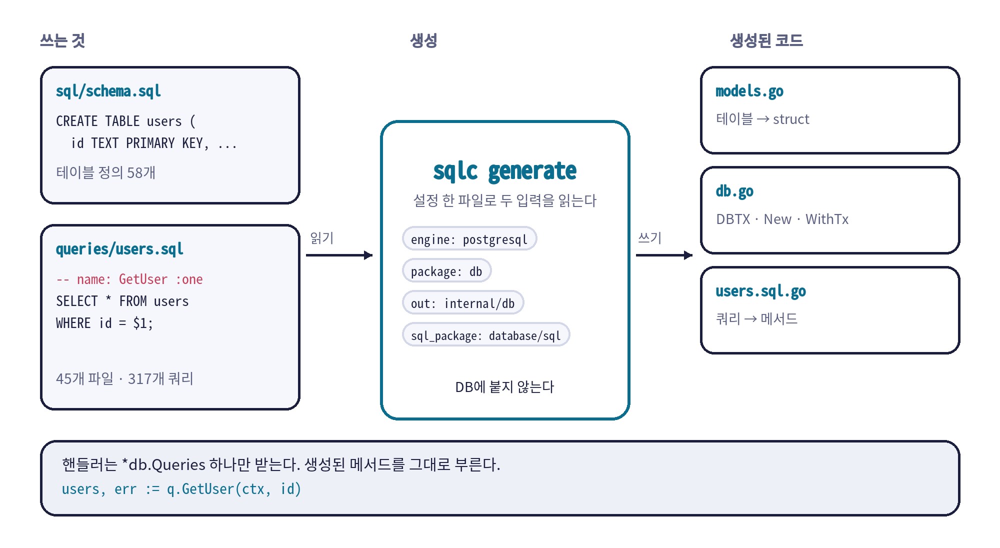
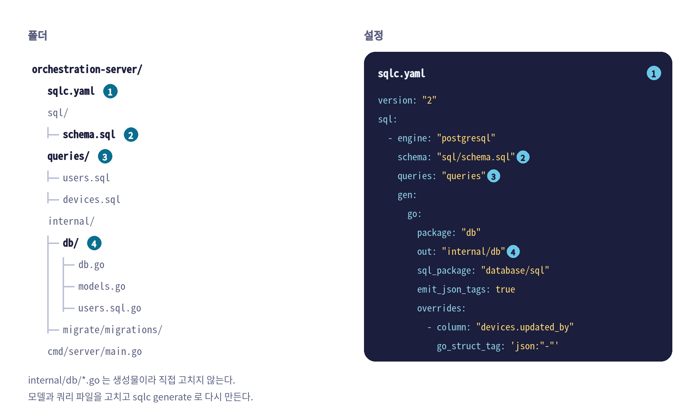
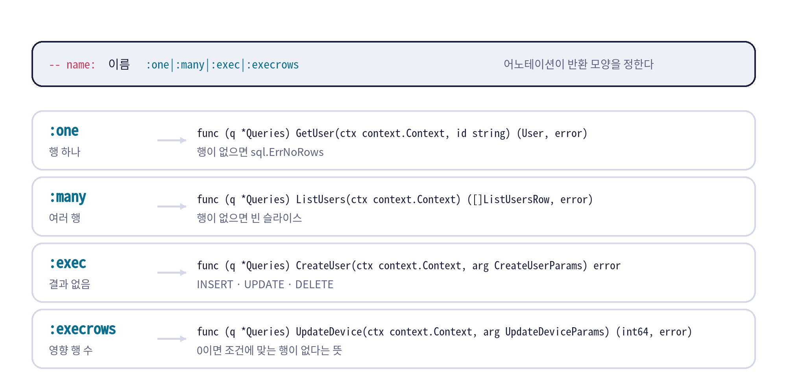
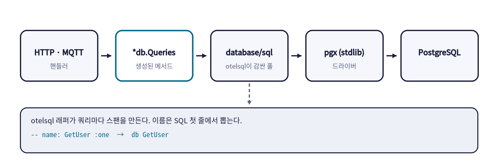
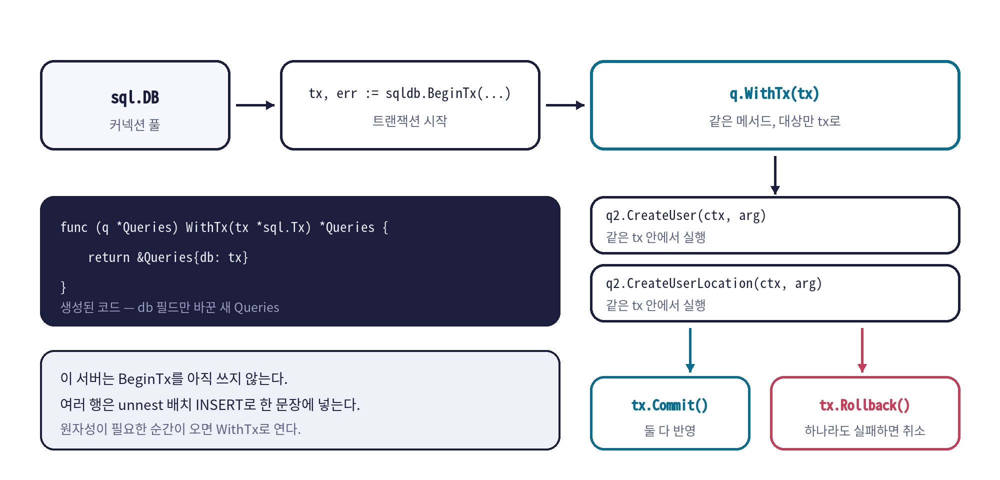

<dl class="facts">
  <div><dt>쿼리</dt><dd>317<small>개</small></dd></div>
  <div><dt>테이블</dt><dd>58<small>개</small></dd></div>
  <div><dt>어노테이션</dt><dd>4<small>종</small></dd></div>
  <div><dt>Scan 직접 쓰기</dt><dd>0<small>줄</small></dd></div>
</dl>

## sqlc 가 하는 일

한 문장으로 줄이면 이렇습니다. **SQL 은 내가 쓰고, 그 SQL 의 입출력 타입은 도구가 만든다.**

<figure class="wide">
  
  <figcaption>입력은 텍스트 두 종류뿐입니다. 출력은 컴파일되는 Go 코드이고요.</figcaption>
</figure>

`sqlc generate` 는 DB 에 붙지 않습니다. 스키마 파일과 쿼리 파일, 두 개의 텍스트만 읽어서 Go 파일을 씁니다. 그래서 빠르고, 접속 정보도 필요 없고, 어디서 돌려도 같은 결과가 나옵니다. 대신 런타임에 조건을 조립하는 동적 `WHERE` 는 못 씁니다. 조건이 여러 개면 쿼리를 나누거나, 뒤에서 설명할 `sqlc.narg` 로 NULL 허용 인자를 받습니다.

ORM 과 비교하면 이렇게 갈립니다.

| 항목 | database/sql 직접 | ORM | sqlc |
|---|---|---|---|
| SQL | 내가 쓴다 | 도구가 만든다 | 내가 쓴다 |
| 결과 타입 | `Scan` 순서를 손으로 맞춘다 | 런타임 리플렉션 | 생성된 구조체 |
| 컬럼 추가 시 | 조용히 어긋날 수 있다 | 마이그레이션 도구 몫 | `generate` 가 실패한다 |
| 런타임 비용 | 없음 | 리플렉션·쿼리 빌더 | 없음 |

## 설정은 파일 하나

<figure class="wide">
  
  <figcaption>설정 파일이 가리키는 곳은 세 군데입니다. 스키마, 쿼리, 생성 위치.</figcaption>
</figure>

```yaml
version: "2"
sql:
  - engine: "postgresql"
    schema: "sql/schema.sql"
    queries: "queries"
    gen:
      go:
        package: "db"
        out: "internal/db"
        sql_package: "database/sql"
        emit_json_tags: true
```

| 항목 | 하는 일 |
|---|---|
| `engine: postgresql` | 스키마와 쿼리를 PostgreSQL 문법으로 해석한다 |
| `schema: sql/schema.sql` | 테이블 정의. 여기 없는 테이블은 쿼리에서 쓸 수 없다 |
| `queries: queries` | `-- name:` 으로 시작하는 `.sql` 파일을 모아 둔 디렉터리 |
| `package: db`, `out: internal/db` | 생성될 패키지 이름과 위치 |
| `sql_package: database/sql` | 생성 코드가 쓸 계층. `pgx/v5` 로 두면 pgx 자체 타입으로 나온다 |
| `emit_json_tags: true` | 구조체에 `json` 태그를 붙인다 |

`overrides` 로 컬럼 단위 예외를 둡니다. 감사용 컬럼 `updated_by` 는 내부 기록이라 API 응답에 나갈 이유가 없어서, 열한 개 테이블 모두 `json:"-"` 로 덮었습니다.

```yaml
        overrides:
          - column: "devices.updated_by"
            go_struct_tag: 'json:"-"'
```

같은 방법으로 이름만 바꿀 수도 있습니다. `ai_messages.user_id` 는 응답에서 `session_id` 라는 이름으로 나가야 해서 `json:"session_id"` 로 덮었습니다.

## 쿼리 파일에 이름과 모양을 적는다

쿼리 파일은 그냥 SQL 입니다. 파일 맨 위 한 줄이 이름과 반환 모양을 정합니다.

```sql
-- name: GetUser :one
SELECT * FROM users WHERE id = $1;

-- name: ListUsers :many
SELECT u.*, p.title AS persona_name
FROM users u
LEFT JOIN personas p ON p.id = u.persona_id
ORDER BY u.created_at DESC LIMIT 200;
```

<figure class="wide">
  
  <figcaption>어노테이션 하나가 반환 타입을 정합니다. 나머지는 SQL 이 정합니다.</figcaption>
</figure>

`$1` 의 타입은 스키마에서, 반환 타입은 `SELECT` 목록에서 나옵니다. `users.*` 는 `User` 구조체, 조인이 붙어 별칭이 섞이면 `ListUsersRow` 같은 행 전용 구조체가 생깁니다.

`:execrows` 는 영향받은 행 수를 돌려줍니다. `UPDATE` 나 `DELETE` 가 0행인지 확인해야 할 때 씁니다. 이 서버에서는 35개 쿼리가 `:execrows` 입니다.

인자가 여러 개면 이름을 붙이는 편이 읽기 좋습니다. 키셋 페이징 쿼리가 그 예입니다.

```sql
-- name: ListUsersPage :many
SELECT u.*, p.title AS persona_name
FROM users u
LEFT JOIN personas p ON p.id = u.persona_id
WHERE sqlc.narg('after_id')::text IS NULL OR u.id < sqlc.narg('after_id')
ORDER BY u.id DESC
LIMIT sqlc.arg('page_size');
```

```go
type ListUsersPageParams struct {
	AfterID  sql.NullString `json:"after_id"`
	PageSize int32          `json:"page_size"`
}
```

`sqlc.arg` 는 필수 인자, `sqlc.narg` 는 NULL 을 허용하는 인자입니다. `narg` 를 쓰면 Go 타입이 `sql.NullString` 이 되고, 첫 페이지를 조회할 때 `IS NULL` 분기로 자연스럽게 흘러갑니다.

## 생성된 코드는 세 종류

**`db.go`** — 쿼리 집합과 실행 대상을 잇는 작은 껍데기입니다.

```go
type DBTX interface {
	ExecContext(context.Context, string, ...interface{}) (sql.Result, error)
	PrepareContext(context.Context, string) (*sql.Stmt, error)
	QueryContext(context.Context, string, ...interface{}) (*sql.Rows, error)
	QueryRowContext(context.Context, string, ...interface{}) *sql.Row
}

func New(db DBTX) *Queries { return &Queries{db: db} }
```

`*sql.DB` 도 `*sql.Tx` 도 이 네 메서드를 다 가지고 있습니다. 그래서 같은 쿼리 집합을 트랜잭션 위에서 그대로 다시 쓸 수 있습니다. `WithTx` 가 그 일을 합니다.

**`models.go`** — 테이블 하나에 구조체 하나입니다.

```go
type User struct {
	ID              string       `json:"id"`
	Username        string       `json:"username"`
	PersonaID       string       `json:"persona_id"`
	EndedAt         sql.NullTime `json:"ended_at"`
	LastActivityAt  sql.NullTime `json:"last_activity_at"`
	PointBalance    int64        `json:"point_balance"`
	CreatedAt       time.Time    `json:"created_at"`
}
```

NULL 이 가능한 컬럼은 `sql.NullTime`, `sql.NullString` 으로 나옵니다. 값이 없을 수 있다는 사실이 타입에 남습니다.

**`<쿼리파일>.sql.go`** — 쿼리 하나에 메서드 하나입니다.

```go
func (q *Queries) GetUser(ctx context.Context, id string) (User, error) {
	row := q.db.QueryRowContext(ctx, getUser, id)
	var i User
	err := row.Scan(&i.ID, &i.Username, &i.PersonaID, &i.EndedAt, /* ... */)
	return i, err
}
```

`Scan` 인자 순서를 손으로 맞출 일이 없습니다. 컬럼을 추가하고 `generate` 를 다시 돌리면, 스키마와 쿼리와 구조체가 한꺼번에 맞춰집니다.

## 서버에 붙이는 방법

<figure class="wide">
  
  <figcaption>핸들러는 생성된 메서드만 알고, 그 아래는 표준 라이브러리와 드라이버가 맡습니다.</figcaption>
</figure>

```go
// pgx 드라이버를 database/sql 에 등록한다 (빈 임포트 한 줄)
_ "github.com/jackc/pgx/v5/stdlib"

// otelsql 로 감싼 드라이버 — 쿼리마다 스팬이 생긴다
sqldb, err := dbtrace.Open("pgx", cfg.DatabaseURL)
if err != nil {
	return err
}
defer sqldb.Close()
sqldb.SetMaxOpenConns(25)

if err := migrate.Up(sqldb); err != nil {
	return err
}

queries := db.New(sqldb)
```

`sql_package: database/sql` 로 생성했기 때문에 코드는 표준 인터페이스만 씁니다. 드라이버는 빈 임포트로 등록하는 pgx 의 `stdlib` 이고, 그 사이에 `otelsql` 래퍼를 끼워 쿼리마다 스팬을 만듭니다. 나중에 드라이버를 바꿔도 생성 코드와 핸들러는 그대로입니다.

`*db.Queries` 하나를 만들어 라우터에 넘기고, 핸들러는 그것만 받습니다.

```go
router := NewRouter(cfg, queries, mqttHub, mqttService, /* ... */)
```

```go
func (h *handler) getUser(c *gin.Context) {
	user, err := h.q.GetUser(c.Request.Context(), c.Param("id"))
	if errors.Is(err, sql.ErrNoRows) {
		c.Status(http.StatusNotFound)
		return
	}
	...
}
```

스팬 이름은 쿼리 상수의 첫 줄에서 나옵니다. 생성된 SQL 상수가 `-- name: GetUser :one` 으로 시작하니, Jaeger 에서는 `db GetUser` 로 보입니다. 이름을 대충 지으면 트레이스도 대충 읽히게 됩니다.

## 트랜잭션

<figure class="wide">
  
  <figcaption>새 타입이 생기는 게 아니라, 실행 대상만 tx 로 바뀐 쿼리 집합이 하나 더 생깁니다.</figcaption>
</figure>

```go
tx, err := sqldb.BeginTx(ctx, nil)
if err != nil {
	return err
}
defer tx.Rollback() // Commit 뒤의 Rollback 은 에러만 돌려주고 아무 일도 하지 않는다

q := queries.WithTx(tx)
if err := q.CreateUser(ctx, createUser); err != nil {
	return err
}
if err := q.CreateUserLocation(ctx, userLocation); err != nil {
	return err
}
return tx.Commit()
```

`WithTx` 가 하는 일은 한 줄입니다. `db` 필드를 `tx` 로 바꾼 `*Queries` 를 새로 만들어 돌려줍니다. 그래서 트랜잭션 안에서도 같은 메서드 이름을 그대로 씁니다. 중간에 하나라도 실패하면 `defer` 의 `Rollback` 이 전부 되돌립니다.

여기서 정직하게 하나 적자면, 이 서버에는 아직 `BeginTx` 를 여는 코드가 없습니다. 여러 행을 넣어야 할 때는 트랜잭션 대신 한 문장으로 처리합니다.

```sql
-- name: CreateUserLocations :exec
INSERT INTO user_locations (id, user_id, location_id, visit_order)
SELECT unnest(@ids::text[]), @user_id::text,
       unnest(@location_ids::text[]), unnest(@visit_orders::bigint[]);
```

문장 하나는 그 자체로 원자적이라 커밋도 롤백도 필요 없습니다. 루프를 돌며 `INSERT` 를 부르는 코드가 사라지고, 왕복도 한 번으로 줄어듭니다. 원자성이 정말 필요한 순간이 오면 그때 `WithTx` 로 엽니다.

## 실제로 걸리는 것들

- **`generate` 뒤에는 `internal/db` 전체를 커밋합니다.** 쿼리 파일만 커밋하고 `models.go` 를 빼먹으면, 빌드는 되는데 구조체와 스키마가 어긋난 채로 남습니다.
- **스키마 파일은 마이그레이션과 따로 삽니다.** 런타임 마이그레이션은 goose 로 164번까지 쌓여 있고, `generate` 가 읽는 스키마는 그걸 한 파일로 정리한 `sql/schema.sql` 입니다. 새 마이그레이션을 넣고 이 파일을 안 고치면 `generate` 는 새 컬럼을 모른 채 지나갑니다.
- **생성 파일은 직접 고치지 않습니다.** 다음 `generate` 에서 사라집니다. 고칠 것이 있으면 쿼리나 설정을 고칩니다.
- **동적 정렬은 쿼리를 나눕니다.** `ORDER BY` 를 문자열로 이어 붙이는 순간 타입 검사의 장점이 사라집니다. 정렬 기준이 세 개면 쿼리도 세 개가 맞습니다.
- **쿼리 이름이 곧 스팬 이름입니다.** 로그와 트레이스에서 읽을 이름이라 `ListUsersPage` 처럼 하는 일이 드러나게 짓습니다.
- **`sqlc.yaml` 의 `overrides` 는 늘어납니다.** 공통 규칙(감사 컬럼 숨기기 같은)이 생기면 컬럼마다 한 줄씩 붙습니다. 규칙이 다섯 개를 넘으면 생성 코드를 얇게 감싸는 별도 구조체를 고민할 시점입니다.

## 정리

sqlc 가 없애는 것은 SQL 이 아니라 **SQL 과 Go 사이의 손 작업**입니다. 컬럼 목록, `Scan` 순서, `NULL` 처리, 영향 행 수. 이걸 손으로 맞추는 대신 SQL 을 쓰고 `generate` 를 누릅니다. 대신 잃는 것은 런타임 조립의 자유이고, 그 자유가 필요 없는 곳이 대부분입니다.

이 글에 쓴 숫자와 코드는 실제로 운영 중인 Go 서버에서 가져왔습니다. 저장소는 비공개라 링크는 없습니다. sqlc 자체 문서는 [sqlc.dev](https://sqlc.dev) 에 있습니다.
