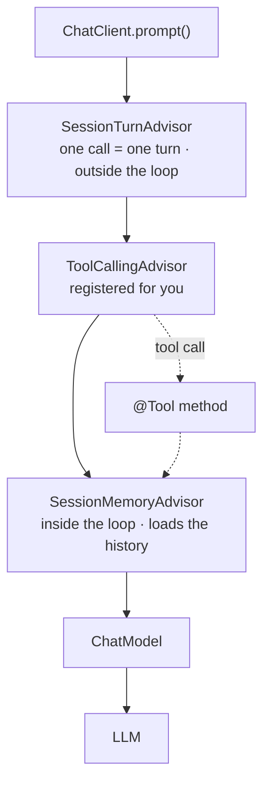
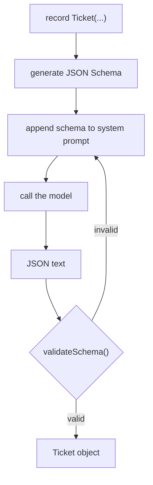
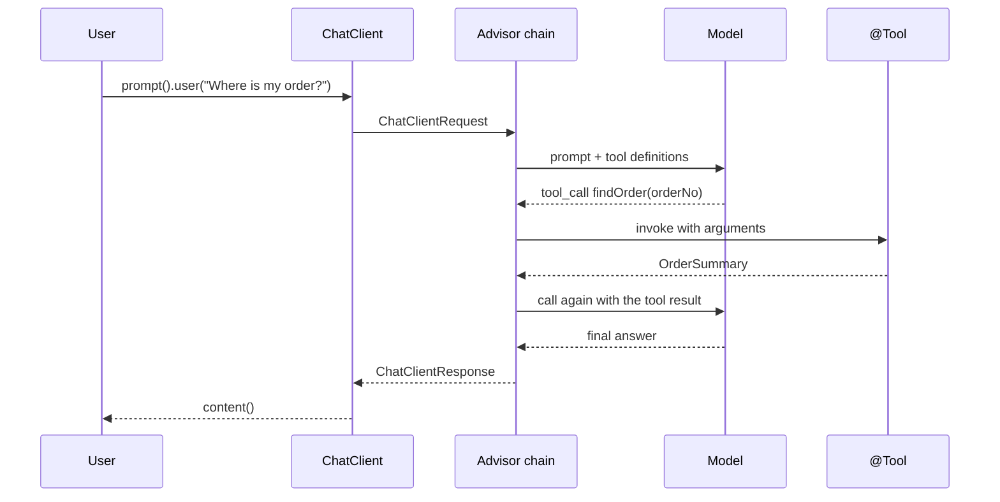

<dl class="facts">
  <div><dt>Spring AI</dt><dd>2.1.0</dd></div>
  <div><dt>Spring Boot</dt><dd>4.2</dd></div>
  <div><dt>Java</dt><dd>21</dd></div>
  <div><dt>Diagrams</dt><dd>3</dd></div>
</dl>

## What 2.1.0 changed

Spring AI 2.1.0 went GA on 20 November 2026, five months after 2.0.0 and more than 430 commits later. Three parts of it matter for the code in this post.

- **It is built on Spring Boot 4.2.** 2.0.x targets Boot 4.0 and 4.1; 2.1.x targets 4.2. Upgrade both together.
- **`ChatMemory` is deprecated.** `MessageChatMemoryAdvisor` and its auto-configuration are deprecated in 2.1.0 and will be removed in 3.0.0. The **Session API** takes over.
- Messages now hold ordered parts, so reasoning blocks and tool calls survive a round trip. On OpenAI the Responses API sits next to Chat Completions.

The compatibility table is short.

| Spring AI | Spring Boot | Notes |
|---|---|---|
| 2.1.x | 4.2.x | What this post uses. Session API |
| 2.0.x | 4.0.x · 4.1.x | `ChatMemory` still current |
| 1.1.x | 3.5.x | 1.x tool loop |

## One BOM, a few starters

Put `spring-ai-bom` on the platform and pick starters. This build uses OpenAI and the JDBC session store.

```kotlin
// build.gradle.kts
import org.springframework.boot.gradle.plugin.SpringBootPlugin

plugins {
    java
    id("org.springframework.boot") version "4.2.0"
}

java { toolchain { languageVersion = JavaLanguageVersion.of(21) } }

repositories { mavenCentral() }

dependencies {
    implementation(platform(SpringBootPlugin.BOM_COORDINATES))
    implementation(platform("org.springframework.ai:spring-ai-bom:2.1.0"))

    implementation("org.springframework.boot:spring-boot-starter-web")
    implementation("org.springframework.ai:spring-ai-starter-model-openai")
    implementation("org.springframework.ai:spring-ai-starter-model-session-jdbc")

    runtimeOnly("com.h2database:h2")
    testImplementation("org.springframework.boot:spring-boot-starter-test")
}
```

```yaml
# application.yml
spring:
  ai:
    openai:
      api-key: ${OPENAI_API_KEY}
      chat:
        options:
          temperature: 0.2
    session:
      repository:
        jdbc:
          initialize-schema: always   # embedded DB in development; use a migration tool in production
```

Leave the model name to the starter default and set `spring.ai.openai.chat.options.model` only when you need another one. With a `DataSource` on the classpath, the session starter auto-configures a `JdbcSessionRepository` and a `SessionService`.

## ChatClient: prompts as code

`ChatClient` is a fluent API in the shape of `WebClient` and `RestClient`. Auto-configuration hands you a `ChatClient.Builder`, so a controller can take it directly.

```java
@RestController
class ChatController {

    private final ChatClient chatClient;

    ChatController(ChatClient.Builder builder) {
        this.chatClient = builder.build();
    }

    @GetMapping("/ai")
    String ask(@RequestParam(defaultValue = "Pick one thing for me to do today") String message) {
        return chatClient.prompt()
                .system("You answer briefly. You do not claim what you cannot back up.")
                .user(message)
                .call()
                .content();
    }
}
```

`.call().content()` returns a string; `.stream().content()` returns a `Flux<String>`. Repeating settings go on the builder as `defaultSystem(...)`, `defaultTools(...)` and `defaultAdvisors(...)`.

From here on, the 2.x shape shows. One `ChatClient` call travels through an **advisor chain**, and the tool loop and the memory each take their place inside it.



## Advisors: order is behaviour

An advisor with a lower `getOrder()` handles the request earlier and the response later. Think of a stack. `SessionAdvisors` builds two of them at their default orders.

- `SessionTurnAdvisor` — `HIGHEST_PRECEDENCE + 200`, **outside** the tool loop. One `ChatClient` call is one turn: it creates a session on first use, stores the tool results of a loop that ended without a model round, and runs compaction after the reply has gone out.
- `SessionMemoryAdvisor` — `HIGHEST_PRECEDENCE + 1000`, **inside** the loop. On every model call it loads the active view into the prompt and stores the request's user message or tool results plus the model's reply.
- `ToolCallingAdvisor` — registered by the `ChatClient` itself. When the model asks for a tool, `ToolCallingManager` runs it and the loop calls the model again with the result.

The memory advisor sits inside the loop for a reason. The loop rebuilds the prompt on every round, so history loaded outside it would be prepended twice. Inside, each round is rebuilt from the session and only that round's trailing message is stored.

## Structured output with `.entity()`

No more cutting JSON out of prose with a regex. Describe the shape as a record and hand it to `.entity()`: Spring AI generates a schema, appends it to the prompt, and parses the answer into your type.

```java
record Ticket(String title, Priority priority, List<String> tags) {}

enum Priority { LOW, NORMAL, HIGH }

Ticket ticket = chatClient.prompt()
        .system("Turn the message into a ticket. At most three tags.")
        .user("I paid last night but the order is not in my history.")
        .call()
        .entity(Ticket.class, spec -> spec.validateSchema());
```

- Plain `.entity()` asks the model to honour the schema; it does not force it. Sometimes a field is missing or prose sneaks in.
- `validateSchema()` retries with the validation error appended to the prompt, three attempts by default.
- `useProviderStructuredOutput()` sends the schema as a provider-level constraint. The two compose.
- For generics such as `List<Ticket>`, pass `new ParameterizedTypeReference<List<Ticket>>() {}`.
- Need token usage too? `.responseEntity(Ticket.class)` returns the `ChatResponse` alongside the entity.
- `.entity()` is `.call()` only. A stream is text chunks, not a typed object.



## Tool calling: one annotation

Getting the model to call your code takes one annotation. A method with `@Tool` becomes a name, a description and a parameter schema that go out with the prompt.

```java
record OrderSummary(String orderNo, String status, int amountWon, LocalDate placedOn) {}

@Component
class OrderTools {

    private final OrderRepository orders;

    OrderTools(OrderRepository orders) {
        this.orders = orders;
    }

    @Tool(description = "Look up the status and paid amount of an order by its number")
    OrderSummary findOrder(
            @ToolParam(description = "Order number, for example ORD-20261127-001") String orderNo) {
        return orders.findSummary(orderNo);
    }
}
```

`@Tool` carries `name`, `description`, `returnDirect`, `requiresConfirmation` and `resultConverter`. Always write the description; without it the model has no reason to pick the tool. Parameters are required by default, and `@ToolParam(required = false)` or `@Nullable` makes one optional. For a GraalVM native image the class holding the tools must be a bean.

There are two places to attach tools: `.tools(...)` for a single call and `.defaultTools(...)` for every call built from that client. A call-level tool **adds to** the defaults. Destructive tools (payments, deletes) belong at the call site, not in the defaults.

```java
@Bean
ChatClient supportClient(ChatClient.Builder builder, OrderTools orderTools) {
    return builder
            .defaultSystem("""
                You are a shop support agent.
                When asked about an order, check it with findOrder and state only what it returns.
                If the tool finds nothing, say so.
                """)
            .defaultTools(orderTools)
            .build();
}
```



One 2.0 change worth knowing: the `SpringBeanToolCallbackResolver` pattern, where a bare `Function` bean was resolved by name, is gone. Tools registered as beans must be `ToolCallback` beans.

## Memory: the Session API

A 2.1 session keeps the conversation as an **append-only log of events**. That is more than the per-conversation list of messages `ChatMemory` held.

- Every message is a `SessionEvent` with an id, a timestamp, its session and metadata.
- Compaction happens only on **turn boundaries**, so the model never sees a tool call without its result. It does not rewrite the log; it appends a boundary that defines the view from then on.
- `SessionRepository` is an SPI with an in-memory implementation for tests and a JDBC one for production.

```java
@Bean
ChatClient supportClient(ChatClient.Builder builder,
                         OrderTools orderTools,
                         SessionService sessionService) {
    return builder
            .defaultSystem("You are a shop support agent. State only what you verified.")
            .defaultTools(orderTools)
            .defaultAdvisors(SessionAdvisors.builder(sessionService)
                    .compaction(new TurnCountTrigger(20),
                                WindowCompactionStrategy.builder().lastTurns(10).build())
                    .asyncCompaction(true)
                    .build())
            .build();
}

// every call needs its session id
String answer = supportClient.prompt()
        .user("Where is order ORD-20261127-001?")
        .advisors(SessionAdvisors.session(userId + ":" + chatId))
        .call()
        .content();
```

The session id is required on every call. There is no fallback, because a shared default would silently merge different users' conversations. A session that does not exist is created on first use. The compaction trigger and strategy go together; setting one alone makes `build()` throw.

One catch for tool-heavy applications: the older `JdbcChatMemoryRepository` silently drops assistant messages that contain tool calls and tool responses. A conversation that uses tools needs the **session JDBC** store, which persists every message type.

The 2.0 way still runs on 2.1, but it is deprecated.

```java
// 2.0.x style — deprecated in 2.1.0, removed in 3.0.0
ChatClient client = builder
        .defaultAdvisors(MessageChatMemoryAdvisor.builder(chatMemory).build())
        .build();

client.prompt()
        .user("What did I say earlier?")
        .advisors(a -> a.param(ChatMemory.CONVERSATION_ID, conversationId))
        .call()
        .content();
```

## Putting it in one request

Structured output, tools and sessions share one chain. Here the support reply comes back typed.

```java
record Reply(String answer, boolean needsHuman, List<String> orderNos) {}

Reply reply = supportClient.prompt()
        .user("I want a refund for ORD-20261127-001. Is that possible?")
        .advisors(SessionAdvisors.session(sessionId))
        .call()
        .entity(Reply.class, spec -> spec.validateSchema());
```

The tool loop runs first, and the final answer is parsed into `Reply`. The session keeps the whole turn — user message, tool calls, tool results and reply — as one unit.

## Checklist

- Upgrade Boot and Spring AI together: 2.1.x with Boot 4.2, 2.0.x with 4.1 or 4.0.
- Write new code with `SessionAdvisors`, not `MessageChatMemoryAdvisor`.
- Derive the session id on the server per user and conversation. Never a fixed value.
- `.entity()` works on `.call()` only; do not expect typed streaming.
- Do not leave tool descriptions empty, and keep risky tools out of `defaultTools`.
- When the shape matters, look at both `validateSchema()` and `useProviderStructuredOutput()`.
- For tool-using conversations, choose the session JDBC store over the old chat memory repository.

2.1 is a release that ships the parts of an agent harness: the `ChatClient` and its advisor chain, the tool loop, and sessions. A separate project that composes several agents on top of it starts incubating in December. Shaping today's code the 2.1 way makes that next step shorter.
