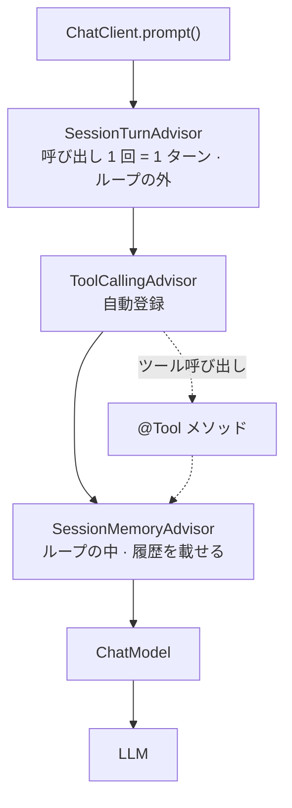
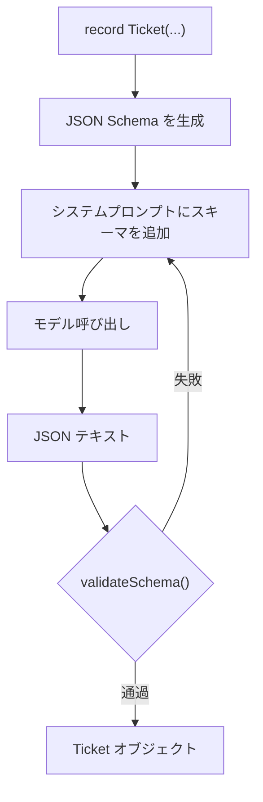
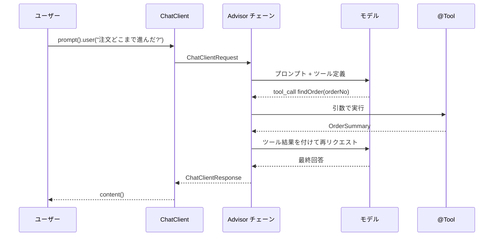

<dl class="facts">
  <div><dt>Spring AI</dt><dd>2.1.0</dd></div>
  <div><dt>Spring Boot</dt><dd>4.2</dd></div>
  <div><dt>Java</dt><dd>21</dd></div>
  <div><dt>図</dt><dd>3<small>個</small></dd></div>
</dl>

## 2.1.0 が変えたものから

Spring AI 2.1.0 が 2026 年 11 月 20 日に GA になりました。2.0.0 から 5 か月、430 を超えるコミットのリリースです。この記事で使える変化は 3 つです。

- **Spring Boot 4.2 ベース**です。2.0.x が Boot 4.0・4.1 なら、2.1.x は 4.2 です。一緒に上げる必要があります。
- **`ChatMemory` が deprecated** になりました。`MessageChatMemoryAdvisor` と関連する auto-configuration も 2.1.0 で deprecated、3.0.0 で削除予定です。代わりに **Session API** が入りました。
- メッセージが複数の part を持てるようになり、推論(reasoning)ブロックやツール呼び出しが往復しても生き残ります。OpenAI は Chat Completions の隣に Responses API も加わりました。

バージョンの互換は公式の表にまとまっています。

| Spring AI | Spring Boot | 備考 |
|---|---|---|
| 2.1.x | 4.2.x | この記事の基準。Session API |
| 2.0.x | 4.0.x · 4.1.x | `ChatMemory` を維持 |
| 1.1.x | 3.5.x | 1.x のツール呼び出しループ |

## 依存関係は BOM ひとつで

`spring-ai-bom` を platform に上げて、スターターを選びます。OpenAI とセッション保存先(JDBC)を使う構成です。

```kotlin
// build.gradle.kts
import org.springframework.boot.gradle.plugin.SpringBootPlugin

plugins {
    java
    id("org.springframework.boot") version "4.2.0"
}

java { toolchain { languageVersion = JavaLanguageVersion.of(21) } }

repositories { mavenCentral() }

dependencies {
    implementation(platform(SpringBootPlugin.BOM_COORDINATES))
    implementation(platform("org.springframework.ai:spring-ai-bom:2.1.0"))

    implementation("org.springframework.boot:spring-boot-starter-web")
    implementation("org.springframework.ai:spring-ai-starter-model-openai")
    implementation("org.springframework.ai:spring-ai-starter-model-session-jdbc")

    runtimeOnly("com.h2database:h2")
    testImplementation("org.springframework.boot:spring-boot-starter-test")
}
```

```yaml
# application.yml
spring:
  ai:
    openai:
      api-key: ${OPENAI_API_KEY}
      chat:
        options:
          temperature: 0.2
    session:
      repository:
        jdbc:
          initialize-schema: always   # 組み込み DB の開発用。本番はマイグレーションツールで
```

モデル名はスターターの既定値を使い、変えるときだけ `spring.ai.openai.chat.options.model` を入れます。セッションスターターは `DataSource` があれば `JdbcSessionRepository` と `SessionService` を自動で作ってくれます。

## ChatClient: プロンプトをコードで書く

`ChatClient` は `WebClient`・`RestClient` に似た fluent API です。auto-configuration が `ChatClient.Builder` を作るので、コントローラーでそのまま受け取れば済みます。

```java
@RestController
class ChatController {

    private final ChatClient chatClient;

    ChatController(ChatClient.Builder builder) {
        this.chatClient = builder.build();
    }

    @GetMapping("/ai")
    String ask(@RequestParam(defaultValue = "今日やることを 1 つだけ選んで") String message) {
        return chatClient.prompt()
                .system("あなたは短く答える秘書だ。根拠のないことは言わない。")
                .user(message)
                .call()
                .content();
    }
}
```

`.call().content()` は文字列を、`.stream().content()` は `Flux<String>` を返します。同じビルダーに `defaultSystem(...)`、`defaultTools(...)`、`defaultAdvisors(...)` を掛けておけば、呼び出しのたびに繰り返さなくて済みます。

ここからが 2.x の核心です。`ChatClient` の呼び出し 1 回は **advisor チェーン**を通り、チェーンの中にツール呼び出しループとメモリがそれぞれの位置で入ります。



## Advisor: 順序がそのまま動作

Advisor は `getOrder()` が小さいものから先にリクエストを処理し、レスポンスは逆順に戻ります。スタックと考えると分かりやすいです。2.1 の `SessionAdvisors` は 2 つをまとめて作り、既定の順序で入れます。

- `SessionTurnAdvisor` — `HIGHEST_PRECEDENCE + 200`、ツールループの**外側**。`ChatClient` の呼び出し 1 回を 1 ターンとみなし、初めて使うセッションを作り、ループがモデルの応答なしで終わった場合のツール結果を保存し、応答が出たあとにコンパクションを掛けます。
- `SessionMemoryAdvisor` — `HIGHEST_PRECEDENCE + 1000`、ツールループの**内側**。モデルを呼ぶたびに、いま見えている会話(active view)をプロンプトに載せ、今回のリクエストのユーザーメッセージ・ツール結果とモデルの応答をログに残します。
- `ToolCallingAdvisor` — `ChatClient` が自分で登録します。モデルがツールを呼べば `ToolCallingManager` で実行し、結果を付けてまた呼びます。

メモリの advisor がループの中にある理由があります。ツールループはラウンドごとにプロンプトを作り直しますが、セッションから読んだ履歴がループの外にあると、同じ会話が 2 回入ってしまいます。内側でラウンドごとに合わせればその問題は起きません。

## 構造化出力: `.entity()`

モデルの答えを文字列で受け取って正規表現で切る仕事は、もう要りません。欲しい形を record で書いて `.entity()` に渡せば、スキーマを作ってプロンプトに入れ、JSON をオブジェクトに展開してくれます。

```java
record Ticket(String title, Priority priority, List<String> tags) {}

enum Priority { LOW, NORMAL, HIGH }

Ticket ticket = chatClient.prompt()
        .system("問い合わせ内容をチケットに整理する。タグは 3 個以下。")
        .user("決済は済んだのに注文履歴が見えません。昨夜買いました。")
        .call()
        .entity(Ticket.class, spec -> spec.validateSchema());
```

- 既定の `.entity()` は「スキーマに合わせて」と頼むだけで、強制はしません。ときどきフィールドが抜けたり、地の文が混ざったりします。
- `validateSchema()` は検証に失敗するとエラーをプロンプトに付けて最大 3 回まで呼び直します。
- `useProviderStructuredOutput()` はスキーマを provider API レベルの制約として送ります。2 つは一緒に使えます。
- `List<Ticket>` のようにジェネリクスなら `new ParameterizedTypeReference<List<Ticket>>() {}` を使います。
- トークン使用量まで要るなら `.responseEntity(Ticket.class)` で `ChatResponse` も一緒に受け取ります。
- `.entity()` は `.call()` 専用です。ストリーミングは断片テキストなので型に展開できません。



## ツール呼び出し: `@Tool` ひとつで済む

モデルにこちらのコードを呼ばせるのに必要なのは、アノテーション 1 つです。`@Tool` が付いたメソッドは名前・説明・パラメータースキーマになってモデルに渡ります。

```java
record OrderSummary(String orderNo, String status, int amountWon, LocalDate placedOn) {}

@Component
class OrderTools {

    private final OrderRepository orders;

    OrderTools(OrderRepository orders) {
        this.orders = orders;
    }

    @Tool(description = "注文番号で注文の状態と決済金額を照会する")
    OrderSummary findOrder(
            @ToolParam(description = "注文番号。例: ORD-20261127-001") String orderNo) {
        return orders.findSummary(orderNo);
    }
}
```

`@Tool` は `name`、`description`、`returnDirect`、`requiresConfirmation`、`resultConverter` を受けます。説明は必ず書きます。ないとモデルはいつ呼ぶべきか分かりません。パラメーターは既定が必須で、`@ToolParam(required = false)` や `@Nullable` で任意にできます。AOT ネイティブイメージを使うなら、ツールを持つクラスはビーンでなければなりません。

ツールを付ける場所は 2 か所です。呼び出しごとにだけ使うなら `.tools(...)`、クライアント全体で使うなら `.defaultTools(...)` です。呼び出し時のツールは既定のツールに**加わります**。決済・削除のように危ないツールは既定値ではなく、呼び出し時に付けるほうが安全です。

```java
@Bean
ChatClient supportClient(ChatClient.Builder builder, OrderTools orderTools) {
    return builder
            .defaultSystem("""
                あなたはショッピングモールのカスタマーサポート担当だ。
                注文の状態を聞かれたら findOrder ツールで確認し、確認した値だけを言う。
                ツールが見つけられなければ、見つからなかったと答える。
                """)
            .defaultTools(orderTools)
            .build();
}
```



2.0 で変わった点をひとつ。以前は `Function` ビーンを名前で探してツールにする `SpringBeanToolCallbackResolver` 方式がありましたが、2.0 でなくなりました。ビーンとして登録するツールは `ToolCallback` 型でなければなりません。

## メモリ: いまは Session

2.1 の Session は会話を **append-only のイベントログ**として置きます。`ChatMemory` が会話 ID ごとのメッセージ一覧だけを持っていたのとは違います。

- すべてのメッセージが `SessionEvent` なので、id・時刻・セッション・メタデータが付きます。
- コンパクションは**ターンの境界**でだけ起きます。ツール呼び出しだけが残って結果が消えることはありません。コンパクションはログを書き換えず、「ここから見せる」という境界を足すだけです。
- `SessionRepository` SPI があり、テスト用の in-memory と本番用の JDBC 実装があります。

```java
@Bean
ChatClient supportClient(ChatClient.Builder builder,
                         OrderTools orderTools,
                         SessionService sessionService) {
    return builder
            .defaultSystem("あなたはショッピングモールのカスタマーサポート担当だ。確認した値だけを言う。")
            .defaultTools(orderTools)
            .defaultAdvisors(SessionAdvisors.builder(sessionService)
                    .compaction(new TurnCountTrigger(20),
                                WindowCompactionStrategy.builder().lastTurns(10).build())
                    .asyncCompaction(true)
                    .build())
            .build();
}

// 呼び出すときにセッション id を必ず渡す
String answer = supportClient.prompt()
        .user("ORD-20261127-001 の注文はどこまで進んだ?")
        .advisors(SessionAdvisors.session(userId + ":" + chatId))
        .call()
        .content();
```

セッション id は呼び出しのたびに必要です。既定のセッションのようなものはありません。共通の既定値を置くと、別のユーザーの会話が静かに混ざるからです。ないセッションは初めて使うときに作られます。コンパクションのトリガーと戦略は一緒に入れる必要があり、片方だけだと `build()` が例外を投げます。

JDBC 保存先を使うとき、ツール呼び出しが多いアプリケーションなら注意があります。以前の `JdbcChatMemoryRepository` はツール呼び出しのメッセージとツール応答を保存せず、静かに捨てていました。ツールを使う会話なら、すべてのメッセージタイプを保存する**セッション JDBC** に移るべきです。

2.0 まで使っていた方式はこうです。2.1 でも動きますが deprecated です。

```java
// 2.0.x の方式 — 2.1.0 で deprecated、3.0.0 で削除予定
ChatClient client = builder
        .defaultAdvisors(MessageChatMemoryAdvisor.builder(chatMemory).build())
        .build();

client.prompt()
        .user("前に何て言ったっけ?")
        .advisors(a -> a.param(ChatMemory.CONVERSATION_ID, conversationId))
        .call()
        .content();
```

## 1 つのリクエストにまとめると

構造化出力とツール呼び出し、セッションは同じチェーンで一緒に使います。サポートの回答を構造化して返す例です。

```java
record Reply(String answer, boolean needsHuman, List<String> orderNos) {}

Reply reply = supportClient.prompt()
        .user("ORD-20261127-001、返金してほしいです。できますか?")
        .advisors(SessionAdvisors.session(sessionId))
        .call()
        .entity(Reply.class, spec -> spec.validateSchema());
```

ツールループが先に回り、その結果をもとに最後の応答が `Reply` に展開されます。セッションにはこのターン全体(ユーザーメッセージ、ツール呼び出し、ツール結果、答え)がひとまとまりで残ります。

## チェックリスト

- Boot と Spring AI を一緒に上げる。2.1.x は Boot 4.2、2.0.x は 4.1・4.0 だ。
- 新しいコードは `MessageChatMemoryAdvisor` ではなく `SessionAdvisors` で書く。
- セッション id はサーバーでユーザー・会話単位に作る。固定値を使わない。
- `.entity()` は `.call()` だけで。ストリーミングの応答を型で受け取ろうとしない。
- ツールの説明を空にしない。危ないツールは `defaultTools` に入れない。
- 構造化出力が大事なら `validateSchema()` と `useProviderStructuredOutput()` を一緒に検討する。
- ツールを使う会話の JDBC 保存先はセッション JDBC を選ぶ。

2.1 は「エージェントハーネスの部品」を押し込むリリースです。`ChatClient` と advisor チェーン、ツールループ、セッションがその部品で、12 月からはこの上で複数のエージェントを組み合わせるプロジェクトが別に出るそうです。いまのコードを 2.1 の形に合わせておけば、その次が楽になります。
