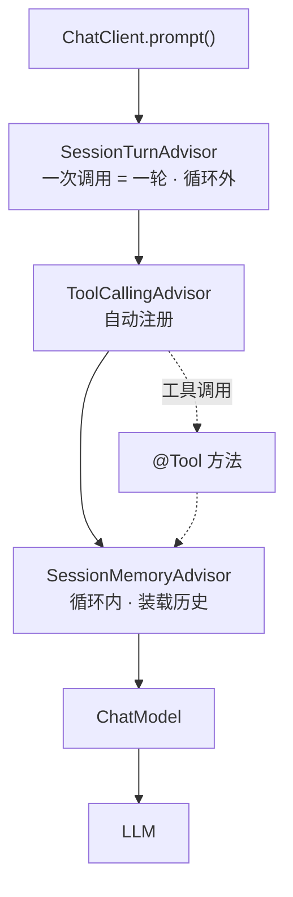
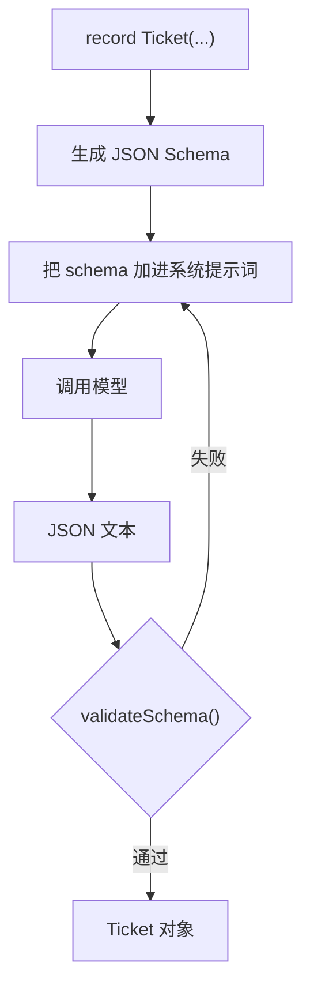
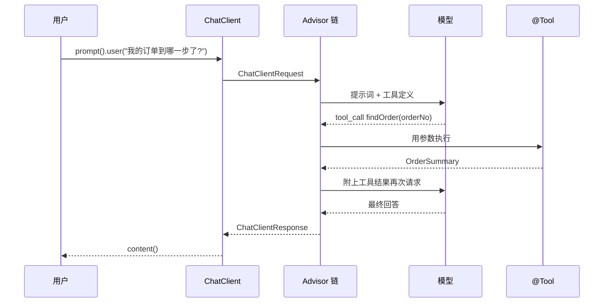

<dl class="facts">
  <div><dt>Spring AI</dt><dd>2.1.0</dd></div>
  <div><dt>Spring Boot</dt><dd>4.2</dd></div>
  <div><dt>Java</dt><dd>21</dd></div>
  <div><dt>图</dt><dd>3<small>张</small></dd></div>
</dl>

## 先说 2.1.0 改了什么

Spring AI 2.1.0 于 2026 年 11 月 20 日 GA。距离 2.0.0 五个月，是 430 多个提交的版本。这里能用到三处变化。

- **基于 Spring Boot 4.2**。2.0.x 对应 Boot 4.0·4.1，2.1.x 对应 4.2，要一起升。
- **`ChatMemory` 被标为 deprecated**。`MessageChatMemoryAdvisor` 和相关 auto-configuration 也在 2.1.0 中 deprecated，计划在 3.0.0 移除。取而代之的是 **Session API**。
- 消息可以携带多个 part，推理(reasoning)块和工具调用来回往返也能保留下来。OpenAI 在 Chat Completions 旁边也加了 Responses API。

版本兼容有官方表格。

| Spring AI | Spring Boot | 备注 |
|---|---|---|
| 2.1.x | 4.2.x | 本文基准。Session API |
| 2.0.x | 4.0.x · 4.1.x | 保留 `ChatMemory` |
| 1.1.x | 3.5.x | 1.x 的工具调用循环 |

## 依赖只要一个 BOM

把 `spring-ai-bom` 作为 platform 引入，再挑 starter。下面是使用 OpenAI 和会话存储(JDBC)的配置。

```kotlin
// build.gradle.kts
import org.springframework.boot.gradle.plugin.SpringBootPlugin

plugins {
    java
    id("org.springframework.boot") version "4.2.0"
}

java { toolchain { languageVersion = JavaLanguageVersion.of(21) } }

repositories { mavenCentral() }

dependencies {
    implementation(platform(SpringBootPlugin.BOM_COORDINATES))
    implementation(platform("org.springframework.ai:spring-ai-bom:2.1.0"))

    implementation("org.springframework.boot:spring-boot-starter-web")
    implementation("org.springframework.ai:spring-ai-starter-model-openai")
    implementation("org.springframework.ai:spring-ai-starter-model-session-jdbc")

    runtimeOnly("com.h2database:h2")
    testImplementation("org.springframework.boot:spring-boot-starter-test")
}
```

```yaml
# application.yml
spring:
  ai:
    openai:
      api-key: ${OPENAI_API_KEY}
      chat:
        options:
          temperature: 0.2
    session:
      repository:
        jdbc:
          initialize-schema: always   # 内嵌数据库开发用。生产环境交给迁移工具
```

模型名用 starter 的默认值，要改时再加 `spring.ai.openai.chat.options.model`。会话 starter 只要有 `DataSource`，就会自动造出 `JdbcSessionRepository` 和 `SessionService`。

## ChatClient：用代码写提示词

`ChatClient` 是类似 `WebClient`、`RestClient` 的 fluent API。auto-configuration 会造出 `ChatClient.Builder`，在控制器里直接接住就行。

```java
@RestController
class ChatController {

    private final ChatClient chatClient;

    ChatController(ChatClient.Builder builder) {
        this.chatClient = builder.build();
    }

    @GetMapping("/ai")
    String ask(@RequestParam(defaultValue = "帮我挑一件今天要做的事") String message) {
        return chatClient.prompt()
                .system("你是回答简短的秘书。不说没有根据的话。")
                .user(message)
                .call()
                .content();
    }
}
```

`.call().content()` 返回字符串，`.stream().content()` 返回 `Flux<String>`。在同一个 builder 上挂 `defaultSystem(...)`、`defaultTools(...)`、`defaultAdvisors(...)`，每次调用就不用重复。

从这里开始是 2.x 的核心。一次 `ChatClient` 调用会经过 **advisor 链**，链里工具调用循环和记忆各占各的位置。



## Advisor：顺序就是行为

Advisor 中 `getOrder()` 小的先处理请求，响应则反向返回。想成栈就很容易。2.1 的 `SessionAdvisors` 一次造出两个，按默认顺序放进去。

- `SessionTurnAdvisor` — `HIGHEST_PRECEDENCE + 200`，工具循环**外侧**。把一次 `ChatClient` 调用当作一轮，创建首次使用的会话，保存循环在没有模型响应就结束时产生的工具结果，并在响应发出后触发压缩。
- `SessionMemoryAdvisor` — `HIGHEST_PRECEDENCE + 1000`，工具循环**内侧**。每次调用模型时把当前可见的对话(active view)装进提示词，并把本次请求的用户消息、工具结果和模型响应记进日志。
- `ToolCallingAdvisor` — `ChatClient` 自己注册。模型调用工具时用 `ToolCallingManager` 执行，把结果附上再调一次。

记忆 advisor 放在循环里有理由。工具循环每一轮都重建提示词，从会话读出的历史如果在循环外，同一段对话就会进去两次。放在内侧每轮对齐，就没有这个问题。

## 结构化输出：`.entity()`

把模型回答当字符串接住再用正则切的日子过去了。想要的样子写成 record 交给 `.entity()`，它会生成 schema 塞进提示词，再把 JSON 展开成对象。

```java
record Ticket(String title, Priority priority, List<String> tags) {}

enum Priority { LOW, NORMAL, HIGH }

Ticket ticket = chatClient.prompt()
        .system("把咨询内容整理成工单。标签不超过 3 个。")
        .user("付款成功了却看不到订单记录。昨晚买的。")
        .call()
        .entity(Ticket.class, spec -> spec.validateSchema());
```

- 默认的 `.entity()` 只是「请按 schema」地请求，并不强制。偶尔会缺字段，或者混进散文。
- `validateSchema()` 校验失败时把错误附到提示词里，最多重试 3 次。
- `useProviderStructuredOutput()` 把 schema 作为 provider API 级别的约束发送。两者可以一起用。
- 像 `List<Ticket>` 这样的泛型，用 `new ParameterizedTypeReference<List<Ticket>>() {}`。
- 还需要 token 用量时，用 `.responseEntity(Ticket.class)` 一并拿到 `ChatResponse`。
- `.entity()` 只用于 `.call()`。流式是碎片文本，没法展开成类型。



## 工具调用：一个 `@Tool` 就够

让模型调用我们的代码，只需要一个注解。带 `@Tool` 的方法会变成名字、说明和参数 schema，传给模型。

```java
record OrderSummary(String orderNo, String status, int amountWon, LocalDate placedOn) {}

@Component
class OrderTools {

    private final OrderRepository orders;

    OrderTools(OrderRepository orders) {
        this.orders = orders;
    }

    @Tool(description = "按订单号查询订单状态和支付金额")
    OrderSummary findOrder(
            @ToolParam(description = "订单号。例: ORD-20261127-001") String orderNo) {
        return orders.findSummary(orderNo);
    }
}
```

`@Tool` 接受 `name`、`description`、`returnDirect`、`requiresConfirmation`、`resultConverter`。说明一定要写，不写模型就不知道该什么时候调。参数默认必填，用 `@ToolParam(required = false)` 或 `@Nullable` 可以改成可选。用 AOT 原生镜像的话，装工具的类必须是 bean。

挂工具有两个地方。只在某次调用里用就 `.tools(...)`，给整个客户端用就 `.defaultTools(...)`。调用时的工具会**加到**默认工具上。支付、删除这类危险工具，不要放进默认值，在调用时挂上更安全。

```java
@Bean
ChatClient supportClient(ChatClient.Builder builder, OrderTools orderTools) {
    return builder
            .defaultSystem("""
                你是商城的客服。
                问订单状态时用 findOrder 工具确认，只说确认过的值。
                工具找不到就回答没找到。
                """)
            .defaultTools(orderTools)
            .build();
}
```



和 2.0 不同的一点。以前有按名字找 `Function` bean 当工具用的 `SpringBeanToolCallbackResolver` 方式，2.0 里没了。注册成 bean 的工具必须是 `ToolCallback` 类型。

## 记忆：现在是 Session

2.1 的 Session 把对话放在 **append-only 的事件日志**里。和 `ChatMemory` 只持有按对话 ID 分组的消息列表不同。

- 每条消息都是 `SessionEvent`，带 id、时间、会话和元数据。
- 压缩只发生在**轮的边界**。不会出现只剩工具调用、结果却消失的情况。压缩不改日志，只追加一条「从这里开始展示」的边界。
- 有 `SessionRepository` SPI，测试用 in-memory，生产用 JDBC 实现。

```java
@Bean
ChatClient supportClient(ChatClient.Builder builder,
                         OrderTools orderTools,
                         SessionService sessionService) {
    return builder
            .defaultSystem("你是商城的客服。只说确认过的值。")
            .defaultTools(orderTools)
            .defaultAdvisors(SessionAdvisors.builder(sessionService)
                    .compaction(new TurnCountTrigger(20),
                                WindowCompactionStrategy.builder().lastTurns(10).build())
                    .asyncCompaction(true)
                    .build())
            .build();
}

// 调用时一定要传会话 id
String answer = supportClient.prompt()
        .user("ORD-20261127-001 这单到哪一步了?")
        .advisors(SessionAdvisors.session(userId + ":" + chatId))
        .call()
        .content();
```

会话 id 每次调用都需要。没有所谓默认会话。放一个公共默认值，不同用户的对话就会悄悄混在一起。不存在的会话在第一次使用时创建。压缩触发器和策略必须一起给，只给一个 `build()` 会抛异常。

用 JDBC 存储时，如果应用里工具调用很多，有一点要注意。以前的 `JdbcChatMemoryRepository` 不保存工具调用消息和工具响应，会悄悄过滤掉。使用工具的对话要换成保存所有消息类型的**会话 JDBC**。

2.0 之前的用法长这样。2.1 里还能跑，但已 deprecated。

```java
// 2.0.x 的方式 — 2.1.0 deprecated，计划 3.0.0 移除
ChatClient client = builder
        .defaultAdvisors(MessageChatMemoryAdvisor.builder(chatMemory).build())
        .build();

client.prompt()
        .user("我刚才说什么了?")
        .advisors(a -> a.param(ChatMemory.CONVERSATION_ID, conversationId))
        .call()
        .content();
```

## 把一次请求全串起来

结构化输出、工具调用和会话在同一个链里一起用。下面是结构化返回客服回答的例子。

```java
record Reply(String answer, boolean needsHuman, List<String> orderNos) {}

Reply reply = supportClient.prompt()
        .user("ORD-20261127-001 我想退款，可以吗?")
        .advisors(SessionAdvisors.session(sessionId))
        .call()
        .entity(Reply.class, spec -> spec.validateSchema());
```

工具循环先跑，最后基于结果把回答展开成 `Reply`。会话里这一整轮(用户消息、工具调用、工具结果、回答)作为一个整体留下来。

## 检查清单

- Boot 和 Spring AI 一起升。2.1.x 对应 Boot 4.2，2.0.x 对应 4.1·4.0。
- 新代码用 `SessionAdvisors`，不要用 `MessageChatMemoryAdvisor`。
- 会话 id 在服务器端按用户·对话生成，不要用固定值。
- `.entity()` 只在 `.call()` 用。别想把流式响应接成类型。
- 不要留空工具说明。危险工具不要放进 `defaultTools`。
- 结构化输出重要的话，`validateSchema()` 和 `useProviderStructuredOutput()` 一起考虑。
- 用工具的对话，JDBC 存储选会话 JDBC。

2.1 是一个把「智能体骨架部件」塞进来的版本。`ChatClient` 和 advisor 链、工具循环、会话都是这些部件，据说 12 月起还会单独出一个在它之上组合多个智能体的项目。现在把代码对齐成 2.1 的样子，下一步会轻松很多。
