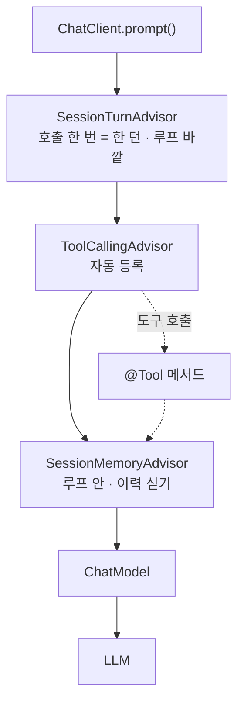
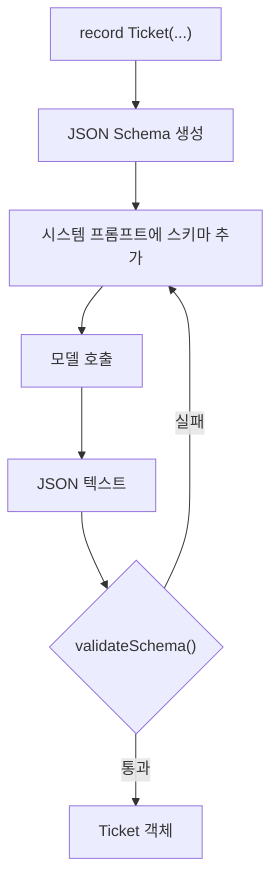
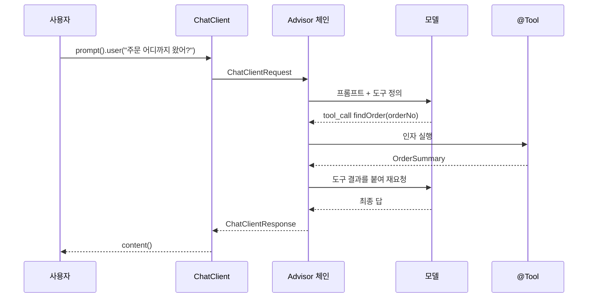

<dl class="facts">
  <div><dt>Spring AI</dt><dd>2.1.0</dd></div>
  <div><dt>Spring Boot</dt><dd>4.2</dd></div>
  <div><dt>Java</dt><dd>21</dd></div>
  <div><dt>그림</dt><dd>3<small>개</small></dd></div>
</dl>

## 2.1.0이 바꾼 것부터

Spring AI 2.1.0이 2026년 11월 20일에 GA로 올라왔습니다. 2.0.0 이후 다섯 달, 커밋 430개가 넘는 릴리스입니다. 이 글에서 쓸 만한 변화는 세 가지입니다.

- **Spring Boot 4.2 기반**입니다. 2.0.x가 Boot 4.0·4.1이라면 2.1.x는 4.2입니다. 같이 올려야 합니다.
- **`ChatMemory`가 deprecated** 되었습니다. `MessageChatMemoryAdvisor`와 관련 auto-configuration도 2.1.0에서 deprecated, 3.0.0에서 제거 예정입니다. 대신 **Session API**가 들어왔습니다.
- 메시지가 여러 조각(part)을 담게 되면서 추론(reasoning) 블록과 도구 호출이 왕복해도 살아남습니다. OpenAI는 Chat Completions 옆에 Responses API도 붙었습니다.

버전 호환은 공식 표로 정리됩니다.

| Spring AI | Spring Boot | 비고 |
|---|---|---|
| 2.1.x | 4.2.x | 이 글의 기준. Session API |
| 2.0.x | 4.0.x · 4.1.x | `ChatMemory` 유지 |
| 1.1.x | 3.5.x | 1.x 도구 호출 루프 |

## 의존성은 BOM 하나로

`spring-ai-bom`을 platform으로 올리고 스타터를 고릅니다. OpenAI와 세션 저장소(JDBC)를 쓰는 구성입니다.

```kotlin
// build.gradle.kts
import org.springframework.boot.gradle.plugin.SpringBootPlugin

plugins {
    java
    id("org.springframework.boot") version "4.2.0"
}

java { toolchain { languageVersion = JavaLanguageVersion.of(21) } }

repositories { mavenCentral() }

dependencies {
    implementation(platform(SpringBootPlugin.BOM_COORDINATES))
    implementation(platform("org.springframework.ai:spring-ai-bom:2.1.0"))

    implementation("org.springframework.boot:spring-boot-starter-web")
    implementation("org.springframework.ai:spring-ai-starter-model-openai")
    implementation("org.springframework.ai:spring-ai-starter-model-session-jdbc")

    runtimeOnly("com.h2database:h2")
    testImplementation("org.springframework.boot:spring-boot-starter-test")
}
```

```yaml
# application.yml
spring:
  ai:
    openai:
      api-key: ${OPENAI_API_KEY}
      chat:
        options:
          temperature: 0.2
    session:
      repository:
        jdbc:
          initialize-schema: always   # 내장 DB 개발용. 운영은 마이그레이션 도구로
```

모델 이름은 스타터 기본값을 쓰고, 바꿀 때만 `spring.ai.openai.chat.options.model`을 넣습니다. 세션 스타터는 `DataSource`가 있으면 `JdbcSessionRepository`와 `SessionService`를 알아서 만들어 줍니다.

## ChatClient: 프롬프트를 코드로 쓰는 법

`ChatClient`는 `WebClient`·`RestClient`와 비슷한 fluent API입니다. auto-configuration이 `ChatClient.Builder`를 만들어 주므로 컨트롤러에 그대로 받으면 됩니다.

```java
@RestController
class ChatController {

    private final ChatClient chatClient;

    ChatController(ChatClient.Builder builder) {
        this.chatClient = builder.build();
    }

    @GetMapping("/ai")
    String ask(@RequestParam(defaultValue = "오늘 할 일 하나만 골라 줘") String message) {
        return chatClient.prompt()
                .system("너는 짧게 답하는 비서다. 근거 없는 말은 하지 않는다.")
                .user(message)
                .call()
                .content();
    }
}
```

`.call().content()`는 문자열을, `.stream().content()`은 `Flux<String>`을 돌려줍니다. 같은 빌더에 `defaultSystem(...)`, `defaultTools(...)`, `defaultAdvisors(...)`를 걸어 두면 매 호출에서 반복하지 않아도 됩니다.

여기서부터가 2.x의 핵심입니다. `ChatClient` 호출 한 번은 **advisor 체인**을 지나고, 체인 안에 도구 호출 루프와 메모리가 각자의 자리로 들어갑니다.



## Advisor: 순서가 곧 동작

Advisor는 `getOrder()`가 낮은 것부터 요청을 먼저 처리하고, 응답은 반대로 돌아옵니다. 스택이라고 생각하면 쉽습니다. 2.1의 `SessionAdvisors`는 두 개를 한 번에 만들어 기본 순서로 넣습니다.

- `SessionTurnAdvisor` — `HIGHEST_PRECEDENCE + 200`, 도구 루프 **바깥**. `ChatClient` 호출 한 번을 한 턴으로 보고, 처음 쓰는 세션을 만들고, 루프가 모델 응답 없이 끝난 경우의 도구 결과를 저장하고, 응답이 나간 뒤 컴팩션을 겁니다.
- `SessionMemoryAdvisor` — `HIGHEST_PRECEDENCE + 1000`, 도구 루프 **안**. 모델을 부를 때마다 지금 보이는 대화(active view)를 프롬프트에 얹고, 이번 요청의 사용자 메시지·도구 결과와 모델 응답을 로그에 남깁니다.
- `ToolCallingAdvisor` — `ChatClient`가 스스로 등록합니다. 모델이 도구를 부르면 `ToolCallingManager`로 실행하고 결과를 붙여 다시 부릅니다.

메모리 advisor가 루프 안에 있는 이유가 있습니다. 도구 루프는 라운드마다 프롬프트를 다시 만드는데, 세션에서 읽은 이력이 루프 밖에 있으면 같은 대화가 두 번 들어갑니다. 안쪽에서 라운드마다 맞추면 그 문제가 없습니다.

## 구조화 출력: `.entity()`

모델 답을 문자열로 받아 정규식으로 자르는 일은 이제 안 해도 됩니다. 원하는 모양을 record로 적고 `.entity()`에 넘기면, 스키마를 만들어 프롬프트에 넣고 JSON을 객체로 풀어 줍니다.

```java
record Ticket(String title, Priority priority, List<String> tags) {}

enum Priority { LOW, NORMAL, HIGH }

Ticket ticket = chatClient.prompt()
        .system("문의 내용을 티켓으로 정리한다. 태그는 3개 이하.")
        .user("결제는 됐는데 주문 내역이 안 보여요. 어제 밤에 샀어요.")
        .call()
        .entity(Ticket.class, spec -> spec.validateSchema());
```

- 기본 `.entity()`는 "스키마에 맞춰 달라"고 부탁할 뿐 강제하지 않습니다. 가끔 필드가 빠지거나 산문이 섞입니다.
- `validateSchema()`는 검증에 실패하면 오류를 프롬프트에 붙여 최대 3번까지 다시 부릅니다.
- `useProviderStructuredOutput()`은 스키마를 provider API 수준 제약으로 보냅니다. 둘은 같이 쓸 수 있습니다.
- `List<Ticket>`처럼 제네릭이면 `new ParameterizedTypeReference<List<Ticket>>() {}`를 씁니다.
- 토큰 사용량까지 필요하면 `.responseEntity(Ticket.class)`로 `ChatResponse`를 같이 받습니다.
- `.entity()`는 `.call()` 전용입니다. 스트리밍은 조각 텍스트라 타입으로 풀 수 없습니다.



## 도구 호출: `@Tool` 하나면 끝

모델이 우리 코드를 부르게 하는 데 필요한 건 애노테이션 하나입니다. `@Tool`이 붙은 메서드는 이름·설명·파라미터 스키마가 되어 모델에 전달됩니다.

```java
record OrderSummary(String orderNo, String status, int amountWon, LocalDate placedOn) {}

@Component
class OrderTools {

    private final OrderRepository orders;

    OrderTools(OrderRepository orders) {
        this.orders = orders;
    }

    @Tool(description = "주문 번호로 주문 상태와 결제 금액을 조회한다")
    OrderSummary findOrder(
            @ToolParam(description = "주문 번호. 예: ORD-20261127-001") String orderNo) {
        return orders.findSummary(orderNo);
    }
}
```

`@Tool`은 `name`, `description`, `returnDirect`, `requiresConfirmation`, `resultConverter`를 받습니다. 설명은 반드시 씁니다. 없으면 모델은 언제 불러야 할지 모릅니다. 파라미터는 기본이 필수이고, `@ToolParam(required = false)`나 `@Nullable`로 선택으로 만들 수 있습니다. AOT 네이티브 이미지를 쓴다면 도구를 담은 클래스가 빈이어야 합니다.

도구를 붙이는 곳은 두 군데입니다. 매 호출에만 쓰려면 `.tools(...)`, 클라이언트 전체에 쓰려면 `.defaultTools(...)`입니다. 호출 시점 도구는 기본 도구에 **더해집니다**. 결제·삭제처럼 위험한 도구는 기본값이 아니라 호출 시점에 붙이는 편이 안전합니다.

```java
@Bean
ChatClient supportClient(ChatClient.Builder builder, OrderTools orderTools) {
    return builder
            .defaultSystem("""
                너는 쇼핑몰 고객센터 상담원이다.
                주문 상태를 물으면 findOrder 도구로 확인하고, 확인한 값만 말한다.
                도구가 찾지 못하면 찾지 못했다고 답한다.
                """)
            .defaultTools(orderTools)
            .build();
}
```



2.0에서 달라진 점 하나. 예전에는 `Function` 빈을 이름으로 찾아 도구로 쓰는 `SpringBeanToolCallbackResolver` 방식이 있었지만 2.0에서 사라졌습니다. 빈으로 등록할 도구는 `ToolCallback` 타입이어야 합니다.

## 메모리: 이제 Session

2.1의 Session은 대화를 **append-only 이벤트 로그**로 둡니다. `ChatMemory`가 대화 ID별 메시지 목록만 들고 있던 것과 다릅니다.

- 모든 메시지는 `SessionEvent`라서 id·시각·세션·메타데이터가 붙습니다.
- 컴팩션은 **턴 경계**에서만 일어납니다. 도구 호출만 남고 결과가 사라지는 일이 없습니다. 컴팩션은 로그를 고치지 않고 "여기부터 보여 준다"는 경계를 덧붙입니다.
- `SessionRepository` SPI가 있고, 테스트용 in-memory와 운영용 JDBC 구현이 있습니다.

```java
@Bean
ChatClient supportClient(ChatClient.Builder builder,
                         OrderTools orderTools,
                         SessionService sessionService) {
    return builder
            .defaultSystem("너는 쇼핑몰 고객센터 상담원이다. 확인한 값만 말한다.")
            .defaultTools(orderTools)
            .defaultAdvisors(SessionAdvisors.builder(sessionService)
                    .compaction(new TurnCountTrigger(20),
                                WindowCompactionStrategy.builder().lastTurns(10).build())
                    .asyncCompaction(true)
                    .build())
            .build();
}

// 호출할 때 세션 id 를 반드시 넘긴다
String answer = supportClient.prompt()
        .user("ORD-20261127-001 주문 어디까지 왔어?")
        .advisors(SessionAdvisors.session(userId + ":" + chatId))
        .call()
        .content();
```

세션 id는 매 호출에 필요합니다. 기본 세션 같은 건 없습니다. 공용 기본값을 두면 서로 다른 사용자의 대화가 조용히 섞이기 때문입니다. 없는 세션은 처음 쓸 때 만들어집니다. 컴팩션 트리거와 전략은 함께 넣어야 하고, 하나만 넣으면 `build()`가 예외를 던집니다.

JDBC 저장소를 쓸 때 도구 호출이 많은 애플리케이션이라면 주의할 점이 있습니다. 예전 `JdbcChatMemoryRepository`는 도구 호출 메시지와 도구 응답을 저장하지 않고 조용히 걸러 냈습니다. 도구를 쓰는 대화라면 모든 메시지 타입을 저장하는 **세션 JDBC**로 가야 합니다.

2.0까지 쓰던 방식은 이렇게 생겼습니다. 2.1에서도 돌아가지만 deprecated입니다.

```java
// 2.0.x 방식 — 2.1.0 에서 deprecated, 3.0.0 에서 제거 예정
ChatClient client = builder
        .defaultAdvisors(MessageChatMemoryAdvisor.builder(chatMemory).build())
        .build();

client.prompt()
        .user("이전에 뭐라고 했지?")
        .advisors(a -> a.param(ChatMemory.CONVERSATION_ID, conversationId))
        .call()
        .content();
```

## 한 요청에 다 묶으면

구조화 출력과 도구 호출, 세션은 같은 체인에서 같이 씁니다. 상담 답변을 구조화해서 돌려주는 예입니다.

```java
record Reply(String answer, boolean needsHuman, List<String> orderNos) {}

Reply reply = supportClient.prompt()
        .user("ORD-20261127-001 환불되고 싶어요. 가능해?")
        .advisors(SessionAdvisors.session(sessionId))
        .call()
        .entity(Reply.class, spec -> spec.validateSchema());
```

도구 루프가 먼저 돌고, 그 결과를 바탕으로 마지막 응답이 `Reply`로 풀립니다. 세션에는 이번 턴 전체(사용자 메시지, 도구 호출, 도구 결과, 답)가 한 묶음으로 남습니다.

## 체크리스트

- Boot와 Spring AI를 같이 올린다. 2.1.x는 Boot 4.2, 2.0.x는 4.1·4.0이다.
- 새 코드는 `MessageChatMemoryAdvisor` 대신 `SessionAdvisors`로 쓴다.
- 세션 id는 서버에서 사용자·대화 단위로 만든다. 고정값을 쓰지 않는다.
- `.entity()`는 `.call()`에서만. 스트리밍 응답을 타입으로 받으려 하지 않는다.
- 도구 설명을 비우지 않는다. 위험한 도구는 `defaultTools`에 넣지 않는다.
- 구조화 출력이 중요하면 `validateSchema()`와 `useProviderStructuredOutput()`을 같이 검토한다.
- 도구를 쓰는 대화의 JDBC 저장소는 세션 JDBC를 고른다.

2.1은 "에이전트 하네스의 부품"을 밀어 넣는 릴리스입니다. `ChatClient`와 advisor 체인, 도구 루프, 세션이 그 부품이고, 12월부터는 이 위에 여러 에이전트를 조합하는 프로젝트가 별도로 나온다고 합니다. 지금 코드를 2.1 모양으로 맞춰 두면 그다음이 수월합니다.
