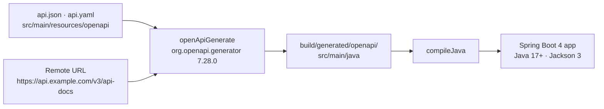
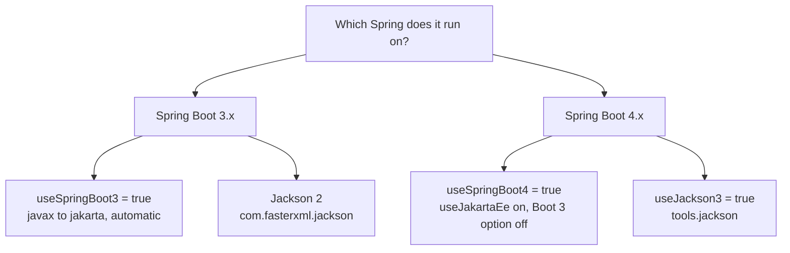
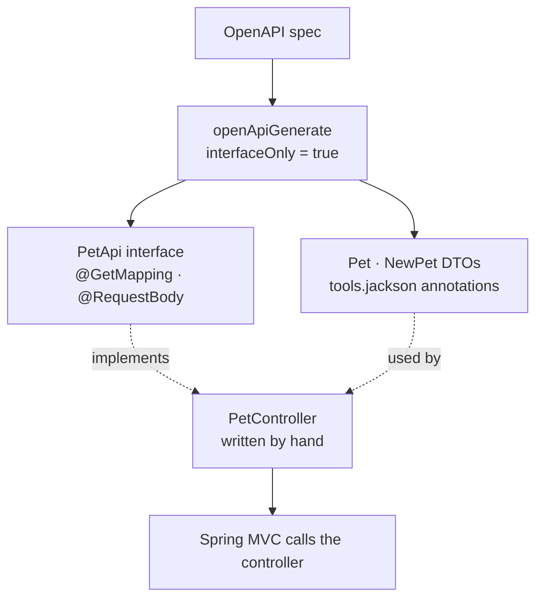
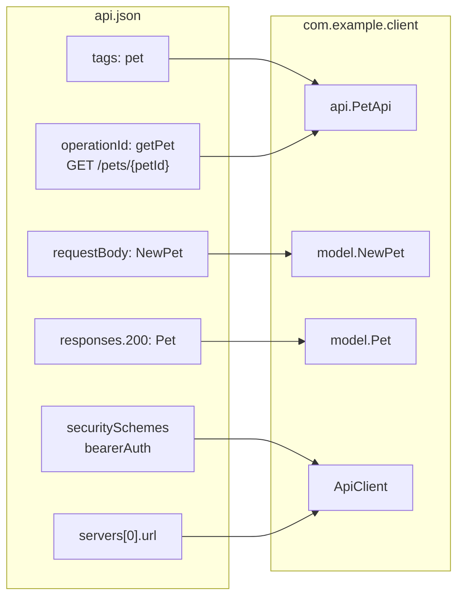

<dl class="facts">
  <div><dt>Plugin</dt><dd>7.28.0</dd></div>
  <div><dt>Spring Boot</dt><dd>4.2.0</dd></div>
  <div><dt>Minimum Java</dt><dd>17</dd></div>
  <div><dt>Spec inputs</dt><dd>2</dd></div>
</dl>

## The spec is the truth, the tool writes the code

Pick one OpenAPI spec and pull the server interfaces and DTOs out of it. The hand-edited DTO that drifts from the spec disappears, and the front end and the other services read the same file. In Gradle it takes one plugin line and one `openApiGenerate` block.

The catch is that Spring Boot 4 moved the option names and defaults. Keep the settings you used on Boot 3 and the generated code imports `javax` or looks for Jackson 2, then stops at compile time.

The flow is straightforward. Wherever the spec comes from — a file or a URL — `openApiGenerate` writes Java under `build/`, and `compileJava` compiles it together with our own code.



## Match the versions first

Spring Boot 4 support arrived recently. If the plugin version stays put, the options simply do not exist.

| Version | Date | What changed |
|---|---|---|
| 7.20.0 | 2026-02-16 | `useSpringBoot4` and `useJackson3` added to the spring generator |
| 7.21.0 | 2026-03-24 | `useSpringBoot3` defaults to `true` (the Boot 3 line is the default) |
| 7.22.0 | 2026-04-28 | `openApiNullable` and `useJackson3` can be used together |
| 7.28.0 | 2026-11-26 | Latest as of writing, same version on the Gradle Plugin Portal |

```kotlin
plugins {
    id("org.openapi.generator") version "7.28.0"
}
```

On the Gradle side, the wrapper Spring Initializr attaches to Boot 4.2 is Gradle 9.9.2. The plugin's own test matrix runs on Gradle 8.14.4, so run `./gradlew openApiGenerate` once when you first wire it up.

## A file or a URL, your choice

Both work. JSON or YAML, either is fine.

| Input | Property | Example |
|---|---|---|
| Local file | `inputSpec` | `inputSpec.set("$projectDir/src/main/resources/openapi/api.json")` |
| Remote URL | `remoteInputSpec` | `remoteInputSpec.set("https://api.example.com/v3/api-docs")` |

- **A remote URL** takes the `/v3/api-docs` endpoint SpringDoc exposes as-is. Good when another team owns the service and you want their current spec on every build.
- The cost is that `remoteInputSpec` goes over the network whenever the task runs again. Offline builds, CI caches, and the day their server is down all fail with it. For a spec you use often, download it once, commit the file, and read it with `inputSpec`.
- Recent plugin versions route a URL passed to `inputSpec` to the remote property for you. Keeping the two separate still documents where the spec comes from.

## The whole build.gradle.kts

This slots into a Boot 4.2 project. Everything below the Spring Initializr part is the plugin, the `openApiGenerate` block, and the source set wiring.

```kotlin
plugins {
    java
    id("org.springframework.boot") version "4.2.0"
    id("io.spring.dependency-management") version "1.1.7"
    id("org.openapi.generator") version "7.28.0"
}

group = "com.example"
version = "0.0.1-SNAPSHOT"

java {
    toolchain { languageVersion = JavaLanguageVersion.of(21) }
}

repositories { mavenCentral() }

dependencies {
    implementation("org.springframework.boot:spring-boot-starter-webmvc")
    implementation("org.springframework.boot:spring-boot-starter-validation")
    // Only when openApiNullable = true. Not needed with false.
    // implementation("org.openapitools:jackson-databind-nullable:0.2.13")
    testImplementation("org.springframework.boot:spring-boot-starter-webmvc-test")
}

openApiGenerate {
    generatorName.set("spring")
    inputSpec.set("$projectDir/src/main/resources/openapi/api.json")
    // For a remote spec, replace the line above with:
    // remoteInputSpec.set("https://api.example.com/v3/api-docs")
    outputDir.set(layout.buildDirectory.dir("generated/openapi"))
    apiPackage.set("com.example.api")
    modelPackage.set("com.example.model")
    configOptions.putAll(
        mapOf(
            "useSpringBoot4" to "true",
            "useJackson3" to "true",
            "interfaceOnly" to "true",
            "openApiNullable" to "false",
            "requestMappingMode" to "api_interface",
            "useTags" to "true",
            "documentationProvider" to "none",
            "annotationLibrary" to "none",
        )
    )
}

val generatedSources = layout.buildDirectory.dir("generated/openapi/src/main/java")
sourceSets["main"].java.srcDir(generatedSources)

tasks.named("compileJava") {
    dependsOn(tasks.named("openApiGenerate"))
}
```

`./gradlew build` now generates and compiles in one go. Everything lands under `build/generated/openapi/`, and `clean` removes it. The only thing you commit is the spec.

To check the spec before generating, run `./gradlew openApiValidate`. Failing on a broken spec is cheaper than failing on generated code.

## Three options decide everything

The `configOptions` map looks long, but on Boot 4 only three entries change the outcome.

| Option | What it does |
|---|---|
| `useSpringBoot4 = true` | Code and dependencies for Spring Boot 4.x / Spring Framework 7. Turns `useJakartaEe` on and `useSpringBoot3` off by itself |
| `useJackson3 = true` | Imports and annotations for Jackson 3 (`tools.jackson`). Requires `useSpringBoot4=true` |
| `openApiNullable = false` | Whether nullable fields are wrapped in `JsonNullable<T>`. Defaults to `true` |

Drawn out:



- Set `useSpringBoot4` without `useJackson3` and Boot 4 goes looking for Jackson 2. Boot 4 ships Jackson 3 by default, so set both.
- Set `useJackson3=true` without `useSpringBoot4` and the plugin refuses with `useJackson3 is only available with Spring Boot >= 4`. It does not slide by quietly, which is the point: you find out at build time.
- `openApiNullable` defaults to `true`. With it on, a nullable field becomes `JsonNullable<Pet>` and every read in the controller gains a line. This post sets it to `false`. Combining it with Jackson 3 needs 7.22.0 or later; earlier versions reject the pair.

The other two entries are about docs. `annotationLibrary=none` skips Swagger annotations such as `@Operation` and `@Schema` on the generated code. Leaving it at the default (`swagger2`) makes the generated code import `io.swagger.v3.oas.annotations`, so the app then needs `org.openapitools:swagger-annotations` to compile. `documentationProvider=none` skips the springdoc config file (which `interfaceOnly` would not produce anyway). The spec file is already the documentation, so both are off.

## interfaceOnly: interfaces and DTOs, nothing else

`interfaceOnly=true` skips the server implementation and generates just the `*Api` interfaces and DTOs. The output stays in `build/`, and we implement it with a controller — the pattern most teams settle on.



```java
@RestController
public class PetController implements PetApi {

    private final PetService service;

    public PetController(PetService service) {
        this.service = service;
    }

    @Override
    public ResponseEntity<Pet> getPet(Long petId) {
        return ResponseEntity.ok(service.find(petId));
    }

    @Override
    public ResponseEntity<Pet> addPet(Pet pet) {
        return ResponseEntity.status(HttpStatus.CREATED).body(service.save(pet));
    }
}
```

The spec writes the signatures. Change an `operationId` or a `parameter` and the next build reports a compile error, which is the whole value: code and spec cannot ship out of sync.

One detail. `requestMappingMode` defaults to `controller`, which puts the class-level `@RequestMapping` on the generated controller. With `interfaceOnly` there is no generated controller, so the annotation has nowhere to land and the base path from the spec disappears. Set it to `api_interface` as above and it goes on the interface. Leave it alone and `/api/v1` turns into a 404.

## The client comes from the same spec

Once the server exists, the caller can be generated from the same file. The `java` generator with `library=restclient` produces a client built on Spring 7's `RestClient`.

```kotlin
// At the top of build.gradle.kts
import org.openapitools.generator.gradle.plugin.tasks.GenerateTask

// Anywhere below
tasks.register<GenerateTask>("openApiGenerateClient") {
    generatorName.set("java")
    library.set("restclient")
    inputSpec.set("$projectDir/src/main/resources/openapi/api.json")
    outputDir.set(layout.buildDirectory.dir("generated/openapi-client"))
    apiPackage.set("com.example.client.api")
    modelPackage.set("com.example.client.model")
    configOptions.putAll(
        mapOf(
            "useSpringBoot4" to "true",
            "useJackson3" to "true",
            "openApiNullable" to "false",
        )
    )
}
```

On the `java` generator, the `restclient`, `resttemplate` and `webclient` libraries also require `useSpringBoot4=true` alongside `useJackson3`. It throws when the conditions do not line up. Generating both sides from one file removes the field-name drift entirely.

## What api.json maps to in the generated code

It helps to trace one line of the spec to one class. Here is the example spec used through the rest of this post. It carries `servers`, `tags`, `paths`, `operationId`, `requestBody`, `responses`, `components.schemas` and `securitySchemes`.

```json
{
  "openapi": "3.1.0",
  "info": { "title": "Pet Service", "version": "1.0.0" },
  "servers": [{ "url": "https://api.example.com/v1" }],
  "tags": [{ "name": "pet", "description": "Pets" }],
  "paths": {
    "/pets/{petId}": {
      "get": {
        "tags": ["pet"],
        "operationId": "getPet",
        "parameters": [
          { "name": "petId", "in": "path", "required": true,
            "schema": { "type": "integer", "format": "int64" } }
        ],
        "responses": {
          "200": { "description": "Found",
            "content": { "application/json":
              { "schema": { "$ref": "#/components/schemas/Pet" } } } },
          "404": { "description": "Not found" }
        }
      }
    },
    "/pets": {
      "post": {
        "tags": ["pet"],
        "operationId": "addPet",
        "requestBody": {
          "required": true,
          "content": { "application/json":
            { "schema": { "$ref": "#/components/schemas/NewPet" } } }
        },
        "responses": {
          "201": { "description": "Created",
            "content": { "application/json":
              { "schema": { "$ref": "#/components/schemas/Pet" } } } }
        }
      }
    }
  },
  "components": {
    "schemas": {
      "Pet": {
        "type": "object",
        "required": ["id", "name"],
        "properties": {
          "id": { "type": "integer", "format": "int64" },
          "name": { "type": "string" },
          "tag": { "type": "string" }
        }
      },
      "NewPet": {
        "type": "object",
        "required": ["name"],
        "properties": {
          "name": { "type": "string" },
          "tag": { "type": "string" }
        }
      }
    },
    "securitySchemes": {
      "bearerAuth": { "type": "http", "scheme": "bearer", "bearerFormat": "JWT" }
    }
  },
  "security": [{ "bearerAuth": [] }]
}
```

With `invokerPackage` set to `com.example.client`, the mapping is one to one.

| In the spec | In the generated code |
|---|---|
| `tags: ["pet"]` (`useTags=true`) | `com.example.client.api.PetApi` — one tag, one API class |
| `operationId: getPet` plus `GET /pets/{petId}` | `PetApi.getPet(Long petId)` and `getPetWithHttpInfo(Long petId)` |
| `parameters[].in: path` · `format: int64` | The argument `Long petId` (with `@Nonnull`, since it is required) |
| `requestBody: NewPet` | The body argument of `addPet(NewPet newPet)` |
| `responses.200.content.schema: Pet` | Return type `Pet`; `getPetWithHttpInfo` returns `ResponseEntity<Pet>` |
| `components.schemas.Pet` | `com.example.client.model.Pet` — setters chain, `new Pet().id(1L).name("…")` |
| `components.securitySchemes.bearerAuth` | `HttpBearerAuth` in the client's `authentications`, an `Authorization` header per call |
| `servers[0].url` | The default of `ApiClient.basePath` |
| `info.title` · `version` | The header comment and `@Generated` description on every file |

Drawn out, the pieces on the left become the classes on the right.



The mapping is recomputed on every edit. Rename an `operationId` and the method name moves; drop `required` and `@Nonnull` leaves the signature; change the response schema from `Pet` to `PetPage` and the return type follows. Compilation is what tells you the spec and the code drifted apart.

## Calling the generated client

Generating the client ends with the block above. Calling it takes three more things: putting the sources on the source path, making the `ApiClient` a bean, and giving that `ApiClient` its address and credentials.

### Source path and packages

This is the earlier `openApiGenerateClient` with `invokerPackage`, the source path and the compile wiring added.

```kotlin
import org.openapitools.generator.gradle.plugin.tasks.GenerateTask

tasks.register<GenerateTask>("openApiGenerateClient") {
    generatorName.set("java")
    library.set("restclient")
    inputSpec.set("$projectDir/src/main/resources/openapi/api.json")
    outputDir.set(layout.buildDirectory.dir("generated/openapi-client"))
    invokerPackage.set("com.example.client")       // ApiClient and ExceptionProvider
    apiPackage.set("com.example.client.api")       // PetApi
    modelPackage.set("com.example.client.model")   // Pet · NewPet
    configOptions.putAll(
        mapOf(
            "useSpringBoot4" to "true",
            "useJackson3" to "true",
            "openApiNullable" to "false",
        )
    )
}

val clientSources = layout.buildDirectory.dir("generated/openapi-client/src/main/java")
sourceSets["main"].java.srcDir(clientSources)

tasks.named("compileJava") {
    dependsOn(tasks.named("openApiGenerateClient"))
}
```

- Leave `invokerPackage` out and it defaults to `org.openapitools.client`. The server interfaces and the client share a module here, so naming it after our own package reads better.
- Keep the client's `outputDir` (`generated/openapi-client`) and packages away from the server task. Generate twice into one folder and the files overwrite each other.
- Files land in `outputDir/src/main/java/…`, so `srcDir` needs the `src/main/java` suffix too.

### Register them as beans

`generateClientAsBean` defaults to `false`, so the generated `ApiClient` and `PetApi` are plain classes. We register them.

```java
@Configuration
public class PetClientConfig {

    @Bean
    ApiClient petApiClient(RestClient.Builder builder) {
        RestClient restClient = builder.build();
        return new ApiClient(restClient)
                .setBasePath("https://api.example.com/v1");
    }

    @Bean
    PetApi petApi(ApiClient petApiClient) {
        return new PetApi(petApiClient);
    }
}
```

`RestClient.Builder` carries state. If several clients share one builder, clone it with `builder.clone()`; built once in one place like this, `build()` is fine.

Setting `generateClientAsBean=true` puts `@Component` on both classes, so a component scan finds them. The generated `ApiClient` still takes a `RestClient` in its constructor, though, and Boot does not provide a `RestClient` bean by default, so you supply one. With more than one spec the `ApiClient` beans also share a type, which makes injection ambiguous — registering them by hand, as below, is the cleaner route.

### basePath belongs on ApiClient

`ApiClient` builds an **absolute URL** for every request by putting `basePath` (or the spec's `servers`) in front of the path: `restClient.method(GET).uri("https://api.example.com/v1/pets/1")`. So changing `RestClient.Builder.baseUrl(...)` does nothing at all. The URI is already absolute, and RestClient's base URL has nowhere to apply.

There is one more layer. `ApiClient`'s `serverIndex` field defaults to `0`, so when `servers` is not empty, `servers[0]` wins. `setBasePath()` sets `basePath` and resets `serverIndex` to `null` along the way, which is what you call to reach an address the spec does not name.

- Local or staging: `apiClient.setBasePath("http://localhost:8080")`
- Several servers in the spec: `apiClient.setServerIndex(1)`
- No `servers` in the spec at all: call `setBasePath`, or there is no URL to build.

### Auth follows the spec

With `securitySchemes` in the spec, `ApiClient` fills the scheme on each call. Your part is the value.

```java
apiClient.setBearerToken(token);          // http bearer
apiClient.setBearerToken(tokenSupplier);  // when it expires quickly
apiClient.setUsername("app");              // http basic
apiClient.setPassword("secret");
```

These walk the `authentications` map and fill schemes of the matching kind. With no `securitySchemes` in the spec that map is empty and **they quietly do nothing.** There, put the header on the HTTP layer.

```java
@Bean
ApiClient petApiClient(RestClient.Builder builder) {
    RestClient restClient = builder
            .defaultHeader(HttpHeaders.AUTHORIZATION, "Bearer " + token)
            .build();
    return new ApiClient(restClient).setBasePath("https://api.example.com/v1");
}
```

If the token changes often, use `requestInterceptor` instead of `defaultHeader` and fill it per request.

```java
RestClient restClient = builder
        .requestInterceptor((request, body, execution) -> {
            request.getHeaders().setBearerAuth(tokens.current());
            return execution.execute(request, body);
        })
        .build();
```

`ApiClient` also has `addDefaultHeader("User-Agent", …)` for a fixed header. One value decided at startup, that is simpler; a value that changes per request, the interceptor is the right tool.

### Calling it from a service

```java
@Service
public class PetGateway {

    private final PetApi petApi;

    public PetGateway(PetApi petApi) {
        this.petApi = petApi;
    }

    public Pet find(long petId) {
        try {
            return petApi.getPet(petId);
        } catch (RestClientResponseException e) {
            if (e.getStatusCode().value() == 404) {
                throw new PetNotFoundException(petId);
            }
            throw e;
        }
    }

    public Pet create(String name, String tag) {
        return petApi.addPet(new NewPet().name(name).tag(tag));
    }

    public Pet findWithStatus(long petId) {
        ResponseEntity<Pet> res = petApi.getPetWithHttpInfo(petId);
        return res.getBody();   // when you need the status and headers
    }
}
```

- `getPet` throws `RestClientResponseException` on 4xx and 5xx. The spec's 404 arrives as an exception too, so you split on the status code and translate it.
- When the body is not enough and you need the status line or headers, `…WithHttpInfo` returns `ResponseEntity<T>`. To parse the response yourself, `…WithResponseSpec` hands back a `RestClient.ResponseSpec`.
- With `openApiNullable=true` the field arrives wrapped: `String name = pet.getName().get();`. This post sets it to `false`, so the value is used directly.

## Generating only a group or tag

The client grows with the spec. When a server carries dozens of APIs and we call two, the rest only cost build time and jar size. Three ways out.

### 1. The server splits it into groups — use the group URL

If the server is SpringDoc too, `GroupedOpenApi` can expose the spec at one address per group.

```java
@Bean
GroupedOpenApi petGroup() {
    return GroupedOpenApi.builder()
            .group("pet")
            .pathsToMatch("/pets/**")
            .build();
}
```

Now `/v3/api-docs/pet` exists beside `/v3/api-docs`, and the client only has to point at it.

```kotlin
remoteInputSpec.set("https://api.example.com/v3/api-docs/pet")
```

The server decides which operations land in which group. Filtering again on the client side would mean filtering twice, so leave `FILTER` out when you use a group URL.

### 2. Narrow the operations with FILTER

When the service belongs to someone else and the server cannot be changed, or when you want two different clients from one spec, narrow it at generation time.

```kotlin
openApiNormalizer.set(
    mapOf("FILTER" to "tag:pet|store")
)
```

`FILTER` takes `name:value1|value2` and joins several with semicolons. Four ways to narrow:

- `tag:pet|store` — operations carrying this tag
- `path:/pets` — operations whose path **starts with** this (prefix match)
- `operationId:getPet|addPet` — operations with exactly this id
- `method:get|post` — the HTTP method

Combine them like `tag:pet;method:get`. Note that semicolons mean **or, not and**: that example keeps operations that are tagged `pet` or use GET. To narrow, a single filter such as `tag:pet` says what you mean.

What happens is marking, not deleting. Operations that do not match get `x-internal: true` and the generator skips them. The spec file itself stays as it is, and the API classes and methods come out of the remaining operations. Models (`components.schemas`) are still all generated, including the ones only the dropped operations used. To shrink models too, add `models` in `globalProperties`.

Bad syntax does not slip through. Since 7.16.0 a malformed `FILTER` stops the build with an exception.

### 3. Pick API classes with apis

```kotlin
globalProperties.set(mapOf("apis" to "Pet:Store"))
```

This lists the API classes to generate, colon-separated. The value is the class name without `Api`: a `pet` tag gives `PetApi`, so you write `Pet`. Where it differs from `FILTER`:

- `apis` works at **class** level. `PetApi` arrives whole; you cannot drop methods inside it.
- `FILTER` works at **operation** level. It can pick classes by tag and still keep only some methods in each.
- Neither touches your spec file. `FILTER` marks it; `apis` only trims the list of APIs handed to the templates.

## When you have more than one spec

One `v3/api-docs` per service, or several external APIs called from one app. Do not pile them into a single task. Each spec produces its own `ApiClient` class under the same name, so generating twice into one package lets the second silently overwrite the first. Common model names like `Pet` collide the same way when their shapes differ.

So give each spec its own `outputDir`, `invokerPackage`, `apiPackage` and `modelPackage`, and register the tasks by looping over a list.

```kotlin
import org.openapitools.generator.gradle.plugin.tasks.GenerateTask

data class ClientSpec(val name: String, val specUrl: String, val basePath: String)

val clientSpecs = listOf(
    ClientSpec("pet",     "https://api.example.com/v3/api-docs/pet",   "https://api.example.com"),
    ClientSpec("order",   "https://api.example.com/v3/api-docs/order", "https://api.example.com"),
    ClientSpec("billing", "https://billing.example.net/v3/api-docs",   "https://billing.example.net"),
)

val clientTasks = clientSpecs.map { spec ->
    val taskName = "openApiGenerateClient" + spec.name.replaceFirstChar { it.uppercase() }
    tasks.register<GenerateTask>(taskName) {
        generatorName.set("java")
        library.set("restclient")
        remoteInputSpec.set(spec.specUrl)
        outputDir.set(layout.buildDirectory.dir("generated/openapi-client/${spec.name}"))
        invokerPackage.set("com.example.client.${spec.name}")        // ApiClient
        apiPackage.set("com.example.client.${spec.name}.api")        // PetApi · OrderApi
        modelPackage.set("com.example.client.${spec.name}.model")    // Pet · Order
        configOptions.putAll(
            mapOf(
                "useSpringBoot4" to "true",
                "useJackson3" to "true",
                "openApiNullable" to "false",
            )
        )
    }
    taskName
}

clientSpecs.forEach { spec ->
    sourceSets["main"].java.srcDir(
        layout.buildDirectory.dir("generated/openapi-client/${spec.name}/src/main/java")
    )
}

tasks.named("compileJava") {
    dependsOn(tasks.named("openApiGenerate"))
    dependsOn(clientTasks.map { tasks.named(it) })
}
```

Three things matter.

- A shared `outputDir` means the second generation writes over the first.
- A shared `invokerPackage` means two `ApiClient` classes and a compile failure. Even with separate packages **the class name is the same**, so Java code refers to them by full name instead of importing both (see below).
- Separate `apiPackage` and `modelPackage` keep names like `Pet` from colliding across services.

Register one bean per client, each with its own address.

```java
@Configuration
public class ClientsConfig {

    @Bean
    com.example.client.pet.ApiClient petApiClient(RestClient.Builder builder) {
        return new com.example.client.pet.ApiClient(builder.build())
                .setBasePath("https://api.example.com");
    }

    @Bean
    com.example.client.billing.ApiClient billingApiClient(RestClient.Builder builder) {
        return new com.example.client.billing.ApiClient(builder.build())
                .setBasePath("https://billing.example.net");
    }

    @Bean
    PetApi petApi(@Qualifier("petApiClient") com.example.client.pet.ApiClient client) {
        return new PetApi(client);
    }

    @Bean
    BillingApi billingApi(@Qualifier("billingApiClient") com.example.client.billing.ApiClient client) {
        return new BillingApi(client);
    }
}
```

Two `ApiClient` beans cannot be told apart by type, so `@Qualifier` names the one you want. The generated `PetApi` and `BillingApi` live in different packages too, so import them separately or write the full name.

If the files are fragments of one service rather than separate services, one client is the better shape. Hand the plugin several specs through `inputSpecRootDirectory` (or `inputSpecFiles`) and it merges them into one spec before generating. Separate services get separate tasks; groups of the same service get merged.

## What actually bites

- **The source path includes `src/main/java`.** Files land in `outputDir/src/main/java/…`. Point `srcDir` at `outputDir` instead and javac stops with `package com.example.api does not correspond to the file path`.
- **If the API is called `DefaultApi`,** the spec has no tags in play. Add `useTags=true` to get `PetApi`.
- **A URL spec ties the build to somebody else's uptime.** A slow server makes a slow build; a dead one fails it. Download on a schedule and commit the file if reproducibility matters.
- **Do not commit generated code.** The spec is the source, the code is output, and `build/` is already outside the repository.
- **Mixing Boot 3 libraries brings both Jacksons.** Boot 4 defaults to Jackson 3 (`tools.jackson`); a Jackson 2 library puts `com.fasterxml.jackson` on the classpath too. Generated code follows the option you set, so check which ObjectMapper the app actually uses.
- **If you do want `openApiNullable`,** confirm 7.22.0 or later first. Earlier versions cannot pair it with `useJackson3`.
- **Leave `invokerPackage` out** and the client lands in `org.openapitools.client`. Generate two specs into one package and `ApiClient` is quietly overwritten, so one client starts calling the other one's address.
- **Skip `setBasePath`** and calls go to the spec's `servers[0]`. If the spec carries the production address, your tests hit production. `RestClient`'s `baseUrl` has no say in this path.
- **`FILTER` does not shrink models.** Schemas of the operations you dropped are generated too; add `models` in `globalProperties` to trim those.

## Wrapping up

Wiring OpenAPI Generator into Spring Boot 4 comes down to three lines.

```kotlin
id("org.openapi.generator") version "7.28.0"
"useSpringBoot4" to "true"
"useJackson3" to "true"
```

The rest is taste: file or URL, interfaces only or full server stubs. Two settings do deserve a look on day one — `requestMappingMode` and the source path — because their defaults come back as a quiet 404 or a compile error. Check them once and move on.

The client side has three of its own. Give the address to `ApiClient.setBasePath`, not to `RestClient`; `setBearerToken` only lands when the spec declares `securitySchemes`; and with several specs, give each one its own packages and output folder so the `ApiClient` classes do not overwrite each other. To shrink a spec to a group, take the group URL when the server offers it and `FILTER` when it does not.

For the spec itself, see the [OpenAPI Specification](https://spec.openapis.org/oas/latest.html); for every generator option, the [spring generator docs](https://openapi-generator.tech/docs/generators/spring).
