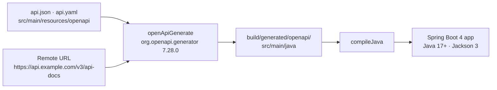
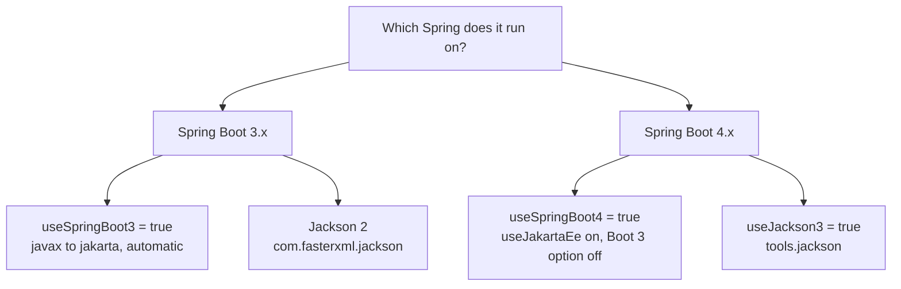
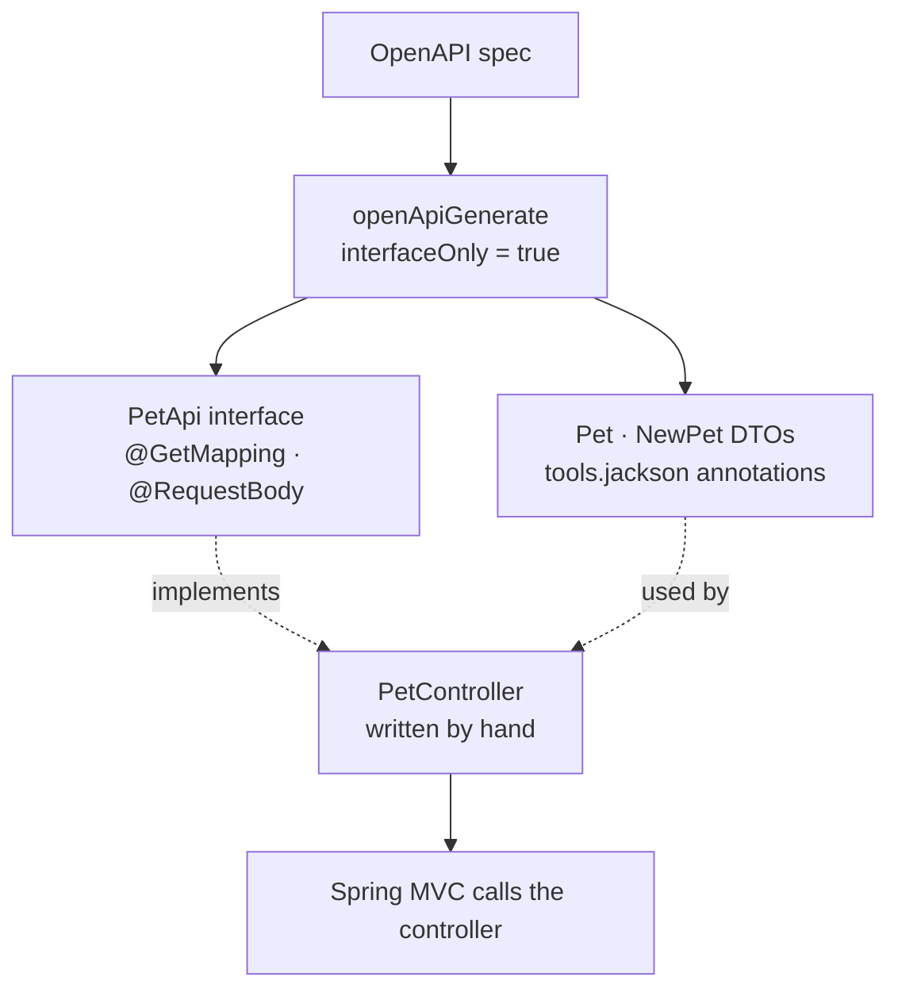

<dl class="facts">
  <div><dt>Plugin</dt><dd>7.28.0</dd></div>
  <div><dt>Spring Boot</dt><dd>4.2.0</dd></div>
  <div><dt>Minimum Java</dt><dd>17</dd></div>
  <div><dt>Spec inputs</dt><dd>2</dd></div>
</dl>

## The spec is the truth, the tool writes the code

Pick one OpenAPI spec and pull the server interfaces and DTOs out of it. The hand-edited DTO that drifts from the spec disappears, and the front end and the other services read the same file. In Gradle it takes one plugin line and one `openApiGenerate` block.

The catch is that Spring Boot 4 moved the option names and defaults. Keep the settings you used on Boot 3 and the generated code imports `javax` or looks for Jackson 2, then stops at compile time.

The flow is straightforward. Wherever the spec comes from — a file or a URL — `openApiGenerate` writes Java under `build/`, and `compileJava` compiles it together with our own code.



## Match the versions first

Spring Boot 4 support arrived recently. If the plugin version stays put, the options simply do not exist.

| Version | Date | What changed |
|---|---|---|
| 7.20.0 | 2026-02-16 | `useSpringBoot4` and `useJackson3` added to the spring generator |
| 7.21.0 | 2026-03-24 | `useSpringBoot3` defaults to `true` (the Boot 3 line is the default) |
| 7.22.0 | 2026-04-28 | `openApiNullable` and `useJackson3` can be used together |
| 7.28.0 | 2026-11-26 | Latest as of writing, same version on the Gradle Plugin Portal |

```kotlin
plugins {
    id("org.openapi.generator") version "7.28.0"
}
```

On the Gradle side, the wrapper Spring Initializr attaches to Boot 4.2 is Gradle 9.9.2. The plugin's own test matrix runs on Gradle 8.14.4, so run `./gradlew openApiGenerate` once when you first wire it up.

## A file or a URL, your choice

Both work. JSON or YAML, either is fine.

| Input | Property | Example |
|---|---|---|
| Local file | `inputSpec` | `inputSpec.set("$projectDir/src/main/resources/openapi/api.json")` |
| Remote URL | `remoteInputSpec` | `remoteInputSpec.set("https://api.example.com/v3/api-docs")` |

- **A remote URL** takes the `/v3/api-docs` endpoint SpringDoc exposes as-is. Good when another team owns the service and you want their current spec on every build.
- The cost is that `remoteInputSpec` goes over the network whenever the task runs again. Offline builds, CI caches, and the day their server is down all fail with it. For a spec you use often, download it once, commit the file, and read it with `inputSpec`.
- Recent plugin versions route a URL passed to `inputSpec` to the remote property for you. Keeping the two separate still documents where the spec comes from.

## The whole build.gradle.kts

This slots into a Boot 4.2 project. Everything below the Spring Initializr part is the plugin, the `openApiGenerate` block, and the source set wiring.

```kotlin
plugins {
    java
    id("org.springframework.boot") version "4.2.0"
    id("io.spring.dependency-management") version "1.1.7"
    id("org.openapi.generator") version "7.28.0"
}

group = "com.example"
version = "0.0.1-SNAPSHOT"

java {
    toolchain { languageVersion = JavaLanguageVersion.of(21) }
}

repositories { mavenCentral() }

dependencies {
    implementation("org.springframework.boot:spring-boot-starter-webmvc")
    implementation("org.springframework.boot:spring-boot-starter-validation")
    // Only when openApiNullable = true. Not needed with false.
    // implementation("org.openapitools:jackson-databind-nullable:0.2.13")
    testImplementation("org.springframework.boot:spring-boot-starter-webmvc-test")
}

openApiGenerate {
    generatorName.set("spring")
    inputSpec.set("$projectDir/src/main/resources/openapi/api.json")
    // For a remote spec, replace the line above with:
    // remoteInputSpec.set("https://api.example.com/v3/api-docs")
    outputDir.set(layout.buildDirectory.dir("generated/openapi"))
    apiPackage.set("com.example.api")
    modelPackage.set("com.example.model")
    configOptions.putAll(
        mapOf(
            "useSpringBoot4" to "true",
            "useJackson3" to "true",
            "interfaceOnly" to "true",
            "openApiNullable" to "false",
            "requestMappingMode" to "api_interface",
            "useTags" to "true",
            "documentationProvider" to "none",
            "annotationLibrary" to "none",
        )
    )
}

sourceSets["main"].java.srcDir(layout.buildDirectory.dir("generated/openapi/src/main/java"))

tasks.named("compileJava") {
    dependsOn(tasks.named("openApiGenerate"))
}
```

`./gradlew build` now generates and compiles in one go. Everything lands under `build/generated/openapi/`, and `clean` removes it. The only thing you commit is the spec.

To check the spec before generating, run `./gradlew openApiValidate`. Failing on a broken spec is cheaper than failing on generated code.

## Three options decide everything

The `configOptions` map looks long, but on Boot 4 only three entries change the outcome.

| Option | Value | What it does |
|---|---|---|
| `useSpringBoot4` | `true` | Code and dependencies for Spring Boot 4.x / Spring Framework 7. Turns `useJakartaEe` on and `useSpringBoot3` off by itself |
| `useJackson3` | `true` | Imports and annotations for Jackson 3 (`tools.jackson`). Requires `useSpringBoot4=true` |
| `openApiNullable` | `false` | Whether nullable fields are wrapped in `JsonNullable<T>`. Defaults to `true` |

Drawn out:



- Set `useSpringBoot4` without `useJackson3` and Boot 4 goes looking for Jackson 2. Boot 4 ships Jackson 3 by default, so set both.
- Set `useJackson3=true` without `useSpringBoot4` and the plugin refuses with `useJackson3 is only available with Spring Boot >= 4`. It does not slide by quietly, which is the point: you find out at build time.
- `openApiNullable` defaults to `true`. With it on, a nullable field becomes `JsonNullable<Pet>` and every read in the controller gains a line. This post sets it to `false`. Combining it with Jackson 3 needs 7.22.0 or later; earlier versions reject the pair.

The other two entries are about docs. `annotationLibrary=none` skips Swagger annotations such as `@Operation` and `@Schema` on the generated code. Leaving it at the default (`swagger2`) makes the generated code import `io.swagger.v3.oas.annotations`, so the app then needs `org.openapitools:swagger-annotations` to compile. `documentationProvider=none` skips the springdoc config file (which `interfaceOnly` would not produce anyway). The spec file is already the documentation, so both are off.

## interfaceOnly: interfaces and DTOs, nothing else

`interfaceOnly=true` skips the server implementation and generates just the `*Api` interfaces and DTOs. The output stays in `build/`, and we implement it with a controller — the pattern most teams settle on.



```java
@RestController
public class PetController implements PetApi {

    private final PetService service;

    public PetController(PetService service) {
        this.service = service;
    }

    @Override
    public ResponseEntity<Pet> getPet(Long petId) {
        return ResponseEntity.ok(service.find(petId));
    }

    @Override
    public ResponseEntity<Pet> addPet(Pet pet) {
        return ResponseEntity.status(HttpStatus.CREATED).body(service.save(pet));
    }
}
```

The spec writes the signatures. Change an `operationId` or a `parameter` and the next build reports a compile error, which is the whole value: code and spec cannot ship out of sync.

One detail. `requestMappingMode` defaults to `controller`, which puts the class-level `@RequestMapping` on the generated controller. With `interfaceOnly` there is no generated controller, so the annotation has nowhere to land and the base path from the spec disappears. Set it to `api_interface` as above and it goes on the interface. Leave it alone and `/api/v1` turns into a 404.

## The client comes from the same spec

Once the server exists, the caller can be generated from the same file. The `java` generator with `library=restclient` produces a client built on Spring 7's `RestClient`.

```kotlin
// At the top of build.gradle.kts
import org.openapitools.generator.gradle.plugin.tasks.GenerateTask

// Anywhere below
tasks.register<GenerateTask>("openApiGenerateClient") {
    generatorName.set("java")
    library.set("restclient")
    inputSpec.set("$projectDir/src/main/resources/openapi/api.json")
    outputDir.set(layout.buildDirectory.dir("generated/openapi-client"))
    apiPackage.set("com.example.client.api")
    modelPackage.set("com.example.client.model")
    configOptions.putAll(
        mapOf(
            "useSpringBoot4" to "true",
            "useJackson3" to "true",
            "openApiNullable" to "false",
        )
    )
}
```

On the `java` generator, the `restclient`, `resttemplate` and `webclient` libraries also require `useSpringBoot4=true` alongside `useJackson3`. It throws when the conditions do not line up. Generating both sides from one file removes the field-name drift entirely.

## What actually bites

- **The source path includes `src/main/java`.** Files land in `outputDir/src/main/java/…`. Point `srcDir` at `outputDir` instead and javac stops with `package com.example.api does not correspond to the file path`.
- **If the API is called `DefaultApi`,** the spec has no tags in play. Add `useTags=true` to get `PetApi`.
- **A URL spec ties the build to somebody else's uptime.** A slow server makes a slow build; a dead one fails it. Download on a schedule and commit the file if reproducibility matters.
- **Do not commit generated code.** The spec is the source, the code is output, and `build/` is already outside the repository.
- **Mixing Boot 3 libraries brings both Jacksons.** Boot 4 defaults to Jackson 3 (`tools.jackson`); a Jackson 2 library puts `com.fasterxml.jackson` on the classpath too. Generated code follows the option you set, so check which ObjectMapper the app actually uses.
- **If you do want `openApiNullable`,** confirm 7.22.0 or later first. Earlier versions cannot pair it with `useJackson3`.

## Wrapping up

Wiring OpenAPI Generator into Spring Boot 4 comes down to three lines.

```kotlin
id("org.openapi.generator") version "7.28.0"
"useSpringBoot4" to "true"
"useJackson3" to "true"
```

The rest is taste: file or URL, interfaces only or full server stubs. Two settings do deserve a look on day one — `requestMappingMode` and the source path — because their defaults come back as a quiet 404 or a compile error. Check them once and move on.

For the spec itself, see the [OpenAPI Specification](https://spec.openapis.org/oas/latest.html); for every generator option, the [spring generator docs](https://openapi-generator.tech/docs/generators/spring).
