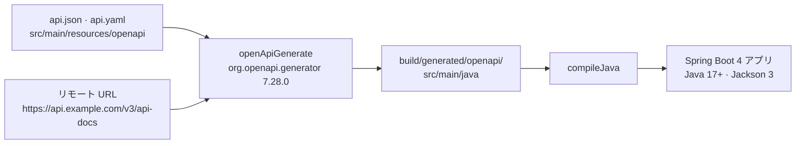
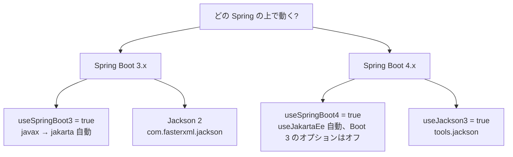
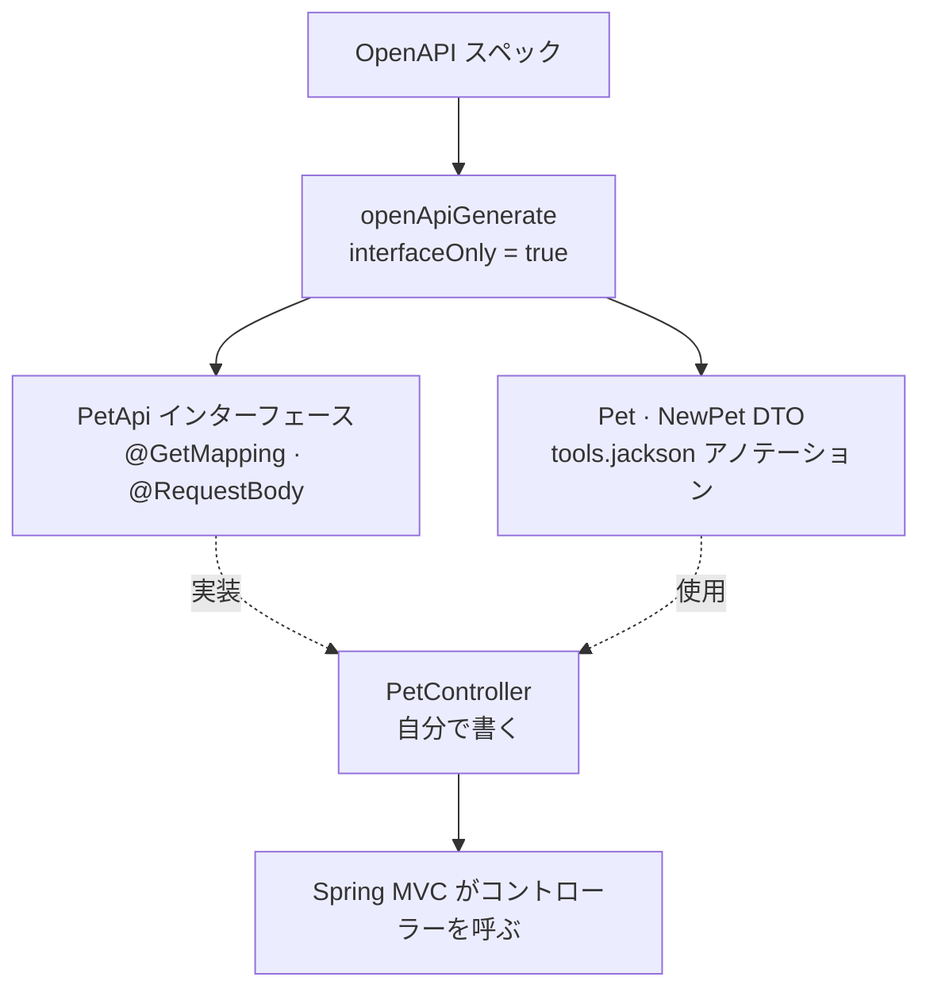
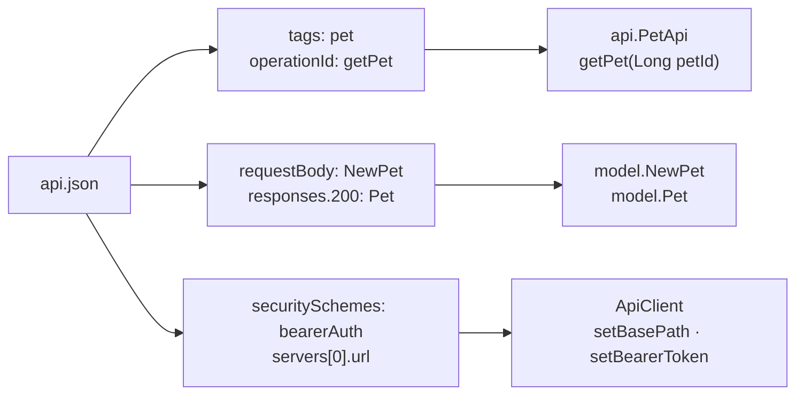

<dl class="facts">
  <div><dt>プラグイン</dt><dd>7.28.0</dd></div>
  <div><dt>Spring Boot</dt><dd>4.2.0</dd></div>
  <div><dt>最小 Java</dt><dd>17</dd></div>
  <div><dt>スペック入力</dt><dd>2<small>種</small></dd></div>
</dl>

## スペックが真実、コードはツールが作る

OpenAPI スペックを 1 つ決めておき、サーバーのインターフェースと DTO をそこから生成する方式です。手で DTO を直してスペックとずれる事故がなくなり、フロントも他のサービスも同じファイルを見ます。Gradle ではプラグイン 1 行と `openApiGenerate` ブロック 1 つで付けられます。

問題は Spring Boot 4 に上がる過程でオプション名と既定値が変わったことです。Boot 3 で使っていた設定をそのまま置くと、生成コードが `javax` を import したり Jackson 2 を探したりしてコンパイルで止まります。

全体の流れはこうです。スペックがどこから来ても(ファイルでも URL でも)、`openApiGenerate` が `build/` の下に Java ファイルを書き、`compileJava` がそれを自分のコードと一緒にコンパイルします。



## バージョンから合わせる

Spring Boot 4 の対応は最近入りました。プラグインのバージョンを上げないと、オプション自体がありません。

| バージョン | 日付 | 変わったこと |
|---|---|---|
| 7.20.0 | 2026-02-16 | spring 生成器に `useSpringBoot4`・`useJackson3` を追加 |
| 7.21.0 | 2026-03-24 | `useSpringBoot3` の既定値が `true` に (Boot 3 世代が既定) |
| 7.22.0 | 2026-04-28 | `openApiNullable` と `useJackson3` を一緒に使えるように |
| 7.28.0 | 2026-11-26 | この記事を書く時点の最新。Gradle プラグインポータルにも同じバージョン |

```kotlin
plugins {
    id("org.openapi.generator") version "7.28.0"
}
```

Gradle 側は、Spring Initializr が Boot 4.2 に入れてくれるラッパーが Gradle 9.9.2 です。プラグイン自身の検証は Gradle 8.14.4 基準なので、最初に付けるときに `./gradlew openApiGenerate` を一度回してみるのがよいです。

## スペックはファイルか、URL か

どちらでもできます。JSON でも YAML でも構いません。

| 入力 | プロパティ | 例 |
|---|---|---|
| ローカルファイル | `inputSpec` | `inputSpec.set("$projectDir/src/main/resources/openapi/api.json")` |
| リモート URL | `remoteInputSpec` | `remoteInputSpec.set("https://api.example.com/v3/api-docs")` |

- **リモート URL** は、SpringDoc が開く `/v3/api-docs` のアドレスをそのまま入れれば済みます。別チームが運用しているサービスのスペックを毎回ダウンロードして使う場合に向いています。
- ただし `remoteInputSpec` はタスクが回るたびにネットワークに出ます。オフラインビルド、CI キャッシュ、相手のサーバーが落ちた日にはビルドも一緒に落ちます。よく使うスペックならファイルに落としてリポジトリにコミットし、`inputSpec` で読むほうが安全です。
- 最新のプラグインは `inputSpec` に URL を入れても自動でリモートとして扱ってくれます。それでも 2 つを書き分けておくと、ビルドファイルを見ただけでどこから来るか分かります。

## build.gradle.kts 全体

Boot 4.2 のプロジェクトにそのまま付ける形です。Spring Initializr が作る部分に `org.openapi.generator` プラグインと `openApiGenerate` ブロック、ソースセットの接続だけを足しました。

```kotlin
plugins {
    java
    id("org.springframework.boot") version "4.2.0"
    id("io.spring.dependency-management") version "1.1.7"
    id("org.openapi.generator") version "7.28.0"
}

group = "com.example"
version = "0.0.1-SNAPSHOT"

java {
    toolchain { languageVersion = JavaLanguageVersion.of(21) }
}

repositories { mavenCentral() }

dependencies {
    implementation("org.springframework.boot:spring-boot-starter-webmvc")
    implementation("org.springframework.boot:spring-boot-starter-validation")
    // openApiNullable = true のときだけ。false なら要らない。
    // implementation("org.openapitools:jackson-databind-nullable:0.2.13")
    testImplementation("org.springframework.boot:spring-boot-starter-webmvc-test")
}

openApiGenerate {
    generatorName.set("spring")
    inputSpec.set("$projectDir/src/main/resources/openapi/api.json")
    // リモートスペックなら上の行の代わりに: remoteInputSpec.set("https://api.example.com/v3/api-docs")
    outputDir.set(layout.buildDirectory.dir("generated/openapi"))
    apiPackage.set("com.example.api")
    modelPackage.set("com.example.model")
    configOptions.putAll(
        mapOf(
            "useSpringBoot4" to "true",
            "useJackson3" to "true",
            "interfaceOnly" to "true",
            "openApiNullable" to "false",
            "requestMappingMode" to "api_interface",
            "useTags" to "true",
            "documentationProvider" to "none",
            "annotationLibrary" to "none",
        )
    )
}

val generatedSources = layout.buildDirectory.dir("generated/openapi/src/main/java")
sourceSets["main"].java.srcDir(generatedSources)

tasks.named("compileJava") {
    dependsOn(tasks.named("openApiGenerate"))
}
```

`./gradlew build` を叩けば生成とコンパイルが一度に回ります。生成ファイルは `build/generated/openapi/` の下にだけでき、`clean` が消します。リポジトリにコミットするのはスペックファイル 1 つだけです。

スペックが文法に合っているか先に見たいときは `./gradlew openApiValidate` を使います。生成前にスペックの誤りで止まるほうが楽です。

## オプション 3 つが分かれ道

`configOptions` は多く見えますが、Boot 4 で実際に分かれるのは 3 つです。

| オプション | すること |
|---|---|
| `useSpringBoot4 = true` | Spring Boot 4.x / Spring Framework 7 向けのコードと依存。`useJakartaEe` が自動でオンになり、`useSpringBoot3` は自動でオフになる |
| `useJackson3 = true` | Jackson 3(`tools.jackson`)基準で import とアノテーションを作る。`useSpringBoot4=true` が必須 |
| `openApiNullable = false` | nullable フィールドを `JsonNullable<T>` で包むかどうか。既定値は `true` |

図にするとこう分かれます。



- `useSpringBoot4` だけオンにして `useJackson3` を外すと、Boot 4 で Jackson 2 を探します。Boot 4 は Jackson 3 が既定なので、2 つを一緒にオンにします。
- `useJackson3=true` を `useSpringBoot4` なしで置くと、プラグインが `useJackson3 is only available with Spring Boot >= 4` で拒否します。静かに通らないので、間違えていればビルドですぐ分かります。
- `openApiNullable` は既定値が `true` です。オンにすると nullable フィールドが `JsonNullable<Pet>` のように 1 枚包まれ、コントローラーで値を取り出すコードが 1 行ずつ増えます。この記事では `false` にします。Jackson 3 と一緒に使うには 7.22.0 以上が必要で、それより前のバージョンではこの組み合わせが例外で止まります。

残り 2 つはドキュメント用です。`annotationLibrary=none` は生成コードに `@Operation`・`@Schema` のような Swagger アノテーションを付けないという意味です。既定値(`swagger2`)にすると生成コードが `io.swagger.v3.oas.annotations` を import するので、アプリに `org.openapitools:swagger-annotations` を足さないとコンパイルできません。`documentationProvider=none` は springdoc の設定ファイルを作らないという意味で(`interfaceOnly` ならもともと作りません)、スペックファイルがすでにドキュメントなので両方オフにしました。

## interfaceOnly: インターフェースと DTO だけ受け取る

`interfaceOnly=true` はサーバー実装を作らず、`*Api` インターフェースと DTO だけを生成します。生成コードを `build/` に置き、こちらがコントローラーで実装する実務型の構造です。



```java
@RestController
public class PetController implements PetApi {

    private final PetService service;

    public PetController(PetService service) {
        this.service = service;
    }

    @Override
    public ResponseEntity<Pet> getPet(Long petId) {
        return ResponseEntity.ok(service.find(petId));
    }

    @Override
    public ResponseEntity<Pet> addPet(Pet pet) {
        return ResponseEntity.status(HttpStatus.CREATED).body(service.save(pet));
    }
}
```

シグネチャはスペックが決めます。スペックの `operationId` と `parameters` を直すと、次のビルドでコンパイルエラーとして現れます。それがこの方式の値です。スペックとコードがずれたまま配布されることはありません。

ひとつ注意があります。`requestMappingMode` の既定値は `controller` です。クラスレベルの `@RequestMapping` を生成されるコントローラーに付ける設定ですが、`interfaceOnly` ではコントローラーを作らないので付ける場所がありません。そこで上の設定のように `api_interface` に変えてインターフェースに付けます。変えないと `/api/v1` のような基本パスが消えて 404 になります。

## クライアントも同じスペックから

サーバーを作ったら、その API を呼ぶ側も同じスペックから生成できます。`java` 生成器に `library=restclient` を渡すと、Spring 7 の `RestClient` を使うクライアントが出てきます。

```kotlin
// build.gradle.kts の先頭に
import org.openapitools.generator.gradle.plugin.tasks.GenerateTask

// 以下はファイルのどこでも
tasks.register<GenerateTask>("openApiGenerateClient") {
    generatorName.set("java")
    library.set("restclient")
    inputSpec.set("$projectDir/src/main/resources/openapi/api.json")
    outputDir.set(layout.buildDirectory.dir("generated/openapi-client"))
    apiPackage.set("com.example.client.api")
    modelPackage.set("com.example.client.model")
    configOptions.putAll(
        mapOf(
            "useSpringBoot4" to "true",
            "useJackson3" to "true",
            "openApiNullable" to "false",
        )
    )
}
```

`java` 生成器でも `restclient`・`resttemplate`・`webclient` ライブラリは `useJackson3` に `useSpringBoot4=true` を要求します。条件が合わないと例外で知らせてくれます。サーバーとクライアントを同じスペックファイルから生成すれば、フィールド名がずれることはありません。

## api.json と生成コードはこう対応する

スペックのどの行が生成コードのどのクラスになるかを一度押さえておきます。以下はこの記事で使い続ける例のスペックです。`servers`・`tags`・`paths`・`operationId`・`requestBody`・`responses`・`components.schemas`・`securitySchemes` がすべて入っています。

```json
{
  "openapi": "3.1.0",
  "info": { "title": "Pet Service", "version": "1.0.0" },
  "servers": [{ "url": "https://api.example.com/v1" }],
  "tags": [{ "name": "pet", "description": "Pets" }],
  "paths": {
    "/pets/{petId}": {
      "get": {
        "tags": ["pet"],
        "operationId": "getPet",
        "parameters": [
          { "name": "petId", "in": "path", "required": true,
            "schema": { "type": "integer", "format": "int64" } }
        ],
        "responses": {
          "200": { "description": "Found",
            "content": { "application/json":
              { "schema": { "$ref": "#/components/schemas/Pet" } } } },
          "404": { "description": "Not found" }
        }
      }
    },
    "/pets": {
      "post": {
        "tags": ["pet"],
        "operationId": "addPet",
        "requestBody": {
          "required": true,
          "content": { "application/json":
            { "schema": { "$ref": "#/components/schemas/NewPet" } } }
        },
        "responses": {
          "201": { "description": "Created",
            "content": { "application/json":
              { "schema": { "$ref": "#/components/schemas/Pet" } } } }
        }
      }
    }
  },
  "components": {
    "schemas": {
      "Pet": {
        "type": "object",
        "required": ["id", "name"],
        "properties": {
          "id": { "type": "integer", "format": "int64" },
          "name": { "type": "string" },
          "tag": { "type": "string" }
        }
      },
      "NewPet": {
        "type": "object",
        "required": ["name"],
        "properties": {
          "name": { "type": "string" },
          "tag": { "type": "string" }
        }
      }
    },
    "securitySchemes": {
      "bearerAuth": { "type": "http", "scheme": "bearer", "bearerFormat": "JWT" }
    }
  },
  "security": [{ "bearerAuth": [] }]
}
```

`invokerPackage` を `com.example.client` にしたとすると、対応はこうなります。

| スペックの値 | 作られるコード |
|---|---|
| `tags: ["pet"]` (`useTags=true`) | `com.example.client.api.PetApi` — タグ 1 つが API クラス 1 つ |
| `operationId: getPet` + `GET /pets/{petId}` | `PetApi.getPet(Long petId)` と `getPetWithHttpInfo(Long petId)` |
| `parameters[].in: path` · `format: int64` | メソッド引数 `Long petId` (必須なので `@Nonnull`) |
| `requestBody: NewPet` | `addPet(NewPet newPet)` の本文引数 |
| `responses.200.content.schema: Pet` | 戻り値の型 `Pet`。`getPetWithHttpInfo` は `ResponseEntity<Pet>` |
| `components.schemas.Pet` | `com.example.client.model.Pet` — `new Pet().id(1L).name("…")` のようにつなぐ setter |
| `components.securitySchemes.bearerAuth` | `ApiClient` の `authentications` に `HttpBearerAuth` — 呼び出しごとに `Authorization` ヘッダー |
| `servers[0].url` | `ApiClient.basePath` の既定値 |
| `info.title` · `version` | 生成ファイル先頭のコメントと `@Generated` の説明 |

図にすると、スペック側の断片がコード側のクラスにつながります。



この対応はスペックを直すたびに計算し直されます。`operationId` を変えればメソッド名が変わり、`required` を外せば引数から `@Nonnull` が消え、応答スキーマを `Pet` から `PetPage` に変えれば戻り値の型がついて変わります。だからコンパイルがスペックとコードのずれを捕まえてくれます。

## 生成したクライアントを実際に呼ぶ

クライアントを生成するところまでは上の設定で終わりです。実際に呼ぶには 3 つ足りません。生成コードをソースパスに付け、`ApiClient` をビーンにし、その `ApiClient` にアドレスと認証を入れることです。

### ソースパスとパッケージ

前の `openApiGenerateClient` に `invokerPackage` とソースパス・コンパイルの接続を足した形です。

```kotlin
import org.openapitools.generator.gradle.plugin.tasks.GenerateTask

tasks.register<GenerateTask>("openApiGenerateClient") {
    generatorName.set("java")
    library.set("restclient")
    inputSpec.set("$projectDir/src/main/resources/openapi/api.json")
    outputDir.set(layout.buildDirectory.dir("generated/openapi-client"))
    invokerPackage.set("com.example.client")       // ApiClient と ExceptionProvider
    apiPackage.set("com.example.client.api")       // PetApi
    modelPackage.set("com.example.client.model")   // Pet · NewPet
    configOptions.putAll(
        mapOf(
            "useSpringBoot4" to "true",
            "useJackson3" to "true",
            "openApiNullable" to "false",
        )
    )
}

val clientSources = layout.buildDirectory.dir("generated/openapi-client/src/main/java")
sourceSets["main"].java.srcDir(clientSources)

tasks.named("compileJava") {
    dependsOn(tasks.named("openApiGenerateClient"))
}
```

- `invokerPackage` を空にすると既定値は `org.openapitools.client` です。同じモジュールでサーバーのインターフェースとクライアントを一緒に使うので、自分のパッケージに変えておくほうが読みやすいです。
- サーバー側の `openApiGenerate` と `outputDir`(`generated/openapi-client`)・パッケージが重ならないようにします。同じフォルダーに 2 回生成するとファイルが上書きし合います。
- 生成ファイルは `outputDir/src/main/java/…` の下にできるので、`srcDir` にも `src/main/java` まで付けます。

### ビーンとして登録する

`generateClientAsBean` の既定値は `false` なので、生成された `ApiClient` と `PetApi` は普通のクラスです。こちらでビーンに登録します。

```java
@Configuration
public class PetClientConfig {

    @Bean
    ApiClient petApiClient(RestClient.Builder builder) {
        RestClient restClient = builder.build();
        return new ApiClient(restClient)
                .setBasePath("https://api.example.com/v1");
    }

    @Bean
    PetApi petApi(ApiClient petApiClient) {
        return new PetApi(petApiClient);
    }
}
```

`RestClient.Builder` は状態を持つビルダーです。複数のクライアントが 1 つのビルダーを共有する構造なら `builder.clone()` で複製して使い、ここみたいに 1 か所でしか作らないならそのまま `build()` しても構いません。

`generateClientAsBean=true` で生成すると、この 2 つのクラスに `@Component` が付いてスキャンだけでビーンになります。ただ生成された `ApiClient` はコンストラクターで `RestClient` を受け取るので、Boot が既定では渡さない `RestClient` ビーンを別に作る必要があります。スペックが複数あると `ApiClient` ビーンが型まで同じになり注入が曖昧になるので、そのときは下のように自分で登録するほうがよいです。

### basePath は ApiClient に入れる

`ApiClient` はリクエストを作るときに `basePath`(またはスペックの `servers`)を前に付けて**絶対 URL** にします。`restClient.method(GET).uri("https://api.example.com/v1/pets/1")` のように出ます。だから `RestClient.Builder.baseUrl(...)` だけ変えても何も起きません。絶対 URL なので RestClient の base URL が使われる場所がないからです。

もう 1 つあります。`ApiClient` の `serverIndex` フィールドの既定値は `0` で、`servers` が空でなければ `servers[0]` が勝ちます。`setBasePath()` は `basePath` を変えながら `serverIndex` を `null` に戻すメソッドなので、スペックに書いたアドレスではなく別の場所を呼ぶときに使います。

- ローカル・ステージングで回すとき: `apiClient.setBasePath("http://localhost:8080")`
- スペックにサーバーが複数あるとき: `apiClient.setServerIndex(1)`
- スペックに `servers` がまったくないとき: `setBasePath` を呼ばないと URL が作れないので必ず入れます。

### 認証はスペックが決める

スペックに `securitySchemes` があれば、`ApiClient` が呼び出し時にそのスキームを埋めます。こちらがやるのは値を入れることだけです。

```java
apiClient.setBearerToken(token);          // http bearer
apiClient.setBearerToken(tokenSupplier);  // 期限が短いなら Supplier で
apiClient.setUsername("app");              // http basic
apiClient.setPassword("secret");
```

これらのメソッドは `authentications` マップを回って同じ種類のスキームに値を入れます。スペックに `securitySchemes` がないとそのマップが空なので、**静かに何もしません。** そのときは HTTP 層でヘッダーを入れます。

```java
@Bean
ApiClient petApiClient(RestClient.Builder builder) {
    RestClient restClient = builder
            .defaultHeader(HttpHeaders.AUTHORIZATION, "Bearer " + token)
            .build();
    return new ApiClient(restClient).setBasePath("https://api.example.com/v1");
}
```

トークンがよく変わるなら `defaultHeader` ではなく `requestInterceptor` でリクエストごとに値を入れます。

```java
RestClient restClient = builder
        .requestInterceptor((request, body, execution) -> {
            request.getHeaders().setBearerAuth(tokens.current());
            return execution.execute(request, body);
        })
        .build();
```

`ApiClient` にも `addDefaultHeader("User-Agent", …)` のように固定ヘッダーを入れるメソッドがあります。値が 1 つに決まるならそちらが簡単で、リクエストごとに変わるならインターセプターが合っています。

### サービスから呼ぶ

```java
@Service
public class PetGateway {

    private final PetApi petApi;

    public PetGateway(PetApi petApi) {
        this.petApi = petApi;
    }

    public Pet find(long petId) {
        try {
            return petApi.getPet(petId);
        } catch (RestClientResponseException e) {
            if (e.getStatusCode().value() == 404) {
                throw new PetNotFoundException(petId);
            }
            throw e;
        }
    }

    public Pet create(String name, String tag) {
        return petApi.addPet(new NewPet().name(name).tag(tag));
    }

    public Pet findWithStatus(long petId) {
        ResponseEntity<Pet> res = petApi.getPetWithHttpInfo(petId);
        return res.getBody();   // ステータスコード・ヘッダーまで要るとき
    }
}
```

- `getPet` は 4xx・5xx で `RestClientResponseException` を投げます。スペックの 404 も例外で来るので、ステータスコードで分けて自分の例外に変えます。
- 本文だけでは足りずステータスコード・ヘッダーが要るなら `…WithHttpInfo` が `ResponseEntity<T>` を返します。応答を自分でパースしたいなら `…WithResponseSpec` が `RestClient.ResponseSpec` を返します。
- `openApiNullable=true` で生成したなら `String name = pet.getName().get();` のように `JsonNullable` を外す必要があります。この記事は `false` なのでそのまま使えます。

## グループ・タグだけ選んで生成する

スペックが大きくなるとクライアントも大きくなります。サーバー 1 つに API が数十個あって、こちらは 2 つしか呼ばないなら、残りはビルド時間と jar のサイズを食うだけです。道は 3 つあります。

### 1. サーバーがグループに分けてくれる — グループ URL

サーバーも SpringDoc なら、`GroupedOpenApi` でスペックをグループ別のアドレスに分けられます。

```java
@Bean
GroupedOpenApi petGroup() {
    return GroupedOpenApi.builder()
            .group("pet")
            .pathsToMatch("/pets/**")
            .build();
}
```

すると `/v3/api-docs` ではなく `/v3/api-docs/pet` ができます。クライアントはアドレスをグループ側に変えるだけです。

```kotlin
remoteInputSpec.set("https://api.example.com/v3/api-docs/pet")
```

どのオペレーションがどのグループに入るかはサーバーが決めます。クライアント側でフィルターを重ねると二重に絞ることになるので、グループ URL を使う場合は `FILTER` を空けておきます。

### 2. FILTER でオペレーションを絞る

他の人のサービスでサーバーを直せない、あるいは 1 つのスペックからクライアントだけ違う形で出したいときは、生成の段階で絞ります。

```kotlin
openApiNormalizer.set(
    mapOf("FILTER" to "tag:pet|store")
)
```

`FILTER` は `名前:値1|値2` の形で、複数はセミコロンでつなぎます。絞る基準は 4 つです。

- `tag:pet|store` — このタグが付いたオペレーション
- `path:/pets` — このパスで**始まる**オペレーション (接頭辞の比較)
- `operationId:getPet|addPet` — 名前が完全に同じオペレーション
- `method:get|post` — HTTP メソッド

組み合わせは `tag:pet;method:get` のように書きます。ただしセミコロンでつないだ条件は **and ではなく or** です。上の例は「pet タグ、または GET の」オペレーションが残ります。狭めたいなら `tag:pet` のように 1 つだけ使うほうがはっきりします。

動作は「消す」ではなく「印を付ける」です。合わないオペレーションに `x-internal: true` を付け、生成器がその印を見て飛ばします。だからスペックファイル自体はそのままで、残ったオペレーションだけで API クラスとメソッドが作られます。モデル(`components.schemas`)はスペックにあるものがすべて生成されます — 絞ったオペレーションが使っていたモデルも含めてです。モデルまで減らすには `globalProperties` の `models` を一緒に使います。

文法が違えば静かに通りません。7.16.0 から `FILTER` の形式エラーは例外でビルドを止めます。

### 3. apis で API クラスを選ぶ

```kotlin
globalProperties.set(mapOf("apis" to "Pet:Store"))
```

生成する API クラス名をコロンで並べます。ここに書く値はクラス名から `Api` を取ったものです。タグが `pet` ならクラスは `PetApi` で、書く値は `Pet` です。`FILTER` との違いはこうです。

- `apis` は**クラス単位**です。`PetApi` は丸ごと来て、その中のメソッドだけ選ぶことはできません。
- `FILTER` は**オペレーション単位**です。タグでクラスを選びつつ、同じタグの中の一部のメソッドだけ残すこともできます。
- どちらもスペックファイルを直しません。`FILTER` は印を付ける方式で、`apis` はテンプレートに渡す API の一覧だけを切ります。

## スペックが複数あるなら

サービスごとに `v3/api-docs` が別々にある、あるいは外部 API を複数呼ぶ場合です。このときはタスク 1 つにスペックを詰め込んではいけません。生成コードには `ApiClient` クラスがスペックごとに 1 つ出ますが名前が同じなので、同じパッケージに 2 回生成すると後のものが前のものを上書きします。`Pet` のようなよくあるモデル名も、サービスごとに形が違えばそのまま衝突します。

そこでスペックごとに `outputDir`・`invokerPackage`・`apiPackage`・`modelPackage` を別に取ります。タスクは一覧を回して登録します。

```kotlin
import org.openapitools.generator.gradle.plugin.tasks.GenerateTask

data class ClientSpec(val name: String, val specUrl: String)

val clientSpecs = listOf(
    ClientSpec("pet",     "https://api.example.com/v3/api-docs/pet"),
    ClientSpec("order",   "https://api.example.com/v3/api-docs/order"),
    ClientSpec("billing", "https://billing.example.net/v3/api-docs"),
)

val clientTasks = clientSpecs.map { spec ->
    val taskName = "openApiGenerateClient" + spec.name.replaceFirstChar { it.uppercase() }
    tasks.register<GenerateTask>(taskName) {
        generatorName.set("java")
        library.set("restclient")
        remoteInputSpec.set(spec.specUrl)
        outputDir.set(layout.buildDirectory.dir("generated/openapi-client/${spec.name}"))
        invokerPackage.set("com.example.client.${spec.name}")        // ApiClient
        apiPackage.set("com.example.client.${spec.name}.api")        // PetApi · OrderApi
        modelPackage.set("com.example.client.${spec.name}.model")    // Pet · Order
        configOptions.putAll(
            mapOf(
                "useSpringBoot4" to "true",
                "useJackson3" to "true",
                "openApiNullable" to "false",
            )
        )
    }
    taskName
}

clientSpecs.forEach { spec ->
    sourceSets["main"].java.srcDir(
        layout.buildDirectory.dir("generated/openapi-client/${spec.name}/src/main/java")
    )
}

tasks.named("compileJava") {
    dependsOn(tasks.named("openApiGenerate"))
    dependsOn(clientTasks.map { tasks.named(it) })
}
```

要点は 3 つです。

- `outputDir` がスペックごとに違わないと、2 回目の生成が 1 回目の結果の上に書きます。
- `invokerPackage` が同じだと `ApiClient` クラスが 2 つできてコンパイルが壊れます。パッケージが違っても**クラス名は同じなので**、Java コードでは import ではなく完全修飾名で書きます(下の設定参照)。
- `apiPackage`・`modelPackage` も分けないと、`Pet` のようなよくある名前がサービス同士でぶつかります。

ビーンはクライアントごとに 1 つずつ、アドレスもそれぞれ別に登録します。

```java
@Configuration
public class ClientsConfig {

    @Bean
    com.example.client.pet.ApiClient petApiClient(RestClient.Builder builder) {
        return new com.example.client.pet.ApiClient(builder.build())
                .setBasePath("https://api.example.com");
    }

    @Bean
    com.example.client.billing.ApiClient billingApiClient(RestClient.Builder builder) {
        return new com.example.client.billing.ApiClient(builder.build())
                .setBasePath("https://billing.example.net");
    }

    @Bean
    PetApi petApi(@Qualifier("petApiClient") com.example.client.pet.ApiClient client) {
        return new PetApi(client);
    }

    @Bean
    BillingApi billingApi(@Qualifier("billingApiClient") com.example.client.billing.ApiClient client) {
        return new BillingApi(client);
    }
}
```

`ApiClient` ビーンが 2 つ以上あると型だけでは選べないので、`@Qualifier` で名前を指定します。生成された `PetApi`・`BillingApi` もパッケージが違うので、import を分けて書くか完全修飾名を使います。

スペックファイルが 1 つのサービスの断片にすぎないなら、クライアントは 1 つにまとめるほうがよいです。プラグインは `inputSpecRootDirectory`(または `inputSpecFiles`)にスペックを複数渡すと、1 つのスペックにまとめて生成します。サービスが違えばタスクを分け、同じサービスのグループならまとめる、という分け方です。

## 実際に引っかかること

- **ソースパスに `src/main/java` まで付けます。** 生成ファイルは `outputDir/src/main/java/…` にできます。`srcDir(outputDir)` で取るとパッケージが合わず `package com.example.api does not correspond to the file path` で止まります。
- **API 名が `DefaultApi` で出るなら** スペックの `tags` を使っていないからです。`useTags=true` を渡すと `PetApi` のようにタグ名で出ます。
- **URL スペックはビルドを外部に縛ります。** 相手のサーバーが遅いとビルドも遅くなり、落ちればビルドが失敗します。定期的に取得してファイルでコミットするほうが再現性に優れます。
- **生成コードはコミットしません。** スペックが真実でコードは結果物です。`build/` はリポジトリの外なので `.gitignore` も触る必要がありません。
- **Boot 3 のライブラリと混ぜると Jackson が 2 つになります。** Boot 4 は Jackson 3(`tools.jackson`)が既定ですが、Jackson 2 ベースのライブラリを一緒に使うと `com.fasterxml.jackson` もクラスパスに上がります。生成コードはこちらが選んだ側に従うので、アプリが実際に使う ObjectMapper がどちらか確かめる必要があります。
- **`openApiNullable` をオンにするなら** 7.22.0 以上か先に見ます。それより前は `useJackson3` と一緒に使えません。
- **`invokerPackage` を空にすると** クライアントが `org.openapitools.client` で出ます。スペック 2 つを同じパッケージに生成すると `ApiClient` が静かに上書きされ、片方のクライアントが別のアドレスに出ていきます。
- **`setBasePath` を忘れると** 呼び出しがスペックの `servers[0]` に出ます。スペックに本番アドレスが埋まっているとテストが本番を叩きます。`RestClient` の `baseUrl` はこの経路に関与しません。
- **`FILTER` はモデルを減らしません。** 絞ったオペレーションのスキーマも生成されるので、モデルまで減らすには `globalProperties` の `models` を一緒に使います。

## まとめ

Spring Boot 4 で OpenAPI Generator を付けるのは、結局 3 行です。

```kotlin
id("org.openapi.generator") version "7.28.0"
"useSpringBoot4" to "true"
"useJackson3" to "true"
```

残りは好みです。スペックをファイルで置くか URL で受けるか、インターフェースだけ受け取るかサーバースタブまで受け取るか。ただ `requestMappingMode` とソースパスの 2 つは、既定値のままにすると静かに 404 やコンパイルエラーで返ってくるので、最初に付けるときに一度確認してから進むのがよいです。

クライアント側で見直すことも 3 つあります。アドレスは `RestClient` ではなく `ApiClient.setBasePath` で入れ、認証はスペックの `securitySchemes` があるときだけ `setBearerToken` が効き、スペックを複数生成するならスペックごとにパッケージと出力フォルダーを分けないと `ApiClient` が互いを上書きします。グループ単位で減らすのは、サーバーがグループ URL をくれるならそれを、なければ `FILTER` を使います。

スペック自体の書き方は [OpenAPI Specification](https://spec.openapis.org/oas/latest.html) に、生成器のオプション全体は [spring generator のドキュメント](https://openapi-generator.tech/docs/generators/spring) にあります。
