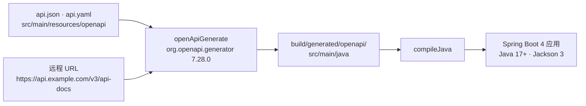
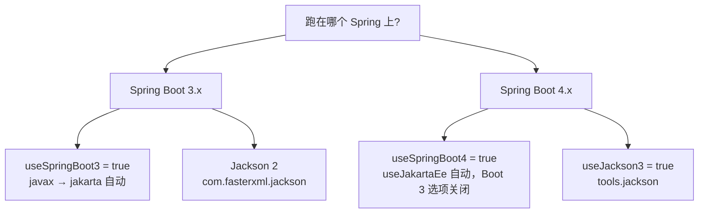
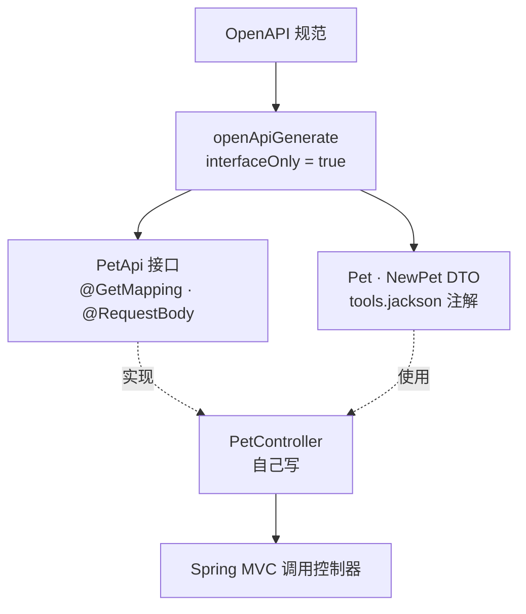
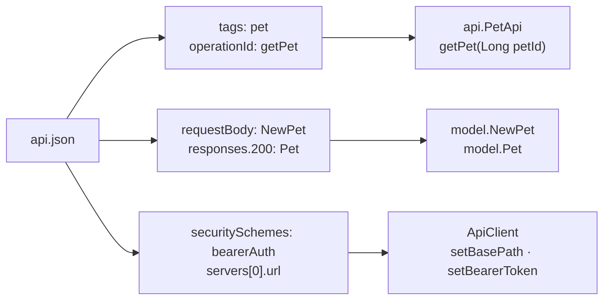

<dl class="facts">
  <div><dt>插件</dt><dd>7.28.0</dd></div>
  <div><dt>Spring Boot</dt><dd>4.2.0</dd></div>
  <div><dt>最低 Java</dt><dd>17</dd></div>
  <div><dt>规范输入</dt><dd>2<small>种</small></dd></div>
</dl>

## 规范是真相，代码由工具生成

先定下一份 OpenAPI 规范，服务器接口和 DTO 都从那里生成。手改 DTO 结果和规范对不上的事故就没了，前端和其他服务看的也是同一个文件。在 Gradle 里，一行插件加一个 `openApiGenerate` 块就能接上。

问题在于升级到 Spring Boot 4 之后，选项名和默认值变了。Boot 3 时用的配置照原样留着，生成的代码会 import `javax`，或者去找 Jackson 2，编译就停了。

整体流程是这样。不管规范从哪儿来（文件还是 URL），`openApiGenerate` 在 `build/` 下面写出 Java 文件，`compileJava` 把它和我们的代码一起编译。



## 先把版本对上

对 Spring Boot 4 的支持是最近才有的。插件版本不升，选项本身就不存在。

| 版本 | 日期 | 变化 |
|---|---|---|
| 7.20.0 | 2026-02-16 | spring 生成器加入 `useSpringBoot4`·`useJackson3` |
| 7.21.0 | 2026-03-24 | `useSpringBoot3` 默认值变为 `true`（默认走 Boot 3 世代） |
| 7.22.0 | 2026-04-28 | `openApiNullable` 可以和 `useJackson3` 一起用 |
| 7.28.0 | 2026-11-26 | 写这篇文章时的最新版。Gradle 插件门户也是同一版本 |

```kotlin
plugins {
    id("org.openapi.generator") version "7.28.0"
}
```

Gradle 这边，Spring Initializr 给 Boot 4.2 装的是 Gradle 9.9.2 的 wrapper。插件自身的验证基准是 Gradle 8.14.4，所以第一次接上时先跑一次 `./gradlew openApiGenerate` 比较好。

## 规范用文件还是 URL

两种都行。JSON 还是 YAML 都无所谓。

| 输入 | 属性 | 例子 |
|---|---|---|
| 本地文件 | `inputSpec` | `inputSpec.set("$projectDir/src/main/resources/openapi/api.json")` |
| 远程 URL | `remoteInputSpec` | `remoteInputSpec.set("https://api.example.com/v3/api-docs")` |

- **远程 URL** 直接把 SpringDoc 开放的 `/v3/api-docs` 地址放进去就行。适合每次都下载别组维护的服务的规范来用的场景。
- 但 `remoteInputSpec` 每次任务重跑都要走网络。离线构建、CI 缓存、对方服务器挂掉的那天，构建也跟着挂。常用的规范建议落成文件提交到仓库，用 `inputSpec` 读更稳。
- 最新的插件即使把 URL 放进 `inputSpec` 也会自动当远程处理。不过分开写，看构建文件就知道规范从哪儿来。

## build.gradle.kts 全貌

这是直接贴到 Boot 4.2 项目里的样子。在 Spring Initializr 生成的部分上，只加了 `org.openapi.generator` 插件、`openApiGenerate` 块和源集连接。

```kotlin
plugins {
    java
    id("org.springframework.boot") version "4.2.0"
    id("io.spring.dependency-management") version "1.1.7"
    id("org.openapi.generator") version "7.28.0"
}

group = "com.example"
version = "0.0.1-SNAPSHOT"

java {
    toolchain { languageVersion = JavaLanguageVersion.of(21) }
}

repositories { mavenCentral() }

dependencies {
    implementation("org.springframework.boot:spring-boot-starter-webmvc")
    implementation("org.springframework.boot:spring-boot-starter-validation")
    // 只有 openApiNullable = true 时需要。设成 false 就不需要。
    // implementation("org.openapitools:jackson-databind-nullable:0.2.13")
    testImplementation("org.springframework.boot:spring-boot-starter-webmvc-test")
}

openApiGenerate {
    generatorName.set("spring")
    inputSpec.set("$projectDir/src/main/resources/openapi/api.json")
    // 远程规范就用这一行代替上面那行: remoteInputSpec.set("https://api.example.com/v3/api-docs")
    outputDir.set(layout.buildDirectory.dir("generated/openapi"))
    apiPackage.set("com.example.api")
    modelPackage.set("com.example.model")
    configOptions.putAll(
        mapOf(
            "useSpringBoot4" to "true",
            "useJackson3" to "true",
            "interfaceOnly" to "true",
            "openApiNullable" to "false",
            "requestMappingMode" to "api_interface",
            "useTags" to "true",
            "documentationProvider" to "none",
            "annotationLibrary" to "none",
        )
    )
}

val generatedSources = layout.buildDirectory.dir("generated/openapi/src/main/java")
sourceSets["main"].java.srcDir(generatedSources)

tasks.named("compileJava") {
    dependsOn(tasks.named("openApiGenerate"))
}
```

敲 `./gradlew build`，生成和编译一次跑完。生成的文件只在 `build/generated/openapi/` 下面出现，`clean` 会删掉。要提交到仓库的只有规范文件这一个。

想先看规范语法对不对，用 `./gradlew openApiValidate`。在生成前因为规范错误停下来更省事。

## 三个选项是分岔口

`configOptions` 看着多，但在 Boot 4 上真正分岔的只有三个。

| 选项 | 作用 |
|---|---|
| `useSpringBoot4 = true` | 生成 Spring Boot 4.x / Spring Framework 7 的代码和依赖。`useJakartaEe` 自动打开，`useSpringBoot3` 自动关闭 |
| `useJackson3 = true` | 按 Jackson 3（`tools.jackson`）生成 import 和注解。必须配合 `useSpringBoot4=true` |
| `openApiNullable = false` | nullable 字段是否包一层 `JsonNullable<T>`。默认值是 `true` |

画成图就是这样的分岔。



- 只开 `useSpringBoot4` 不开 `useJackson3`，在 Boot 4 上会去找 Jackson 2。Boot 4 默认是 Jackson 3，所以两个要一起开。
- `useJackson3=true` 不带 `useSpringBoot4`，插件会用 `useJackson3 is only available with Spring Boot >= 4` 拒绝。它不会悄悄放过，配错了构建当场就知道。
- `openApiNullable` 默认是 `true`。开着的话 nullable 字段会被包成 `JsonNullable<Pet>` 这样一层，控制器里取值的代码每处多一行。这篇文章设成 `false`。要和 Jackson 3 一起用，必须是 7.22.0 以上，之前的版本这个组合会抛异常。

剩下两个是文档用的。`annotationLibrary=none` 意思是生成代码不要带 `@Operation`、`@Schema` 这类 Swagger 注解。用默认值（`swagger2`）的话生成代码会 import `io.swagger.v3.oas.annotations`，应用里得加上 `org.openapitools:swagger-annotations` 才能编译。`documentationProvider=none` 是不生成 springdoc 配置文件（`interfaceOnly` 本来也不生成），规范文件本身就是文档，所以两个都关了。

## interfaceOnly：只拿接口和 DTO

`interfaceOnly=true` 不生成服务端实现，只生成 `*Api` 接口和 DTO。生成代码放在 `build/` 里，我们自己写控制器实现，是实务型的结构。



```java
@RestController
public class PetController implements PetApi {

    private final PetService service;

    public PetController(PetService service) {
        this.service = service;
    }

    @Override
    public ResponseEntity<Pet> getPet(Long petId) {
        return ResponseEntity.ok(service.find(petId));
    }

    @Override
    public ResponseEntity<Pet> addPet(Pet pet) {
        return ResponseEntity.status(HttpStatus.CREATED).body(service.save(pet));
    }
}
```

签名由规范决定。改了规范的 `operationId` 和 `parameters`，下次构建就以编译错误出现，这就是这个方式的价值。不会出现规范和代码错着还发出去的情况。

有一点要注意，`requestMappingMode` 的默认值是 `controller`。这是把类级别的 `@RequestMapping` 加到生成的控制器上的设置，但 `interfaceOnly` 不生成控制器，就没有地方可加。所以像上面的配置那样改成 `api_interface`，加到接口上。不改的话 `/api/v1` 这样的基础路径会消失，变成 404。

## 客户端也用同一份规范

服务端做完了，调用这个 API 的一侧也能从同一份规范生成。给 `java` 生成器传 `library=restclient`，就会出一个用 Spring 7 的 `RestClient` 的客户端。

```kotlin
// build.gradle.kts 最上面
import org.openapitools.generator.gradle.plugin.tasks.GenerateTask

// 下面放在文件任意位置
tasks.register<GenerateTask>("openApiGenerateClient") {
    generatorName.set("java")
    library.set("restclient")
    inputSpec.set("$projectDir/src/main/resources/openapi/api.json")
    outputDir.set(layout.buildDirectory.dir("generated/openapi-client"))
    apiPackage.set("com.example.client.api")
    modelPackage.set("com.example.client.model")
    configOptions.putAll(
        mapOf(
            "useSpringBoot4" to "true",
            "useJackson3" to "true",
            "openApiNullable" to "false",
        )
    )
}
```

`java` 生成器里 `restclient`、`resttemplate`、`webclient` 这几个库同样要求 `useJackson3` 配 `useSpringBoot4=true`。条件不合会以异常告诉你。服务端和客户端从同一份规范文件生成，字段名就不会错位。

## api.json 和生成代码这样对应

规范里哪一行变成生成代码里的哪个类，先过一遍。下面是这篇文章一直用的示例规范，`servers`、`tags`、`paths`、`operationId`、`requestBody`、`responses`、`components.schemas`、`securitySchemes` 全都有。

```json
{
  "openapi": "3.1.0",
  "info": { "title": "Pet Service", "version": "1.0.0" },
  "servers": [{ "url": "https://api.example.com/v1" }],
  "tags": [{ "name": "pet", "description": "Pets" }],
  "paths": {
    "/pets/{petId}": {
      "get": {
        "tags": ["pet"],
        "operationId": "getPet",
        "parameters": [
          { "name": "petId", "in": "path", "required": true,
            "schema": { "type": "integer", "format": "int64" } }
        ],
        "responses": {
          "200": { "description": "Found",
            "content": { "application/json":
              { "schema": { "$ref": "#/components/schemas/Pet" } } } },
          "404": { "description": "Not found" }
        }
      }
    },
    "/pets": {
      "post": {
        "tags": ["pet"],
        "operationId": "addPet",
        "requestBody": {
          "required": true,
          "content": { "application/json":
            { "schema": { "$ref": "#/components/schemas/NewPet" } } }
        },
        "responses": {
          "201": { "description": "Created",
            "content": { "application/json":
              { "schema": { "$ref": "#/components/schemas/Pet" } } } }
        }
      }
    }
  },
  "components": {
    "schemas": {
      "Pet": {
        "type": "object",
        "required": ["id", "name"],
        "properties": {
          "id": { "type": "integer", "format": "int64" },
          "name": { "type": "string" },
          "tag": { "type": "string" }
        }
      },
      "NewPet": {
        "type": "object",
        "required": ["name"],
        "properties": {
          "name": { "type": "string" },
          "tag": { "type": "string" }
        }
      }
    },
    "securitySchemes": {
      "bearerAuth": { "type": "http", "scheme": "bearer", "bearerFormat": "JWT" }
    }
  },
  "security": [{ "bearerAuth": [] }]
}
```

假设 `invokerPackage` 设成 `com.example.client`，对应关系是这样。

| 规范里的值 | 生成的代码 |
|---|---|
| `tags: ["pet"]`（`useTags=true`） | `com.example.client.api.PetApi` — 一个标签对应一个 API 类 |
| `operationId: getPet` + `GET /pets/{petId}` | `PetApi.getPet(Long petId)` 和 `getPetWithHttpInfo(Long petId)` |
| `parameters[].in: path` · `format: int64` | 方法参数 `Long petId`（必填，所以有 `@Nonnull`） |
| `requestBody: NewPet` | `addPet(NewPet newPet)` 的请求体参数 |
| `responses.200.content.schema: Pet` | 返回类型 `Pet`。`getPetWithHttpInfo` 是 `ResponseEntity<Pet>` |
| `components.schemas.Pet` | `com.example.client.model.Pet` — 像 `new Pet().id(1L).name("…")` 这样链式 setter |
| `components.securitySchemes.bearerAuth` | `ApiClient` 的 `authentications` 里放 `HttpBearerAuth` — 每次调用带 `Authorization` 头 |
| `servers[0].url` | `ApiClient.basePath` 的默认值 |
| `info.title` · `version` | 生成文件头注释和 `@Generated` 的说明 |

画成图，规范这边的片段连到代码那边的类。



这个对应每次改规范都会重算。改 `operationId` 方法名就变，去掉 `required` 参数上的 `@Nonnull` 就没了，响应结构从 `Pet` 换成 `PetPage` 返回类型就跟着变。所以编译能抓住规范和代码的错位。

## 实际调用生成的客户端

生成客户端到上面为止就够了。真正调用还差三件事：把生成代码接进源路径，把 `ApiClient` 做成 bean，给这个 `ApiClient` 填地址和认证。

### 源路径和包

在前面的 `openApiGenerateClient` 上加 `invokerPackage`、源路径和编译连接的样子。

```kotlin
import org.openapitools.generator.gradle.plugin.tasks.GenerateTask

tasks.register<GenerateTask>("openApiGenerateClient") {
    generatorName.set("java")
    library.set("restclient")
    inputSpec.set("$projectDir/src/main/resources/openapi/api.json")
    outputDir.set(layout.buildDirectory.dir("generated/openapi-client"))
    invokerPackage.set("com.example.client")       // ApiClient 和 ExceptionProvider
    apiPackage.set("com.example.client.api")       // PetApi
    modelPackage.set("com.example.client.model")   // Pet · NewPet
    configOptions.putAll(
        mapOf(
            "useSpringBoot4" to "true",
            "useJackson3" to "true",
            "openApiNullable" to "false",
        )
    )
}

val clientSources = layout.buildDirectory.dir("generated/openapi-client/src/main/java")
sourceSets["main"].java.srcDir(clientSources)

tasks.named("compileJava") {
    dependsOn(tasks.named("openApiGenerateClient"))
}
```

- `invokerPackage` 留空默认是 `org.openapitools.client`。同一个模块里服务端接口和客户端一起用，改成自己的包读起来更好。
- 别和服务端的 `openApiGenerate` 的 `outputDir`（`generated/openapi-client`）和包撞上。在同一个目录生成两次，文件会互相覆盖。
- 生成文件在 `outputDir/src/main/java/…` 下面，所以 `srcDir` 也要带到 `src/main/java`。

### 注册成 bean

`generateClientAsBean` 默认是 `false`，所以生成的 `ApiClient` 和 `PetApi` 是普通类，由我们自己注册成 bean。

```java
@Configuration
public class PetClientConfig {

    @Bean
    ApiClient petApiClient(RestClient.Builder builder) {
        RestClient restClient = builder.build();
        return new ApiClient(restClient)
                .setBasePath("https://api.example.com/v1");
    }

    @Bean
    PetApi petApi(ApiClient petApiClient) {
        return new PetApi(petApiClient);
    }
}
```

`RestClient.Builder` 是带状态的 builder。多个客户端共用一个 builder 的结构里，要用 `builder.clone()` 复制再用；像这里只在一个地方造，直接 `build()` 也行。

用 `generateClientAsBean=true` 生成，这两个类会带 `@Component`，扫描一下就成了 bean。只是生成的 `ApiClient` 构造器要 `RestClient`，而 Boot 默认不给这个 bean，得另外造一个。规范有多份时 `ApiClient` bean 连类型都一样，注入会变模糊，那时候下面的手动注册更好。

### basePath 放进 ApiClient

`ApiClient` 造请求时会把 `basePath`（或规范的 `servers`）拼在前面，生成**绝对 URL**。出去的形如 `restClient.method(GET).uri("https://api.example.com/v1/pets/1")`。所以只改 `RestClient.Builder.baseUrl(...)` 什么也不会发生。因为是绝对 URL，RestClient 的 base URL 没有用武之地。

还有一点。`ApiClient` 的 `serverIndex` 字段默认是 `0`，只要 `servers` 不为空，`servers[0]` 就赢。`setBasePath()` 是改 `basePath` 并把 `serverIndex` 置回 `null` 的方法，用来改调规范里写的地址以外的地方。

- 打到本地、预发时：`apiClient.setBasePath("http://localhost:8080")`
- 规范里有多个 server 时：`apiClient.setServerIndex(1)`
- 规范里根本没有 `servers` 时：不调 `setBasePath` 就拼不出 URL，必须填。

### 认证由规范决定

规范里有 `securitySchemes`，`ApiClient` 调用时就会去填那个 scheme。我们要做的只是给值。

```java
apiClient.setBearerToken(token);          // http bearer
apiClient.setBearerToken(tokenSupplier);  // 过期快的话用 Supplier
apiClient.setUsername("app");              // http basic
apiClient.setPassword("secret");
```

这些方法遍历 `authentications` 映射，往同类型的 scheme 里填值。规范里没有 `securitySchemes`，那个映射就是空的，**会悄悄什么都不做**。这时候在 HTTP 层加头。

```java
@Bean
ApiClient petApiClient(RestClient.Builder builder) {
    RestClient restClient = builder
            .defaultHeader(HttpHeaders.AUTHORIZATION, "Bearer " + token)
            .build();
    return new ApiClient(restClient).setBasePath("https://api.example.com/v1");
}
```

token 变得频繁，就用 `requestInterceptor` 每次请求填值，而不是 `defaultHeader`。

```java
RestClient restClient = builder
        .requestInterceptor((request, body, execution) -> {
            request.getHeaders().setBearerAuth(tokens.current());
            return execution.execute(request, body);
        })
        .build();
```

`ApiClient` 上也有 `addDefaultHeader("User-Agent", …)` 这类加固定头的方法。值固定就它简单，按请求变化就拦截器对。

### 在服务里调用

```java
@Service
public class PetGateway {

    private final PetApi petApi;

    public PetGateway(PetApi petApi) {
        this.petApi = petApi;
    }

    public Pet find(long petId) {
        try {
            return petApi.getPet(petId);
        } catch (RestClientResponseException e) {
            if (e.getStatusCode().value() == 404) {
                throw new PetNotFoundException(petId);
            }
            throw e;
        }
    }

    public Pet create(String name, String tag) {
        return petApi.addPet(new NewPet().name(name).tag(tag));
    }

    public Pet findWithStatus(long petId) {
        ResponseEntity<Pet> res = petApi.getPetWithHttpInfo(petId);
        return res.getBody();   // 需要状态码、响应头的时候
    }
}
```

- `getPet` 在 4xx、5xx 时抛 `RestClientResponseException`。规范里的 404 也以异常过来，按状态码分出来换成自己的异常。
- 只要响应体不够、还要状态码和响应头，`…WithHttpInfo` 给 `ResponseEntity<T>`。想自己解析响应，`…WithResponseSpec` 给 `RestClient.ResponseSpec`。
- 用 `openApiNullable=true` 生成的话，要像 `String name = pet.getName().get();` 这样剥掉 `JsonNullable`。这篇文章是 `false`，直接取就行。

## 只挑分组、标签来生成

规范变大，客户端也变大。一个服务端有几十个 API，我们只调两个，剩下的只吃构建时间和 jar 体积。有三条路。

### 1. 服务端按分组给出 — 分组 URL

服务端也用 SpringDoc，就能用 `GroupedOpenApi` 把规范拆成按分组的地址。

```java
@Bean
GroupedOpenApi petGroup() {
    return GroupedOpenApi.builder()
            .group("pet")
            .pathsToMatch("/pets/**")
            .build();
}
```

这样就不只有 `/v3/api-docs`，还有 `/v3/api-docs/pet`。客户端把地址换成分组那边就行。

```kotlin
remoteInputSpec.set("https://api.example.com/v3/api-docs/pet")
```

哪个操作进哪个分组由服务端决定。客户端再叠一层过滤等于筛两遍，用分组 URL 的时候 `FILTER` 就留空。

### 2. 用 FILTER 过滤操作

别人的服务改不了服务端，或者想从同一份规范里生成不同的客户端，就在生成阶段过滤。

```kotlin
openApiNormalizer.set(
    mapOf("FILTER" to "tag:pet|store")
)
```

`FILTER` 是 `名字:值1|值2` 的形状，多个用分号连接。过滤依据有四种。

- `tag:pet|store` — 带这个标签的操作
- `path:/pets` — 以这个路径**开头**的操作（前缀比较）
- `operationId:getPet|addPet` — 名字完全相同的操作
- `method:get|post` — HTTP 方法

组合写成 `tag:pet;method:get`。不过用分号连起来的条件是 **or 而不是 and**。上面的例子留下的是「pet 标签或者 GET 的」操作。想收窄，只用 `tag:pet` 这样一条更清楚。

行为是「打标记」而不是「删除」。不匹配的操作被加上 `x-internal: true`，生成器看到标记就跳过。所以规范文件本身不变，只用剩下的操作生成 API 类和方法。模型（`components.schemas`）会把规范里有的全部生成 —— 包括被过滤操作曾用到的模型。要连模型一起减，配合 `globalProperties` 的 `models`。

语法不对不会悄悄放过。从 7.16.0 起 `FILTER` 格式错误会抛异常停掉构建。

### 3. 用 apis 挑 API 类

```kotlin
globalProperties.set(mapOf("apis" to "Pet:Store"))
```

把要生成的 API 类名用冒号列出来。这里写的值是类名去掉 `Api`。标签是 `pet` 类就是 `PetApi`，要写的值是 `Pet`。和 `FILTER` 的区别是这样。

- `apis` 是**类单位**。`PetApi` 整个来，没法只挑里面的方法。
- `FILTER` 是**操作单位**。按标签选类的同时，还能只留同一标签里的一部分方法。
- 两个都不改规范文件。`FILTER` 是打标记的方式，`apis` 只裁掉传给模板的 API 列表。

## 规范有多份的时候

每个服务各有自己的 `v3/api-docs`，或者要调好几个外部 API 的情形。这时候不能把多份规范塞进一个任务。生成代码里 `ApiClient` 类每份规范出一个，但名字相同，在同一个包里生成两次，后面的会覆盖前面的。`Pet` 这种常见模型名，各服务形状不同也会直接冲突。

所以每份规范单独设 `outputDir`、`invokerPackage`、`apiPackage`、`modelPackage`。任务遍历列表注册。

```kotlin
import org.openapitools.generator.gradle.plugin.tasks.GenerateTask

data class ClientSpec(val name: String, val specUrl: String)

val clientSpecs = listOf(
    ClientSpec("pet",     "https://api.example.com/v3/api-docs/pet"),
    ClientSpec("order",   "https://api.example.com/v3/api-docs/order"),
    ClientSpec("billing", "https://billing.example.net/v3/api-docs"),
)

val clientTasks = clientSpecs.map { spec ->
    val taskName = "openApiGenerateClient" + spec.name.replaceFirstChar { it.uppercase() }
    tasks.register<GenerateTask>(taskName) {
        generatorName.set("java")
        library.set("restclient")
        remoteInputSpec.set(spec.specUrl)
        outputDir.set(layout.buildDirectory.dir("generated/openapi-client/${spec.name}"))
        invokerPackage.set("com.example.client.${spec.name}")        // ApiClient
        apiPackage.set("com.example.client.${spec.name}.api")        // PetApi · OrderApi
        modelPackage.set("com.example.client.${spec.name}.model")    // Pet · Order
        configOptions.putAll(
            mapOf(
                "useSpringBoot4" to "true",
                "useJackson3" to "true",
                "openApiNullable" to "false",
            )
        )
    }
    taskName
}

clientSpecs.forEach { spec ->
    sourceSets["main"].java.srcDir(
        layout.buildDirectory.dir("generated/openapi-client/${spec.name}/src/main/java")
    )
}

tasks.named("compileJava") {
    dependsOn(tasks.named("openApiGenerate"))
    dependsOn(clientTasks.map { tasks.named(it) })
}
```

要点有三个。

- `outputDir` 不按规范分开，第二次生成就写在第一次的结果上。
- `invokerPackage` 相同会出现两个 `ApiClient` 类，编译就坏了。包不同**类名也相同**，Java 代码里不能用 import，要用全名（看下面配置）。
- `apiPackage`、`modelPackage` 也要分开，`Pet` 这样的常见名字才不会在服务之间打架。

bean 每个客户端一个，地址也各自注册。

```java
@Configuration
public class ClientsConfig {

    @Bean
    com.example.client.pet.ApiClient petApiClient(RestClient.Builder builder) {
        return new com.example.client.pet.ApiClient(builder.build())
                .setBasePath("https://api.example.com");
    }

    @Bean
    com.example.client.billing.ApiClient billingApiClient(RestClient.Builder builder) {
        return new com.example.client.billing.ApiClient(builder.build())
                .setBasePath("https://billing.example.net");
    }

    @Bean
    PetApi petApi(@Qualifier("petApiClient") com.example.client.pet.ApiClient client) {
        return new PetApi(client);
    }

    @Bean
    BillingApi billingApi(@Qualifier("billingApiClient") com.example.client.billing.ApiClient client) {
        return new BillingApi(client);
    }
}
```

`ApiClient` bean 有两个以上，光靠类型挑不出来，用 `@Qualifier` 指定名字。生成的 `PetApi`、`BillingApi` 包也不同，import 分开写或者用全名。

如果规范文件只是同一个服务的一块，客户端合成一个更好。插件在 `inputSpecRootDirectory`（或 `inputSpecFiles`）里收到多份规范，会合并成一份生成。服务不同就分任务，同服务的分组就合并。

## 实际会绊到的地方

- **源路径要带到 `src/main/java`。** 生成文件在 `outputDir/src/main/java/…`。用 `srcDir(outputDir)` 会因包不匹配卡在 `package com.example.api does not correspond to the file path`。
- **API 名出成 `DefaultApi`** 是因为没用规范的 `tags`。给 `useTags=true` 就会像 `PetApi` 这样用标签名。
- **URL 规范把构建绑在外部。** 对方慢构建也慢，挂了构建就失败。定期取下来提交成文件，可复现性更好。
- **生成代码不提交。** 规范是真相，代码是产物。`build/` 在仓库外，`.gitignore` 也不用动。
- **和 Boot 3 的库混用就有两个 Jackson。** Boot 4 默认是 Jackson 3（`tools.jackson`），但一起用基于 Jackson 2 的库，`com.fasterxml.jackson` 也会上 classpath。生成代码跟着我们选的那边，所以要确认应用实际用的 ObjectMapper 是哪边。
- **要用 `openApiNullable` 的话**，先看是不是 7.22.0 以上。更早的版本不能和 `useJackson3` 一起用。
- **`invokerPackage` 留空**，客户端会出在 `org.openapitools.client`。两份规范生成到同一个包，`ApiClient` 会被悄悄覆盖，一侧客户端打到另一侧的地址去。
- **漏了 `setBasePath`**，调用会走规范的 `servers[0]`。规范里钉着生产地址，测试就会打生产。`RestClient` 的 `baseUrl` 不参与这条路径。
- **`FILTER` 不减模型。** 被过滤操作的 schema 也会生成，要连模型一起减，就配合 `globalProperties` 的 `models`。

## 小结

在 Spring Boot 4 上接 OpenAPI Generator，说到底就是三行。

```kotlin
id("org.openapi.generator") version "7.28.0"
"useSpringBoot4" to "true"
"useJackson3" to "true"
```

剩下的都是口味。规范放文件还是用 URL 取，只要接口还是连服务器 stub 一起要。不过 `requestMappingMode` 和源路径这两处，留在默认值会以 404 或编译错误的形式悄悄回来，第一次接的时候确认一遍再往下走比较好。

客户端那边也有三处要回看。地址不是给 `RestClient`，而是 `ApiClient.setBasePath`；认证只有规范里有 `securitySchemes` 时 `setBearerToken` 才生效；生成多份规范时每份都要分开包和输出目录，`ApiClient` 才不会互相覆盖。按分组减量，服务端给分组 URL 就用它，不然用 `FILTER`。

规范本身怎么写，在 [OpenAPI Specification](https://spec.openapis.org/oas/latest.html)；生成器的全部选项在 [spring generator 文档](https://openapi-generator.tech/docs/generators/spring)。
