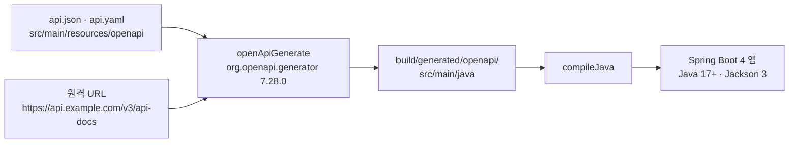
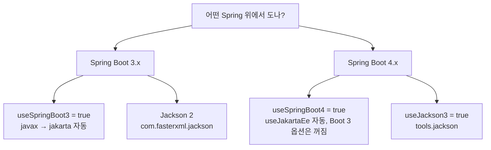
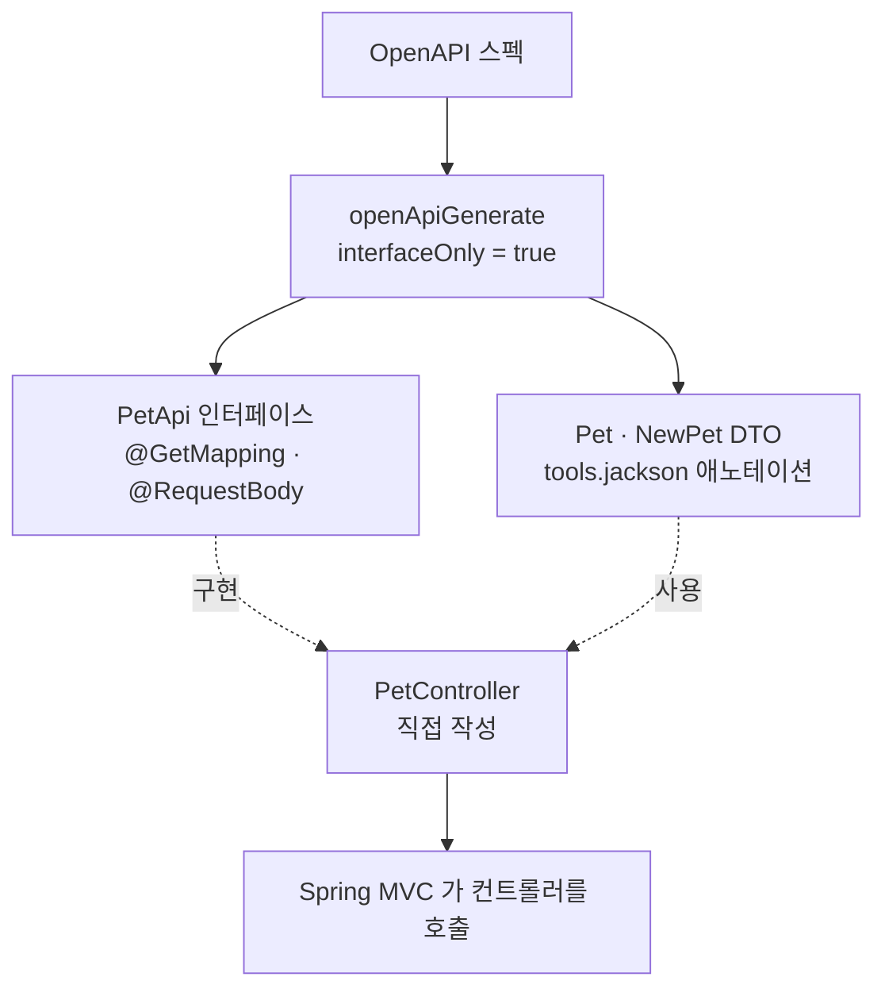

<dl class="facts">
  <div><dt>플러그인</dt><dd>7.28.0</dd></div>
  <div><dt>Spring Boot</dt><dd>4.2.0</dd></div>
  <div><dt>최소 Java</dt><dd>17</dd></div>
  <div><dt>스펙 입력</dt><dd>2<small>가지</small></dd></div>
</dl>

## 스펙이 진실, 코드는 도구가 만든다

OpenAPI 스펙 하나를 정해 두고 서버 인터페이스와 DTO 를 거기서 뽑는 방식입니다. 손으로 DTO 를 고치다 스펙과 어긋나는 일이 사라지고, 프론트도 다른 서비스도 같은 파일을 봅니다. Gradle 에서는 플러그인 한 줄과 `openApiGenerate` 블록 하나면 붙습니다.

문제는 Spring Boot 4 로 올라오면서 옵션 이름과 기본값이 바뀐 것입니다. Boot 3 때 쓰던 설정을 그대로 두면 생성된 코드가 `javax` 를 import 하거나 Jackson 2 를 찾다가 컴파일에서 멈춥니다.

전체 흐름은 이렇습니다. 스펙이 어디서 오든(파일이든 URL 이든) `openApiGenerate` 가 `build/` 아래에 자바 파일을 쓰고, `compileJava` 가 그 파일을 우리 코드와 같이 컴파일합니다.



## 버전부터 맞춘다

Spring Boot 4 지원은 최근에 들어왔습니다. 플러그인 버전을 올리지 않으면 옵션 자체가 없습니다.

| 버전 | 날짜 | 바뀐 것 |
|---|---|---|
| 7.20.0 | 2026-02-16 | spring 생성기에 `useSpringBoot4`·`useJackson3` 추가 |
| 7.21.0 | 2026-03-24 | `useSpringBoot3` 기본값이 `true` 로 (Boot 3 세대가 기본) |
| 7.22.0 | 2026-04-28 | `openApiNullable` 과 `useJackson3` 를 같이 쓸 수 있게 됨 |
| 7.28.0 | 2026-11-26 | 이 글을 쓰는 시점의 최신. Gradle 플러그인 포털에도 같은 버전 |

```kotlin
plugins {
    id("org.openapi.generator") version "7.28.0"
}
```

Gradle 쪽은 Spring Initializr 가 Boot 4.2 에 넣어 주는 래퍼가 Gradle 9.9.2 입니다. 플러그인 자체 검증은 Gradle 8.14.4 기준이라, 처음 붙일 때 `./gradlew openApiGenerate` 를 한 번 돌려 보는 게 좋습니다.

## 스펙은 파일로 받나, URL 로 받나

두 가지 다 됩니다. JSON 이든 YAML 이든 상관없습니다.

| 입력 | 프로퍼티 | 예 |
|---|---|---|
| 로컬 파일 | `inputSpec` | `inputSpec.set("$projectDir/src/main/resources/openapi/api.json")` |
| 원격 URL | `remoteInputSpec` | `remoteInputSpec.set("https://api.example.com/v3/api-docs")` |

- **원격 URL** 은 SpringDoc 이 열어 주는 `/v3/api-docs` 주소를 그대로 넣으면 됩니다. 다른 팀이 운영하는 서비스의 스펙을 매번 내려받아 쓰는 경우에 맞습니다.
- 대신 `remoteInputSpec` 은 태스크가 다시 돌 때마다 네트워크를 탑니다. 오프라인 빌드, CI 캐시, 상대 서버가 죽은 날에는 빌드가 같이 죽습니다. 자주 쓰는 스펙이면 파일로 떨어뜨려 저장소에 커밋하고 `inputSpec` 으로 읽는 편이 안전합니다.
- 최신 플러그인은 `inputSpec` 에 URL 을 넣어도 알아서 원격으로 돌려 줍니다. 그래도 둘을 나눠 적으면 빌드 파일만 봐도 어디서 오는지 보입니다.

## build.gradle.kts 전체

Boot 4.2 프로젝트에 그대로 붙이는 모양입니다. Spring Initializr 가 만들어 주는 부분에 `org.openapi.generator` 플러그인과 `openApiGenerate` 블록, 소스셋 연결만 더했습니다.

```kotlin
plugins {
    java
    id("org.springframework.boot") version "4.2.0"
    id("io.spring.dependency-management") version "1.1.7"
    id("org.openapi.generator") version "7.28.0"
}

group = "com.example"
version = "0.0.1-SNAPSHOT"

java {
    toolchain { languageVersion = JavaLanguageVersion.of(21) }
}

repositories { mavenCentral() }

dependencies {
    implementation("org.springframework.boot:spring-boot-starter-webmvc")
    implementation("org.springframework.boot:spring-boot-starter-validation")
    // openApiNullable = true 일 때만. false 로 두면 필요 없다.
    // implementation("org.openapitools:jackson-databind-nullable:0.2.13")
    testImplementation("org.springframework.boot:spring-boot-starter-webmvc-test")
}

openApiGenerate {
    generatorName.set("spring")
    inputSpec.set("$projectDir/src/main/resources/openapi/api.json")
    // 원격 스펙이면 위 줄 대신: remoteInputSpec.set("https://api.example.com/v3/api-docs")
    outputDir.set(layout.buildDirectory.dir("generated/openapi"))
    apiPackage.set("com.example.api")
    modelPackage.set("com.example.model")
    configOptions.putAll(
        mapOf(
            "useSpringBoot4" to "true",
            "useJackson3" to "true",
            "interfaceOnly" to "true",
            "openApiNullable" to "false",
            "requestMappingMode" to "api_interface",
            "useTags" to "true",
            "documentationProvider" to "none",
            "annotationLibrary" to "none",
        )
    )
}

sourceSets["main"].java.srcDir(layout.buildDirectory.dir("generated/openapi/src/main/java"))

tasks.named("compileJava") {
    dependsOn(tasks.named("openApiGenerate"))
}
```

`./gradlew build` 를 치면 생성과 컴파일이 한 번에 돕니다. 생성된 파일은 `build/generated/openapi/` 아래에만 생기고 `clean` 이 지웁니다. 저장소에 커밋할 것은 스펙 파일 하나뿐입니다.

스펙이 문법에 맞는지 먼저 보고 싶으면 `./gradlew openApiValidate` 를 씁니다. 생성 전에 스펙 오류로 멈춰 주는 편이 낫습니다.

## 옵션 세 개가 갈림길

`configOptions` 가 많아 보이지만, Boot 4 에서 실제로 갈리는 것은 세 가지입니다.

| 옵션 | 값 | 하는 일 |
|---|---|---|
| `useSpringBoot4` | `true` | Spring Boot 4.x / Spring Framework 7 용 코드와 의존성. `useJakartaEe` 가 자동으로 켜지고, `useSpringBoot3` 는 자동으로 꺼진다 |
| `useJackson3` | `true` | Jackson 3(`tools.jackson`) 기준으로 import 와 애노테이션을 만든다. `useSpringBoot4=true` 가 필수 |
| `openApiNullable` | `false` | nullable 필드를 `JsonNullable<T>` 로 감쌀지. 기본값이 `true` |

그림으로 보면 이렇게 갈립니다.



- `useSpringBoot4` 만 켜고 `useJackson3` 을 빼면 Boot 4 에서 Jackson 2 를 찾습니다. Boot 4 는 Jackson 3 가 기본이라 둘을 같이 켜야 합니다.
- `useJackson3=true` 를 `useSpringBoot4` 없이 두면 플러그인이 `useJackson3 is only available with Spring Boot >= 4` 로 거부합니다. 조용히 넘어가지 않으니 잘못 짚었으면 빌드에서 바로 알 수 있습니다.
- `openApiNullable` 은 기본값이 `true` 입니다. 켜 두면 nullable 필드가 `JsonNullable<Pet>` 처럼 한 겹 감싸져서, 컨트롤러에서 값을 꺼내는 코드가 한 줄씩 늘어납니다. 이 글은 `false` 로 둡니다. Jackson 3 와 같이 쓰려면 7.22.0 이상이어야 하고, 그 전 버전에서는 이 조합이 예외로 막힙니다.

남은 두 개는 문서용입니다. `annotationLibrary=none` 은 생성 코드에 `@Operation`·`@Schema` 같은 스웨거 애노테이션을 붙이지 말라는 뜻입니다. 기본값(`swagger2`)으로 두면 생성 코드가 `io.swagger.v3.oas.annotations` 를 import 하므로 앱에 `org.openapitools:swagger-annotations` 를 더해야 컴파일됩니다. `documentationProvider=none` 은 springdoc 설정 파일을 만들지 말라는 뜻이고(`interfaceOnly` 면 원래 만들지 않습니다), 스펙 파일이 이미 문서라서 둘 다 껐습니다.

## interfaceOnly: 인터페이스와 DTO 만 받는다

`interfaceOnly=true` 는 서버 구현체를 만들지 않고 `*Api` 인터페이스와 DTO 만 생성합니다. 생성 코드를 `build/` 에 두고 우리가 컨트롤러로 구현하는 실무형 구조입니다.



```java
@RestController
public class PetController implements PetApi {

    private final PetService service;

    public PetController(PetService service) {
        this.service = service;
    }

    @Override
    public ResponseEntity<Pet> getPet(Long petId) {
        return ResponseEntity.ok(service.find(petId));
    }

    @Override
    public ResponseEntity<Pet> addPet(Pet pet) {
        return ResponseEntity.status(HttpStatus.CREATED).body(service.save(pet));
    }
}
```

시그니처는 스펙이 정합니다. 스펙의 `operationId` 와 `parameters` 를 고치면 다음 빌드에서 컴파일 오류로 나타나고, 그게 이 방식의 값입니다. 스펙과 코드가 어긋난 채로 배포되는 일이 없습니다.

한 가지, `requestMappingMode` 기본값은 `controller` 입니다. 클래스 레벨 `@RequestMapping` 을 생성되는 컨트롤러에 붙이는 설정인데, `interfaceOnly` 에서는 컨트롤러를 만들지 않으니 붙을 곳이 없어집니다. 그래서 위 설정처럼 `api_interface` 로 바꿔 인터페이스에 붙입니다. 안 바꾸면 `/api/v1` 같은 기본 경로가 사라져 404 가 납니다.

## 클라이언트도 같은 스펙으로

서버를 만들었으면 그 API 를 부르는 쪽도 같은 스펙에서 뽑을 수 있습니다. `java` 생성기에 `library=restclient` 를 주면 Spring 7 의 `RestClient` 를 쓰는 클라이언트가 나옵니다.

```kotlin
// build.gradle.kts 맨 위에
import org.openapitools.generator.gradle.plugin.tasks.GenerateTask

// 아래는 파일 아무 곳에나
tasks.register<GenerateTask>("openApiGenerateClient") {
    generatorName.set("java")
    library.set("restclient")
    inputSpec.set("$projectDir/src/main/resources/openapi/api.json")
    outputDir.set(layout.buildDirectory.dir("generated/openapi-client"))
    apiPackage.set("com.example.client.api")
    modelPackage.set("com.example.client.model")
    configOptions.putAll(
        mapOf(
            "useSpringBoot4" to "true",
            "useJackson3" to "true",
            "openApiNullable" to "false",
        )
    )
}
```

`java` 생성기에서도 `restclient`·`resttemplate`·`webclient` 라이브러리는 `useJackson3` 에 `useSpringBoot4=true` 를 요구합니다. 조건이 맞지 않으면 예외로 알려 줍니다. 서버와 클라이언트를 같은 스펙 파일에서 뽑으면 필드 이름이 어긋날 일이 없습니다.

## 실제로 걸리는 것들

- **소스 경로에 `src/main/java` 까지 붙습니다.** 생성 파일은 `outputDir/src/main/java/…` 에 생깁니다. `srcDir(outputDir)` 로 잡으면 패키지가 안 맞아 `package com.example.api does not correspond to the file path` 로 막힙니다.
- **API 이름이 `DefaultApi` 로 나온다면** 스펙의 `tags` 를 쓰지 않아서입니다. `useTags=true` 를 주면 `PetApi` 처럼 태그 이름으로 나옵니다.
- **URL 스펙은 빌드를 외부에 묶습니다.** 상대 서버가 느리면 빌드도 느려지고, 죽으면 빌드가 실패합니다. 정기적으로 받아 파일로 커밋하는 편이 재현성에 낫습니다.
- **생성 코드는 커밋하지 않습니다.** 스펙이 진실이고 코드는 결과물입니다. `build/` 가 저장소 밖이라 `.gitignore` 도 손댈 것이 없습니다.
- **Boot 3 라이브러리와 섞으면 Jackson 이 둘이 됩니다.** Boot 4 는 Jackson 3(`tools.jackson`)가 기본인데, Jackson 2 기반 라이브러리를 같이 쓰면 `com.fasterxml.jackson` 이 클래스패스에 함께 올라옵니다. 생성 코드는 우리가 고른 쪽을 따르니, 앱에서 실제로 쓰는 ObjectMapper 가 어느 쪽인지 확인해야 합니다.
- **`openApiNullable` 을 켤 거라면** 7.22.0 이상인지 먼저 봅니다. 그 전 버전은 `useJackson3` 와 같이 쓸 수 없습니다.

## 정리

Spring Boot 4 에서 OpenAPI Generator 를 붙이는 일은 결국 세 줄입니다.

```kotlin
id("org.openapi.generator") version "7.28.0"
"useSpringBoot4" to "true"
"useJackson3" to "true"
```

나머지는 취향입니다. 스펙을 파일로 둘지 URL 로 받을지, 인터페이스만 받을지 서버 스텁까지 받을지. 다만 `requestMappingMode` 와 소스 경로 두 개는 기본값 그대로 두면 조용히 404 나 컴파일 오류로 돌아오니, 처음 붙일 때 한 번은 확인하고 넘어가는 게 좋습니다.

스펙 자체를 어떻게 쓰는지는 [OpenAPI Specification](https://spec.openapis.org/oas/latest.html) 에, 생성기 옵션 전체는 [spring generator 문서](https://openapi-generator.tech/docs/generators/spring) 에 있습니다.
