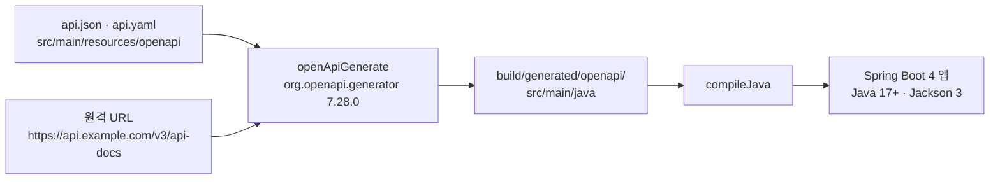
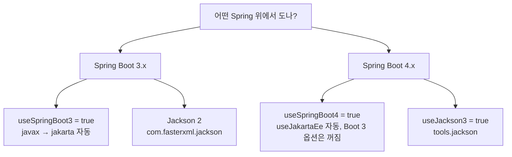
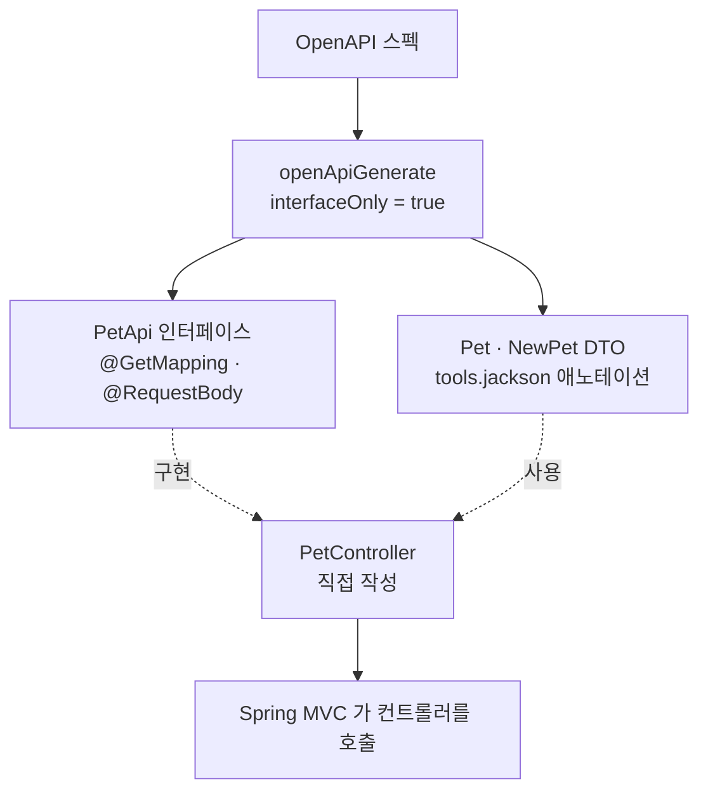
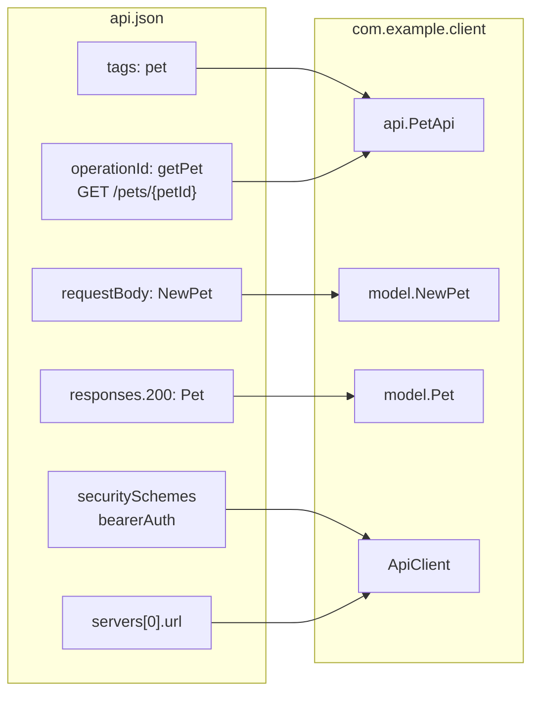

<dl class="facts">
  <div><dt>플러그인</dt><dd>7.28.0</dd></div>
  <div><dt>Spring Boot</dt><dd>4.2.0</dd></div>
  <div><dt>최소 Java</dt><dd>17</dd></div>
  <div><dt>스펙 입력</dt><dd>2<small>가지</small></dd></div>
</dl>

## 스펙이 진실, 코드는 도구가 만든다

OpenAPI 스펙 하나를 정해 두고 서버 인터페이스와 DTO 를 거기서 뽑는 방식입니다. 손으로 DTO 를 고치다 스펙과 어긋나는 일이 사라지고, 프론트도 다른 서비스도 같은 파일을 봅니다. Gradle 에서는 플러그인 한 줄과 `openApiGenerate` 블록 하나면 붙습니다.

문제는 Spring Boot 4 로 올라오면서 옵션 이름과 기본값이 바뀐 것입니다. Boot 3 때 쓰던 설정을 그대로 두면 생성된 코드가 `javax` 를 import 하거나 Jackson 2 를 찾다가 컴파일에서 멈춥니다.

전체 흐름은 이렇습니다. 스펙이 어디서 오든(파일이든 URL 이든) `openApiGenerate` 가 `build/` 아래에 자바 파일을 쓰고, `compileJava` 가 그 파일을 우리 코드와 같이 컴파일합니다.



## 버전부터 맞춘다

Spring Boot 4 지원은 최근에 들어왔습니다. 플러그인 버전을 올리지 않으면 옵션 자체가 없습니다.

| 버전 | 날짜 | 바뀐 것 |
|---|---|---|
| 7.20.0 | 2026-02-16 | spring 생성기에 `useSpringBoot4`·`useJackson3` 추가 |
| 7.21.0 | 2026-03-24 | `useSpringBoot3` 기본값이 `true` 로 (Boot 3 세대가 기본) |
| 7.22.0 | 2026-04-28 | `openApiNullable` 과 `useJackson3` 를 같이 쓸 수 있게 됨 |
| 7.28.0 | 2026-11-26 | 이 글을 쓰는 시점의 최신. Gradle 플러그인 포털에도 같은 버전 |

```kotlin
plugins {
    id("org.openapi.generator") version "7.28.0"
}
```

Gradle 쪽은 Spring Initializr 가 Boot 4.2 에 넣어 주는 래퍼가 Gradle 9.9.2 입니다. 플러그인 자체 검증은 Gradle 8.14.4 기준이라, 처음 붙일 때 `./gradlew openApiGenerate` 를 한 번 돌려 보는 게 좋습니다.

## 스펙은 파일로 받나, URL 로 받나

두 가지 다 됩니다. JSON 이든 YAML 이든 상관없습니다.

| 입력 | 프로퍼티 | 예 |
|---|---|---|
| 로컬 파일 | `inputSpec` | `inputSpec.set("$projectDir/src/main/resources/openapi/api.json")` |
| 원격 URL | `remoteInputSpec` | `remoteInputSpec.set("https://api.example.com/v3/api-docs")` |

- **원격 URL** 은 SpringDoc 이 열어 주는 `/v3/api-docs` 주소를 그대로 넣으면 됩니다. 다른 팀이 운영하는 서비스의 스펙을 매번 내려받아 쓰는 경우에 맞습니다.
- 대신 `remoteInputSpec` 은 태스크가 다시 돌 때마다 네트워크를 탑니다. 오프라인 빌드, CI 캐시, 상대 서버가 죽은 날에는 빌드가 같이 죽습니다. 자주 쓰는 스펙이면 파일로 떨어뜨려 저장소에 커밋하고 `inputSpec` 으로 읽는 편이 안전합니다.
- 최신 플러그인은 `inputSpec` 에 URL 을 넣어도 알아서 원격으로 돌려 줍니다. 그래도 둘을 나눠 적으면 빌드 파일만 봐도 어디서 오는지 보입니다.

## build.gradle.kts 전체

Boot 4.2 프로젝트에 그대로 붙이는 모양입니다. Spring Initializr 가 만들어 주는 부분에 `org.openapi.generator` 플러그인과 `openApiGenerate` 블록, 소스셋 연결만 더했습니다.

```kotlin
plugins {
    java
    id("org.springframework.boot") version "4.2.0"
    id("io.spring.dependency-management") version "1.1.7"
    id("org.openapi.generator") version "7.28.0"
}

group = "com.example"
version = "0.0.1-SNAPSHOT"

java {
    toolchain { languageVersion = JavaLanguageVersion.of(21) }
}

repositories { mavenCentral() }

dependencies {
    implementation("org.springframework.boot:spring-boot-starter-webmvc")
    implementation("org.springframework.boot:spring-boot-starter-validation")
    // openApiNullable = true 일 때만. false 로 두면 필요 없다.
    // implementation("org.openapitools:jackson-databind-nullable:0.2.13")
    testImplementation("org.springframework.boot:spring-boot-starter-webmvc-test")
}

openApiGenerate {
    generatorName.set("spring")
    inputSpec.set("$projectDir/src/main/resources/openapi/api.json")
    // 원격 스펙이면 위 줄 대신: remoteInputSpec.set("https://api.example.com/v3/api-docs")
    outputDir.set(layout.buildDirectory.dir("generated/openapi"))
    apiPackage.set("com.example.api")
    modelPackage.set("com.example.model")
    configOptions.putAll(
        mapOf(
            "useSpringBoot4" to "true",
            "useJackson3" to "true",
            "interfaceOnly" to "true",
            "openApiNullable" to "false",
            "requestMappingMode" to "api_interface",
            "useTags" to "true",
            "documentationProvider" to "none",
            "annotationLibrary" to "none",
        )
    )
}

val generatedSources = layout.buildDirectory.dir("generated/openapi/src/main/java")
sourceSets["main"].java.srcDir(generatedSources)

tasks.named("compileJava") {
    dependsOn(tasks.named("openApiGenerate"))
}
```

`./gradlew build` 를 치면 생성과 컴파일이 한 번에 돕니다. 생성된 파일은 `build/generated/openapi/` 아래에만 생기고 `clean` 이 지웁니다. 저장소에 커밋할 것은 스펙 파일 하나뿐입니다.

스펙이 문법에 맞는지 먼저 보고 싶으면 `./gradlew openApiValidate` 를 씁니다. 생성 전에 스펙 오류로 멈춰 주는 편이 낫습니다.

## 옵션 세 개가 갈림길

`configOptions` 가 많아 보이지만, Boot 4 에서 실제로 갈리는 것은 세 가지입니다.

| 옵션 | 하는 일 |
|---|---|
| `useSpringBoot4 = true` | Spring Boot 4.x / Spring Framework 7 용 코드와 의존성. `useJakartaEe` 가 자동으로 켜지고, `useSpringBoot3` 는 자동으로 꺼진다 |
| `useJackson3 = true` | Jackson 3(`tools.jackson`) 기준으로 import 와 애노테이션을 만든다. `useSpringBoot4=true` 가 필수 |
| `openApiNullable = false` | nullable 필드를 `JsonNullable<T>` 로 감쌀지. 기본값이 `true` |

그림으로 보면 이렇게 갈립니다.



- `useSpringBoot4` 만 켜고 `useJackson3` 을 빼면 Boot 4 에서 Jackson 2 를 찾습니다. Boot 4 는 Jackson 3 가 기본이라 둘을 같이 켜야 합니다.
- `useJackson3=true` 를 `useSpringBoot4` 없이 두면 플러그인이 `useJackson3 is only available with Spring Boot >= 4` 로 거부합니다. 조용히 넘어가지 않으니 잘못 짚었으면 빌드에서 바로 알 수 있습니다.
- `openApiNullable` 은 기본값이 `true` 입니다. 켜 두면 nullable 필드가 `JsonNullable<Pet>` 처럼 한 겹 감싸져서, 컨트롤러에서 값을 꺼내는 코드가 한 줄씩 늘어납니다. 이 글은 `false` 로 둡니다. Jackson 3 와 같이 쓰려면 7.22.0 이상이어야 하고, 그 전 버전에서는 이 조합이 예외로 막힙니다.

남은 두 개는 문서용입니다. `annotationLibrary=none` 은 생성 코드에 `@Operation`·`@Schema` 같은 스웨거 애노테이션을 붙이지 말라는 뜻입니다. 기본값(`swagger2`)으로 두면 생성 코드가 `io.swagger.v3.oas.annotations` 를 import 하므로 앱에 `org.openapitools:swagger-annotations` 를 더해야 컴파일됩니다. `documentationProvider=none` 은 springdoc 설정 파일을 만들지 말라는 뜻이고(`interfaceOnly` 면 원래 만들지 않습니다), 스펙 파일이 이미 문서라서 둘 다 껐습니다.

## interfaceOnly: 인터페이스와 DTO 만 받는다

`interfaceOnly=true` 는 서버 구현체를 만들지 않고 `*Api` 인터페이스와 DTO 만 생성합니다. 생성 코드를 `build/` 에 두고 우리가 컨트롤러로 구현하는 실무형 구조입니다.



```java
@RestController
public class PetController implements PetApi {

    private final PetService service;

    public PetController(PetService service) {
        this.service = service;
    }

    @Override
    public ResponseEntity<Pet> getPet(Long petId) {
        return ResponseEntity.ok(service.find(petId));
    }

    @Override
    public ResponseEntity<Pet> addPet(Pet pet) {
        return ResponseEntity.status(HttpStatus.CREATED).body(service.save(pet));
    }
}
```

시그니처는 스펙이 정합니다. 스펙의 `operationId` 와 `parameters` 를 고치면 다음 빌드에서 컴파일 오류로 나타나고, 그게 이 방식의 값입니다. 스펙과 코드가 어긋난 채로 배포되는 일이 없습니다.

한 가지, `requestMappingMode` 기본값은 `controller` 입니다. 클래스 레벨 `@RequestMapping` 을 생성되는 컨트롤러에 붙이는 설정인데, `interfaceOnly` 에서는 컨트롤러를 만들지 않으니 붙을 곳이 없어집니다. 그래서 위 설정처럼 `api_interface` 로 바꿔 인터페이스에 붙입니다. 안 바꾸면 `/api/v1` 같은 기본 경로가 사라져 404 가 납니다.

## 클라이언트도 같은 스펙으로

서버를 만들었으면 그 API 를 부르는 쪽도 같은 스펙에서 뽑을 수 있습니다. `java` 생성기에 `library=restclient` 를 주면 Spring 7 의 `RestClient` 를 쓰는 클라이언트가 나옵니다.

```kotlin
// build.gradle.kts 맨 위에
import org.openapitools.generator.gradle.plugin.tasks.GenerateTask

// 아래는 파일 아무 곳에나
tasks.register<GenerateTask>("openApiGenerateClient") {
    generatorName.set("java")
    library.set("restclient")
    inputSpec.set("$projectDir/src/main/resources/openapi/api.json")
    outputDir.set(layout.buildDirectory.dir("generated/openapi-client"))
    apiPackage.set("com.example.client.api")
    modelPackage.set("com.example.client.model")
    configOptions.putAll(
        mapOf(
            "useSpringBoot4" to "true",
            "useJackson3" to "true",
            "openApiNullable" to "false",
        )
    )
}
```

`java` 생성기에서도 `restclient`·`resttemplate`·`webclient` 라이브러리는 `useJackson3` 에 `useSpringBoot4=true` 를 요구합니다. 조건이 맞지 않으면 예외로 알려 줍니다. 서버와 클라이언트를 같은 스펙 파일에서 뽑으면 필드 이름이 어긋날 일이 없습니다.

## api.json 과 생성 코드는 이렇게 대응한다

스펙의 어느 줄이 생성 코드의 어느 클래스가 되는지 한 번 짚고 가겠습니다. 아래는 이 글에서 계속 쓰는 예시 스펙입니다. `servers`·`tags`·`paths`·`operationId`·`requestBody`·`responses`·`components.schemas`·`securitySchemes` 가 모두 들어 있습니다.

```json
{
  "openapi": "3.1.0",
  "info": { "title": "Pet Service", "version": "1.0.0" },
  "servers": [{ "url": "https://api.example.com/v1" }],
  "tags": [{ "name": "pet", "description": "Pets" }],
  "paths": {
    "/pets/{petId}": {
      "get": {
        "tags": ["pet"],
        "operationId": "getPet",
        "parameters": [
          { "name": "petId", "in": "path", "required": true,
            "schema": { "type": "integer", "format": "int64" } }
        ],
        "responses": {
          "200": { "description": "Found",
            "content": { "application/json":
              { "schema": { "$ref": "#/components/schemas/Pet" } } } },
          "404": { "description": "Not found" }
        }
      }
    },
    "/pets": {
      "post": {
        "tags": ["pet"],
        "operationId": "addPet",
        "requestBody": {
          "required": true,
          "content": { "application/json":
            { "schema": { "$ref": "#/components/schemas/NewPet" } } }
        },
        "responses": {
          "201": { "description": "Created",
            "content": { "application/json":
              { "schema": { "$ref": "#/components/schemas/Pet" } } } }
        }
      }
    }
  },
  "components": {
    "schemas": {
      "Pet": {
        "type": "object",
        "required": ["id", "name"],
        "properties": {
          "id": { "type": "integer", "format": "int64" },
          "name": { "type": "string" },
          "tag": { "type": "string" }
        }
      },
      "NewPet": {
        "type": "object",
        "required": ["name"],
        "properties": {
          "name": { "type": "string" },
          "tag": { "type": "string" }
        }
      }
    },
    "securitySchemes": {
      "bearerAuth": { "type": "http", "scheme": "bearer", "bearerFormat": "JWT" }
    }
  },
  "security": [{ "bearerAuth": [] }]
}
```

`invokerPackage` 를 `com.example.client` 로 두었다고 가정하면 대응은 이렇습니다.

| 스펙의 값 | 만들어지는 코드 |
|---|---|
| `tags: ["pet"]` (`useTags=true`) | `com.example.client.api.PetApi` — 태그 하나가 API 클래스 하나 |
| `operationId: getPet` + `GET /pets/{petId}` | `PetApi.getPet(Long petId)` 와 `getPetWithHttpInfo(Long petId)` |
| `parameters[].in: path` · `format: int64` | 메서드 인자 `Long petId` (필수라 `@Nonnull`) |
| `requestBody: NewPet` | `addPet(NewPet newPet)` 의 본문 인자 |
| `responses.200.content.schema: Pet` | 반환 타입 `Pet`. `getPetWithHttpInfo` 는 `ResponseEntity<Pet>` |
| `components.schemas.Pet` | `com.example.client.model.Pet` — `new Pet().id(1L).name("…")` 처럼 잇는 setter |
| `components.securitySchemes.bearerAuth` | `ApiClient` 의 `authentications` 에 `HttpBearerAuth` — 호출마다 `Authorization` 헤더 |
| `servers[0].url` | `ApiClient.basePath` 의 기본값 |
| `info.title` · `version` | 생성 파일 머리 주석과 `@Generated` 의 설명 |

그림으로 보면 스펙 쪽 조각이 코드 쪽 클래스로 이어집니다.



이 대응은 스펙을 고칠 때마다 다시 계산됩니다. `operationId` 를 바꾸면 메서드 이름이 바뀌고, `required` 를 빼면 인자에서 `@Nonnull` 이 빠지고, 응답 스키마를 `Pet` 에서 `PetPage` 로 바꾸면 반환 타입이 따라 바뀝니다. 그래서 컴파일이 스펙과 코드의 어긋남을 잡아 줍니다.

## 생성된 클라이언트를 실제로 부른다

클라이언트를 뽑는 데까지는 위 설정으로 끝입니다. 실제로 호출하려면 세 가지가 더 필요합니다. 생성 코드를 소스 경로에 붙이고, `ApiClient` 를 빈으로 만들고, 그 `ApiClient` 에 주소와 인증을 넣는 일입니다.

### 소스 경로와 패키지

앞의 `openApiGenerateClient` 에 `invokerPackage` 와 소스 경로·컴파일 연결을 더한 모양입니다.

```kotlin
import org.openapitools.generator.gradle.plugin.tasks.GenerateTask

tasks.register<GenerateTask>("openApiGenerateClient") {
    generatorName.set("java")
    library.set("restclient")
    inputSpec.set("$projectDir/src/main/resources/openapi/api.json")
    outputDir.set(layout.buildDirectory.dir("generated/openapi-client"))
    invokerPackage.set("com.example.client")       // ApiClient 와 ExceptionProvider
    apiPackage.set("com.example.client.api")       // PetApi
    modelPackage.set("com.example.client.model")   // Pet · NewPet
    configOptions.putAll(
        mapOf(
            "useSpringBoot4" to "true",
            "useJackson3" to "true",
            "openApiNullable" to "false",
        )
    )
}

val clientSources = layout.buildDirectory.dir("generated/openapi-client/src/main/java")
sourceSets["main"].java.srcDir(clientSources)

tasks.named("compileJava") {
    dependsOn(tasks.named("openApiGenerateClient"))
}
```

- `invokerPackage` 를 비우면 기본값이 `org.openapitools.client` 입니다. 같은 모듈에서 서버 인터페이스와 클라이언트를 같이 쓰니 우리 패키지로 바꿔 두는 편이 읽기 좋습니다.
- 서버 쪽 `openApiGenerate` 와 `outputDir`(`generated/openapi-client`)·패키지가 겹치지 않게 합니다. 같은 폴더에 두 번 생성하면 파일이 서로 덮입니다.
- 생성 파일은 `outputDir/src/main/java/…` 아래에 생기므로 `srcDir` 에도 `src/main/java` 까지 붙입니다.

### 빈으로 등록한다

`generateClientAsBean` 은 기본값이 `false` 라, 생성된 `ApiClient` 와 `PetApi` 는 평범한 클래스입니다. 우리가 빈으로 등록합니다.

```java
@Configuration
public class PetClientConfig {

    @Bean
    ApiClient petApiClient(RestClient.Builder builder) {
        RestClient restClient = builder.build();
        return new ApiClient(restClient)
                .setBasePath("https://api.example.com/v1");
    }

    @Bean
    PetApi petApi(ApiClient petApiClient) {
        return new PetApi(petApiClient);
    }
}
```

`RestClient.Builder` 는 상태를 담는 빌더입니다. 여러 클라이언트가 한 빌더를 나눠 쓰는 구조라면 `builder.clone()` 으로 복제해 쓰고, 여기처럼 한 곳에서만 만들면 그대로 `build()` 해도 됩니다.

`generateClientAsBean=true` 로 생성하면 이 두 클래스에 `@Component` 가 붙어 스캔만으로 빈이 됩니다. 다만 생성된 `ApiClient` 는 생성자에서 `RestClient` 를 받으므로, Boot 가 기본으로 주지 않는 `RestClient` 빈을 따로 만들어야 합니다. 스펙이 여러 개면 `ApiClient` 빈이 타입까지 같아져 주입이 모호해지니, 그때는 아래처럼 직접 등록하는 쪽이 낫습니다.

### basePath 는 ApiClient 에 넣는다

`ApiClient` 는 요청을 만들 때 `basePath`(또는 스펙의 `servers`)를 앞에 붙여 **절대 URL** 을 만듭니다. `restClient.method(GET).uri("https://api.example.com/v1/pets/1")` 처럼 나갑니다. 그래서 `RestClient.Builder.baseUrl(...)` 만 바꿔서는 아무 일도 일어나지 않습니다. 절대 URL 이라 RestClient 의 base URL 이 쓰일 자리가 없습니다.

한 가지 더 있습니다. `ApiClient` 의 `serverIndex` 필드 기본값은 `0` 이고, `servers` 가 비어 있지 않으면 `servers[0]` 이 이깁니다. `setBasePath()` 는 `basePath` 를 바꾸면서 `serverIndex` 를 `null` 로 되돌리는 메서드라, 스펙에 적힌 주소 대신 다른 곳을 부를 때 씁니다.

- 로컬·스테이징으로 돌릴 때: `apiClient.setBasePath("http://localhost:8080")`
- 스펙에 서버가 여러 개 있을 때: `apiClient.setServerIndex(1)`
- 스펙에 `servers` 가 아예 없을 때: `setBasePath` 를 부르지 않으면 URL 을 만들 수 없으니 반드시 넣습니다.

### 인증은 스펙이 정한다

스펙에 `securitySchemes` 가 있으면 `ApiClient` 가 호출할 때 그 스킴을 채웁니다. 우리가 할 일은 값만 넣는 것입니다.

```java
apiClient.setBearerToken(token);          // http bearer
apiClient.setBearerToken(tokenSupplier);  // 만료가 짧으면 Supplier 로
apiClient.setUsername("app");              // http basic
apiClient.setPassword("secret");
```

이 메서드들은 `authentications` 맵을 돌며 같은 종류의 스킴에 값을 넣습니다. 스펙에 `securitySchemes` 가 없으면 그 맵이 비어 있어 **조용히 아무 일도 하지 않습니다.** 이때는 HTTP 계층에서 헤더를 넣습니다.

```java
@Bean
ApiClient petApiClient(RestClient.Builder builder) {
    RestClient restClient = builder
            .defaultHeader(HttpHeaders.AUTHORIZATION, "Bearer " + token)
            .build();
    return new ApiClient(restClient).setBasePath("https://api.example.com/v1");
}
```

토큰이 자주 바뀌면 `defaultHeader` 대신 `requestInterceptor` 로 요청마다 값을 채웁니다.

```java
RestClient restClient = builder
        .requestInterceptor((request, body, execution) -> {
            request.getHeaders().setBearerAuth(tokens.current());
            return execution.execute(request, body);
        })
        .build();
```

`ApiClient` 에도 `addDefaultHeader("User-Agent", …)` 처럼 고정 헤더를 넣는 메서드가 있습니다. 값이 하나로 정해지면 그쪽이 간단하고, 요청마다 달라지면 인터셉터가 맞습니다.

### 서비스에서 호출한다

```java
@Service
public class PetGateway {

    private final PetApi petApi;

    public PetGateway(PetApi petApi) {
        this.petApi = petApi;
    }

    public Pet find(long petId) {
        try {
            return petApi.getPet(petId);
        } catch (RestClientResponseException e) {
            if (e.getStatusCode().value() == 404) {
                throw new PetNotFoundException(petId);
            }
            throw e;
        }
    }

    public Pet create(String name, String tag) {
        return petApi.addPet(new NewPet().name(name).tag(tag));
    }

    public Pet findWithStatus(long petId) {
        ResponseEntity<Pet> res = petApi.getPetWithHttpInfo(petId);
        return res.getBody();   // 상태 코드·헤더까지 필요할 때
    }
}
```

- `getPet` 은 4xx·5xx 에서 `RestClientResponseException` 을 던집니다. 스펙의 404 도 예외로 오므로 상태 코드로 갈라 우리 예외로 바꿉니다.
- 본문만으로는 부족하고 상태 코드·헤더가 필요하면 `…WithHttpInfo` 가 `ResponseEntity<T>` 를 줍니다. 응답을 직접 파싱하려면 `…WithResponseSpec` 이 `RestClient.ResponseSpec` 을 줍니다.
- `openApiNullable=true` 로 생성했다면 `String name = pet.getName().get();` 처럼 `JsonNullable` 을 벗겨야 합니다. 이 글은 `false` 라 그대로 씁니다.

## 그룹·태그만 골라서 뽑기

스펙이 커지면 클라이언트도 커집니다. 서버 하나에 API 가 수십 개인데 우리는 두 개만 부른다면 나머지는 빌드 시간과 jar 크기만 먹습니다. 세 가지 길이 있습니다.

### 1. 서버가 그룹으로 나눠 준다 — 그룹 URL

서버도 SpringDoc 이면 `GroupedOpenApi` 로 스펙을 그룹별 주소로 나눠 줄 수 있습니다.

```java
@Bean
GroupedOpenApi petGroup() {
    return GroupedOpenApi.builder()
            .group("pet")
            .pathsToMatch("/pets/**")
            .build();
}
```

이러면 `/v3/api-docs` 말고 `/v3/api-docs/pet` 이 생깁니다. 클라이언트는 주소만 그룹 쪽으로 바꾸면 됩니다.

```kotlin
remoteInputSpec.set("https://api.example.com/v3/api-docs/pet")
```

어느 오퍼레이션이 어느 그룹에 들어가는지는 서버가 정합니다. 클라이언트에서 필터를 또 걸면 두 번 거르는 셈이니, 그룹 URL 을 쓰는 경우에는 `FILTER` 를 비워 둡니다.

### 2. FILTER 로 오퍼레이션을 거른다

남의 서비스라 서버를 못 고치거나, 한 스펙에서 클라이언트만 다르게 뽑고 싶을 때는 생성 단계에서 거릅니다.

```kotlin
openApiNormalizer.set(
    mapOf("FILTER" to "tag:pet|store")
)
```

`FILTER` 는 `이름:값1|값2` 꼴이고, 여러 개는 세미콜론으로 잇습니다. 거르는 기준은 네 가지입니다.

- `tag:pet|store` — 이 태그가 붙은 오퍼레이션
- `path:/pets` — 이 경로로 **시작하는** 오퍼레이션 (접두어 비교)
- `operationId:getPet|addPet` — 이름이 정확히 같은 오퍼레이션
- `method:get|post` — HTTP 메서드

조합은 `tag:pet;method:get` 처럼 씁니다. 다만 세미콜론으로 이은 조건은 **and 가 아니라 or** 입니다. 위 예는 "pet 태그이거나 GET 인" 오퍼레이션이 남습니다. 좁히고 싶으면 `tag:pet` 처럼 하나만 쓰는 편이 분명합니다.

동작은 "지우기"가 아니라 "표시"입니다. 맞지 않는 오퍼레이션에 `x-internal: true` 를 붙이고, 생성기가 그 표시를 보고 건너뜁니다. 그래서 스펙 파일 자체는 그대로이고, 남은 오퍼레이션만으로 API 클래스와 메서드가 만들어집니다. 모델(`components.schemas`)은 스펙에 있는 것이 모두 생성됩니다 — 거른 오퍼레이션이 쓰던 모델까지 포함입니다. 모델까지 줄이려면 `globalProperties` 의 `models` 를 함께 씁니다.

문법이 틀리면 조용히 넘어가지 않습니다. 7.16.0 부터 `FILTER` 형식 오류는 예외로 빌드를 멈춥니다.

### 3. apis 로 API 클래스를 고른다

```kotlin
globalProperties.set(mapOf("apis" to "Pet:Store"))
```

생성할 API 클래스 이름을 콜론으로 나열합니다. 여기 적는 값은 클래스 이름에서 `Api` 를 뺀 것입니다. 태그가 `pet` 이면 클래스는 `PetApi` 이고, 적을 값은 `Pet` 입니다. `FILTER` 와 다른 점은 이렇습니다.

- `apis` 는 **클래스 단위**입니다. `PetApi` 는 통째로 오고, 그 안의 메서드를 골라낼 수는 없습니다.
- `FILTER` 는 **오퍼레이션 단위**입니다. 태그로 클래스를 고르면서 같은 태그 안의 일부 메서드만 남길 수도 있습니다.
- 둘 다 스펙 파일을 고치지 않습니다. `FILTER` 는 표시를 붙이는 방식이고, `apis` 는 템플릿에 넘길 API 목록만 자릅니다.

## 스펙이 여러 개라면

서비스마다 `v3/api-docs` 가 따로 있거나, 외부 API 를 여러 개 부르는 경우입니다. 이때는 태스크 하나에 스펙을 몰아넣으면 안 됩니다. 생성 코드에는 `ApiClient` 클래스가 스펙마다 하나씩 나오는데 이름이 같아서, 같은 패키지에 두 번 생성하면 나중 것이 앞의 것을 덮습니다. `Pet` 처럼 흔한 모델 이름도 서비스마다 모양이 다르면 그대로 충돌합니다.

그래서 스펙마다 `outputDir`·`invokerPackage`·`apiPackage`·`modelPackage` 를 따로 잡습니다. 태스크는 목록을 돌며 등록합니다.

```kotlin
import org.openapitools.generator.gradle.plugin.tasks.GenerateTask

data class ClientSpec(val name: String, val specUrl: String, val basePath: String)

val clientSpecs = listOf(
    ClientSpec("pet",     "https://api.example.com/v3/api-docs/pet",   "https://api.example.com"),
    ClientSpec("order",   "https://api.example.com/v3/api-docs/order", "https://api.example.com"),
    ClientSpec("billing", "https://billing.example.net/v3/api-docs",   "https://billing.example.net"),
)

val clientTasks = clientSpecs.map { spec ->
    val taskName = "openApiGenerateClient" + spec.name.replaceFirstChar { it.uppercase() }
    tasks.register<GenerateTask>(taskName) {
        generatorName.set("java")
        library.set("restclient")
        remoteInputSpec.set(spec.specUrl)
        outputDir.set(layout.buildDirectory.dir("generated/openapi-client/${spec.name}"))
        invokerPackage.set("com.example.client.${spec.name}")        // ApiClient
        apiPackage.set("com.example.client.${spec.name}.api")        // PetApi · OrderApi
        modelPackage.set("com.example.client.${spec.name}.model")    // Pet · Order
        configOptions.putAll(
            mapOf(
                "useSpringBoot4" to "true",
                "useJackson3" to "true",
                "openApiNullable" to "false",
            )
        )
    }
    taskName
}

clientSpecs.forEach { spec ->
    sourceSets["main"].java.srcDir(
        layout.buildDirectory.dir("generated/openapi-client/${spec.name}/src/main/java")
    )
}

tasks.named("compileJava") {
    dependsOn(tasks.named("openApiGenerate"))
    dependsOn(clientTasks.map { tasks.named(it) })
}
```

핵심은 세 가지입니다.

- `outputDir` 이 스펙마다 다르지 않으면 두 번째 생성이 첫 번째 결과 위에 씁니다.
- `invokerPackage` 가 같으면 `ApiClient` 클래스가 두 개 생겨 컴파일이 깨집니다. 패키지가 달라도 **클래스 이름은 같으니** Java 코드에서는 import 대신 전체 이름으로 써야 합니다(아래 설정 참고).
- `apiPackage`·`modelPackage` 도 나눠야 `Pet` 같은 흔한 이름이 서비스끼리 부딪히지 않습니다.

빈은 클라이언트마다 하나씩, 주소도 각각 다르게 등록합니다.

```java
@Configuration
public class ClientsConfig {

    @Bean
    com.example.client.pet.ApiClient petApiClient(RestClient.Builder builder) {
        return new com.example.client.pet.ApiClient(builder.build())
                .setBasePath("https://api.example.com");
    }

    @Bean
    com.example.client.billing.ApiClient billingApiClient(RestClient.Builder builder) {
        return new com.example.client.billing.ApiClient(builder.build())
                .setBasePath("https://billing.example.net");
    }

    @Bean
    PetApi petApi(@Qualifier("petApiClient") com.example.client.pet.ApiClient client) {
        return new PetApi(client);
    }

    @Bean
    BillingApi billingApi(@Qualifier("billingApiClient") com.example.client.billing.ApiClient client) {
        return new BillingApi(client);
    }
}
```

`ApiClient` 빈이 둘 이상이면 타입만으로는 고를 수 없으니 `@Qualifier` 로 이름을 지정합니다. 생성된 `PetApi`·`BillingApi` 도 패키지가 다르니 import 를 나눠 적거나 전체 이름을 씁니다.

스펙 파일이 한 서비스의 조각일 뿐이라면 클라이언트를 하나로 두는 편이 낫습니다. 플러그인은 `inputSpecRootDirectory`(또는 `inputSpecFiles`)에 스펙 여러 개를 넘기면 하나의 스펙으로 합쳐 생성합니다. 서비스가 다르면 태스크를 나누고, 같은 서비스의 그룹이면 합치는 쪽입니다.

## 실제로 걸리는 것들

- **소스 경로에 `src/main/java` 까지 붙습니다.** 생성 파일은 `outputDir/src/main/java/…` 에 생깁니다. `srcDir(outputDir)` 로 잡으면 패키지가 안 맞아 `package com.example.api does not correspond to the file path` 로 막힙니다.
- **API 이름이 `DefaultApi` 로 나온다면** 스펙의 `tags` 를 쓰지 않아서입니다. `useTags=true` 를 주면 `PetApi` 처럼 태그 이름으로 나옵니다.
- **URL 스펙은 빌드를 외부에 묶습니다.** 상대 서버가 느리면 빌드도 느려지고, 죽으면 빌드가 실패합니다. 정기적으로 받아 파일로 커밋하는 편이 재현성에 낫습니다.
- **생성 코드는 커밋하지 않습니다.** 스펙이 진실이고 코드는 결과물입니다. `build/` 가 저장소 밖이라 `.gitignore` 도 손댈 것이 없습니다.
- **Boot 3 라이브러리와 섞으면 Jackson 이 둘이 됩니다.** Boot 4 는 Jackson 3(`tools.jackson`)가 기본인데, Jackson 2 기반 라이브러리를 같이 쓰면 `com.fasterxml.jackson` 이 클래스패스에 함께 올라옵니다. 생성 코드는 우리가 고른 쪽을 따르니, 앱에서 실제로 쓰는 ObjectMapper 가 어느 쪽인지 확인해야 합니다.
- **`openApiNullable` 을 켤 거라면** 7.22.0 이상인지 먼저 봅니다. 그 전 버전은 `useJackson3` 와 같이 쓸 수 없습니다.
- **`invokerPackage` 를 비워 두면** 클라이언트가 `org.openapitools.client` 로 나옵니다. 스펙 두 개를 같은 패키지에 뽑으면 `ApiClient` 가 조용히 덮여, 한쪽 클라이언트가 다른 쪽 주소로 나갑니다.
- **`setBasePath` 를 빠뜨리면** 호출이 스펙의 `servers[0]` 로 나갑니다. 스펙에 운영 주소가 박혀 있으면 테스트가 운영을 칩니다. `RestClient` 의 `baseUrl` 은 이 경로에 관여하지 않습니다.
- **`FILTER` 는 모델을 줄이지 않습니다.** 거른 오퍼레이션의 스키마도 생성되니, 모델까지 줄이려면 `globalProperties` 의 `models` 를 같이 씁니다.

## 정리

Spring Boot 4 에서 OpenAPI Generator 를 붙이는 일은 결국 세 줄입니다.

```kotlin
id("org.openapi.generator") version "7.28.0"
"useSpringBoot4" to "true"
"useJackson3" to "true"
```

나머지는 취향입니다. 스펙을 파일로 둘지 URL 로 받을지, 인터페이스만 받을지 서버 스텁까지 받을지. 다만 `requestMappingMode` 와 소스 경로 두 개는 기본값 그대로 두면 조용히 404 나 컴파일 오류로 돌아오니, 처음 붙일 때 한 번은 확인하고 넘어가는 게 좋습니다.

클라이언트 쪽에서 되짚어 볼 것도 셋입니다. 주소는 `RestClient` 가 아니라 `ApiClient.setBasePath` 로 넣고, 인증은 스펙의 `securitySchemes` 가 있을 때만 `setBearerToken` 이 먹으며, 스펙을 여러 개 뽑으면 스펙마다 패키지와 출력 폴더를 나눠야 `ApiClient` 가 서로 덮이지 않습니다. 그룹 단위로 줄이는 일은 서버가 그룹 URL 을 주면 그것을, 아니면 `FILTER` 를 씁니다.

스펙 자체를 어떻게 쓰는지는 [OpenAPI Specification](https://spec.openapis.org/oas/latest.html) 에, 생성기 옵션 전체는 [spring generator 문서](https://openapi-generator.tech/docs/generators/spring) 에 있습니다.
