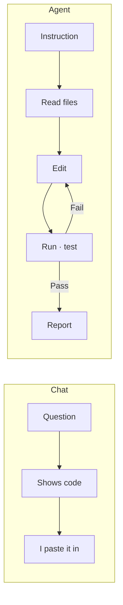
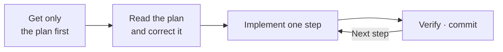

<dl class="facts">
  <div><dt>For</dt><dd>Developers · beginners</dd></div>
  <div><dt>In the instructions</dt><dd>4</dd></div>
  <div><dt>Things to verify</dt><dd>4</dd></div>
  <div><dt>Key</dt><dd>Be able to roll back</dd></div>
</dl>

## How is it different from chat?

An AI chat **shows you** code. Whether to paste it in is up to you. A coding agent **edits the files itself**, runs commands, looks at the results and edits again. Tools such as Claude Code, Cursor and Codex work this way.



Work gets much faster, but the role of the person delegating changes too. Instead of writing code line by line, you **decide what to do and check that it is done**.

## Before you start: make sure you can roll back

Prepare exactly one thing before using an agent. **You must be able to return to the previous state at any time.**

- Make the working folder a **git repository** and commit before you start.
- Do large tasks on a **new branch**.
- After the agent makes changes, look at what changed with `git diff`.

```bash
git status          # check that the tree is clean before starting
git switch -c ai/add-search   # branch for the work
# ... agent works ...
git diff            # review what changed
git restore .       # undo everything if you don't like it
```

If you aren't comfortable with git, at least **copy the whole folder** before you start.

## Four things to put in the instructions

### 1. What, and why

Write not just the name of the feature but **who uses it and how**.

```text
In the blog's post list, the Korean, English, Japanese and Chinese versions of the same post show up separately.
Group the same post into one row and show which languages exist as small tags.
The point is that visitors should not see the same title four times.
```

### 2. What must not be touched

```text
- Do not change the URLs of existing posts.
- Ask me before adding a new library.
- Do not touch the credentials in the config files.
```

### 3. What counts as done

"Make it work well" can't be checked. Write **what has to be true for it to be done**.

```text
Done means:
- All existing tests pass.
- A post that exists in only one language still appears in the list.
- At mobile width, the layout doesn't break when the tags wrap.
```

### 4. Where to stop and ask

```text
Ask me first before deleting files, deploying, or sending anything outside.
```

## How to split the work

If you hand over a big task in one go, you only find out it drifted off course after it is finished.



```text
Don't change anything yet. First just tell me the plan: which files you will change and how.
```

Reading the plan shows you **how the agent understood your request**. Correcting it here is the cheapest.

## How to check "it's done"

When the agent reports that it is finished, don't take it at its word. There are four things to verify.

| Check | How |
|---|---|
| Does it actually work? | Run it yourself and look at the screen |
| What did it change? | Skim the changed files with `git diff`. Make sure no files you didn't ask about were changed |
| What could it not verify? | Ask the agent directly |
| Did it make the tests pass by editing them? | If a test file changed, look at why |

The third is especially useful.

```text
For the work you just did, separate what you verified by actually running it from what you could not verify and assumed.
```

An agent may say "done" without having seen the browser screen or connected to a real server. **The list of what it could not verify** is the list of what you have to look at yourself.

## What to watch out for

- **Secrets**: check whether `.env` files or API keys are within what the agent can read. Check `.gitignore` so they don't end up in the repository.
- **Auto-approval**: at first, approve commands one at a time and watch what they do. Once you are used to it, move to auto-approval starting with read-only commands.
- **Irreversible commands**: deleting, force-pushing, changing a production database and deploying should run only after you have checked them yourself.
- **Code you don't understand**: don't leave code in place that you don't understand. Ask "explain why this part is needed". When it breaks, the one who has to fix it is you.
- **Long conversations**: as a conversation gets long, earlier instructions can get lost. When a task is finished, start the next in a new conversation, and write the rules you use often in the project's instruction file (for example `CLAUDE.md`).

## Summary

- An agent edits files directly. Start only after making sure you can **roll back with git**.
- Put **what and why, what must not be touched, what counts as done, and where to stop** in the instructions.
- When it reports that it is done, run it yourself and ask **what it could not verify**.

### Related posts

- [When AI is confidently wrong: how to verify its answers](/en/posts/ai-hallucination-check/)
- [Five ways to ask AI that change the result](/en/posts/ai-prompt-basics/)
- [A checklist of what not to paste into AI](/en/posts/ai-privacy-checklist/)
