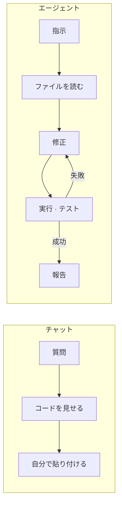

<dl class="facts">
  <div><dt>対象</dt><dd>開発者 · 入門者</dd></div>
  <div><dt>指示に入れること</dt><dd>4<small>つ</small></dd></div>
  <div><dt>確認すること</dt><dd>4<small>つ</small></dd></div>
  <div><dt>要点</dt><dd>元に戻せるように</dd></div>
</dl>

## チャットと何が違うのか

AI チャットはコードを**見せてくれます。** 貼り付けるかどうかは自分で決めます。コーディングエージェントは、ファイルを**直接書き換え**、コマンドを実行し、結果を見てまた直します。Claude Code、Cursor、Codex といったツールがこの方式です。



作業はずっと速くなりますが、任せる側の役割も変わります。コードを 1 行ずつ書く代わりに、**何をするかを決め、終わったかどうかを確かめる仕事**をすることになります。

## 始める前に: 元に戻せるようにしておく

エージェントを使う前に、準備することは 1 つだけです。**いつでも前の状態に戻れるようにしておきます。**

- 作業フォルダーを **git リポジトリ**にして、始める前にコミットしておきます。
- 大きな作業は**新しいブランチ**で行います。
- エージェントが書き換えたあとは、`git diff` で何が変わったかを見ます。

```bash
git status          # 始める前にクリーンな状態か確認
git switch -c ai/add-search   # 作業用のブランチ
# ... エージェントの作業 ...
git diff            # 変更内容を確認
git restore .       # 気に入らなければすべて元に戻す
```

git に慣れていないなら、せめて**フォルダーを丸ごとコピー**してから始めます。

## 指示に入れること 4 つ

### 1. 何を、なぜ

機能の名前だけでなく、**だれがどう使うのか**を書きます。

```text
ブログの記事一覧で、同じ記事の韓国語・英語・日本語・中国語版が別々に表示されている。
同じ記事は 1 行にまとめ、どの言語があるかは小さなタグで見せて。
訪問者が同じタイトルを 4 回見なくて済むようにしたい。
```

### 2. 触ってはいけないもの

```text
- 既存の記事のアドレス(URL)は変えないで。
- 新しいライブラリは、追加する前に先に聞いて。
- 設定ファイルの認証情報には触らないで。
```

### 3. 完了の基準

「うまく動くようにして」では確認のしようがありません。**何ができたら終わりなのか**を書きます。

```text
完了の基準:
- 既存のテストがすべて通る。
- 記事が 1 つの言語でしかない場合も一覧に出る。
- モバイルの幅でタグが折り返されても表示が崩れない。
```

### 4. どこで止まって聞くか

```text
ファイルを削除する、デプロイする、外部に何かを送る、その前には先に聞いて。
```

## 仕事の分け方

大きな仕事を一度に任せると、途中で方向がずれても、終わってからでないと気づけません。


```text
すぐには直さず、まずどのファイルをどう変えるのか、計画だけ教えて。
```

計画を読むと、**エージェントがこちらの依頼をどう理解したのか**が見えます。ここで正すのがいちばん安く済みます。

## 「終わりました」の確かめ方

エージェントが終わったと報告しても、そのまま信じません。確認することは 4 つです。

| 確認 | 方法 |
|---|---|
| 実際に動くか | 自分で実行して画面を見る |
| 何を変えたか | `git diff` で変更されたファイルに目を通す。頼んでいないファイルが変わっていないかを見る |
| 確認できなかったことは何か | エージェントに直接聞く |
| テストを書き換えて通していないか | テストファイルが変わっていたら理由を見る |

3 つ目がとくに役に立ちます。

```text
いまの作業で、あなたが実際に実行して確認したことと、確認できずに推定したことを分けて教えて。
```

エージェントは、ブラウザーの画面を見ていなかったり、実際のサーバーに接続できなかったりしたまま「完了」と言うことがあります。**確認できなかったことのリスト**が、自分で見るべきもののリストです。

## 気をつけること

- **秘密の値**: `.env` ファイルや API キーが、エージェントの読める範囲にないかを見ます。リポジトリに上がらないように `.gitignore` を確認します。
- **自動承認**: 最初はコマンドを 1 つずつ承認しながら、何をしているのかを見ます。慣れてきたら、読み取り専用のコマンドから自動承認に切り替えます。
- **元に戻せないコマンド**: 削除、強制プッシュ、本番データベースの変更、デプロイは、自分で確認してから実行します。
- **分からないコード**: 理解できていないコードをそのままにしません。「この部分がなぜ必要なのか説明して」と聞きます。壊れたときに直すのは、結局自分です。
- **長い会話**: 会話が長くなると、前の指示を見落とすことがあります。作業が 1 つ終わったら新しい会話で始め、よく使うルールはプロジェクトの指示ファイル(例: `CLAUDE.md`)に書いておきます。

## まとめ

- エージェントはファイルを直接書き換えます。**git で元に戻せるように**してから始めます。
- 指示には、**何を・なぜ、触ってはいけないもの、完了の基準、止まる地点**を入れます。
- 終わったという報告を受けたら、自分で実行してみて、**確認できなかったことは何か**を聞きます。

### あわせて読みたい記事

- [AI が自信満々に間違えるとき：答えを検証する方法](/ja/posts/ai-hallucination-check/)
- [AI に仕事を頼むとき、結果が変わる頼み方 5 つ](/ja/posts/ai-prompt-basics/)
- [AI に入力してはいけない情報チェックリスト](/ja/posts/ai-privacy-checklist/)
