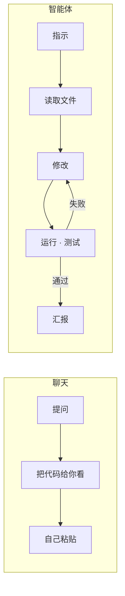

<dl class="facts">
  <div><dt>适合谁</dt><dd>开发者 · 入门者</dd></div>
  <div><dt>指示里要写的</dt><dd>4<small>样</small></dd></div>
  <div><dt>要确认的</dt><dd>4<small>样</small></dd></div>
  <div><dt>关键</dt><dd>能够回退</dd></div>
</dl>

## 和聊天有什么不同

AI 聊天是把代码**给你看**。贴不贴由你决定。编程智能体则**直接修改**文件，执行命令，看了结果再接着改。Claude Code、Cursor、Codex 这类工具就是这种方式。



工作快了很多，交代工作的人的角色也变了。不再一行行写代码，而是**决定做什么，并确认是否做完**。

## 开始之前：先保证能够回退

使用智能体之前，只需要准备一件事。**必须随时能回到之前的状态。**

- 把工作目录做成 **git 仓库**，开始之前先提交一次。
- 大的改动在**新分支**上做。
- 智能体改完以后，用 `git diff` 看改了什么。

```bash
git status          # 开始前确认工作区是干净的
git switch -c ai/add-search   # 工作用的分支
# ... 智能体工作 ...
git diff            # 查看改动内容
git restore .       # 不满意就全部撤销
```

如果不熟悉 git，至少先**把整个文件夹复制一份**再开始。

## 指示里要写的 4 样东西

### 1. 做什么，为什么

不只写功能的名字，还要写**谁、怎么用**。

```text
博客文章列表里，同一篇文章的韩语、英语、日语、中文版本是分开显示的。
请把同一篇文章合并成一行，有哪些语言用小标签显示。
目的是不让访客把同一个标题看四遍。
```

### 2. 不能碰的东西

```text
- 现有文章的地址（URL）不要改。
- 新增库之前先问我。
- 配置文件里的认证信息不要动。
```

### 3. 完成的标准

“帮我弄好”是没法确认的。写清楚**做到什么才算完成**。

```text
完成的标准：
- 现有测试全部通过。
- 只有一种语言的文章也会出现在列表里。
- 在手机宽度下标签换行时布局也不会乱。
```

### 4. 在哪里停下来问

```text
删除文件、部署，或者向外部发送任何东西之前，先问我。
```

## 拆分工作的方法

把一件大事一次交出去，中途方向偏了，也要等做完才知道。


```text
先不要改，只告诉我打算改哪些文件、怎么改的计划。
```

读了计划，就能看出**智能体是怎么理解你的请求的**。在这里纠正，代价最小。

## 确认“做完了”的方法

智能体汇报说做完了，也不要直接相信。要确认的有四样。

| 确认 | 方法 |
|---|---|
| 真的能运行吗 | 自己运行，亲眼看界面 |
| 改了什么 | 用 `git diff` 过一遍改动的文件。看有没有改到没要求的文件 |
| 没能确认的是什么 | 直接问智能体 |
| 有没有靠改测试来通过 | 如果测试文件有改动，看原因 |

第三项尤其有用。

```text
刚才的工作里，请把你亲自运行确认过的，和没能确认、只是推测的，分开告诉我。
```

智能体可能没看到浏览器界面，或者没能连上真实的服务器，就说“完成”了。**没能确认的清单**，就是你要亲自看的清单。

## 要注意的

- **机密值**：看看 `.env` 文件或 API 密钥是否在智能体能读到的范围内。检查 `.gitignore`，不让它们进到仓库里。
- **自动批准**：一开始逐条批准命令，看它在做什么。熟悉以后，先从只读命令开始改为自动批准。
- **无法撤销的命令**：删除、强制推送、修改生产数据库、部署，要亲自确认后再执行。
- **看不懂的代码**：不要把没看懂的代码原样留着。问一句“请说明这部分为什么需要”。出了故障，最后要修的人是你。
- **很长的对话**：对话一长，它可能漏掉前面的指示。做完一件事就开新对话，常用的规则写进项目的指示文件（例如 `CLAUDE.md`）里。

## 小结

- 智能体会直接修改文件。先**用 git 保证能够回退**，再开始。
- 指示里写上**做什么和为什么、不能碰的东西、完成的标准、停下来的位置**。
- 收到做完的汇报后，亲自运行一遍，并问**没能确认的是什么**。

### 推荐一起读

- [AI 自信地答错时：验证回答的方法](/zh/posts/ai-hallucination-check/)
- [让 AI 干活时，结果大不一样的 5 个提问方法](/zh/posts/ai-prompt-basics/)
- [不能输入 AI 的信息清单](/zh/posts/ai-privacy-checklist/)
