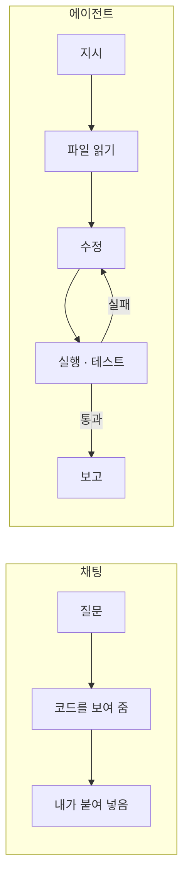
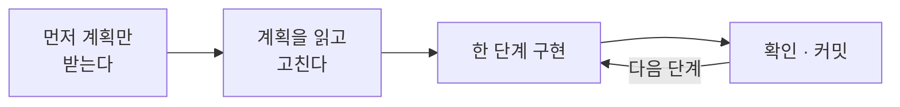

<dl class="facts">
  <div><dt>대상</dt><dd>개발자 · 입문자</dd></div>
  <div><dt>지시에 넣을 것</dt><dd>4<small>가지</small></dd></div>
  <div><dt>확인할 것</dt><dd>4<small>가지</small></dd></div>
  <div><dt>핵심</dt><dd>되돌릴 수 있게</dd></div>
</dl>

## 채팅과 무엇이 다른가

AI 채팅은 코드를 **보여 줍니다.** 붙여 넣을지는 내가 정합니다. 코딩 에이전트는 파일을 **직접 고치고**, 명령을 실행하고, 결과를 보고 다시 고칩니다. Claude Code, Cursor, Codex 같은 도구가 이런 방식입니다.



일이 훨씬 빨라지지만 맡기는 사람의 역할도 달라집니다. 코드를 한 줄씩 쓰는 대신 **무엇을 할지 정하고, 끝났는지 확인하는 일**을 하게 됩니다.

## 시작하기 전에: 되돌릴 수 있게 해 둔다

에이전트를 쓰기 전에 딱 하나를 준비합니다. **언제든 이전 상태로 돌아갈 수 있어야 합니다.**

- 작업 폴더를 **git 저장소**로 만들고, 시작 전에 커밋해 둡니다.
- 큰 작업은 **새 브랜치**에서 합니다.
- 에이전트가 고친 뒤에는 `git diff` 로 무엇이 바뀌었는지 봅니다.

```bash
git status          # 시작 전에 깨끗한 상태인지 확인
git switch -c ai/add-search   # 작업용 브랜치
# ... 에이전트 작업 ...
git diff            # 바뀐 내용 확인
git restore .       # 마음에 안 들면 전부 되돌리기
```

git 이 익숙하지 않다면 최소한 **폴더를 통째로 복사**해 두고 시작합니다.

## 지시에 넣을 것 4가지

### 1. 무엇을, 왜

기능 이름만이 아니라 **누가 어떻게 쓰는지**를 적습니다.

```text
블로그 글 목록에서 같은 글의 한국어·영어·일본어·중국어 버전이 따로따로 보인다.
같은 글은 한 줄로 묶고, 어떤 언어가 있는지는 작은 태그로 보여 줘.
방문자가 같은 제목을 네 번 보지 않게 하려는 것이다.
```

### 2. 건드리면 안 되는 것

```text
- 기존 글 주소(URL)는 바꾸지 마.
- 새 라이브러리는 추가하기 전에 먼저 물어봐.
- 설정 파일의 인증 정보는 건드리지 마.
```

### 3. 끝났다는 기준

"잘 되게 해 줘" 는 확인할 수 없습니다. **무엇이 되면 끝인지**를 적습니다.

```text
끝났다는 기준:
- 기존 테스트가 전부 통과한다.
- 글이 한 언어로만 있는 경우에도 목록에 나온다.
- 모바일 너비에서 태그가 줄바꿈되어도 깨지지 않는다.
```

### 4. 어디서 멈추고 물어볼지

```text
파일을 지우거나, 배포하거나, 외부로 무언가를 보내기 전에는 먼저 물어봐.
```

## 일을 나누는 법

큰 일을 한 번에 맡기면 중간에 방향이 틀어져도 끝난 뒤에야 알게 됩니다.



```text
바로 고치지 말고, 먼저 어떤 파일을 어떻게 바꿀지 계획만 알려 줘.
```

계획을 읽으면 **에이전트가 내 요청을 어떻게 이해했는지**가 보입니다. 여기서 바로잡는 것이 가장 쌉니다.

## "끝났습니다" 를 확인하는 법

에이전트가 끝났다고 보고해도 그대로 믿지 않습니다. 확인할 것은 네 가지입니다.

| 확인 | 방법 |
|---|---|
| 실제로 돌아가는가 | 내가 직접 실행하고 화면을 본다 |
| 무엇을 바꿨는가 | `git diff` 로 바뀐 파일을 훑는다. 요청하지 않은 파일이 바뀌지 않았는지 본다 |
| 확인하지 못한 것은 무엇인가 | 에이전트에게 직접 묻는다 |
| 테스트를 고쳐서 통과시키지 않았는가 | 테스트 파일이 바뀌었으면 이유를 본다 |

세 번째가 특히 쓸모 있습니다.

```text
방금 작업에서 네가 직접 실행해서 확인한 것과, 확인하지 못하고 추정한 것을 나눠서 알려 줘.
```

에이전트는 브라우저 화면을 보지 못했거나 실제 서버에 연결하지 못한 채 "완료" 라고 할 수 있습니다. **확인하지 못한 목록**이 내가 직접 봐야 할 목록입니다.

## 조심할 것

- **비밀 값**: `.env` 파일이나 API 키가 에이전트가 읽는 범위에 있는지 봅니다. 저장소에 올라가지 않게 `.gitignore` 를 확인합니다.
- **자동 승인**: 처음에는 명령을 하나씩 승인하면서 어떤 일을 하는지 봅니다. 익숙해진 뒤에 읽기 전용 명령부터 자동 승인으로 넘깁니다.
- **되돌릴 수 없는 명령**: 삭제, 강제 푸시, 운영 데이터베이스 변경, 배포는 직접 확인한 뒤에 실행합니다.
- **모르는 코드**: 이해하지 못한 코드를 그대로 두지 않습니다. "이 부분이 왜 필요한지 설명해 줘" 라고 묻습니다. 고장 났을 때 고칠 사람은 결국 나입니다.
- **긴 대화**: 대화가 길어지면 앞의 지시를 놓칠 수 있습니다. 작업이 하나 끝나면 새 대화에서 시작하고, 자주 쓰는 규칙은 프로젝트의 지시 파일(예: `CLAUDE.md`)에 적어 둡니다.

## 정리

- 에이전트는 파일을 직접 고칩니다. **git 으로 되돌릴 수 있게** 해 두고 시작합니다.
- 지시에는 **무엇을·왜, 건드리면 안 되는 것, 끝났다는 기준, 멈출 지점**을 넣습니다.
- 끝났다는 보고를 받으면 직접 실행해 보고, **확인하지 못한 것이 무엇인지** 묻습니다.

### 같이 읽으면 좋은 글

- [AI 가 자신 있게 틀릴 때: 답을 검증하는 방법](/posts/ai-hallucination-check/)
- [AI 에게 일 시킬 때 결과가 달라지는 요청법 5가지](/posts/ai-prompt-basics/)
- [AI 에 넣으면 안 되는 정보 체크리스트](/posts/ai-privacy-checklist/)
