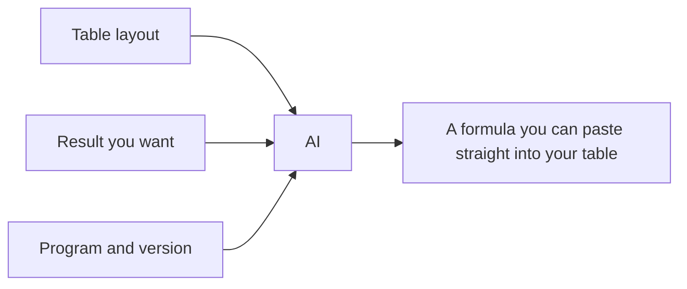
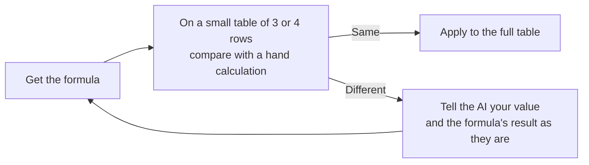

<dl class="facts">
  <div><dt>For</dt><dd>Excel · Google Sheets users</dd></div>
  <div><dt>Things to tell it</dt><dd>3</dd></div>
  <div><dt>Prompts</dt><dd>6</dd></div>
  <div><dt>Key</dt><dd>Describe the table</dd></div>
</dl>

## Why the formula comes out wrong

Ask "give me a formula for total sales" and you get something like `=SUM(A:A)`. It isn't a wrong answer, but it doesn't fit your table. **The AI can't see your table.** If you don't tell it what is in which column, it guesses.



## Three things to tell it

### 1. The table layout

The surest way is to paste the column names and **two or three rows of real data** as they are. Copy the cells in Excel and paste them into the chat.

```text
My table looks like this. Row 1 is the header and the data runs from row 2 to row 500.

Column A: order date (2026-11-03)
Column B: branch (Downtown, Uptown, Harbor)
Column C: product name
Column D: quantity
Column E: unit price
```

### 2. The result you want

Say **what you want to do**, not the name of a function. Giving one example value makes it more accurate.

```text
When I type a branch name in cell G2, I want H2 to show that branch's total sales for November (quantity × unit price).
Example: if G2 is "Downtown", the sum of only the Downtown branch's November orders.
```

### 3. The program and version

Excel and Google Sheets have slightly different functions, and within Excel the available functions depend on the version. Functions such as `XLOOKUP`, `FILTER` and `UNIQUE` don't exist in older versions of Excel.

```text
I'm using Excel 2016. Use only functions that work in this version.
```

## How to check the formula you get

Don't take the AI's formula on trust. Even when it returns a value with no error, **the value can be wrong.**



- **Try a small table first.** Test with three or four rows where you know the answer.
- **Look at the edges.** Empty cells, zeros, numbers mixed with text, the last row of the range.
- **Have it explain the formula.** You need to know what it does to fix it later.

```text
Explain what this formula does, part by part.
Then tell me the cases where this formula could return a wrong value.
```

When you get an error, paste **the error message and the formula as they are**. `#N/A`, `#VALUE!` and `#REF!` each have a different cause.

```text
I entered this formula and got #N/A.
Formula: =VLOOKUP(G2, A:C, 3, FALSE)
G2 contains "Downtown Branch", and column A says "Downtown".
```

## Common requests

### Looking up a value from another table

```text
Sheet1 has employee IDs in column A. Sheet2 has the employee ID in column A, the name in column B and the department in column C.
Make column B of Sheet1 show the department that matches the employee ID. If the ID doesn't exist, show "Not found".
```

### Summing and counting only what matches

```text
The sum of column D for rows where column B is "Downtown" and the date in column A is in November 2026.
Also the number of rows under the same conditions.
```

### Splitting and joining text

```text
Column A has entries like "Jane Smith (Sales Team 1)".
Make column B show only the name and column C show only the team name inside the parentheses.
```

### Date calculations

```text
Column A is the hire date. Show years of service as of today in the format "3 years 2 months".
```

### Finding duplicates

```text
Among the emails in column A, mark the ones that appear two or more times as "Duplicate" in column B.
Treat them as the same even if the letter case differs.
```

### Cleaning up messy data

```text
The phone numbers in column A are mixed, like "555-010-0123", "5550100123" and "555 010 0123".
Write a formula that changes all of them to the "555-010-0123" format.
```

## When a formula isn't enough

- **Pivot tables**: If what you want is a summary table, as in "I want a table of sales by branch and by month", a pivot table is better than a formula. Ask for the steps click by click.
- **Repetitive work**: If you do the same cleanup every week, you can ask for a macro (VBA) or an Apps Script for Google Sheets. Before running it, **always make a copy of the file**, and get an explanation of what the code deletes or changes.
- **Uploading the file itself**: If your AI can analyze files, you can upload the Excel file and hand over the analysis. First make sure it doesn't contain things like customer information or salaries. See [A checklist of what not to paste into AI](/en/posts/ai-privacy-checklist/).

## Summary

- The AI can't see your table. Paste **the column names and two or three rows of data**.
- Say **what you want to do and an example value**, not a function name.
- Check the formula first on a small table where you know the answer.

### Related posts

- [Five ways to ask AI that change the result](/en/posts/ai-prompt-basics/)
- [When AI is confidently wrong: how to verify its answers](/en/posts/ai-hallucination-check/)
- [Writing emails and reports with AI: how to keep your own voice](/en/posts/ai-writing-email-report/)
