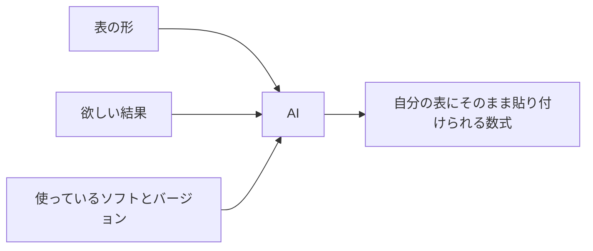

<dl class="facts">
  <div><dt>対象</dt><dd>Excel · Google スプレッドシートの利用者</dd></div>
  <div><dt>伝えること</dt><dd>3<small>つ</small></dd></div>
  <div><dt>例文</dt><dd>6<small>種類</small></dd></div>
  <div><dt>要点</dt><dd>表の形を説明</dd></div>
</dl>

## 数式が見当違いになる理由

「売上の合計を出す数式を教えて」と聞くと、`=SUM(A:A)` のような答えが返ってきます。間違いではありませんが、自分の表には合いません。**AI には自分の表が見えないからです。** どの列に何が入っているかを伝えなければ、推測します。



## 伝えること 3 つ

### 1. 表の形

列の名前と**実際のデータ 2、3 行**をそのまま貼るのがいちばん確実です。Excel でセルをコピーして、チャット欄に貼り付けるだけです。

```text
わたしの表はこうなっている。1 行目が見出しで、データは 2 行目から 500 行目まで。

A列: 注文日 (2026-11-03)
B列: 店舗 (新宿、渋谷、大阪)
C列: 商品名
D列: 数量
E列: 単価
```

### 2. 欲しい結果

数式の名前ではなく、**やりたいこと**を伝えます。例となる値を 1 つ挙げると、さらに正確になります。

```text
G2 セルに店舗名を入れると、H2 にその店舗の 11 月の売上合計(数量 × 単価)が出るようにしたい。
例: G2 が「新宿」なら、新宿店の 11 月の注文だけを合計した値。
```

### 3. ソフトとバージョン

Excel と Google スプレッドシートでは関数が少し違い、Excel もバージョンによって使える関数が違います。`XLOOKUP`、`FILTER`、`UNIQUE` のような関数は、古いバージョンの Excel にはありません。

```text
Excel 2016 を使っている。このバージョンで使える関数だけで書いて。
```

## もらった数式の確かめ方

AI がくれた数式をそのまま信じてはいけません。エラーなく値が出ても、**間違った値のことがあります。**


- **小さな表で先に試す。** 答えが分かっている 3、4 行でテストします。
- **境界を見る。** 空のセル、0、文字の混じった数字、範囲の最後の行。
- **数式を説明させる。** 何をしているのかを分かっていないと、あとで直せません。

```text
この数式が何をしているのか、部分ごとに分けて説明して。
それから、この数式が間違った値を出す可能性があるケースを教えて。
```

エラーが出たら、**エラーメッセージと数式をそのまま**貼ります。`#N/A`、`#VALUE!`、`#REF!` は、それぞれ原因が違います。

```text
この数式を入れたら #N/A になった。
数式: =VLOOKUP(G2, A:C, 3, FALSE)
G2 には「新宿店」と入っていて、A列には「新宿」と入っている。
```

## よく使う依頼

### 別の表から値を引いてくる

```text
Sheet1 の A列に社員番号があり、Sheet2 の A列に社員番号、B列に氏名、C列に部署がある。
Sheet1 の B列に、社員番号に対応する部署が出るようにして。存在しない社員番号なら「なし」と出るように。
```

### 条件に合うものだけ合計する・数える

```text
B列が「新宿」で、A列の日付が 2026 年 11 月の行の D列の合計。
同じ条件で行数も。
```

### 文字を分ける・つなげる

```text
A列に「佐藤太郎(営業1課)」のように入っている。
B列には名前だけ、C列にはかっこの中の課名だけが出るようにして。
```

### 日付の計算

```text
A列が入社日。今日時点の勤続年数を「3年2か月」の形式で表示して。
```

### 重複を探す

```text
A列のメールアドレスのうち、2 回以上出てくるものに B列で「重複」と表示して。
大文字と小文字が違っても同じものとして扱って。
```

### 乱れたデータを整える

```text
A列の電話番号が「090-1234-5678」「09012345678」「090 1234 5678」のように混ざっている。
すべて「090-1234-5678」の形式にそろえる数式を書いて。
```

## 数式で無理なら

- **ピボットテーブル**: 「店舗別・月別の売上表を作りたい」のように集計表が目的なら、数式よりピボットテーブルが向いています。作る手順をクリック単位で聞けば教えてくれます。
- **繰り返しの作業**: 毎週同じ整理をしているなら、マクロ(VBA)や Google スプレッドシートの Apps Script を書いてもらえます。実行する前に**必ずファイルをコピーしておき**、コードが何を消したり変えたりするのか説明してもらいます。
- **ファイルを直接アップロードする**: ファイル分析機能のある AI なら、Excel ファイルをアップロードして分析を任せられます。その場合は、顧客情報や給与のような内容が入っていないかを先に確認します。[AI に入力してはいけない情報チェックリスト](/ja/posts/ai-privacy-checklist/)を参考にしてください。

## まとめ

- AI には自分の表が見えません。**列の名前とデータ 2、3 行**を貼って渡します。
- 関数の名前ではなく、**やりたいことと例となる値**を伝えます。
- もらった数式は、答えが分かっている小さな表で先に確かめます。

### あわせて読みたい記事

- [AI に仕事を頼むとき、結果が変わる頼み方 5 つ](/ja/posts/ai-prompt-basics/)
- [AI が自信満々に間違えるとき：答えを検証する方法](/ja/posts/ai-hallucination-check/)
- [AI でメール・報告書を書く：自分の文体を守る方法](/ja/posts/ai-writing-email-report/)
