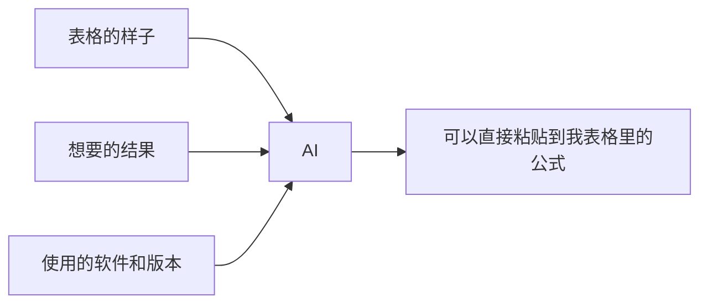
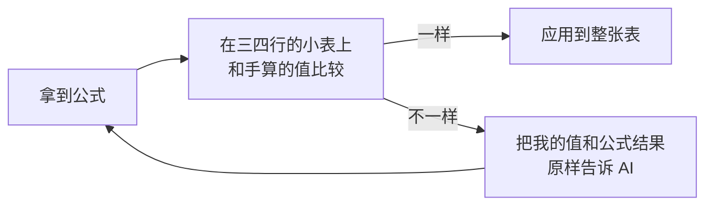

<dl class="facts">
  <div><dt>适合谁</dt><dd>Excel · Google 表格用户</dd></div>
  <div><dt>要告诉它的</dt><dd>3<small>样</small></dd></div>
  <div><dt>例句</dt><dd>6<small>类</small></dd></div>
  <div><dt>关键</dt><dd>说明表格的样子</dd></div>
</dl>

## 公式为什么不对路

问一句“告诉我求销售额合计的公式”，得到的会是 `=SUM(A:A)` 这样的回答。回答不算错，但和你的表格对不上。**因为 AI 看不到你的表格。**不告诉它哪一列是什么，它就只能猜。



## 要告诉它的 3 样东西

### 1. 表格的样子

最可靠的做法是把列名和**两三行真实数据**原样贴上去。在 Excel 里复制单元格，粘贴到聊天框里就行。

```text
我的表格是这样的。第 1 行是标题，数据从第 2 行到第 500 行。

A 列：下单日期 (2026-11-03)
B 列：门店 (朝阳、浦东、天河)
C 列：商品名称
D 列：数量
E 列：单价
```

### 2. 想要的结果

不要说公式的名字，而是说**想做的事**。举一个示例值会更准确。

```text
我想在 G2 单元格填入门店名称后，H2 显示该门店 11 月的销售额合计（数量 × 单价）。
例：G2 是“朝阳”时，结果是只把朝阳店 11 月的订单加起来的值。
```

### 3. 软件和版本

Excel 和 Google 表格的函数略有不同，Excel 不同版本能用的函数也不一样。`XLOOKUP`、`FILTER`、`UNIQUE` 这些函数在旧版 Excel 里没有。

```text
我用的是 Excel 2016。请只用这个版本支持的函数来写。
```

## 检查拿到的公式

AI 给的公式不能直接相信。即使没有报错、算出了值，**也可能是错的值。**



- **先用小表看。**用自己知道答案的三四行来试。
- **看边界。**空单元格、0、夹着文字的数字、范围的最后一行。
- **让它解释公式。**知道公式在做什么，以后才改得了。

```text
请把这个公式拆成几个部分，说明每部分在做什么。
另外告诉我这个公式在什么情况下可能算出错误的值。
```

出错的时候，把**错误信息和公式原样**贴上去。`#N/A`、`#VALUE!`、`#REF!` 的原因各不相同。

```text
填入这个公式后显示 #N/A。
公式：=VLOOKUP(G2, A:C, 3, FALSE)
G2 里填的是“朝阳店”，A 列里写的是“朝阳”。
```

## 常用的请求

### 从另一张表里查找值

```text
Sheet1 的 A 列是工号，Sheet2 的 A 列是工号、B 列是姓名、C 列是部门。
请让 Sheet1 的 B 列显示与工号对应的部门。工号不存在时显示“无”。
```

### 只对符合条件的求和、计数

```text
B 列是“朝阳”且 A 列日期在 2026 年 11 月的行，求 D 列的合计。
按同样的条件再求行数。
```

### 拆分和合并文字

```text
A 列的内容是“张伟(销售一部)”这样的。
请让 B 列只显示姓名，C 列只显示括号里的部门名称。
```

### 日期计算

```text
A 列是入职日期。请以今天为准，用“3年2个月”的格式显示工龄。
```

### 查找重复

```text
A 列的邮箱里出现两次以上的，请在 B 列标上“重复”。
大小写不同也算作相同。
```

### 整理杂乱的数据

```text
A 列的手机号是“138-1234-5678”“13812345678”“138 1234 5678”这样混在一起的。
请写一个公式，全部改成“138-1234-5678”的格式。
```

## 公式解决不了的时候

- **数据透视表**：如果目的是“想做一张按门店、按月份的销售额表”这样的汇总表，数据透视表比公式更合适。可以让它按每一步点哪里来告诉你制作顺序。
- **重复性的工作**：如果每周都做同样的整理，可以让它写宏（VBA）或 Google 表格的 Apps Script。运行之前**一定要先复制一份文件**，并让它说明代码会删除或修改什么。
- **直接上传文件**：如果用的 AI 有文件分析功能，可以把 Excel 文件传上去让它分析。这时要先看里面有没有客户信息、工资之类的内容。可以参考[不能输入 AI 的信息清单](/zh/posts/ai-privacy-checklist/)。

## 小结

- AI 看不到你的表格。把**列名和两三行数据**贴给它。
- 不要说函数名，而是说**想做的事和示例值**。
- 拿到的公式，先在知道答案的小表上检查。

### 推荐一起读

- [让 AI 干活时，结果大不一样的 5 个提问方法](/zh/posts/ai-prompt-basics/)
- [AI 自信地答错时：验证回答的方法](/zh/posts/ai-hallucination-check/)
- [用 AI 写邮件和报告：保住自己的语气](/zh/posts/ai-writing-email-report/)
