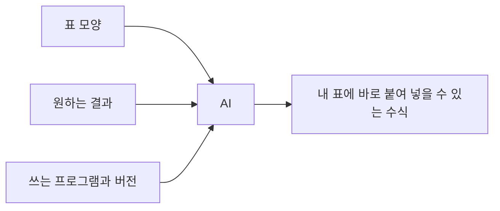

<dl class="facts">
  <div><dt>대상</dt><dd>엑셀 · 구글 시트 사용자</dd></div>
  <div><dt>알려 줄 것</dt><dd>3<small>가지</small></dd></div>
  <div><dt>예문</dt><dd>6<small>종류</small></dd></div>
  <div><dt>핵심</dt><dd>표 모양 설명</dd></div>
</dl>

## 수식이 엉뚱하게 나오는 이유

"매출 합계 구하는 수식 알려 줘" 라고 물으면 `=SUM(A:A)` 같은 답이 나옵니다. 틀린 답은 아니지만 내 표에는 맞지 않습니다. **AI 는 내 표를 볼 수 없기 때문입니다.** 어느 열에 무엇이 있는지 말해 주지 않으면 추측합니다.



## 알려 줄 것 3가지

### 1. 표 모양

열 이름과 **실제 데이터 두세 줄**을 그대로 붙이는 것이 가장 확실합니다. 엑셀에서 셀을 복사해서 채팅창에 붙이면 됩니다.

```text
내 표는 이렇게 생겼어. 1행이 제목이고 데이터는 2행부터 500행까지야.

A열: 주문일 (2026-11-03)
B열: 지점 (강남, 홍대, 부산)
C열: 상품명
D열: 수량
E열: 단가
```

### 2. 원하는 결과

수식 이름이 아니라 **하고 싶은 일**을 말합니다. 예시 값을 하나 들어 주면 더 정확합니다.

```text
G2 셀에 지점 이름을 넣으면, H2 에 그 지점의 11월 매출 합계(수량 × 단가)가 나오게 하고 싶어.
예: G2 가 "강남" 이면 강남 지점의 11월 주문만 더한 값.
```

### 3. 프로그램과 버전

엑셀과 구글 시트는 함수가 조금 다르고, 엑셀도 버전에 따라 쓸 수 있는 함수가 다릅니다. `XLOOKUP`, `FILTER`, `UNIQUE` 같은 함수는 예전 버전 엑셀에 없습니다.

```text
엑셀 2016 을 쓰고 있어. 이 버전에서 되는 함수로만 써 줘.
```

## 받은 수식을 확인하는 법

AI 가 준 수식을 그대로 믿으면 안 됩니다. 오류 없이 값이 나와도 **틀린 값일 수 있습니다.**


- **작은 표로 먼저 본다.** 답을 내가 아는 서너 줄로 시험합니다.
- **경계를 본다.** 빈 셀, 0, 글자가 섞인 숫자, 범위의 마지막 줄.
- **수식을 설명하게 한다.** 무슨 일을 하는지 알아야 나중에 고칠 수 있습니다.

```text
이 수식이 무엇을 하는지 부분별로 나눠서 설명해 줘.
그리고 이 수식이 틀린 값을 낼 수 있는 경우를 알려 줘.
```

오류가 나면 **오류 메시지와 수식을 그대로** 붙입니다. `#N/A`, `#VALUE!`, `#REF!` 는 원인이 각각 다릅니다.

```text
이 수식을 넣었더니 #N/A 가 나와.
수식: =VLOOKUP(G2, A:C, 3, FALSE)
G2 에는 "강남점" 이 들어 있고, A열에는 "강남" 이라고 되어 있어.
```

## 자주 쓰는 요청

### 다른 표에서 값 찾아오기

```text
시트1 의 A열에 사번이 있고, 시트2 의 A열에 사번, B열에 이름, C열에 부서가 있어.
시트1 의 B열에 사번에 맞는 부서가 나오게 해 줘. 없는 사번이면 "없음" 이라고 나오게.
```

### 조건에 맞는 것만 더하고 세기

```text
B열이 "강남" 이고 A열 날짜가 2026년 11월인 행의 D열 합계.
같은 조건으로 행 개수도.
```

### 글자 나누고 합치기

```text
A열에 "홍길동(영업1팀)" 처럼 들어 있어.
B열에는 이름만, C열에는 괄호 안의 팀 이름만 나오게 해 줘.
```

### 날짜 계산

```text
A열이 입사일이야. 오늘 기준 근속 연수를 "3년 2개월" 형식으로 보여 줘.
```

### 중복 찾기

```text
A열 이메일 중에 두 번 이상 나오는 것을 B열에 "중복" 이라고 표시해 줘.
대소문자가 달라도 같은 것으로 봐 줘.
```

### 지저분한 데이터 정리

```text
A열 전화번호가 "010-1234-5678", "01012345678", "010 1234 5678" 처럼 섞여 있어.
전부 "010-1234-5678" 형식으로 바꾸는 수식을 써 줘.
```

## 수식으로 안 되면

- **피벗 테이블**: "지점별, 월별 매출표를 만들고 싶어" 처럼 집계표가 목적이면 수식보다 피벗 테이블이 낫습니다. 만드는 순서를 클릭 단위로 물어보면 됩니다.
- **반복 작업**: 매주 같은 정리를 한다면 매크로(VBA)나 구글 시트의 Apps Script 를 써 달라고 할 수 있습니다. 실행하기 전에 **반드시 파일을 복사해 두고**, 코드가 무엇을 지우거나 바꾸는지 설명을 받습니다.
- **파일을 직접 올리기**: 파일 분석 기능이 있는 AI 라면 엑셀 파일을 올려서 분석을 맡길 수 있습니다. 이때는 고객 정보나 급여 같은 내용이 들어 있지 않은지 먼저 봅니다. [AI 에 넣으면 안 되는 정보 체크리스트](/posts/ai-privacy-checklist/)를 참고하세요.

## 정리

- AI 는 내 표를 볼 수 없습니다. **열 이름과 데이터 두세 줄**을 붙여 줍니다.
- 함수 이름이 아니라 **하고 싶은 일과 예시 값**을 말합니다.
- 받은 수식은 답을 아는 작은 표에서 먼저 확인합니다.

### 같이 읽으면 좋은 글

- [AI 에게 일 시킬 때 결과가 달라지는 요청법 5가지](/posts/ai-prompt-basics/)
- [AI 가 자신 있게 틀릴 때: 답을 검증하는 방법](/posts/ai-hallucination-check/)
- [AI 로 이메일·보고서 쓰기: 내 말투를 지키는 법](/posts/ai-writing-email-report/)
