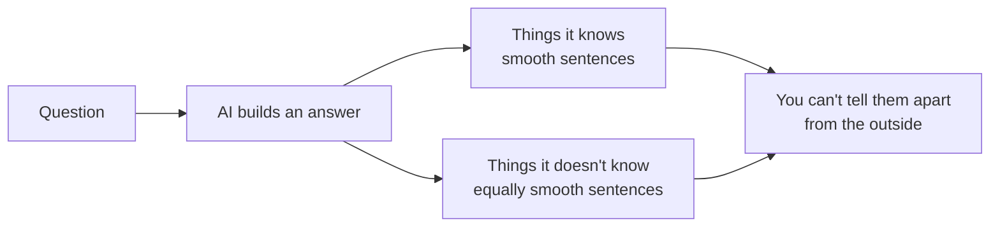
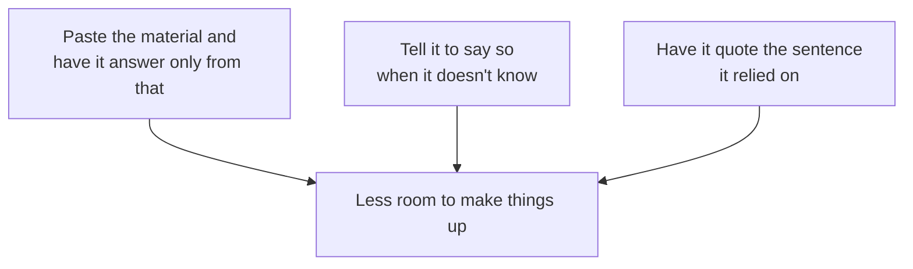

<dl class="facts">
  <div><dt>For</dt><dd>Anyone</dd></div>
  <div><dt>Risky types</dt><dd>5</dd></div>
  <div><dt>Ways to check</dt><dd>4</dd></div>
  <div><dt>Key</dt><dd>Check the source</dd></div>
</dl>

## Why does it sound sure when it's wrong?

An AI chat builds its answer by **continuing with a plausible next sentence**. It does not look up facts and write them down. It produces sentences that fit the patterns of the text it learned from. Most of the time they are right, but the sentences come out just as smooth in the parts it doesn't know. This is commonly called hallucination.

The problem is that **wrong answers and right answers sound the same**. A confident tone is not evidence of accuracy.



## Five kinds of answers to be careful with

You don't need to doubt every answer. Check when one of these five shows up.

| Type | Examples | Why it's risky |
|---|---|---|
| Exact numbers | Statistics, amounts, dates, percentages | The sentence reads naturally even if one number is off |
| Sources and quotes | Paper titles, articles, books, links | It produces things that don't exist, in the correct format |
| Law, tax, medicine | Clause numbers, deduction limits, drug doses | Mistakes are costly, and the rules change often |
| Recent events | Rules that changed this year, the latest version | It doesn't know what happened after its training |
| Lesser-known subjects | Small companies, local information, specific people | The less text it learned from, the more likely it is to make things up |

On the other hand, tasks where **you can read the result and judge it right away**, such as polishing text, brainstorming, summarizing and translating, carry less risk.

## Four ways to check

### 1. Ask for sources, then open them yourself

```text
For each number and factual claim in your last answer, add a source.
Mark any item whose source you are not sure of as "needs checking".
```

Don't stop there. **Sources can be made up too.** Click the link and see whether that sentence is really on the page. If your AI has a search feature, turn it on before asking. It will then answer from real pages, which is much better, but still open the original for important numbers.

### 2. Ask again in a new conversation

If you ask "are you sure?" in the same conversation, the AI may defend its earlier answer, or it may take back an answer that was right. **Open a new conversation and ask the same question again.** If the answers differ, trust neither.

### 3. Ask the opposite way

```text
If the claim "X is Y" were wrong, in what ways would it be wrong?
Review it from the position of someone arguing against it.
```

If you ask the AI to agree with you, it tends to agree. Asking it to argue against you brings out the conditions and exceptions you missed.

### 4. Don't ask for the calculation, ask for the steps

A long calculation done "in its head" can come out wrong. Have it write the formula and the steps one by one, then recompute the final number with a calculator or a spreadsheet. If your AI can run code, say "calculate it with code" and it will give you a value that was actually computed.

## Asking so it gets less wrong to begin with



- **Give it the material directly.** Don't ask "what is our company's vacation policy?" Paste the policy document and then ask.
- **Allow "I don't know" as an answer.** AI tends to answer no matter what, so this one line does a lot.
- **Have it quote the supporting sentence.** With a quote attached, it is easy for you to compare.

```text
Answer using only the document below.
If something is not in the document, do not guess. Answer "not in the document".
For each answer, quote the exact sentence it is based on.

[paste the document]
```

## How much should you check?

If you check everything, there is no point in using AI. Decide by **what it costs you if it's wrong**.

| If it's wrong | Examples | Level of checking |
|---|---|---|
| Nothing much happens | Dinner ideas, title options | None |
| You just redo it | A spreadsheet formula, an email draft | Run the result once |
| It goes out to other people | Numbers in a report, presentation slides | Compare numbers and sources with the original |
| Money, health or law is involved | Contracts, tax filing, medication | Confirm with an expert or official documents |

## Summary

- An AI's **tone has nothing to do with accuracy.** It is equally smooth when right and when wrong.
- Numbers, sources, law and medicine, recent events, lesser-known subjects. When one of these five shows up, check the original.
- Paste the material and have it answer "only from this, and say so if you don't know", and it will be wrong far less often.

### Related posts

- [Five ways to ask AI that change the result](/en/posts/ai-prompt-basics/)
- [How to get AI to summarize long documents and PDFs properly](/en/posts/ai-summarize-documents/)
- [How to learn an unfamiliar subject quickly with AI](/en/posts/ai-learn-new-topic/)
