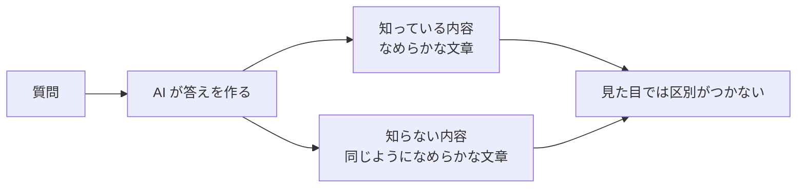
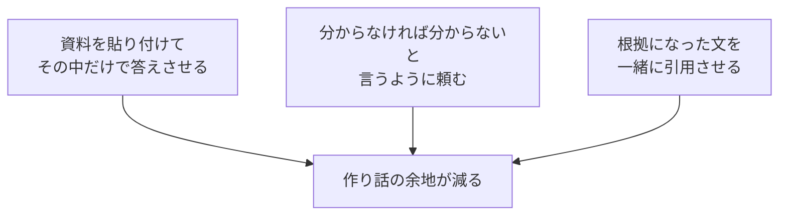

<dl class="facts">
  <div><dt>対象</dt><dd>だれでも</dd></div>
  <div><dt>危ないタイプ</dt><dd>5<small>つ</small></dd></div>
  <div><dt>確認方法</dt><dd>4<small>つ</small></dd></div>
  <div><dt>要点</dt><dd>原文を確認</dd></div>
</dl>

## なぜ間違っているのに自信ありげに話すのか

AI チャットは、**もっともらしい次の文をつないでいく方式**で答えを作ります。事実を調べて書いているのではなく、学習した文章のパターンに合う文を作り出しています。大半は合っていますが、知らない部分でも文章は同じようになめらかに出てきます。これを一般にハルシネーション(hallucination、幻覚)と呼びます。

問題は、**間違った答えと正しい答えの口調が同じ**という点です。自信のある口調は、正確さの証拠にはなりません。



## とくに気をつけたい答え 5 つ

すべての答えを疑う必要はありません。次の 5 つが出てきたら、そのときに確認します。

| タイプ | 例 | なぜ危ないのか |
|---|---|---|
| 正確な数字 | 統計、金額、日付、割合 | 数字が 1 つ違っていても文章は自然に読める |
| 出典と引用 | 論文のタイトル、記事、本、リンク | 実在しないものを形式どおりに作り出す |
| 法律・税金・医療 | 条文番号、控除の上限、薬の用量 | 間違えると損害が大きく、よく変わる |
| 最近のできごと | 今年変わった制度、最新バージョン | 学習時点より後のことは知らない |
| あまり知られていない対象 | 小さな会社、地域の情報、特定の人物 | 学習した文章が少ないほど作り話になりやすい |

反対に、文章の手直し、アイデア出し、要約、翻訳のように、**結果を自分ですぐ読んで判断できる作業**はリスクが低めです。

## 確認する方法 4 つ

### 1. 出典を出してもらい、自分で開いてみる

```text
いまの答えのうち、数字と事実に関する主張のそれぞれに出典を付けて。
出典に確信が持てない項目は「要確認」と書いて。
```

ここで終わりにしてはいけません。**出典も作り話のことがあります。** リンクを開いて、その文が実際にあるかを見ます。検索機能のある AI なら、検索をオンにして聞くと実際のページを根拠に答えるのでずっとましですが、それでも大事な数字は原文を開きます。

### 2. 新しい会話でもう一度聞く

同じ会話の中で「本当に?」と聞くと、前の答えを守ろうとしたり、逆に正しい答えを間違いだったと撤回したりすることがあります。**新しい会話を開いて同じ質問をもう一度**してみて、答えが変わるようならどちらも信じません。

### 3. 逆の立場から聞く

```text
「OO は XX である」という主張が間違っているとしたら、どの点で間違っているのか、
反論する立場から検討して。
```

自分の考えに同意してほしいという聞き方をすると、同意する答えが出やすくなります。反論させると、見落としていた条件や例外が見えてきます。

### 4. 計算はさせずに、過程を出してもらう

長い計算を暗算でさせると、間違えることがあります。式と過程をステップごとに書かせ、最終的な数字は電卓や Excel で計算し直します。コード実行機能のある AI なら、「コードで計算して」と頼めば実際に計算した値が返ってきます。

## そもそも間違えにくい聞き方



- **資料を直接渡す。** 「うちの会社の休暇規程はどうなっている?」と聞くのではなく、規程の文書を貼り付けてから聞きます。
- **「分からない」という答えを認める。** AI は何とかして答えようとする傾向があるので、この 1 行がよく効きます。
- **根拠の文を引用させる。** 引用が付いていれば、自分で照らし合わせやすくなります。

```text
下の文書だけを根拠に答えて。
文書にない内容は推測せず、「文書に記載なし」と答えて。
答えごとに、根拠になった文をそのまま引用して。

[文書を貼り付け]
```

## どこまで確認すればいいのか

全部を確認していたら、AI を使う意味がなくなります。**間違っていたときに払う代償**で決めます。

| 間違っていたら | 例 | 確認のレベル |
|---|---|---|
| とくに困らない | 夕食のメニュー、記事タイトルの候補 | 確認しない |
| やり直せば済む | Excel の数式、メールの下書き | 結果を一度動かしてみる |
| 人の目に触れる | 報告書の数字、発表資料 | 数字と出典を原文と照合 |
| お金・健康・法律がかかわる | 契約、確定申告、服薬 | 専門家や公式の文書で確認 |

## まとめ

- AI の**口調は正確さと関係がありません。** 合っているときも間違っているときも、同じようになめらかです。
- 数字、出典、法律・医療、最近のできごと、あまり知られていない対象。この 5 つが出てきたら原文を確認します。
- 資料を貼り付けて「この中だけで、分からなければ分からないと」答えさせると、間違いは大きく減ります。

### あわせて読みたい記事

- [AI に仕事を頼むとき、結果が変わる頼み方 5 つ](/ja/posts/ai-prompt-basics/)
- [長い文書・PDF の要約を AI にきちんと頼む方法](/ja/posts/ai-summarize-documents/)
- [AI で知らない分野をすばやく学ぶ方法](/ja/posts/ai-learn-new-topic/)
