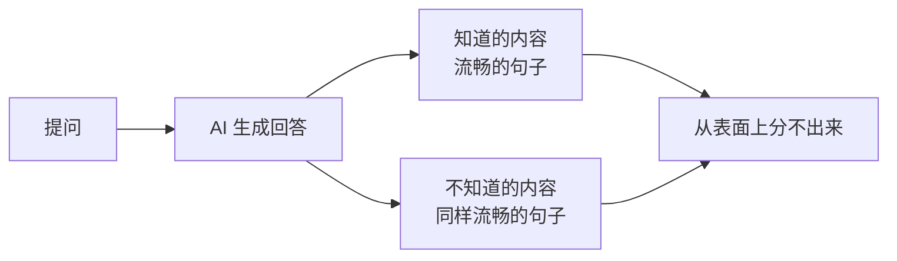
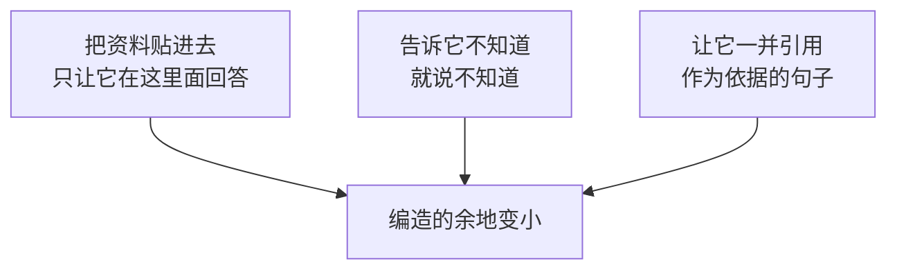

<dl class="facts">
  <div><dt>适合谁</dt><dd>所有人</dd></div>
  <div><dt>危险类型</dt><dd>5<small>种</small></dd></div>
  <div><dt>确认方法</dt><dd>4<small>种</small></dd></div>
  <div><dt>关键</dt><dd>核对原文</dd></div>
</dl>

## 为什么错了还说得那么自信

AI 聊天是靠**接着写出看似合理的下一句话**来生成回答的。它不是查到事实再写下来，而是按照学过的文字的规律造出句子。大部分时候是对的，但在它不知道的地方，句子同样流畅。这通常被称为幻觉（hallucination）。

问题在于，**错的回答和对的回答语气一样**。语气自信并不能证明内容准确。



## 尤其要小心的 5 种回答

没必要怀疑所有回答。出现下面五种情况时再去确认。

| 类型 | 例子 | 为什么危险 |
|---|---|---|
| 精确的数字 | 统计、金额、日期、比例 | 数字哪怕只差一个，句子依然通顺 |
| 出处和引用 | 论文标题、报道、书、链接 | 会按格式造出实际上不存在的东西 |
| 法律·税务·医疗 | 条款编号、扣除限额、药物剂量 | 错了损失大，而且经常变动 |
| 最近的事 | 今年改的制度、最新版本 | 训练截止之后的事它不知道 |
| 不太知名的对象 | 小公司、地方信息、某个具体的人 | 学到的文字越少，编造的可能性越高 |

反过来，润色文字、出点子、摘要、翻译这类**结果一出来自己就能读、能判断的事**，风险较低。

## 4 种确认方法

### 1. 要出处，然后亲自打开看

```text
刚才的回答里，请给每个数字和事实性的说法都附上出处。
对出处没有把握的条目，请标上“待确认”。
```

不能到这里就结束。**出处也可能是编的。**点开链接，看那句话是不是真的在里面。如果用的 AI 有搜索功能，打开搜索再问，它会依据真实网页回答，要好得多；即便如此，重要的数字还是要打开原文看。

### 2. 开一个新对话再问一遍

在同一个对话里问“真的吗？”，它有时会维护前面的回答，有时反而会把对的回答改口说成错的。**开一个新对话，把同样的问题再问一遍**，如果回答不一样，两个都不要信。

### 3. 反过来问

```text
如果“OO 是 XX”这个说法是错的，可能错在哪里？
请站在反驳的立场上检查一下。
```

如果问的方式是请它赞同你的想法，就容易得到赞同的回答。让它反驳，漏掉的条件和例外就会显露出来。

### 4. 不要让它心算，要它写出过程

让它在脑子里做很长的计算，可能会算错。让它把算式和过程一步步写出来，最后的数字用计算器或 Excel 再算一遍。如果用的 AI 有代码执行功能，说一句“请用代码计算”，它给的就是实际算出来的值。

## 从一开始就少出错的问法



- **直接给资料。**不要问“我们公司的休假规定是什么”，而是把规定文件贴进去再问。
- **允许它回答不知道。**AI 有无论如何都要给出回答的倾向，所以这一行效果很大。
- **让它引用依据的句子。**有了引用，自己对照起来就方便。

```text
请只依据下面的文档回答。
文档里没有的内容不要猜测，请回答“文档中没有”。
每条回答都请原样引用作为依据的句子。

[粘贴文档]
```

## 要确认到什么程度

全都确认，用 AI 就没有意义了。按**错了要付出的代价**来定。

| 错了的话 | 例子 | 确认程度 |
|---|---|---|
| 没什么大不了 | 晚饭吃什么、文章标题备选 | 不确认 |
| 重做一遍就行 | Excel 公式、邮件草稿 | 把结果跑一遍看看 |
| 会发给别人 | 报告里的数字、演示材料 | 把数字和出处同原文对照 |
| 关系到钱·健康·法律 | 合同、报税、用药 | 找专业人士或官方文件确认 |

## 小结

- AI 的**语气和准确度无关。**答对和答错时一样流畅。
- 数字、出处、法律和医疗、最近的事、不太知名的对象。出现这五种，就去核对原文。
- 把资料贴进去，让它“只在这里面回答，不知道就说不知道”，出错的情况会少很多。

### 推荐一起读

- [让 AI 干活时，结果大不一样的 5 个提问方法](/zh/posts/ai-prompt-basics/)
- [长文档和 PDF 摘要，怎样让 AI 做对](/zh/posts/ai-summarize-documents/)
- [用 AI 快速学习陌生领域的方法](/zh/posts/ai-learn-new-topic/)
