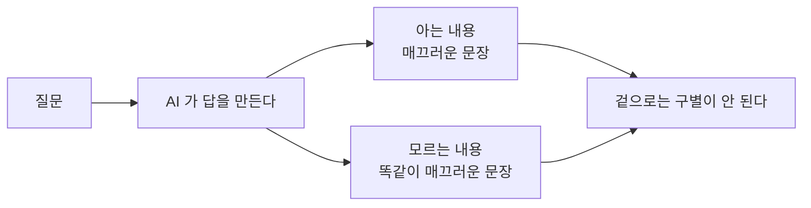
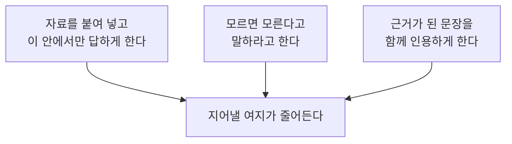

<dl class="facts">
  <div><dt>대상</dt><dd>누구나</dd></div>
  <div><dt>위험한 유형</dt><dd>5<small>가지</small></dd></div>
  <div><dt>확인 방법</dt><dd>4<small>가지</small></dd></div>
  <div><dt>핵심</dt><dd>원문 확인</dd></div>
</dl>

## 왜 틀리는데 자신 있게 말할까

AI 채팅은 **그럴듯한 다음 문장을 이어 쓰는 방식**으로 답을 만듭니다. 사실을 찾아서 적는 것이 아니라, 배운 글의 패턴에 맞는 문장을 만들어 냅니다. 대부분은 맞지만, 모르는 부분에서도 문장은 똑같이 매끄럽게 나옵니다. 이것을 흔히 환각(hallucination)이라고 부릅니다.

문제는 **틀린 답과 맞는 답의 말투가 같다**는 점입니다. 자신 있는 말투는 정확도의 증거가 아닙니다.



## 특히 조심해야 하는 답 5가지

모든 답을 의심할 필요는 없습니다. 아래 다섯 가지가 나오면 그때 확인합니다.

| 유형 | 예 | 왜 위험한가 |
|---|---|---|
| 정확한 숫자 | 통계, 금액, 날짜, 비율 | 숫자 하나만 달라도 문장은 자연스럽다 |
| 출처와 인용 | 논문 제목, 기사, 책, 링크 | 실제로 없는 것을 형식에 맞게 만들어 낸다 |
| 법·세금·의료 | 조항 번호, 공제 한도, 약 용량 | 틀리면 손해가 크고, 자주 바뀐다 |
| 최근 일 | 올해 바뀐 제도, 최신 버전 | 학습 시점 이후의 일은 모른다 |
| 덜 알려진 대상 | 작은 회사, 지역 정보, 특정 인물 | 배운 글이 적을수록 지어낼 가능성이 높다 |

반대로 글 다듬기, 아이디어 내기, 요약, 번역처럼 **내가 결과를 바로 읽고 판단할 수 있는 일**은 위험이 낮습니다.

## 확인하는 방법 4가지

### 1. 출처를 달라고 하고, 직접 열어 본다

```text
방금 답한 내용 중 숫자와 사실 주장마다 출처를 붙여 줘.
출처를 확신할 수 없는 항목은 "확인 필요" 라고 표시해 줘.
```

여기서 끝내면 안 됩니다. **출처도 지어낼 수 있습니다.** 링크를 눌러서 그 문장이 실제로 있는지 봅니다. 검색 기능이 있는 AI 라면 검색을 켜고 물으면 실제 페이지를 근거로 답하므로 훨씬 낫지만, 그래도 중요한 숫자는 원문을 엽니다.

### 2. 새 대화에서 다시 묻는다

같은 대화에서 "정말이야?" 라고 물으면 앞의 답을 지키려 하거나, 반대로 맞는 답을 틀렸다고 번복하기도 합니다. **새 대화를 열어 같은 질문을 다시** 해 보고, 답이 달라지면 둘 다 믿지 않습니다.

### 3. 반대로 묻는다

```text
"OO 는 XX 이다" 라는 주장이 틀렸다면 어떤 점에서 틀렸을지,
반박하는 입장에서 검토해 줘.
```

내 생각에 동의해 달라고 물으면 동의하는 답이 나오기 쉽습니다. 반박을 시키면 빠뜨린 조건이나 예외가 드러납니다.

### 4. 계산은 시키지 말고 과정을 받는다

긴 계산을 머릿속으로 시키면 틀릴 수 있습니다. 식과 과정을 단계별로 적게 하고, 최종 숫자는 계산기나 엑셀로 다시 계산합니다. 코드 실행 기능이 있는 AI 라면 "코드로 계산해 줘" 라고 하면 실제로 계산한 값을 줍니다.

## 애초에 덜 틀리게 묻는 법



- **자료를 직접 준다.** "우리 회사 휴가 규정이 뭐야" 라고 묻지 말고 규정 문서를 붙여 넣고 묻습니다.
- **모른다는 답을 허락한다.** AI 는 어떻게든 답하려는 경향이 있어서, 이 한 줄이 효과가 큽니다.
- **근거 문장을 인용하게 한다.** 인용이 붙으면 내가 대조하기 쉽습니다.

```text
아래 문서만 근거로 답해 줘.
문서에 없는 내용은 추측하지 말고 "문서에 없음" 이라고 답해 줘.
답마다 근거가 된 문장을 그대로 인용해 줘.

[문서 붙여넣기]
```

## 어디까지 확인해야 할까

전부 확인하면 AI 를 쓰는 의미가 없습니다. **틀렸을 때 치르는 값**으로 정합니다.

| 틀렸을 때 | 예 | 확인 수준 |
|---|---|---|
| 별일 없다 | 저녁 메뉴, 글 제목 후보 | 확인 안 함 |
| 다시 하면 된다 | 엑셀 수식, 메일 초안 | 결과를 한 번 돌려 본다 |
| 남에게 나간다 | 보고서의 숫자, 발표 자료 | 숫자와 출처를 원문과 대조 |
| 돈·건강·법이 걸린다 | 계약, 세금 신고, 복약 | 전문가나 공식 문서로 확인 |

## 정리

- AI 의 **말투는 정확도와 관계가 없습니다.** 맞을 때도 틀릴 때도 똑같이 매끄럽습니다.
- 숫자, 출처, 법·의료, 최근 일, 덜 알려진 대상. 이 다섯 가지가 나오면 원문을 확인합니다.
- 자료를 붙여 넣고 "이 안에서만, 모르면 모른다고" 답하게 하면 틀릴 일이 크게 줄어듭니다.

### 같이 읽으면 좋은 글

- [AI 에게 일 시킬 때 결과가 달라지는 요청법 5가지](/posts/ai-prompt-basics/)
- [긴 문서·PDF 요약, AI 에게 제대로 시키는 법](/posts/ai-summarize-documents/)
- [AI 로 낯선 분야를 빠르게 배우는 법](/posts/ai-learn-new-topic/)
