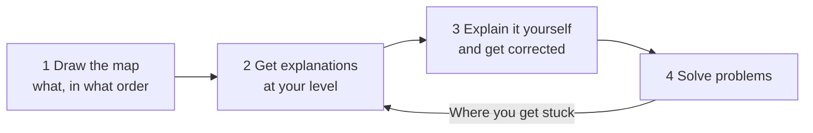
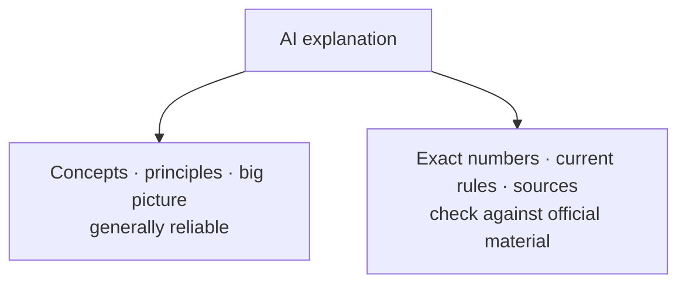

<dl class="facts">
  <div><dt>For</dt><dd>Anyone</dd></div>
  <div><dt>Steps</dt><dd>4</dd></div>
  <div><dt>Prompts</dt><dd>8</dd></div>
  <div><dt>Key</dt><dd>You explain it</dd></div>
</dl>

## Listening alone doesn't stick

AI explains anything in simple terms. While you read, it feels like you understand all of it. Then you close the window and can't explain it to anyone. **Feeling that you understand and actually knowing are different things.**

What sets AI apart from a book or a video is that **it can hear your answer and respond to it**. Using that is what changes how fast you learn.



## Step 1: Start with a map

The biggest problem with an unfamiliar subject is that **you don't know what you don't know**. Get the overall map before the details.

```text
I am new to [accounting]. My goal is [to be able to read my company's financial statements and ask questions about them].
- List the topics I need for this goal, in the order I should learn them, 7 at most.
- For each topic, give a one-line description and say why it comes in that order.
- Also tell me which topics I can skip because my goal doesn't need them.
```

The key is to state the **goal specifically**. "I want to learn accounting" and "I want to read financial statements" cover completely different ground. The last line, asking what to skip, saves the most time.

## Step 2: Get explanations at your level

With "explain it simply", there is no telling whose idea of simple applies. Tell it **what you already know**.

```text
Explain [depreciation].
- I don't know accounting terms, but I keep a household budget in a spreadsheet.
- Explain it by comparing it to things I know, and give one example with numbers.
- When a new term comes up, explain it right where it first appears.
```

If the explanation is hard, point to where you got stuck and ask again.

```text
In the second paragraph, I'm lost from "useful life" onward. Explain just that part again with a different example.
```

A comparison helps you understand, but it stops fitting somewhere. Ask about that too.

```text
Where does the analogy you just used differ from the real thing?
```

## Step 3: Explain it yourself and get corrected

This is the step that does the most. Write what you learned **in your own words** and have the AI check it.

```text
Let me explain [depreciation] the way I understand it.
Point out what is wrong or missing. You don't need to praise the parts that are right.

[my explanation]
```

The places where you get stuck while writing are exactly **the places you don't know**. Gaps that were invisible while reading show up when you write.

There is a reason for "you don't need to praise". AI tends to go along with what the other person says, so it sometimes opens with "you've understood this well" even when the explanation is wrong.

## Step 4: Solve problems

```text
Give me 5 problems on what I have learned so far.
- Don't ask for things I memorized. Make them problems I can only solve by applying it to a situation I haven't seen.
- Give them one at a time, and give the next one after you see my answer.
- Don't tell me the answer before I have tried.
```

For a problem you got wrong, get an explanation of why, then get **one more similar problem**. Repeat until you get it right and that part stays with you.

The best problem is using it on real work.

```text
I saw [item name and number] on my company's income statement.
I'll first explain what this number means using what I have learned so far, so check my explanation.
```

## What to watch out for while learning



- **Concepts from AI, facts from official material.** AI is good for grasping principles and the big picture, but things like tax rates, legal clauses or how to use the latest version of something may be wrong or out of date. See [When AI is confidently wrong: how to verify its answers](/en/posts/ai-hallucination-check/).
- **Keep one good book alongside.** AI is strong at answering questions but doesn't tell you what to ask. A good combination is to use a well-ordered introductory book or course as your base and ask the AI where you get stuck.
- **Don't take the answer first.** If you hand over homework or a coding problem whole, you keep the result but not the skill. Say "give me a hint, not the answer".

```text
Don't tell me the answer. Point out where I am stuck and give me a hint for just the next step.
```

## Summary

- Listening to explanations is not enough to make it stick. You need **the steps where you explain and solve problems**.
- State your goal specifically and ask **what to skip** first.
- Get the concepts from AI, and check numbers and rules against official material.

### Related posts

- [Five ways to ask AI that change the result](/en/posts/ai-prompt-basics/)
- [When AI is confidently wrong: how to verify its answers](/en/posts/ai-hallucination-check/)
- [How to get AI to summarize long documents and PDFs properly](/en/posts/ai-summarize-documents/)
