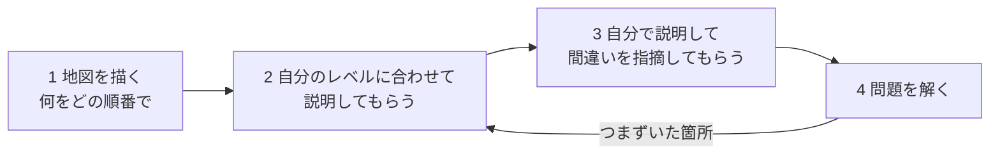
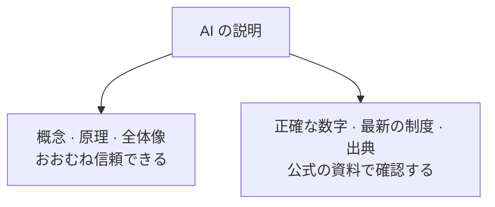

<dl class="facts">
  <div><dt>対象</dt><dd>だれでも</dd></div>
  <div><dt>手順</dt><dd>4<small>ステップ</small></dd></div>
  <div><dt>例文</dt><dd>8<small>個</small></dd></div>
  <div><dt>要点</dt><dd>自分で説明する</dd></div>
</dl>

## 聞くだけでは残らない

AI は何でも分かりやすく説明してくれます。読んでいるあいだは、すべて理解できた気がします。ところが、画面を閉じると人に説明できません。**分かった気分と、実際に分かっていることは別です。**

AI が本や動画と違うのは、**こちらの答えを聞いて反応できる**点です。この点を使ってこそ、学ぶ速さが変わります。



## ステップ 1: まず地図を描く

知らない分野では、**何が分からないのかも分からない**ことがいちばんの問題です。細かい内容より先に、全体の地図をもらいます。

```text
わたしは [会計] を初めて学ぶ。目標は [自分の会社の財務諸表を読んで質問できるようになること] だ。
- この目標に必要なテーマを、学ぶ順番に 7 つ以内で挙げて。
- テーマごとに 1 行の説明と、なぜその順番なのかを書いて。
- わたしの目標には不要で、飛ばしてよいテーマも教えて。
```

**目標を具体的に**書くことが肝心です。「会計を学びたい」と「財務諸表を読みたい」では、学ぶ範囲がまったく違います。飛ばすものを聞く最後の 1 行が、いちばん時間の節約になります。

## ステップ 2: 自分のレベルに合わせて説明してもらう

「分かりやすく説明して」では、だれにとっての分かりやすさなのかが伝わりません。**自分がすでに知っていること**を伝えます。

```text
[減価償却] を説明して。
- わたしは会計用語は知らないが、Excel で家計簿はつけている。
- わたしが知っているものにたとえて説明し、数字の入った例を 1 つ挙げて。
- 新しい用語が出てきたら、最初に出たところですぐ説明して。
```

説明が難しければ、どこでつまずいたのかを示して聞き直します。

```text
2 つ目の段落の「耐用年数」から分からなくなった。その部分だけ、別の例でもう一度説明して。
```

たとえを使った説明は理解の助けになりますが、どこかで合わなくなります。これも聞いておきます。

```text
いまのたとえが、実際と違っている点はどこ?
```

## ステップ 3: 自分で説明して、間違いを指摘してもらう

いちばん効果の大きいステップです。学んだことを**自分の言葉で書いて**、AI にチェックしてもらいます。

```text
わたしが理解したとおりに [減価償却] を説明してみる。
間違っている部分や抜けている部分を指摘して。合っている部分はほめなくていい。

[自分の説明]
```

書いていて手が止まる箇所が、まさに**分かっていない箇所**です。読んでいるときには見えなかった穴が、書くときに見えてきます。

「ほめなくていい」を入れるのには理由があります。AI は相手の言うことに合わせる傾向があり、間違った説明にも「よく理解されていますね」と始めることがあるからです。

## ステップ 4: 問題を解いてみる

```text
ここまで学んだ内容で問題を 5 問出して。
- 暗記したことを問うのではなく、初めて見る状況に当てはめないと解けない問題で。
- 一度に 1 問ずつ出し、わたしの答えを見てから次の問題を出して。
- 答えは、わたしが解く前には教えないで。
```

間違えた問題は、なぜ間違えたのかを説明してもらい、**似た問題をもう 1 問**もらいます。正解できるまで繰り返せば、その部分は身につきます。

実際の仕事に使ってみるのが、いちばんよい問題になります。

```text
自分の会社の損益計算書で [項目名と数字] を見た。
ここまで学んだことをもとに、この数字が何を意味するのかをまずわたしが説明するので、チェックして。
```

## 学ぶときに気をつけること



- **概念は AI で、事実は公式の資料で。** 原理や全体像をつかむには向いていますが、税率や法律の条文、最新バージョンの使い方などは、間違っていたり古い情報だったりすることがあります。[AI が自信満々に間違えるとき：答えを検証する方法](/ja/posts/ai-hallucination-check/)を参考にしてください。
- **よい本を 1 冊、一緒に読む。** AI は質問には強いのですが、何を質問すべきかは教えてくれません。順序立てて書かれた入門書や講座を軸にして、つまずいた箇所を AI に聞く組み合わせがおすすめです。
- **先に答えをもらわない。** 宿題やコーディングの問題を丸ごと任せると、結果は残っても力は残りません。「答えではなくヒントだけ教えて」と頼みます。

```text
正解は教えずに、わたしがどこでつまずいているのかを指摘して、次の一歩のヒントだけ教えて。
```

## まとめ

- 説明を聞くだけでは残りません。**自分で説明し、問題を解くステップ**が必要です。
- 目標を具体的に伝え、**飛ばしてよいもの**を先に聞きます。
- 概念は AI でつかみ、数字と制度は公式の資料で確認します。

### あわせて読みたい記事

- [AI に仕事を頼むとき、結果が変わる頼み方 5 つ](/ja/posts/ai-prompt-basics/)
- [AI が自信満々に間違えるとき：答えを検証する方法](/ja/posts/ai-hallucination-check/)
- [長い文書・PDF の要約を AI にきちんと頼む方法](/ja/posts/ai-summarize-documents/)
