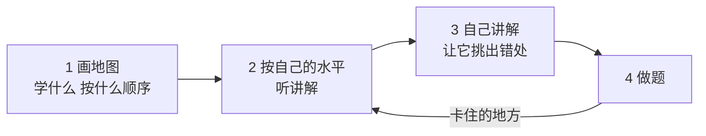
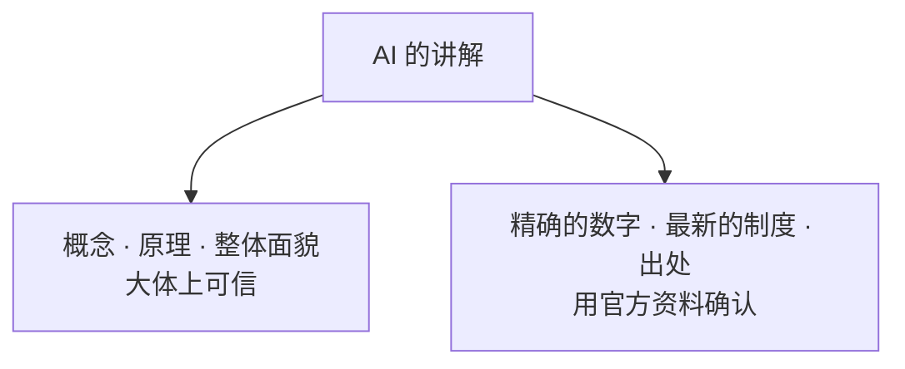

<dl class="facts">
  <div><dt>适合谁</dt><dd>所有人</dd></div>
  <div><dt>步骤</dt><dd>4<small>步</small></dd></div>
  <div><dt>例句</dt><dd>8<small>个</small></dd></div>
  <div><dt>关键</dt><dd>自己来讲解</dd></div>
</dl>

## 只听是留不住的

AI 什么都能讲得很简单。读的时候觉得全懂了。可是关掉窗口以后，却没法讲给别人听。**觉得懂了和真的会了是两回事。**

AI 和书、视频不同的地方在于，**它能听你的回答并做出反应**。用上这一点，学习的速度才会不一样。



## 第 1 步：先画地图

陌生的领域，最大的问题是**连自己不知道什么都不知道**。先拿到整体的地图，再看细节。

```text
我第一次学 [会计]。目标是 [能看懂我们公司的财务报表并提出问题]。
- 请按学习的先后顺序列出达到这个目标需要的主题，不超过 7 个。
- 每个主题写一行说明，以及为什么排在这个位置。
- 对我的目标来说用不上、可以跳过的主题也请告诉我。
```

关键是把**目标写具体**。“想学会计”和“想看懂财务报表”，要学的范围完全不同。最后一行问可以跳过什么，最能省时间。

## 第 2 步：按自己的水平听讲解

“讲简单点”，说不清是以谁为标准的简单。告诉它**你已经知道什么**。

```text
请讲解 [折旧]。
- 我不懂会计术语，但会用 Excel 记家里的账。
- 请用我知道的东西来打比方，并举一个带数字的例子。
- 出现新术语时，请在第一次出现的地方就解释清楚。
```

讲解听不懂，就指出卡在哪里，再问一次。

```text
第二段从“使用年限”开始就看不懂了。请只把那部分换个例子再讲一遍。
```

打比方有助于理解，但总会在某个地方对不上。这一点也问清楚。

```text
刚才打的比方和实际情况不一样的地方是什么？
```

## 第 3 步：自己讲解，让它挑出错处

这是效果最大的一步。把学到的东西**用自己的话写下来**，让 AI 检查。

```text
我按自己的理解来讲一下 [折旧]。
请指出讲错或漏掉的地方。讲对的部分不用夸。

[我的讲解]
```

写着写着卡住的地方，就是**不会的地方**。读的时候看不见的空白，写的时候会显露出来。

加上“不用夸”是有原因的。AI 有附和对方的倾向，对错误的讲解有时也会用“您理解得很好”来开头。

## 第 4 步：做题

```text
请用到目前为止学的内容出 5 道题。
- 不要考背诵的内容，要出必须应用到没见过的情境才能解答的题。
- 一次出一道，看过我的回答后再出下一道。
- 在我作答之前不要告诉我答案。
```

做错的题，让它讲清楚为什么错，再要**一道类似的题**。反复做到答对为止，那部分就留下了。

用在实际的工作上，是最好的题目。

```text
我在我们公司的利润表上看到了 [项目名称和数字]。
我先用到目前为止学的内容讲讲这个数字是什么意思，请你检查。
```

## 学习时要注意的



- **概念靠 AI，事实靠官方资料。**它适合用来把握原理和整体面貌，但税率、法律条款、最新版本的用法这类内容，可能是错的或过时的。可以参考[AI 自信地答错时：验证回答的方法](/zh/posts/ai-hallucination-check/)。
- **同时读一本好书。**AI 擅长回答问题，却不会告诉你该问什么。以一本顺序清楚的入门书或一门课为主线，卡住的地方再问 AI，这样搭配比较好。
- **不要先要答案。**把作业或编程题整个交给它，结果是有了，本事却没留下。要说“不要答案，只给提示”。

```text
请不要告诉我正确答案，只指出我卡在哪里，并给出下一步的提示。
```

## 小结

- 只听讲解是留不住的。必须有**自己讲解和做题的步骤**。
- 把目标说具体，先问**可以跳过什么**。
- 概念靠 AI 来把握，数字和制度用官方资料确认。

### 推荐一起读

- [让 AI 干活时，结果大不一样的 5 个提问方法](/zh/posts/ai-prompt-basics/)
- [AI 自信地答错时：验证回答的方法](/zh/posts/ai-hallucination-check/)
- [长文档和 PDF 摘要，怎样让 AI 做对](/zh/posts/ai-summarize-documents/)
