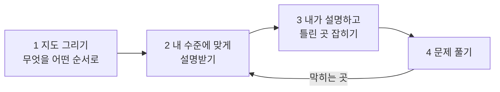
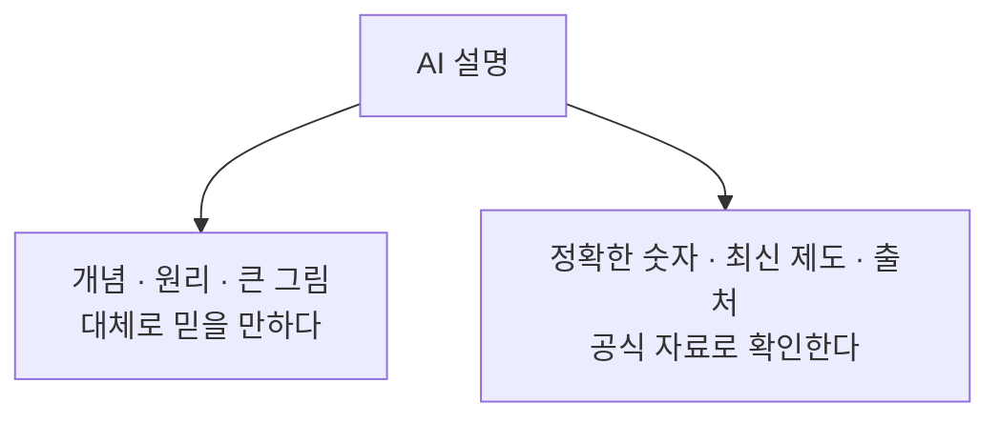

<dl class="facts">
  <div><dt>대상</dt><dd>누구나</dd></div>
  <div><dt>단계</dt><dd>4<small>단계</small></dd></div>
  <div><dt>예문</dt><dd>8<small>개</small></dd></div>
  <div><dt>핵심</dt><dd>내가 설명하기</dd></div>
</dl>

## 듣기만 하면 남지 않는다

AI 는 무엇이든 쉽게 설명해 줍니다. 읽을 때는 다 이해한 것 같습니다. 그런데 창을 닫고 나면 남에게 설명하지 못합니다. **이해한 기분과 실제로 아는 것은 다릅니다.**

AI 가 책이나 영상과 다른 점은 **내 답을 듣고 반응할 수 있다**는 것입니다. 이 점을 써야 배우는 속도가 달라집니다.



## 1단계: 지도부터 그린다

낯선 분야는 **무엇을 모르는지도 모르는 것**이 가장 큰 문제입니다. 세부 내용보다 전체 지도를 먼저 받습니다.

```text
나는 [회계] 를 처음 배운다. 목표는 [우리 회사 재무제표를 읽고 질문할 수 있는 것] 이다.
- 이 목표에 필요한 주제를 배우는 순서대로 7개 이내로 나열해 줘.
- 주제마다 한 줄 설명과, 왜 그 순서인지 적어 줘.
- 내 목표에는 필요 없어서 건너뛰어도 되는 주제도 알려 줘.
```

**목표를 구체적으로** 적는 것이 핵심입니다. "회계를 배우고 싶다" 와 "재무제표를 읽고 싶다" 는 배울 범위가 전혀 다릅니다. 건너뛸 것을 묻는 마지막 줄이 시간을 가장 많이 아껴 줍니다.

## 2단계: 내 수준에 맞게 설명받는다

"쉽게 설명해 줘" 는 누구 기준의 쉬움인지 알 수 없습니다. **내가 이미 아는 것**을 알려 줍니다.

```text
[감가상각] 을 설명해 줘.
- 나는 회계 용어는 모르지만 엑셀로 가계부는 쓴다.
- 내가 아는 것에 빗대어 설명하고, 숫자가 들어간 예를 하나 들어 줘.
- 새 용어가 나오면 처음 나올 때 바로 풀어 줘.
```

설명이 어려우면 어디서 막혔는지 짚어서 다시 묻습니다.

```text
두 번째 문단에서 "내용연수" 부터 이해가 안 된다. 그 부분만 다른 예로 다시 설명해 줘.
```

빗댄 설명은 이해를 돕지만 어디선가 맞지 않게 됩니다. 이것도 물어 둡니다.

```text
방금 든 비유가 실제와 다른 점은 뭐야?
```

## 3단계: 내가 설명하고 틀린 곳을 잡힌다

가장 효과가 큰 단계입니다. 배운 것을 **내 말로 적어서** AI 에게 검사받습니다.

```text
내가 이해한 대로 [감가상각] 을 설명해 볼게.
틀렸거나 빠진 부분을 짚어 줘. 맞는 부분은 칭찬하지 않아도 돼.

[내 설명]
```

적다가 막히는 곳이 바로 **모르는 곳**입니다. 읽을 때는 보이지 않던 빈칸이 쓸 때 드러납니다.

"칭찬하지 않아도 돼" 를 넣는 이유가 있습니다. AI 는 상대의 말에 맞장구치는 경향이 있어서, 틀린 설명에도 "잘 이해하셨네요" 로 시작하는 일이 있습니다.

## 4단계: 문제를 풀어 본다

```text
지금까지 배운 내용으로 문제를 5개 내 줘.
- 외운 것을 묻지 말고, 처음 보는 상황에 적용해야 풀 수 있는 문제로.
- 한 번에 하나씩 내고, 내 답을 본 뒤에 다음 문제를 내 줘.
- 답은 내가 풀기 전에는 알려 주지 마.
```

틀린 문제는 왜 틀렸는지 설명받고, **비슷한 문제를 하나 더** 받습니다. 맞힐 때까지 반복하면 그 부분은 남습니다.

실제 일에 써 보는 것이 가장 좋은 문제입니다.

```text
우리 회사 손익계산서에서 [항목 이름과 숫자] 를 봤다.
지금까지 배운 것으로 이 숫자가 무엇을 뜻하는지 내가 먼저 설명해 볼 테니 검사해 줘.
```

## 배울 때 조심할 것



- **개념은 AI 로, 사실은 공식 자료로.** 원리와 큰 그림을 잡는 데는 좋지만, 세율이나 법 조항, 최신 버전의 사용법 같은 것은 틀리거나 오래된 정보일 수 있습니다. [AI 가 자신 있게 틀릴 때: 답을 검증하는 방법](/posts/ai-hallucination-check/)을 참고하세요.
- **좋은 책 한 권을 같이 본다.** AI 는 질문에는 강하지만 무엇을 물어야 하는지는 알려 주지 않습니다. 순서가 잡힌 입문서나 강의를 기준으로 삼고, 막히는 곳을 AI 에게 묻는 조합이 좋습니다.
- **답부터 받지 않는다.** 숙제나 코딩 문제를 통째로 맡기면 결과는 남지만 실력은 남지 않습니다. "답 말고 힌트만 줘" 라고 합니다.

```text
정답은 알려 주지 말고, 내가 어디서 막혔는지 짚고 다음 한 걸음에 대한 힌트만 줘.
```

## 정리

- 설명을 듣는 것만으로는 남지 않습니다. **내가 설명하고 문제를 푸는 단계**가 있어야 합니다.
- 목표를 구체적으로 말하고 **건너뛸 것**을 먼저 묻습니다.
- 개념은 AI 로 잡고, 숫자와 제도는 공식 자료로 확인합니다.

### 같이 읽으면 좋은 글

- [AI 에게 일 시킬 때 결과가 달라지는 요청법 5가지](/posts/ai-prompt-basics/)
- [AI 가 자신 있게 틀릴 때: 답을 검증하는 방법](/posts/ai-hallucination-check/)
- [긴 문서·PDF 요약, AI 에게 제대로 시키는 법](/posts/ai-summarize-documents/)
