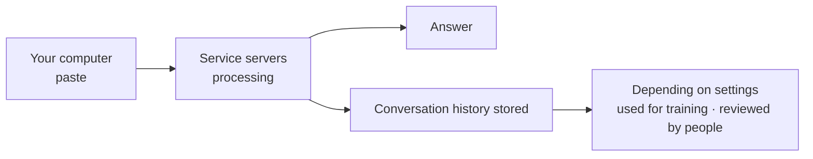
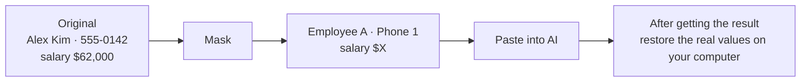

<dl class="facts">
  <div><dt>For</dt><dd>Office workers · anyone</dd></div>
  <div><dt>Don't paste</dt><dd>6</dd></div>
  <div><dt>Settings to check</dt><dd>4</dd></div>
  <div><dt>Key</dt><dd>Mask, then paste</dd></div>
</dl>

## Where does pasted text go?

An AI chat is not a program running inside your computer. The text you type and the files you upload are **sent to the service provider's servers and processed there**. Depending on the service, the plan and your settings, conversations may be stored for a period, may be seen by people for quality checks, or may be used to train models.



So the rule is simple. Ask yourself **whether you could email this to a stranger outside your company**. If not, don't paste it as is.

## Six things not to paste

| Kind | Examples |
|---|---|
| Passwords and credentials | Passwords, API keys, certificates, recovery codes, one-time codes |
| Personal identifiers | National ID or Social Security number, passport number, bank account and card numbers, address and phone number |
| Other people's information | Customer lists, employee HR records, applicants' résumés, patient records |
| Company secrets | Unreleased results, contract terms, source code, pre-launch plans |
| Contractual secrets | Material from a party you have a non-disclosure agreement (NDA) with |
| Sensitive private matters | Health, legal disputes, family problems and other things you would not want others to know |

Be especially careful with **other people's information**. With your own information you bear the risk yourself, but information about customers or coworkers is not yours to decide on.

## When you have to: mask it first

Most tasks don't need the real values. What the AI needs is the **structure**, not the real names and numbers.



| Original | Replace with |
|---|---|
| Real names | Employee A, Customer B, Vendor C |
| Phone number, email | 555-0100, user@example.com |
| Exact amounts | Keep only the ratios, or use arbitrary numbers |
| Company and product names | Company A, New Product X |
| Passwords, API keys | `<PASSWORD>`, `<API_KEY>` |

When you ask for an email to be edited, swap the names and amounts before pasting, and put the real values back on your own computer once you have the result. When you ask about a spreadsheet formula, **the column names and two or three made-up rows** are enough. You don't need the real data.

### Things that only feel masked

- **Converting to Base64 is not encryption.** It is just a notation that anyone can reverse in one step. Put it into the [Base64 encode and decode tool](/en/online/base64/) and it comes right back.
- **Screenshots** capture what is around the content too. Check the address bar, the titles of other tabs and notification pop-ups.
- **File properties** may still hold the author's name and company name.
- **Even with the name removed**, a job title, date and location can be enough to tell who it is.

## Four settings to check

Menu names differ between services and change often, so look for these four things in the settings and privacy policy of the service you use.

1. **Use for training**: whether your conversations are used to improve the model, and whether you can turn that off
2. **Retention period**: when a deleted conversation is actually removed from the servers
3. **Temporary chat**: whether there is a mode that keeps a conversation out of your history
4. **Connected apps**: if you connected email, drive or calendar, how far the AI can read

At work there is one more: **your company's rules on AI use**. Business plans that a company signs up for often have different data-handling terms from personal plans, so don't handle company material with a personal account.

## Checklist before you paste

```text
[ ] No passwords, API keys or verification codes
[ ] No national ID or Social Security number, no bank account or card numbers
[ ] Other people's names and contact details are masked
[ ] The company's unreleased numbers and contract terms are masked
[ ] The material is not covered by a non-disclosure agreement
[ ] I checked the edges of the screenshot
[ ] If it is company material, I am using an account and tool the company allows
```

## If you already pasted it

- **Passwords or API keys**: don't stop at deleting the conversation. **Change them right away.** Treat any value that has left your hands once as exposed.
- **Deleting the conversation**: delete that conversation and check whether the service has a way to request deletion.
- **Company material or customer information**: don't cover it up on your own. Tell your security contact. The sooner you report it, the more can be done about it.

## Summary

- Text you put into a chat goes to the service's servers. The test is **whether you could email it to a stranger**.
- Most tasks don't need the real values. **Swap the names and numbers** before pasting and restore them after you get the result.
- If you pasted a password or a key, don't just delete it. **Change it.**

### Related posts

- [Five ways to ask AI that change the result](/en/posts/ai-prompt-basics/)
- [How to get AI to summarize long documents and PDFs properly](/en/posts/ai-summarize-documents/)
- [How to delegate work to an AI coding agent: instruct, verify, roll back](/en/posts/ai-coding-agent-delegation/)
