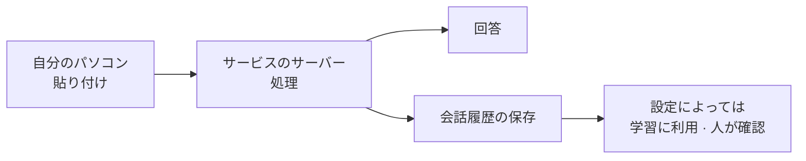
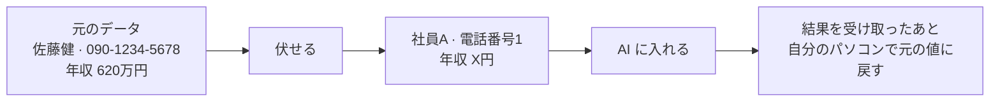

<dl class="facts">
  <div><dt>対象</dt><dd>会社員 · だれでも</dd></div>
  <div><dt>入れないもの</dt><dd>6<small>種類</small></dd></div>
  <div><dt>確認する設定</dt><dd>4<small>つ</small></dd></div>
  <div><dt>要点</dt><dd>伏せてから入れる</dd></div>
</dl>

## 貼り付けた文章はどこへ行くのか

AI チャットは、自分のパソコンの中で動いているプログラムではありません。入力した文章やアップロードしたファイルは、**サービス会社のサーバーに送られて処理されます。** サービスや料金プラン、設定によっては、会話が一定期間保存されたり、品質チェックのために人が見たり、モデルの学習に使われたりすることがあります。



ですから、基準は単純です。**社外の見知らぬ人にメールで送ってもよい内容かどうか**を考えます。だめなら、そのままでは入れません。

## 入れてはいけないもの 6 つ

| 種類 | 例 |
|---|---|
| パスワードと認証情報 | パスワード、API キー、証明書、リカバリーコード、ワンタイムパスワード |
| 個人を特定する情報 | マイナンバー、パスポート番号、口座・カード番号、住所と電話番号 |
| 他人の情報 | 顧客名簿、社員の人事資料、応募者の履歴書、患者の記録 |
| 会社の機密 | 未公開の業績、契約条件、ソースコード、発売前の計画 |
| 契約上の秘密 | 秘密保持契約(NDA)を結んだ相手の資料 |
| 個人的でデリケートな内容 | 健康、法的なトラブル、家族の問題など、人に知られると困る内容 |

とくに**他人の情報**に気をつけます。自分の情報なら自分でリスクを引き受ければ済みますが、顧客や同僚の情報は自分が決めてよいものではありません。

## どうしても入れるとき: 伏せてから入れる

たいていの作業は、実際の値がなくてもできます。AI に必要なのは**構造**であって、本物の名前や数字ではありません。



| 元 | 置き換え |
|---|---|
| 実名 | 社員A、顧客B、取引先C |
| 電話番号、メールアドレス | 090-0000-0000、user@example.com |
| 正確な金額 | 比率だけ残すか、適当な数字に |
| 会社名・製品名 | A社、新製品 X |
| パスワード、API キー | `<パスワード>`、`<API_KEY>` |

メールの手直しを頼むときは、名前と金額を置き換えてから入れ、結果が出たあとに自分のパソコンで元の値に戻せば済みます。Excel の数式を聞くときは、実際のデータではなく**列の名前と作りものの 2、3 行**で十分です。

### 伏せたつもりになりやすいもの

- **Base64 に変換するのは暗号化ではありません。** だれでもすぐ元に戻せる表記方法にすぎません。[Base64 エンコード・デコードツール](/ja/online/base64/)に入れてみれば、すぐに元に戻ります。
- **スクリーンショット**には、周りの情報も一緒に写ります。アドレスバー、ほかのタブのタイトル、通知のポップアップを確認します。
- **ファイルのプロパティ**に、作成者の名前や会社名が残っていることがあります。
- **名前だけ消しても**、役職、日付、地域が残っていれば、だれのことか分かってしまいます。

## 確認する設定 4 つ

サービスごとにメニューの名前が違い、よく変わるので、使っているサービスの設定とプライバシーポリシーで次の 4 つを探します。

1. **学習への利用**: 自分の会話をモデルの改善に使うのか、オフにできるのか
2. **会話の保存期間**: 消した会話がサーバーからいつ削除されるのか
3. **一時チャット機能**: 履歴に残さない会話モードがあるか
4. **連携しているアプリ**: メール、ドライブ、カレンダーを連携しているなら、AI がどこまで読めるのか

会社で使うなら、もう 1 つあります。**会社が定めた AI の利用ルール**です。会社が契約している業務用プランは、個人用とデータの取り扱い条件が違うことが多いので、個人アカウントで会社の資料を扱わないようにします。

## 貼り付ける前のチェックリスト

```text
[ ] パスワード、API キー、認証コードが入っていない
[ ] マイナンバー、口座・カード番号が入っていない
[ ] 他人の名前と連絡先を伏せた
[ ] 会社の未公開の数字と契約条件を伏せた
[ ] 秘密保持契約の対象になっている資料ではない
[ ] スクリーンショットの端まで確認した
[ ] 会社の資料なら、会社が許可したアカウントとツールである
```

## もう入れてしまったら

- **パスワードや API キー**: 会話を消して終わりにせず、**すぐに変更します。** 一度外に出た値は、漏れたものとして扱います。
- **会話の削除**: その会話を削除し、サービスに削除を依頼する方法があるか確認します。
- **会社の資料や顧客情報**: 一人で抱え込まず、セキュリティ担当者に知らせます。早く知らせるほど、打てる手が多くなります。

## まとめ

- チャット欄に入れた文章は、サービスのサーバーへ送られます。**見知らぬ人にメールで送ってもよいか**が基準です。
- たいていの作業に本物の値は必要ありません。**名前と数字を置き換えて**入れ、結果を受け取ったあとに戻します。
- パスワードやキーを入れてしまったら、消すのではなく**変更します。**

### あわせて読みたい記事

- [AI に仕事を頼むとき、結果が変わる頼み方 5 つ](/ja/posts/ai-prompt-basics/)
- [長い文書・PDF の要約を AI にきちんと頼む方法](/ja/posts/ai-summarize-documents/)
- [AI コーディングエージェントに仕事を任せる方法：指示、確認、巻き戻し](/ja/posts/ai-coding-agent-delegation/)
