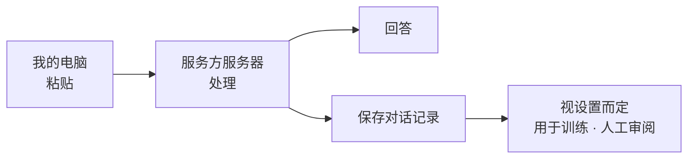
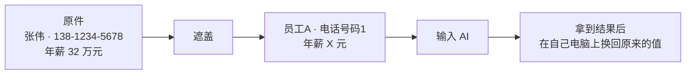

<dl class="facts">
  <div><dt>适合谁</dt><dd>上班族 · 所有人</dd></div>
  <div><dt>不要输入的</dt><dd>6<small>类</small></dd></div>
  <div><dt>要检查的设置</dt><dd>4<small>项</small></dd></div>
  <div><dt>关键</dt><dd>遮盖后再输入</dd></div>
</dl>

## 粘贴进去的文字去了哪里

AI 聊天不是在你电脑里运行的程序。输入的文字和上传的文件会**被传到服务提供商的服务器上处理**。根据服务、套餐和设置的不同，对话可能被保存一段时间，可能为了检查质量被人查看，也可能被用于训练模型。



所以标准很简单。想一想**这些内容能不能用邮件发给公司外面的陌生人**。不能的话，就不要原样输入。

## 不要输入的 6 类信息

| 种类 | 例子 |
|---|---|
| 密码和认证信息 | 密码、API 密钥、证书、恢复码、动态验证码 |
| 个人身份信息 | 身份证号、护照号、银行账号和卡号、住址和电话号码 |
| 别人的信息 | 客户名单、员工人事资料、应聘者简历、病历 |
| 公司机密 | 未公开的业绩、合同条件、源代码、发布前的计划 |
| 合同约定保密的内容 | 签了保密协议（NDA）的对方的资料 |
| 敏感的私人内容 | 健康、法律纠纷、家庭问题这类不便让别人知道的内容 |

尤其要小心**别人的信息**。自己的信息后果自己承担就行，客户和同事的信息却不是你能做主的。

## 非输入不可时：遮盖后再输入

大部分事情不需要真实的值。AI 需要的是**结构**，不是真实的姓名和数字。



| 原来的 | 换成 |
|---|---|
| 真实姓名 | 员工A、客户B、供应商C |
| 电话号码、邮箱 | 138-0000-0000、user@example.com |
| 精确的金额 | 只保留比例，或者换成随意的数字 |
| 公司·产品名称 | A 公司、新产品 X |
| 密码、API 密钥 | `<密码>`、`<API_KEY>` |

让它改邮件的时候，把姓名和金额换掉再输入，结果出来以后在自己电脑上换回原来的值就行。问 Excel 公式的时候，不用真实数据，有**列名和编出来的两三行**就够了。

### 容易误以为已经遮盖的情况

- **转成 Base64 不是加密。**它只是一种谁都能一步还原的表示方式。放进 [Base64 编码·解码工具](/zh/online/base64/)里试一下，马上就解开了。
- **截图**会把周围的信息一起拍进去。检查地址栏、其他标签页的标题、通知窗口。
- **文件属性**里可能留着作者姓名和公司名称。
- **只删掉姓名**，如果职位、日期、地区还在，也能看出是谁。

## 要检查的 4 项设置

每个服务的菜单名称不同，而且经常变，所以请在你用的服务的设置和隐私政策里找下面四项。

1. **是否用于训练**：你的对话是否用于改进模型，能不能关掉
2. **对话保存期限**：删除的对话什么时候从服务器上清除
3. **临时对话功能**：有没有不留记录的对话模式
4. **已连接的应用**：如果连接了邮箱、网盘、日历，AI 能读到哪里

在公司使用的话，还要多看一项。**公司制定的 AI 使用规定。**公司签约的企业版套餐，数据处理条件往往和个人版不同，所以不要用个人账号处理公司资料。

## 粘贴之前的清单

```text
[ ] 没有密码、API 密钥、验证码
[ ] 没有身份证号、银行账号和卡号
[ ] 别人的姓名和联系方式已遮盖
[ ] 公司未公开的数字和合同条件已遮盖
[ ] 不是受保密协议约束的资料
[ ] 已检查截图的边缘
[ ] 如果是公司资料，用的是公司允许的账号和工具
```

## 如果已经输入了

- **密码或 API 密钥**：不要删掉对话就算了，**马上更换。**出去过一次的值，就当作已经泄露。
- **删除对话**：删掉那段对话，并确认服务有没有申请删除的途径。
- **公司资料或客户信息**：不要自己捂着，告诉负责安全的同事。说得越早，能采取的措施越多。

## 小结

- 输入聊天框的文字会传到服务方的服务器。标准是**能不能用邮件发给陌生人**。
- 大部分事情不需要真实的值。**把姓名和数字换掉**再输入，拿到结果后再换回来。
- 密码和密钥一旦输入了，不是删，而是**换。**

### 推荐一起读

- [让 AI 干活时，结果大不一样的 5 个提问方法](/zh/posts/ai-prompt-basics/)
- [长文档和 PDF 摘要，怎样让 AI 做对](/zh/posts/ai-summarize-documents/)
- [把工作交给 AI 编程智能体：指示、确认、回退](/zh/posts/ai-coding-agent-delegation/)
