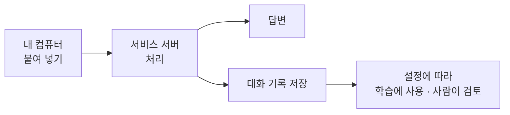
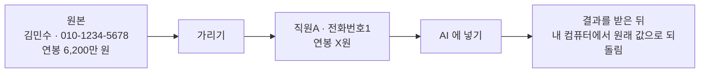

<dl class="facts">
  <div><dt>대상</dt><dd>직장인 · 누구나</dd></div>
  <div><dt>넣지 말 것</dt><dd>6<small>종류</small></dd></div>
  <div><dt>확인할 설정</dt><dd>4<small>가지</small></dd></div>
  <div><dt>핵심</dt><dd>가리고 넣기</dd></div>
</dl>

## 붙여 넣은 글은 어디로 갈까

AI 채팅은 내 컴퓨터 안에서 돌아가는 프로그램이 아닙니다. 입력한 글과 올린 파일은 **서비스 회사의 서버로 전송되어 처리**됩니다. 서비스와 요금제, 설정에 따라 대화가 일정 기간 저장되거나, 품질 점검을 위해 사람이 볼 수 있거나, 모델 학습에 쓰일 수 있습니다.



그래서 기준은 단순합니다. **회사 밖의 낯선 사람에게 메일로 보내도 되는 내용인지** 생각해 봅니다. 안 된다면 그대로 넣지 않습니다.

## 넣지 말아야 할 것 6가지

| 종류 | 예 |
|---|---|
| 비밀번호와 인증 정보 | 비밀번호, API 키, 인증서, 복구 코드, OTP |
| 개인 식별 정보 | 주민등록번호, 여권 번호, 계좌·카드 번호, 주소와 전화번호 |
| 다른 사람의 정보 | 고객 명단, 직원 인사 자료, 지원자 이력서, 환자 기록 |
| 회사 기밀 | 미공개 실적, 계약 조건, 소스 코드, 출시 전 계획 |
| 계약상 비밀 | 비밀 유지 계약(NDA)을 맺은 상대의 자료 |
| 민감한 사적 내용 | 건강, 법적 분쟁, 가족 문제처럼 남이 알면 곤란한 내용 |

특히 **다른 사람의 정보**를 조심합니다. 내 정보는 내가 감수하면 되지만, 고객이나 동료의 정보는 내가 결정할 수 있는 것이 아닙니다.

## 꼭 넣어야 할 때: 가리고 넣는다

대부분의 일은 실제 값이 없어도 됩니다. AI 에게 필요한 것은 **구조**이지 진짜 이름과 숫자가 아닙니다.



| 원래 | 바꿔서 |
|---|---|
| 실제 이름 | 직원A, 고객B, 거래처C |
| 전화번호, 이메일 | 010-0000-0000, user@example.com |
| 정확한 금액 | 비율만 남기거나 임의의 숫자로 |
| 회사·제품 이름 | A사, 신제품 X |
| 비밀번호, API 키 | `<비밀번호>`, `<API_KEY>` |

메일을 고쳐 달라고 할 때는 이름과 금액을 바꿔서 넣고, 결과가 나온 뒤 내 컴퓨터에서 원래 값으로 돌려놓으면 됩니다. 엑셀 수식을 물을 때는 실제 데이터가 아니라 **열 이름과 지어낸 두세 줄**이면 충분합니다.

### 가렸다고 착각하기 쉬운 것

- **Base64 로 바꾸는 것은 암호화가 아닙니다.** 누구나 한 번에 되돌릴 수 있는 표기 방식일 뿐입니다. [Base64 인코딩·디코딩 도구](/online/base64/)에 넣어 보면 바로 풀립니다.
- **화면 캡처**에는 주변 정보가 함께 찍힙니다. 주소 표시줄, 다른 탭 제목, 알림 창을 확인합니다.
- **파일 속성**에 작성자 이름과 회사 이름이 남아 있을 수 있습니다.
- **이름만 지워도** 직책, 날짜, 지역이 남으면 누구인지 알 수 있습니다.

## 확인할 설정 4가지

서비스마다 메뉴 이름이 다르고 자주 바뀌므로, 쓰는 서비스의 설정과 개인정보 처리 방침에서 아래 네 가지를 찾아봅니다.

1. **학습 사용 여부**: 내 대화를 모델 개선에 쓰는지, 끌 수 있는지
2. **대화 보관 기간**: 지운 대화가 서버에서 언제 삭제되는지
3. **임시 대화 기능**: 기록에 남기지 않는 대화 모드가 있는지
4. **연결된 앱**: 메일, 드라이브, 캘린더를 연결했다면 AI 가 어디까지 읽을 수 있는지

회사에서 쓴다면 하나가 더 있습니다. **회사가 정한 AI 사용 규정**입니다. 회사가 계약한 업무용 요금제는 개인용과 데이터 처리 조건이 다른 경우가 많으므로, 개인 계정으로 회사 자료를 다루지 않습니다.

## 붙여 넣기 전 체크리스트

```text
[ ] 비밀번호, API 키, 인증 코드가 들어 있지 않다
[ ] 주민등록번호, 계좌·카드 번호가 들어 있지 않다
[ ] 다른 사람의 이름과 연락처를 가렸다
[ ] 회사의 미공개 숫자와 계약 조건을 가렸다
[ ] 비밀 유지 계약이 걸린 자료가 아니다
[ ] 캡처 화면의 가장자리를 확인했다
[ ] 회사 자료라면 회사가 허용한 계정과 도구다
```

## 이미 넣어 버렸다면

- **비밀번호나 API 키**: 대화를 지우는 것으로 끝내지 말고 **바로 바꿉니다.** 한 번 밖으로 나간 값은 노출된 것으로 봅니다.
- **대화 삭제**: 해당 대화를 지우고, 서비스에 삭제 요청 방법이 있는지 확인합니다.
- **회사 자료나 고객 정보**: 혼자 덮지 말고 보안 담당자에게 알립니다. 빨리 알릴수록 대응할 수 있는 일이 많습니다.

## 정리

- 채팅창에 넣은 글은 서비스 서버로 갑니다. **낯선 사람에게 메일로 보내도 되는지**가 기준입니다.
- 대부분의 일은 진짜 값이 필요 없습니다. **이름과 숫자를 바꿔서** 넣고, 결과를 받은 뒤 되돌립니다.
- 비밀번호와 키는 넣었다면 지우지 말고 **바꿉니다.**

### 같이 읽으면 좋은 글

- [AI 에게 일 시킬 때 결과가 달라지는 요청법 5가지](/posts/ai-prompt-basics/)
- [긴 문서·PDF 요약, AI 에게 제대로 시키는 법](/posts/ai-summarize-documents/)
- [AI 코딩 에이전트에게 일을 맡기는 법](/posts/ai-coding-agent-delegation/)
