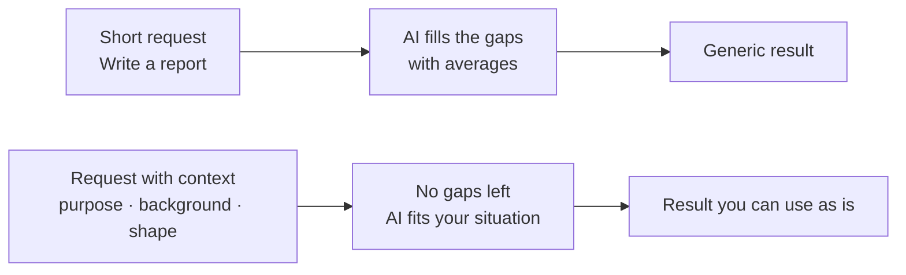
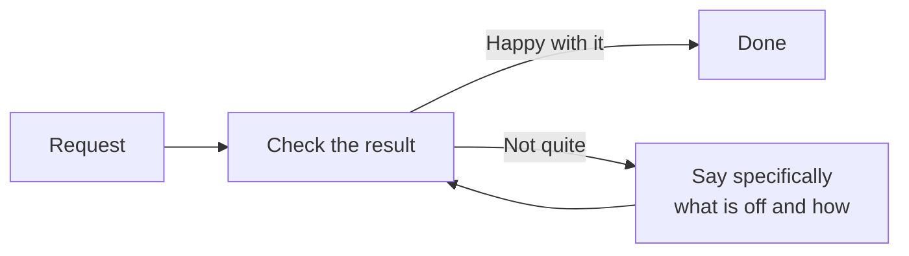

<dl class="facts">
  <div><dt>For</dt><dd>Anyone</dd></div>
  <div><dt>You need</dt><dd>One AI chat</dd></div>
  <div><dt>Tips</dt><dd>5</dd></div>
  <div><dt>To memorize</dt><dd>0</dd></div>
</dl>

## AI does not know your situation

If all you say is "write a report", you get something that fits everyone and therefore fits no one. That is not because the AI is bad at it. **It does not know who will read it, why you are writing it, or how far it should go.**

It helps to picture handing work to a contractor on their first day. They are smart, but they know nothing about your company. Whatever you would explain to that person, explain to the AI.



## 1. Say the purpose first

Before saying what to make, say **what you are going to do with it**. Once the AI knows the purpose, it decides for itself what to include and what to leave out.

| Instead of | Try |
|---|---|
| Summarize the meeting | Summarize it so that a team lead who missed the meeting can pick up just the decisions in three minutes |
| Fix this text | Rewrite it with the jargon spelled out so a first-time customer can follow it |
| Make me a workout plan | Make a plan for someone in their 40s with bad knees: three times a week, 30 minutes at home |

## 2. Don't hold back on background

There is no need to worry about the request getting long. AI does not get tired of reading. If the background is missing, it fills the hole with guesses.

Things worth including:

- **The reader**: an executive, a new hire, a customer
- **What you already tried**: write "I tried this and it didn't work" and you won't get the same answer again
- **Constraints**: length, deadline, wording to avoid, budget
- **The source material**: paste the original text, not your summary of it

```text
Write an email to a client, to be sent next Monday, about a delivery delay.

Background:
- Parts arrived two weeks late, so the delivery date moved from November 15 to November 29.
- We have worked with this contact for three years and the relationship is good.
- We were also late once last month, so this time the email must include how we will prevent it from happening again.

Conditions:
- It should not sound like an excuse. Stick to facts and what we are doing about it.
- 10 lines or fewer.
```

## 3. Decide the shape of the output

Even if the content is right, you have to rework it when the shape is wrong. Set the shape from the start.

- **Format**: table, numbered list, paragraphs, email body
- **Length**: a number such as "5 lines or fewer" or "half a page" works better than "short"
- **Tone**: polite, casual, formal written style
- **Order**: "conclusion first, reasons below it"

```text
Compare the three phone plans below.
- Put them in a table with the columns "Monthly price / Data / Contract / Best for".
- Under the table, give one recommendation in a single sentence.
```

## 4. Show one example

When the feel you want is hard to put into words, **attaching one example is the fastest way.** It conveys tone, length and structure all at once.

```text
Below is a notice I wrote a while ago. Matching its tone and length,
write a new notice titled "Office relocation".

[paste the old notice]
```

There is one thing to watch. The AI may copy the example too closely, so add **"use only the structure and tone, and write the content fresh."**

## 5. Let it ask about what it doesn't know

It is hard to write a perfect request. So add this line at the end.

```text
Before you start, if anything that could change the result is unclear, ask me first.
```

This turns the places the AI would have guessed into questions. Once you answer them, even the first result lands much closer.

## If it's not right the first time, ask for changes

If you don't like the first result, there is no need to start over. Just say **what is off and how**.



| Instead of | Try |
|---|---|
| Write it again | The second paragraph is too long. Cut it to 3 lines and keep the numbers |
| Make it better | Drop the greeting and move the request to the first line |
| This is weird | The tone is too stiff. Rewrite it the way you'd talk to a coworker |

## A template to copy

```text
[Purpose] What I will do with this, and who will read it

[Background] The current situation, what I already tried, the original source material

[Output] Format, length, tone, order

[Example] One, if I have it

Before you start, ask me about anything that is unclear.
```

## Summary

- AI is smart but does not know your situation. Write as if you were **briefing someone on their first day**.
- Purpose, background, shape, example, asking back. You don't need all five. **Purpose and background alone** make a visible difference.
- The first result is a draft. Improve it by saying what is off and how.

### Related posts

- [When AI is confidently wrong: how to verify its answers](/en/posts/ai-hallucination-check/)
- [Writing emails and reports with AI: how to keep your own voice](/en/posts/ai-writing-email-report/)
- [A checklist of what not to paste into AI](/en/posts/ai-privacy-checklist/)
