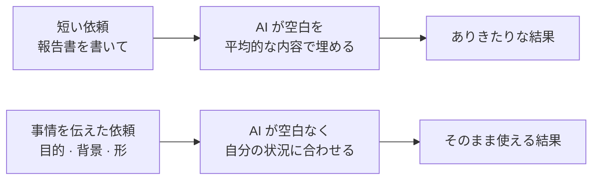
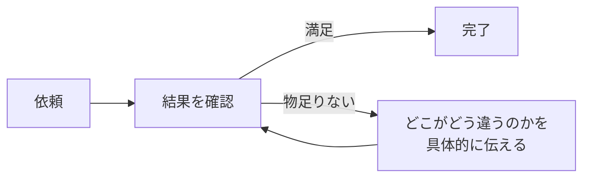

<dl class="facts">
  <div><dt>対象</dt><dd>だれでも</dd></div>
  <div><dt>必要なもの</dt><dd>AI チャット 1 つ</dd></div>
  <div><dt>コツ</dt><dd>5<small>つ</small></dd></div>
  <div><dt>覚えること</dt><dd>0<small>個</small></dd></div>
</dl>

## AI はこちらの事情を知らない

AI に「報告書を書いて」とだけ頼むと、だれにでも当てはまる、つまりだれにもぴったり合わない文章が出てきます。AI の能力が足りないからではありません。**だれが読むのか、なぜ書くのか、どこまで書けばいいのかを知らないからです。**

初めて来た外注スタッフに仕事を頼む場面を思い浮かべると分かりやすくなります。頭は切れるけれど、こちらの会社の事情は何も知らない人です。その人に渡すはずの説明を、そのまま AI に渡せば十分です。



## 1. 目的を先に伝える

何を作るかよりも、**それで何をしたいのか**を先に書きます。目的が分かれば、何を入れて何を省くかを AI が自分で選びます。

| こうではなく | こう |
|---|---|
| 会議の内容をまとめて | 会議に出られなかった課長が 3 分で決定事項だけ把握できるようにまとめて |
| この文章を直して | 初めて読むお客さまにも伝わるように、専門用語をかみくだいて直して |
| 運動の計画を立てて | ひざが悪い 40 代が週 3 回、自宅で 30 分ずつできる計画を立てて |

## 2. 背景を惜しまない

依頼文が長くなることを心配する必要はありません。AI は長い文章を読んでも疲れません。むしろ背景が抜けていると、推測で埋めてしまいます。

入れておくとよいのは次のようなものです。

- **読む人**: 役員なのか、新入社員なのか、お客さまなのか
- **すでに試したこと**: 「この方法は試したがうまくいかなかった」と書いておけば、同じ答えをもう一度もらわずに済みます
- **制約**: 分量、締め切り、使ってはいけない表現、予算
- **資料の原文**: 要約して入れるのではなく、原文をそのまま貼ります

```text
来週の月曜日に取引先へ送る、納期遅延のお知らせメールを書いて。

背景:
- 部品の入荷が 2 週間遅れ、納期が 11 月 15 日から 11 月 29 日にずれた。
- 取引先の担当者とは 3 年の付き合いで、関係は良好。
- 先月も一度遅れているので、今回は再発防止策を必ず入れたい。

条件:
- 言い訳に聞こえないように、事実と対策を中心に。
- 10 行以内。
```

## 3. 成果物の形を決めておく

内容が合っていても、形が合わなければ手直しが必要になります。最初から形を決めて伝えます。

- **形式**: 表、番号付きリスト、段落、メール本文
- **分量**: 「短く」よりも「5 行以内」「A4 半ページ」のように数字で
- **文体**: です・ます体、くだけた口調、かしこまった書き言葉
- **順番**: 「結論が先、根拠はその下」

```text
下の 3 つの料金プランを比較して。
- 表にまとめて、列は「月額料金 / データ容量 / 契約期間 / こんな人に向いている」で。
- 表の下に、おすすめを 1 つだけ 1 文で。
```

## 4. 例を 1 つ見せる

欲しい雰囲気を言葉で説明しにくいときは、**例を 1 つ付けるのがいちばん早い方法です。** 文体、長さ、構成を一度に伝えられます。

```text
下は以前わたしが書いたお知らせ文。この文体と長さに合わせて
「オフィス移転のお知らせ」を新しく書いて。

[以前書いたお知らせ文を貼り付け]
```

注意点は 1 つです。例をそのままなぞってしまうことがあるので、**「構成と文体だけ参考にして、内容は新しく書いて」**と付け加えます。

## 5. 分からないことは聞き返してもらう

依頼文を完璧に書くのは難しいものです。そこで、最後にこの 1 行を足します。

```text
作業を始める前に、結果が変わりそうな点で不明なところがあれば、先に質問して。
```

AI が推測で埋めるはずだった部分が、質問に変わります。質問に答えておけば、最初の結果からずっと的を射たものになります。

## 一度でうまくいかなければ直してもらう

最初の結果が気に入らなくても、一から書き直す必要はありません。**どこがどう違うのか**だけを伝えれば足ります。



| こうではなく | こう |
|---|---|
| 書き直して | 2 つ目の段落が長すぎる。3 行に縮めて、数字は残して |
| もっと良くして | あいさつを削って、お願いしたい内容を 1 行目に持ってきて |
| なんか変 | 文体が硬すぎる。同僚に話すような調子に変えて |

## コピーして使えるひな形

```text
[目的] これで何をしたいのか、だれが読むのか

[背景] いまの状況、すでに試したこと、関連資料の原文

[成果物] 形式、分量、文体、順番

[例] あれば 1 つ

作業を始める前に、不明な点があれば先に質問して。
```

## まとめ

- AI は賢いけれど、こちらの事情を知りません。**初めて来たスタッフに説明するつもりで**書きます。
- 目的、背景、形、例、聞き返し。5 つすべてを入れなくてもかまいません。**目的と背景を入れるだけでも**、結果は目に見えて変わります。
- 最初の結果は下書きです。どこがどう違うのかを伝えて、直していきます。

### あわせて読みたい記事

- [AI が自信満々に間違えるとき：答えを検証する方法](/ja/posts/ai-hallucination-check/)
- [AI でメール・報告書を書く：自分の文体を守る方法](/ja/posts/ai-writing-email-report/)
- [AI に入力してはいけない情報チェックリスト](/ja/posts/ai-privacy-checklist/)
