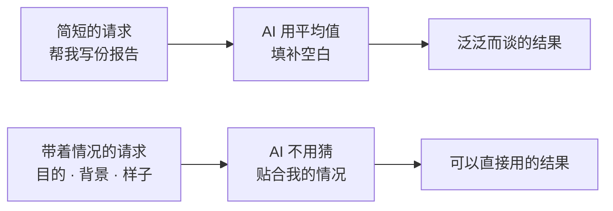
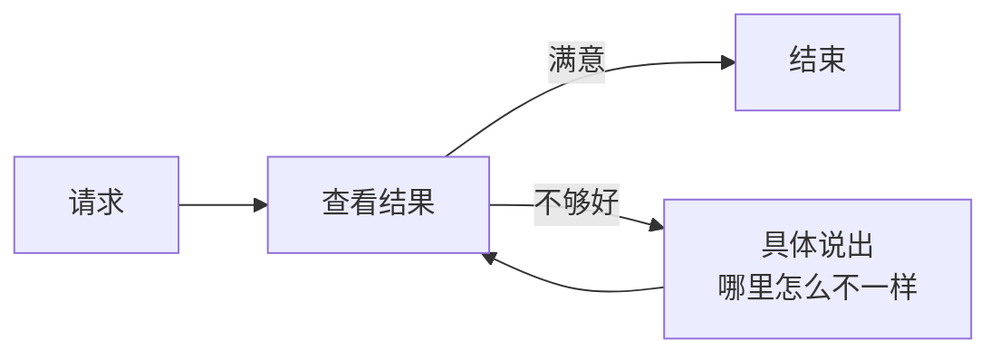

<dl class="facts">
  <div><dt>适合谁</dt><dd>所有人</dd></div>
  <div><dt>需要什么</dt><dd>一个 AI 聊天工具</dd></div>
  <div><dt>要点</dt><dd>5<small>个</small></dd></div>
  <div><dt>要背的</dt><dd>0<small>个</small></dd></div>
</dl>

## AI 不了解你的情况

只对 AI 说一句“帮我写份报告”，得到的会是一篇谁都能用、所以对谁都不太合适的文章。这不是因为 AI 能力不行，而是因为**它不知道谁来读、为什么写、要写到什么程度。**

把它想成第一次来帮忙的外包人员就容易理解了。人很聪明，但对我们公司的情况一无所知。你会怎么跟这个人交代，就原样交代给 AI。



## 1. 先说目的

比起要做什么，先写**打算拿它来做什么**。知道了目的，AI 会自己判断该放什么、该去掉什么。

| 不要这样 | 而是这样 |
|---|---|
| 帮我整理一下会议内容 | 帮我整理一下，让没来开会的主管 3 分钟内只看明白决定了哪些事 |
| 帮我改改这篇文章 | 把专业术语换成通俗说法，让第一次接触的客户也能看懂 |
| 帮我制定健身计划 | 给膝盖不好的 40 多岁的人制定一个每周 3 次、每次在家练 30 分钟的计划 |

## 2. 背景不要省

不用担心请求写得太长。AI 读长文不会累。背景缺了，它反而会靠猜来补。

值得写进去的有这些。

- **读的人**：是高管、新人，还是客户
- **已经试过的**：写上“这个办法试过了，不行”，就不会再收到同样的回答
- **限制**：篇幅、截止时间、不能用的说法、预算
- **资料原文**：不要自己概括后再放，直接贴原文

```text
帮我写一封下周一发给客户的延期交货通知邮件。

背景：
- 零件到货晚了 2 周，交货期从 11 月 15 日推迟到 11 月 29 日。
- 和对方负责人已经合作 3 年，关系不错。
- 上个月也延误过一次，所以这次一定要写上防止再次发生的措施。

要求：
- 不要听起来像找借口，以事实和对策为主。
- 10 行以内。
```

## 3. 定好成品的样子

内容对了，样子不对，还是得返工。一开始就把样子定好。

- **形式**：表格、编号列表、段落、邮件正文
- **篇幅**：与其说“短一点”，不如用数字，比如“5 行以内”“半页 A4”
- **语气**：用“您”还是用“你”，口语还是正式的书面语
- **顺序**：“先说结论，依据放在下面”

```text
帮我比较下面三种套餐。
- 用表格整理，列为“月费 / 流量 / 合约期 / 适合什么人”。
- 表格下面用一句话只推荐一个。
```

## 4. 给一个示例

想要的感觉很难用语言描述时，**贴一个示例是最快的。**语气、长度、结构可以一次传达清楚。

```text
下面是我以前写的一则通知。请按这个语气和长度，
新写一则“办公室搬迁通知”。

[粘贴以前写的通知]
```

要注意的只有一点。AI 可能会照搬示例，所以加上一句**“只参考结构和语气，内容请重新写”**。

## 5. 让它不清楚就先问

请求很难写得十全十美。所以在最后加上这一行。

```text
动手之前，如果有会影响结果的地方不清楚，请先向我提问。
```

这样就把 AI 原本要靠猜来填的地方换成了提问。回答完这些问题，第一版结果就会贴合得多。

## 一次不行，就让它改

第一版不满意，也不必从头重写。只要说清楚**哪里、怎么不一样**就行。



| 不要这样 | 而是这样 |
|---|---|
| 重写一下 | 第二段太长了。缩成 3 行，数字保留 |
| 再好一点 | 去掉问候语，把请求的内容提到第一行 |
| 感觉怪怪的 | 语气太生硬了。改成跟同事说话的口吻 |

## 可以直接复制的模板

```text
[目的] 打算拿它做什么，谁来读

[背景] 现在的情况、已经试过的、相关资料原文

[成品] 形式、篇幅、语气、顺序

[示例] 有的话给一个

动手之前如果有不清楚的地方，请先向我提问。
```

## 小结

- AI 很聪明，但不了解你的情况。**像给第一次来的帮手交代工作那样**写。
- 目的、背景、样子、示例、反问。五样不必全写。**只写目的和背景**，结果也会有明显变化。
- 第一版是草稿。说出哪里、怎么不一样，一步步改。

### 推荐一起读

- [AI 自信地答错时：验证回答的方法](/zh/posts/ai-hallucination-check/)
- [用 AI 写邮件和报告：保住自己的语气](/zh/posts/ai-writing-email-report/)
- [不能输入 AI 的信息清单](/zh/posts/ai-privacy-checklist/)
