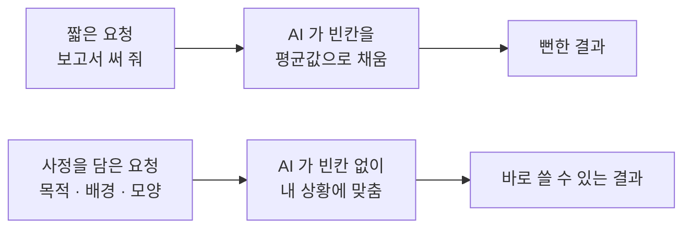
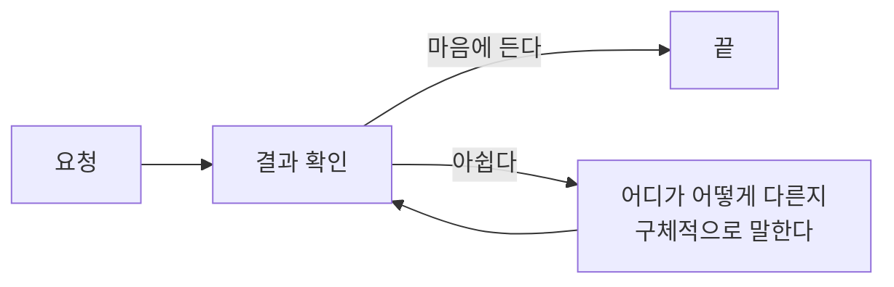

<dl class="facts">
  <div><dt>대상</dt><dd>누구나</dd></div>
  <div><dt>필요한 것</dt><dd>AI 채팅 하나</dd></div>
  <div><dt>요령</dt><dd>5<small>가지</small></dd></div>
  <div><dt>외울 것</dt><dd>0<small>개</small></dd></div>
</dl>

## AI 는 내 사정을 모른다

AI 에게 "보고서 써 줘" 라고만 하면 누구에게나 맞는, 그래서 누구에게도 딱 맞지 않는 글이 나옵니다. AI 가 못해서가 아닙니다. **누가 읽는지, 왜 쓰는지, 어디까지 써야 하는지를 모르기 때문입니다.**

처음 온 외주 작업자에게 일을 맡긴다고 생각하면 쉽습니다. 똑똑하지만 우리 회사 사정은 하나도 모르는 사람입니다. 그 사람에게 건넬 설명을 그대로 AI 에게 건네면 됩니다.



## 1. 목적을 먼저 말한다

무엇을 만들지보다 **그걸로 무엇을 하려는지**를 먼저 적습니다. 목적을 알면 AI 가 무엇을 넣고 뺄지 스스로 고릅니다.

| 이렇게 말고 | 이렇게 |
|---|---|
| 회의 내용 정리해 줘 | 회의에 못 온 팀장이 3분 안에 결정 사항만 파악할 수 있게 정리해 줘 |
| 이 글 고쳐 줘 | 처음 보는 고객이 읽어도 이해되게 전문 용어를 풀어서 고쳐 줘 |
| 운동 계획 짜 줘 | 무릎이 안 좋은 40대가 주 3회, 집에서 30분씩 할 수 있는 계획을 짜 줘 |

## 2. 배경을 아끼지 않는다

요청문이 길어지는 것을 겁낼 필요가 없습니다. AI 는 긴 글을 읽는 데 지치지 않습니다. 오히려 배경이 빠지면 추측으로 채웁니다.

넣으면 좋은 것은 이렇습니다.

- **읽는 사람**: 임원인지, 신입인지, 고객인지
- **이미 해 본 것**: "이 방법은 써 봤는데 안 됐다" 를 적으면 같은 답을 다시 받지 않습니다
- **제약**: 분량, 마감, 쓰면 안 되는 표현, 예산
- **자료 원문**: 요약해서 넣지 말고 원문을 그대로 붙입니다

```text
다음 주 월요일에 거래처에 보낼 납기 지연 안내 메일을 써 줘.

배경:
- 부품 입고가 2주 늦어져서 납기가 11월 15일에서 11월 29일로 밀렸다.
- 거래처 담당자와는 3년째 거래 중이고 관계가 좋다.
- 지난달에도 한 번 늦은 적이 있어서 이번에는 재발 방지책을 꼭 넣어야 한다.

조건:
- 변명처럼 들리지 않게, 사실과 대책 위주로.
- 10줄 이내.
```

## 3. 결과물의 모양을 정해 준다

내용이 맞아도 모양이 안 맞으면 다시 손봐야 합니다. 처음부터 모양을 정해 줍니다.

- **형식**: 표, 번호 목록, 문단, 메일 본문
- **분량**: "짧게" 보다 "5줄 이내", "A4 반 장" 처럼 숫자로
- **말투**: 존댓말, 반말, 격식 있는 문어체
- **순서**: "결론 먼저, 근거는 그 아래"

```text
아래 세 가지 요금제를 비교해 줘.
- 표로 정리하고, 열은 "월 요금 / 데이터 / 약정 / 이런 사람에게 맞음" 으로.
- 표 아래에 한 문장으로 추천 하나만.
```

## 4. 예시를 한 개 보여 준다

원하는 느낌을 말로 설명하기 어려우면 **예시를 하나 붙이는 것이 가장 빠릅니다.** 말투, 길이, 구성을 한 번에 전달할 수 있습니다.

```text
아래는 내가 예전에 쓴 공지다. 이 말투와 길이에 맞춰서
"사무실 이전 안내" 공지를 새로 써 줘.

[예전에 쓴 공지 붙여넣기]
```

주의할 점은 하나입니다. 예시를 너무 그대로 따라 할 수 있으니, **"구성과 말투만 참고하고 내용은 새로 써 줘"** 라고 덧붙입니다.

## 5. 모르는 건 되묻게 한다

요청문을 완벽하게 쓰기는 어렵습니다. 그래서 마지막에 이 한 줄을 붙입니다.

```text
작업하기 전에, 결과가 달라질 만한 부분이 불분명하면 먼저 질문해 줘.
```

AI 가 추측으로 채울 자리를 질문으로 바꿔 줍니다. 질문에 답하고 나면 첫 결과부터 훨씬 맞게 나옵니다.

## 한 번에 안 되면 고쳐 달라고 한다

첫 결과가 마음에 안 들어도 처음부터 다시 쓸 필요는 없습니다. **무엇이 어떻게 다른지**만 말하면 됩니다.



| 이렇게 말고 | 이렇게 |
|---|---|
| 다시 써 줘 | 두 번째 문단이 너무 길다. 3줄로 줄이고 숫자는 남겨 줘 |
| 좀 더 좋게 | 인사말을 빼고, 부탁하는 내용을 첫 줄로 올려 줘 |
| 이상해 | 말투가 너무 딱딱하다. 동료에게 말하듯이 바꿔 줘 |

## 복사해서 쓰는 틀

```text
[목적] 이걸로 무엇을 하려는지, 누가 읽는지

[배경] 지금 상황, 이미 해 본 것, 관련 자료 원문

[결과물] 형식, 분량, 말투, 순서

[예시] 있으면 하나

작업하기 전에 불분명한 점이 있으면 먼저 질문해 줘.
```

## 정리

- AI 는 똑똑하지만 내 사정을 모릅니다. **처음 온 작업자에게 설명하듯** 적습니다.
- 목적, 배경, 모양, 예시, 되묻기. 다섯 가지를 다 넣지 않아도 됩니다. **목적과 배경만 넣어도** 결과가 눈에 띄게 달라집니다.
- 첫 결과는 초안입니다. 어디가 어떻게 다른지 말해서 고쳐 나갑니다.

### 같이 읽으면 좋은 글

- [AI 가 자신 있게 틀릴 때: 답을 검증하는 방법](/posts/ai-hallucination-check/)
- [AI 로 이메일·보고서 쓰기: 내 말투를 지키는 법](/posts/ai-writing-email-report/)
- [AI 에 넣으면 안 되는 정보 체크리스트](/posts/ai-privacy-checklist/)
