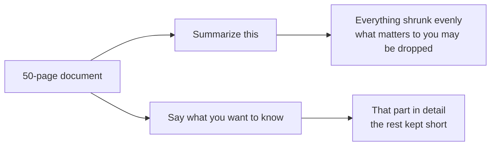
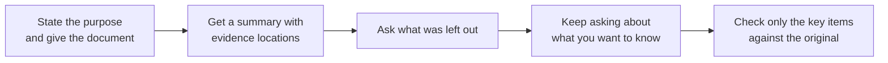

<dl class="facts">
  <div><dt>For</dt><dd>Anyone</dd></div>
  <div><dt>Steps</dt><dd>3</dd></div>
  <div><dt>Prompts</dt><dd>4</dd></div>
  <div><dt>Key</dt><dd>Question first</dd></div>
</dl>

## Why "summarize this" falls short

Summarizing is **choosing what to throw away**. Without knowing your purpose, the AI shrinks the whole document evenly. The one line you were looking for, say the penalty clause in a contract, gets flattened into "there are other conditions".



## Step 1: Say what you want to know first

Before pasting the document, write **who you are and what you are trying to decide with it**.

| Instead of | Try |
|---|---|
| Summarize this contract | I am the tenant. Pull out only the clauses where I might have to pay more or end up at a disadvantage |
| Summarize this report | I have to decide at tomorrow's meeting whether to support this proposal. Separate the reasons for and the reasons against |
| Summarize this paper | I'm not from this field. Three paragraphs: what they found, how they tested it, and what the limits are |

## Step 2: Get the location of the evidence

If checking the summary means reading the whole original again, the summary was pointless. Ask for **a page number or clause number and the original sentence for each item**, and you can go straight to the places you need to check.

```text
For each item, quote the exact sentence from the original that it is based on,
and add the page number or clause number.
Do not fill in anything that is not in the document by guessing.
```

## Step 3: Ask what was left out

After you get the summary, ask one more question.

```text
Among the things you left out of that summary, is there anything I should know in my situation?
Focus on exceptions, deadlines and amounts.
```

Summarizing is less a one-shot task than **a conversation with the document**. After reading the summary, keep asking about the parts you are curious about.



## Ready-to-use prompts

### Contracts and terms of service

```text
I am the [tenant / freelancer / buyer] in this contract.
From the contract below, put the following in a table.
1. What I have to pay and by when
2. Obligations I have to keep
3. Termination conditions and penalties
4. Clauses that are unfavorable to me or unusual
Add the clause number to each item, and quote vague wording exactly as written.
```

An AI summary is **preparation for reading the contract**, not a legal review. If the amount is large or a clause worries you, show it to a professional.

### Work reports

```text
I have to brief an executive on this report in one minute.
- The conclusion in one sentence
- Three numbers that support it (with page numbers)
- What needs a decision
- Questions the report does not answer
```

The last item is the most useful. It points out what is **not** in the report.

### Papers and technical documents

```text
Write this up as if explaining it to someone who doesn't know the field.
1. What problem were they trying to solve?
2. How did they test it? (subjects, scale, method)
3. What were the results? (with numbers)
4. Limitations stated by the authors
5. Why the results should not be read as more than they are
```

### Meeting notes and transcripts

```text
Below is a meeting transcript. Organize it in this format.
- What was decided
- What was left undecided
- Action items: owner / task / due date (table)
If the owner or due date is not clear from the transcript, write "TBD".
```

If you don't allow "TBD", the AI may guess an owner and fill it in.

## Common problems

- **The document is too long.** There is a limit to how much you can put in at once. Summarize it chapter by chapter, then ask for the summaries to be combined.
- **It's a scanned PDF.** If the content is stored as images rather than text, tables and numbers may be misread. Compare the numbers with the original.
- **Tables and charts.** Rows and columns of a table sometimes get mixed up. Ask about an important table on its own.
- **Company documents.** First check whether the material is allowed to be pasted in. See [A checklist of what not to paste into AI](/en/posts/ai-privacy-checklist/).

## Summary

- Summarizing is choosing what to throw away. Say **what you want to know first**.
- Ask for **a page number and a quote from the original** for each item and checking becomes easy.
- After you get the summary, ask once more: "Is there anything important in what you left out?"

### Related posts

- [When AI is confidently wrong: how to verify its answers](/en/posts/ai-hallucination-check/)
- [Five ways to ask AI that change the result](/en/posts/ai-prompt-basics/)
- [How to learn an unfamiliar subject quickly with AI](/en/posts/ai-learn-new-topic/)
