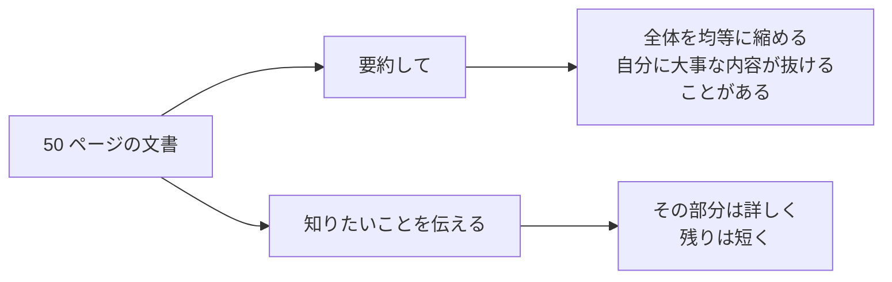
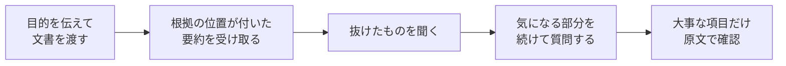

<dl class="facts">
  <div><dt>対象</dt><dd>だれでも</dd></div>
  <div><dt>手順</dt><dd>3<small>ステップ</small></dd></div>
  <div><dt>例文</dt><dd>4<small>種類</small></dd></div>
  <div><dt>要点</dt><dd>質問が先</dd></div>
</dl>

## 「要約して」が物足りない理由

要約とは、**何を捨てるかを選ぶ作業**です。目的が分からなければ、AI は文書全体を均等に縮めます。すると、探していた 1 行、たとえば契約書の違約金の条項は「その他の条件があります」の一言にまとめられてしまいます。



## ステップ 1: 知りたいことを先に伝える

文書を貼る前に、**自分がだれで、この文書をもとに何を決めようとしているのか**を書きます。

| こうではなく | こう |
|---|---|
| この契約書を要約して | わたしは借主だ。追加でお金を払うことになったり、不利になったりしそうな条項だけ抜き出して |
| この報告書を要約して | 明日の会議でこの案に賛成するかどうか決めなければならない。賛成の根拠と反対の根拠に分けて |
| この論文を要約して | 専門外の人間だ。何を明らかにしたのか、どう確かめたのか、限界は何かを 3 段落で |

## ステップ 2: 根拠の位置を一緒にもらう

要約が合っているかを確かめるのに原文を全部読み直すのなら、要約した意味がありません。**項目ごとにページ番号や条項番号、原文の文**を一緒にもらえば、必要な箇所だけ見に行って確認できます。

```text
項目ごとに、根拠になった原文の文をそのまま引用し、
ページ番号か条項番号を付けて。
文書にない内容を推測で補わないで。
```

## ステップ 3: 抜けたものを聞き返す

要約を受け取ったら、この質問をもう 1 つ投げます。

```text
いまの要約で省いた内容のうち、わたしの状況で知っておくべきものはある?
とくに例外条件、期限、金額に関するものを中心に。
```

要約は一度で終わる作業というより、**文書と対話する作業**に近いものです。要約を見てから、気になった部分を続けて聞いていきます。



## そのまま使える例文

### 契約書・利用規約

```text
わたしはこの契約の [借主 / フリーランス / 買主] だ。
下の契約書から、次の内容を表にまとめて。
1. わたしが支払うお金と期限
2. わたしが守るべき義務
3. 解約の条件と違約金
4. わたしに不利な条項、あまり見かけない条項
項目ごとに条項番号を付けて、あいまいな表現は原文のまま引用して。
```

AI の要約は**契約書を読むための準備**であって、法的なチェックではありません。金額が大きいときや気になる条項があるときは、専門家に見てもらいます。

### 業務報告書

```text
この報告書を役員に 1 分で報告しなければならない。
- 結論を 1 文で
- 根拠になる数字を 3 つ (ページ番号付き)
- 決定が必要な事項
- 報告書が答えていない疑問
```

最後の項目がとくに役に立ちます。報告書に**書かれていないこと**を指摘してくれるからです。

### 論文・技術文書

```text
この分野を知らない人に説明するつもりでまとめて。
1. どんな問題を解こうとしたのか
2. どうやって確かめたのか (対象、規模、方法)
3. 結果は何か (数字を含めて)
4. 著者が認めている限界
5. 結果を大げさに受け取ってはいけない理由
```

### 議事録・録音の文字起こし

```text
下は会議の文字起こしだ。次の形式でまとめて。
- 決まったこと
- 決まらずに残ったこと
- やること: 担当者 / 内容 / 期限 (表で)
文字起こしで担当者や期限がはっきりしない場合は「未定」と書いて。
```

「未定」を認めておかないと、AI が担当者を推測で埋めてしまうことがあります。

## よくある問題

- **文書が長すぎる。** 一度に入れられる分量には上限があります。章ごとに分けて要約させたあと、その要約をまとめ直してもらいます。
- **スキャンした PDF である。** 文字ではなく画像として入っていると、表や数字を読み違えることがあります。数字は原文と照らし合わせます。
- **表とグラフ。** 表の行と列を取り違えることがあります。大事な表は、その表だけ別に質問します。
- **会社の文書。** 貼り付けてよい資料かどうかを先に確認します。[AI に入力してはいけない情報チェックリスト](/ja/posts/ai-privacy-checklist/)を参考にしてください。

## まとめ

- 要約は、捨てるものを選ぶ作業です。**何を知りたいのかを先に**伝えます。
- 項目ごとに**ページ番号と原文の引用**をもらうと、確認が楽になります。
- 要約を受け取ったら、「省いた中に大事なものはある?」ともう一度聞きます。

### あわせて読みたい記事

- [AI が自信満々に間違えるとき：答えを検証する方法](/ja/posts/ai-hallucination-check/)
- [AI に仕事を頼むとき、結果が変わる頼み方 5 つ](/ja/posts/ai-prompt-basics/)
- [AI で知らない分野をすばやく学ぶ方法](/ja/posts/ai-learn-new-topic/)
